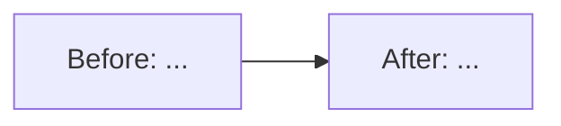

Part of / Closes #

## Where this fits
<!-- Epic → milestone → issue. What this depends on, and what it unblocks. -->

## Before → After
<!-- A mermaid diagram of only the part of the system this PR changes, then 2–4 plain-language sentences. -->

## What changed, and why
<!-- One bullet per meaningful change, explained for someone who didn't write it. -->

## Where to start reviewing
<!-- The 1–3 files that matter most, in reading order. -->

## How it was verified
<!-- CI run, new tests, and any manual check (command + output). -->

## Checklist
- [ ] Targets `next`, not `main`
- [ ] CI is green
- [ ] `docs/ARCHITECTURE.md` updated if structure changed
- [ ] `README.md` updated if user-facing behaviour changed (settings, ports, commands, outputs)
- [ ] New or changed tools are documented in `docs/TOOL_CATALOG.md`
- [ ] ADR appended to `docs/DECISIONS.md` if a lasting decision was made
- [ ] `## Session notes` comment posted on the issue
