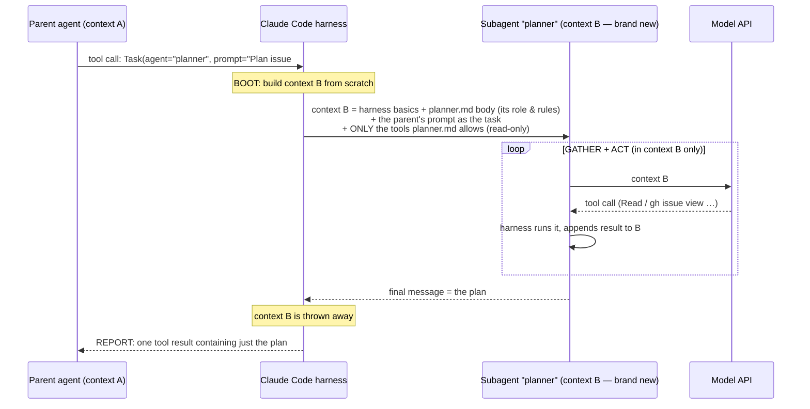

2026_11_07_19_05-(How-The-AI-System-Connects)

# Lecture 2: How the AI System Actually Connects

### Harnesses, boot sequences, subagents, skills, headless mode, evals, worktrees, and how to rebuild this workflow anywhere

---

## Why this lecture exists

Lecture 1 explained *what* each piece of your workflow is for. You've now used it for a day, and you've noticed the gap that matters: **it still feels like magic, because you can't see how the AI gets connected to the files you created.** Where does the agent run? Who decides what it reads? Is the set of markdown files "the harness"? How does one agent create another? Could you set all this up again on a new project?

Those are the right questions. Your own notes contain the key insight, so let's start from it:

> *"It seems like this entire system will need some kind of booting sequence. Each agent needs to have a booting sequence when they start up… go out and read the specific documents to gather the context… perform those actions, then report back to the parent agent that spawned it."*

That's correct, and it's the organising idea of this lecture. **Every agent, top-level or sub, has a boot sequence: assemble a starting context, pull in more context on demand, act, and report.** Once you can trace that sequence for any agent, the "magic" turns into ordinary plumbing.

Contents:

1. The three physical places your system runs
2. The harness: what it is, and what it isn't
3. The boot sequence: how an agent's context gets filled
4. Tracing one real run on your repo, step by step
5. What each file I created does, and who reads it
6. GitHub concepts: what's standard and what we built
7. Subagents and orchestration: how one agent creates another (and why it isn't MCP)
8. Skills: walking through two skills being used
9. Headless mode: `claude -p` with examples
10. Evals: measuring whether a prompt change helped
11. Git worktrees: a simple example
12. Rebuilding this workflow on a new project
13. Self-check questions

---

# Part 1 — The three places your system runs

Most of the confusion comes from not having a clear picture of *where* things happen. There are exactly three places:

```
┌───────────────────────────┐      ┌────────────────────────────────┐      ┌─────────────────────────┐
│  1. GITHUB (the website)  │      │  2. THE RUNNER (a temporary VM) │      │  3. ANTHROPIC (the API) │
│                           │      │                                 │      │                         │
│  • stores your repo       │event │  • a fresh Ubuntu machine       │HTTPS │  • the Claude MODEL     │
│  • issues, labels, PRs    │─────►│  • checks out your repo         │─────►│    runs here            │
│  • fires events           │      │  • runs Claude Code (HARNESS)   │◄─────│  • receives text,       │
│  • runs nothing AI itself │◄─────│  • runs tools: git, dotnet, gh  │      │    returns text         │
│                           │ git  │  • destroyed after the job      │      │  • touches no files     │
│                           │ push │                                 │      │                         │
│                           │ + API│                                 │      │                         │
└───────────────────────────┘      └────────────────────────────────┘      └─────────────────────────┘
```

- **GitHub** stores everything and fires events. It doesn't run the AI.
- **The runner** is where the *agent* runs. Claude Code is installed on the runner and does everything with files: reading files, running `dotnet build`, `git push`, `gh issue view`.
- **Anthropic's servers** are where the *model* runs. The model never sees your files directly. It receives text over HTTPS, sends text back, and the harness on the runner acts on that text.

So "the agent" is really **a program on the runner (the harness) talking to a model on Anthropic's servers in a loop.** Every tool call is executed on the runner. Every "thought" happens on Anthropic's servers. The HTTPS connection between them carries text only.

On your laptop it's the same picture with one change: when you type `claude` in your terminal, **your laptop is the runner.** The harness runs on your Mac and still talks to the model over HTTPS.

---

# Part 2 — The harness: what it is, and what it isn't

## 2.1 Definition

A **harness** is the program that turns a model into an agent. It:

1. **builds the context** (system prompt, instruction files, tool definitions, the task),
2. **sends it to the model** through the API,
3. **reads the response**, and if the model asked to use a tool,
4. **checks permission**, **runs the tool** on the local machine, **appends the result** to the context,
5. **repeats** until the model gives a final answer,
6. **manages the context**: summarising when it gets full, starting subagents, loading skills.

The word comes from a horse's harness, the equipment that connects a horse's power to a cart. The model supplies the intelligence, and the harness connects it to something it can actually move.

## 2.2 Concrete examples

| Harness | Where it runs | Who makes it |
|---|---|---|
| **Claude Code** (`claude` CLI) | your terminal, or a GitHub runner | Anthropic |
| **claude-code-action** | a GitHub Actions runner; it *installs and drives* Claude Code | Anthropic |
| **GitHub Copilot coding agent** | GitHub's own Actions environment | GitHub / Microsoft |
| **Cursor, VS Code agent mode** | inside the editor on your machine | those vendors |
| **The Claude app you're talking to right now** | Anthropic's servers plus a workspace | Anthropic |
| **One you write yourself** | anywhere: a Python script calling the API in a loop | you |

So yes, to your question: **a harness is usually something people download and run on their own system that calls the model's API.** Claude Code is an npm package. When the GitHub Action runs, it does `npm install` of Claude Code on the runner and starts it.

## 2.3 Are the markdown files the harness?

**No.** Here's the distinction:

| Layer | What it is | In your system |
|---|---|---|
| **Model** | the intelligence; text in, text out | Claude, on Anthropic's servers |
| **Harness** | the program running the loop, executing tools, enforcing permissions | Claude Code, on the runner |
| **Configuration and context** | instructions and settings the harness *loads* and feeds to the model | `CLAUDE.md`, `.claude/agents/*.md`, `.claude/skills/`, `.claude/settings.json`, the `--allowedTools` in `claude.yml` |
| **Trigger and plumbing** | what starts the harness, on which machine, with which secrets | `.github/workflows/claude.yml`, GitHub events, the runner |
| **Process artefacts** | where humans and agents coordinate | issues, labels, milestones, PRs, ADRs |

A useful analogy: **the model is a very capable new employee, the harness is their body and desk (hands to type, a computer to work on, a badge that opens only certain doors), and your markdown files are the employee handbook and the job description.** The handbook doesn't do any work, but it decides *how* the employee works. You didn't build a harness. You **configured** one: you wrote its handbook and set its door permissions.

## 2.4 Writing a harness yourself

Seeing a harness in its smallest form makes the idea concrete. This is a complete, minimal harness, around 30 lines of Python using Anthropic's SDK:

```python
# tiny_harness.py — a whole agent loop, nothing hidden
import anthropic, subprocess

client = anthropic.Anthropic()          # reads ANTHROPIC_API_KEY from the environment
tools = [{
    "name": "run_shell",
    "description": "Run a read-only shell command in the repo and return its output.",
    "input_schema": {"type": "object",
                     "properties": {"command": {"type": "string"}},
                     "required": ["command"]},
}]
ALLOWED = ("ls", "cat", "git log", "git status")   # ← the permission check is HERE, in the harness

messages = [{"role": "user", "content": "What is the most recent commit in this repo?"}]

while True:
    reply = client.messages.create(model="claude-sonnet-5-5", max_tokens=1024,
                                   tools=tools, messages=messages)
    messages.append({"role": "assistant", "content": reply.content})

    if reply.stop_reason != "tool_use":                 # model gave a final answer
        print(reply.content[0].text); break

    results = []
    for block in reply.content:
        if block.type == "tool_use":
            cmd = block.input["command"]
            if cmd.startswith(ALLOWED):
                out = subprocess.run(cmd, shell=True, capture_output=True, text=True).stdout
            else:
                out = f"DENIED: '{cmd}' is not allowed"   # same idea as your --allowedTools
            results.append({"type": "tool_result", "tool_use_id": block.id, "content": out[:4000]})
    messages.append({"role": "user", "content": results})  # results go back INTO the context
```

Everything from Lecture 1 is visible here:

- The **model** only ever produces text (a `tool_use` block is a structured request).
- The **harness** runs the command, on this machine.
- The **permission check** is ordinary code in the harness (`ALLOWED`). Your `--allowedTools` is the same idea, built into Claude Code.
- **Tool results are appended to `messages`**, which is why big outputs cost tokens on every later turn.
- **No memory**: everything the model knows is in `messages`, which is re-sent on every call.

Claude Code is this loop plus decades' worth of engineering on top: file editing tools, context compaction, subagents, skills, hooks, a permission system and a terminal UI. The heart of it is the same.

---

# Part 3 — The boot sequence: how an agent's context gets filled

Your "booting sequence" idea is the right mental model. Here it is in detail. The context is filled in **four layers**, in this order:

```
                 ┌────────────────────────────────────────────────────────────┐
  LAYER 1        │ HARNESS SYSTEM PROMPT                                       │  written by the harness maker
  (always)       │  "You are Claude Code… here is how to use your tools…"      │  you never see or edit it
                 ├────────────────────────────────────────────────────────────┤
  LAYER 2        │ TOOL DEFINITIONS + SKILL/AGENT DESCRIPTIONS                 │  names + 1-line descriptions
  (always,       │  Read, Edit, Bash, Task… · "voxel: conventions for the…"    │  of everything available
   short)        │  · "planner: turns an issue into a step plan…"              │  (NOT their full content)
                 ├────────────────────────────────────────────────────────────┤
  LAYER 3        │ PROJECT INSTRUCTIONS: CLAUDE.md                             │  auto-loaded from the repo
  (always)       │  project map, rules, "the issue is the memory", stages…     │  root by the harness
                 ├────────────────────────────────────────────────────────────┤
  LAYER 4        │ THE TASK                                                    │  built by whatever started
  (per run)      │  the issue title/body/comments + "respond to this comment"  │  the agent (the Action, or
                 │                                                             │  you typing, or a parent agent)
                 └────────────────────────────────────────────────────────────┘
                                         │
                                         ▼  the model starts acting and PULLS more:
                 ┌────────────────────────────────────────────────────────────┐
  ON DEMAND      │ Read docs/DECISIONS.md · gh issue view 24 --comments ·      │  chosen by the model,
                 │ Read src/…/ToolBoxServerComposition.cs · load a skill ·     │  guided by pointers in
                 │ start a subagent                                            │  layers 3 and 4
                 └────────────────────────────────────────────────────────────┘
```

Two principles make this work:

**Push a little, pull a lot.** Layers 1–4 are *pushed* into every context, so they must be small. Everything else is *pulled* by the model when it decides it needs it. That's what you called "memory protection". The usual name is **context management**, and the main technique is the progressive disclosure from Lecture 1.

**The always-loaded layers contain pointers, not content.** How does the agent "know" to read `docs/DECISIONS.md`? Because `CLAUDE.md` (layer 3) says *"A decision with lasting consequences gets an ADR appended to `docs/DECISIONS.md`"* and the project map lists it. How does it know about the `planner`? Layer 2 contains a one-line description of it. **You steer an agent by deciding which pointers go in the always-loaded layers.** That's the whole technique, and it's how "you direct the agent to read specific items."

### The pointer chain in your repo

```
claude.yml trigger
   └─► the Action's prompt: "here is issue #24 and the comment that mentioned you"
          └─► CLAUDE.md (auto-loaded): "the issue is the memory; read body + all comments";
              "obey the stage-* label"; "before writing in Documentation/, read CONVENTIONS.md";
              "ADRs live in docs/DECISIONS.md"; "delegate plans to the planner agent"
                 ├─► gh issue view 24 --comments     (task memory)
                 ├─► docs/DECISIONS.md               (decisions, only if relevant)
                 ├─► Documentation/CONVENTIONS.md    (only if writing docs)
                 └─► planner subagent                (only at stage-3-plan)
                        └─► .claude/agents/planner.md becomes ITS layer 1/3
```

Nothing is magic: **each file is reached because an earlier, always-loaded file points to it.** If you deleted the line in `CLAUDE.md` that mentions `CONVENTIONS.md`, the agent would stop following your documentation rules, and nothing would announce that. That's both the power and the fragility of this design.

---

# Part 4 — Tracing one real run

Here's what physically happened when you commented `@claude plan this. Use the planner agent…` on issue #24:

| # | Where | What happens | What gets added to context |
|---|---|---|---|
| 1 | GitHub | Your comment is saved and fires an `issue_comment` event with a JSON payload (your comment, your `author_association: OWNER`, the issue) | — |
| 2 | GitHub | It finds `.github/workflows/claude.yml` **on `main`**, evaluates the `if:` (OWNER ✓, contains `@claude` ✓), and queues the job | — |
| 3 | Runner | A fresh Ubuntu VM starts, runs `actions/checkout` (your repo, default branch), and installs .NET | — |
| 4 | Runner | `anthropics/claude-code-action` starts: verifies you have write access, gets the GitHub App token, posts the "Claude is working…" comment, creates branch `claude/issue-24-…` | — |
| 5 | Runner | The Action fetches the issue's title, body and comments through GitHub's API and **writes a prompt** describing the task | **Layer 4** |
| 6 | Runner | The Action installs Claude Code and starts it with that prompt, your `--allowedTools`, `--max-turns 40`, and the OAuth token as its credential | — |
| 7 | Runner | Claude Code assembles its system prompt and tool list and auto-loads `CLAUDE.md` from the checked-out repo | **Layers 1, 2, 3** |
| 8 | Runner → Anthropic | First API call: the whole context goes over HTTPS to the model | — |
| 9 | Anthropic → Runner | The model replies: "I'll use the Task tool to start the `planner` agent with this brief: …" | — |
| 10 | Runner | Claude Code starts a **subagent**: a *new* context, built from `.claude/agents/planner.md` plus the brief the parent wrote (Part 7) | (a separate context) |
| 11 | Runner ↔ Anthropic | The planner runs its own loop: `gh issue view 24`, reads `ToolBoxServerComposition.cs`, `ToolsetDescriptor.cs`, the ADRs… | (in the planner's context only) |
| 12 | Runner | The planner's **final message** (the plan) returns to the parent as a single tool result | the plan, about 1 page |
| 13 | Runner ↔ Anthropic | The parent formats the plan and updates the GitHub comment through the API | — |
| 14 | Runner | The job ends and the VM is destroyed. The only things that survive are the comment and the branch | — |

The parent agent never had `ToolBoxServerComposition.cs` in its own context. It only received the planner's one-page result. That's context protection working as designed.

Where to see this for yourself: every Claude comment has a **"View job"** link. Open it and expand the Claude step. The log shows the turns, the tool calls and their results. Reading two or three of these logs carefully is the best way to make the system stop feeling like magic. (Exercise 1.)

---

# Part 5 — What each file I created does, and who reads it

| File | Read by | When | Purpose |
|---|---|---|---|
| `.github/workflows/claude.yml` | **GitHub** | on every issue or comment event | Decides *if* an agent starts, *where* it runs, *with which secrets and permissions*, and passes `--allowedTools`. Plumbing, not AI. |
| `.github/workflows/claude-queue.yml` | GitHub | when run manually | Same, but starts Claude with a fixed prompt: "pick the oldest queued issue" |
| `CLAUDE.md` | **Claude Code** (auto) | every session, top-level agents | Layer 3: global rules and the pointers to everything else |
| `.claude/agents/planner.md`, `reviewer.md`, `lecturer.md` | Claude Code | the *description line* every session (layer 2); the *body* only when that subagent is started | Subagent definitions: role, allowed tools, procedure |
| `.claude/skills/voxel/SKILL.md` | Claude Code | description every session; body when relevant | A reusable procedure (Part 8) |
| `.claude/settings.json` | Claude Code **on your laptop** | local sessions | Permission allow and deny rules. (In CI, `--allowedTools` in `claude.yml` plays this role.) |
| `docs/AI_WORKFLOW.md` | **you** (and agents, if pointed to it) | when you want the overview | Human-facing explanation |
| `docs/DECISIONS.md` | agents, on demand; you | when a task touches an area | Lasting decisions |
| `Documentation/CONVENTIONS.md` | agents, only when writing docs | on demand | Your doc rules, moved out of the always-loaded layer |
| `.github/ISSUE_TEMPLATE/*.yml` | **GitHub** | when you click "New issue" | The forms you fill in (Part 6) |
| `.github/pull_request_template.md` | GitHub | when a PR is opened | The PR checklist |
| `scripts/setup-github-workflow.sh` + `.github/seed-issues/` | **you** (once) | setup | Created the labels, milestones and first issues |

The key point: **three different readers.** GitHub reads the `.github/` files. Claude Code reads `CLAUDE.md` and `.claude/`. You read `docs/`. Once you know who reads a file, you know what it can affect.

---

# Part 6 — GitHub concepts: what's standard and what we built

You asked whether the issues "already talking about the agent" was something GitHub did. **It was me.** I wrote the issue templates, and their text (*"This issue **is** the task's memory…"*) is what you saw. Here's the split:

| Concept | Standard GitHub feature? | What we did with it |
|---|---|---|
| **Issue** | Yes | Used as the task's memory |
| **Comment** | Yes | Used as the conversation and the session notes |
| **Label** | Yes, as a mechanism; the *names* are custom | Created `stage-1-design`…`stage-5-verify`, `claude`, `needs-timothy`, … with the setup script. They mean only what `CLAUDE.md` says they mean |
| **Milestone** | Yes | Groups issues into a phase (M2 = S0, …), with a progress bar |
| **Issue template / form** | Yes (`.github/ISSUE_TEMPLATE/`) | We wrote Task, Epic and Bug forms |
| **PR template** | Yes | We wrote the checklist |
| **Epic** | **No.** It's a convention, not a GitHub object | An ordinary issue with a checklist of other issues. (GitHub also has **sub-issues**: the "Create sub-issue" button you've seen is a newer, built-in way to do the same thing) |
| **Projects (boards)** | Yes | Not used yet. A kanban board over issues, useful later |
| **Actions / workflows** | Yes | `ci.yml` (yours), `claude.yml` and `claude-queue.yml` (ours) |
| **The Claude GitHub App** | Third-party app you installed | Lets the action act as `claude[bot]` |

### Which of these does the agent actually see?

This is an important correction to an assumption in your notes. **Milestones and epics are not automatically injected into the agent's context.** Here's what reaches it:

| Item | Reaches the agent? |
|---|---|
| The issue that triggered the run: title, body, comments | **Yes, pushed** (layer 4) |
| Labels on that issue | Usually included with the issue data; `CLAUDE.md` tells it to act on them |
| The milestone, the epic, other issues | **Only if the agent pulls them** (`gh issue view 13`), or if the triggering issue mentions them |
| The repo's files | Only those it chooses to `Read` |

Milestones and epics are mostly **for you**: they're how a human plans and tracks. The agent works at the level of one issue. That's deliberate, because it keeps the agent's context the size of one task. When an agent needs the bigger picture, put a pointer in the issue (*"see the v2 epic #23 and Brainstorm 004 §7.2"*), as your S0 issue does.

### What gets merged to `main`, and when

You have it right: **a phase (milestone) that leaves the system working is a releasable unit.** When M2 (S0) is merged into `next` and CI is green, you open a PR from `next` to `main` and tag it (v1.1). The epic tracks the phases, the milestone tracks one phase's issues, and each issue tracks one task's memory.

```
Epic #23  "v2 — control center"         ← roadmap (you read it)
 ├─ Milestone M2  "S0 Catalog seam"      ← phase; done ⇒ next→main release
 │    ├─ Issue #24  S0 catalog + config   ← task; THE AGENT'S MEMORY
 │    │    ├─ PR A (steps 1–2) → next
 │    │    ├─ PR B (steps 3–4) → next
 │    │    └─ PR C (step 5)    → next  "Closes #24"
 │    └─ (more issues if S0 needs them)
 └─ Milestone M3  "S1 …"                 ← its issues are written when S1 starts
```

---

# Part 7 — Subagents and orchestration: how one agent creates another

## 7.1 Is it an MCP call?

**No.** This is a common confusion, so it's worth being precise:

- **MCP (Model Context Protocol)** connects a harness to **external tool servers**: processes that live outside the harness, such as your Tool_Box, a GitHub MCP server or a database server. The harness acts as an MCP *client*.
- **Subagents** are a **built-in feature of the harness itself.** In Claude Code, the model starts one by calling a built-in tool. In your `claude.yml` it's listed as `Task` (newer Claude Code versions call it `Agent`). No server, no network protocol, nothing to install.

So you **don't** need to set up an MCP server for orchestration, and you don't download one. It's part of Claude Code. You only define *which kinds* of subagents exist, by writing `.claude/agents/*.md` files.

(More advanced systems *can* expose an agent as an MCP server, so that one harness can call an agent running elsewhere. That's an architecture choice for distributed systems, not how Claude Code's subagents work.)

## 7.2 A subagent's boot sequence

Here's the full lifecycle, which matches the "boot, gather, act, report back" sequence from your notes:



Five things to take from this:

1. **The subagent knows nothing about the parent's conversation.** Its *only* information about the task is the prompt the parent wrote in the `Task` call. **The parent writing that brief is the context-engineering moment.** A vague brief gets a vague result, exactly as with a human contractor.
2. **Its role comes from the agent file.** The body of `planner.md` (*"You write Stage 3 plans… read all of them first… output exactly this shape"*) becomes its standing instructions. Depending on the Claude Code version, project instructions like `CLAUDE.md` may also be loaded, but the agent file is what makes it a planner.
3. **Its tools are restricted by the agent file's `tools:` line.** The planner can read but can't edit. That's least privilege applied to a subagent.
4. **Only the final message comes back.** The 40 files it read never enter the parent's context. That's the "protecting memory" benefit.
5. **The cost:** the subagent's tokens are spent in addition to the parent's, and if the subagent made a mistake, the parent only sees its summary. Orchestration trades tokens and visibility for keeping the parent's context clean.

## 7.3 Orchestrator patterns

| Pattern | Shape | Use when |
|---|---|---|
| **Delegate one specialist** | parent → planner → back | One sub-job needs a lot of reading (your setup) |
| **Fan-out / fan-in** | parent → 5 researchers in parallel → combine | Independent sub-questions ("survey these 5 vector stores") |
| **Pipeline** | planner → implementer → reviewer | Distinct phases with clean handoffs |
| **Critic loop** | implementer ⇄ reviewer until it passes | Quality matters more than tokens |

Your GitHub workflow is *also* an orchestration system, but **you are the orchestrator.** You decide the stage, write the brief (the issue) and judge the result (the merge). Claude's subagents are orchestration *inside* one run. You're orchestration *across* runs.

---

# Part 8 — Skills: two skills being used, step by step

## 8.1 What a skill is

A **skill** is a folder containing a `SKILL.md` (frontmatter `name` + `description`, then instructions), plus optional scripts or reference files. It's **a procedure the agent can load on demand.** Your repo has one: `.claude/skills/voxel/SKILL.md`.

The key mechanism is the **two-stage load**, progressive disclosure again:

- **At boot:** only the `name` and `description` of every skill go into context (layer 2). That's a sentence or two per skill.
- **When relevant:** the model decides a skill matches the task, calls the harness's skill-loading tool, and the **full** `SKILL.md` is read into context.

This way an agent can have 50 skills "available" while paying for just 50 short descriptions until one is actually needed.

## 8.2 Walkthrough: two skills, one task

Suppose your repo has two skills:

```
.claude/skills/voxel/SKILL.md
  name: voxel
  description: Conventions for the Tool_Box voxel toolset — scale, materials, primitives,
               build order. Read this before any voxel build.

.claude/skills/adr-writer/SKILL.md          (hypothetical — doesn't exist yet)
  name: adr-writer
  description: How to append an Architecture Decision Record to docs/DECISIONS.md in this
               repo's exact format. Use whenever a decision must be recorded.
```

You ask, in a local Claude Code session connected to your Tool_Box MCP server:

> "Build a small castle in the voxel world, then record an ADR saying the castle is our official demo scene."

**Step 0, boot.** Context contains the system prompt, the tools (including the Tool_Box MCP tools: `place_box`, `world_info`, …), `CLAUDE.md`, and **two one-line skill descriptions**. Neither skill's body is loaded.

**Step 1, match.** The model reads the request. "Build a castle in the voxel world" matches the voxel description, *"Read this before any voxel build."* The description is written as an instruction about **when** to use the skill, and that's why it gets picked. (Writing good descriptions is the main skill-authoring skill.)

**Step 2, load skill #1.** The model calls the skill tool for `voxel`, and the harness inserts the full `SKILL.md`: *"Call `world_info` before you place anything… pick 3–5 materials… never place a large form block by block…"*

**Step 3, act under that skill.** The model calls the MCP tool `world_info` (an MCP call to your Tool_Box server, over stdio or HTTP), then `place_box`, `place_cylinder`, `place_cone`… following the skill's conventions. Each MCP call goes harness → Tool_Box → result → back into context.

**Step 4, match skill #2.** The second half of the request, "record an ADR", matches the `adr-writer` description.

**Step 5, load skill #2.** Its body is inserted: *"Read the last ADR to find the next number. Use the heading format `## ADR-NNN — Title (date)`. Sections: Context / Decision / Consequences…"*

**Step 6, act under that skill.** The model reads `docs/DECISIONS.md`, finds ADR-015, and appends ADR-016 in the right format using the `Edit` tool.

**Step 7, done.** The context now holds both skill bodies, the tool results and the edit. Both skills were loaded **only because the task needed them**. Had you asked about git, neither would have been loaded.

### Skills vs subagents vs CLAUDE.md vs MCP

| | What it adds | Loaded | Runs in |
|---|---|---|---|
| `CLAUDE.md` | rules that always apply | always | the main context |
| **Skill** | a *procedure* ("how to do X here") | description always, body on demand | the **same** context as the agent using it |
| **Subagent** | a *worker* with its own role and tools | description always, body when started | a **separate**, fresh context |
| **MCP server** | new *capabilities* (tools) from an external process | tool definitions at boot | an external process; results come back as tool results |

A short way to remember it: **skills teach, subagents delegate, MCP adds capabilities, and `CLAUDE.md` sets the rules.**

---

# Part 9 — Headless mode: `claude -p`

**Headless** means running the harness with no interactive terminal session. You give it a task, it runs the agent loop to completion, prints the result and exits. `-p` stands for "print". This is how an agent runs inside scripts and pipelines. The GitHub Action is essentially doing this for you.

### Example 1: a one-shot question in your terminal

```bash
cd ~/Desktop/projects/Tool_Box
claude -p "In two sentences, what does ToolBoxServerComposition.cs do?"
```

It reads `CLAUDE.md`, explores the code, prints an answer and exits. Nothing is left running.

### Example 2: limit what it can do

```bash
claude -p "List every TODO comment in src/ with file and line" \
  --allowedTools "Read,Grep,Glob" \
  --max-turns 10
```

These are the same `--allowedTools` and `--max-turns` flags as in your `claude.yml`. Now you can see where they come from: `claude.yml` passes them through to exactly this command.

### Example 3: machine-readable output for a script

```bash
claude -p "Does any file in src/ToolBox.Core reference a toolset project? Answer only YES or NO." \
  --allowedTools "Read,Grep,Glob" --output-format json > result.json

python3 -c "import json; print(json.load(open('result.json'))['result'])"
```

`--output-format json` wraps the answer in JSON along with metadata such as cost and turn count, so another program can use it. (`stream-json` streams every step as it happens.)

### Example 4: pipe data in

```bash
git diff next...HEAD | claude -p "Review this diff for violations of ADR-003 (Core must not reference a toolset). Be brief."
```

Standard input becomes part of the task. This is a quick local version of your `reviewer` agent.

### Example 5: a headless agent in CI

```yaml
# .github/workflows/adr-check.yml — a hypothetical example
on: pull_request
jobs:
  adr-check:
    runs-on: ubuntu-latest
    steps:
      - uses: actions/checkout@v4
        with: { fetch-depth: 0 }
      - run: npm install -g @anthropic-ai/claude-code
      - run: |
          git diff origin/next...HEAD > pr.diff
          claude -p "Read pr.diff. If it introduces a lasting architectural decision without adding an ADR to docs/DECISIONS.md, print FAIL and why; otherwise print PASS." \
            --allowedTools "Read" --max-turns 5 > verdict.txt
          cat verdict.txt
          grep -q PASS verdict.txt
        env:
          CLAUDE_CODE_OAUTH_TOKEN: ${{ secrets.CLAUDE_CODE_OAUTH_TOKEN }}
```

That's a complete headless agent as a CI check, with no GitHub app and no comments. Your `claude-queue.yml` is the same idea, wrapped in the official action.

**Two warnings.** First, headless runs have nobody to approve a permission prompt, so anything not explicitly allowed is denied. That's why Claude kept saying "my shell blocked it." Second, there's a flag that skips all permission checks. Don't use it on a machine with anything you care about, because it turns the agent's judgement into your only safety barrier.

---

# Part 10 — Evals: measuring whether a prompt change helped

## 10.1 Your tool descriptions are prompts

In Tool_Box, every tool has a `[Description("…")]`. When an agent connects, your server sends those descriptions in the `tools/list` response, and **they go straight into the model's context** (layer 2). The model chooses which tool to call, and with which arguments, **based on those words**. Your `DescriptionConventionTests` already enforce that descriptions are written for an AI reader. That's why your voxel skill says *"never place a large form block by block"*: an earlier description wasn't steering the model well enough.

So when you change a description, you're **changing a prompt.** How do you know the change helped? With the usual approach ("try it once and it looked fine"), you don't. Models are probabilistic. One good run proves little, and a change that fixes one case can quietly break another.

## 10.2 What an eval is

An **eval** is a test suite for an AI system's behaviour:

- a **dataset** of cases (inputs + what "good" looks like),
- a **runner** that sends each case to the model, several times each, because outputs vary,
- **graders** that score each output: exact checks where possible, an LLM-as-judge where not,
- a **score** you compare between versions: *description A: 14/20 correct; description B: 19/20.*

It's unit testing, adjusted for non-determinism: you measure a **rate**, not a pass/fail.

## 10.3 A minimal eval for Tool_Box tool selection

The question: *"Given a user request and our tool descriptions, does the model pick the right tool?"* This is a complete, runnable sketch:

```python
# evals/tool_choice_eval.py
import anthropic, json

client = anthropic.Anthropic()

# 1. The tools exactly as the model sees them: copy these from your server's tools/list
#    response, or generate them from the [Description] attributes.
def load_tools(variant):
    return json.load(open(f"evals/tools_{variant}.json"))   # tools_A.json, tools_B.json

# 2. The dataset: request → the tool we expect the model to call first
CASES = [
    ("Build a 10-block-tall stone tower",            "world_info"),   # skill says: call world_info first
    ("Put a glass dome on top of the tower",         "place_sphere"),
    ("What time is it on the server?",               "current_time"),
    ("Remove everything and start over",             "clear"),
    ("Make the left wing identical to the right one", "mirror"),
    # … aim for 20–50 realistic, varied cases, including tricky ones
]

def first_tool(request, tools):
    r = client.messages.create(model="claude-sonnet-5-5", max_tokens=512, tools=tools,
                               messages=[{"role": "user", "content": request}])
    calls = [b.name for b in r.content if b.type == "tool_use"]
    return calls[0] if calls else None

# 3. Run every case several times per variant, because outputs vary
for variant in ["A", "B"]:
    tools, score, total = load_tools(variant), 0, 0
    for request, expected in CASES:
        for _ in range(3):
            total += 1
            score += (first_tool(request, tools) == expected)
    print(f"variant {variant}: {score}/{total} = {score/total:.0%}")
```

How you'd use it:

1. Save the current descriptions as `tools_A.json`. Run it and note the baseline, say 41/60.
2. Rewrite one description (for example, make `place_sphere`'s mention "dome") and save as `tools_B.json`.
3. Run again. 52/60 means the change helped. 38/60 means you broke something, and the per-case results show you which.
4. **Keep the dataset.** Every time a real agent misuses a tool, add that request as a new case. The eval grows from real failures, the same way a regression test suite does.

The grader here is an exact check (`== expected`). For open-ended behaviour ("did the castle look like a castle?") you'd use an **LLM-as-judge**: a second model call with a rubric that returns a score. That needs care, because judges have their own biases.

This is a strong portfolio piece: *"I treated my MCP tool descriptions as prompts and built an eval suite to measure changes to them."* Very few candidates can say that.

---

# Part 11 — Git worktrees, with a simple example

## 11.1 The problem

A normal git repo has **one working directory**: one folder, one checked-out branch at a time. To work on two branches at once, you have to stash, switch, switch back. Two agents can't work in the same folder at once either, because they'd overwrite each other's files.

## 11.2 What a worktree is

A **worktree** is an **extra working directory attached to the same repository.** All worktrees share one `.git` database (the same history, branches and remotes), but each folder has its own checked-out branch and its own files. Commit in one, and the commit is immediately visible from the others, because it's the same repository.

```
~/projects/Tool_Box/            ← main worktree, on branch next
~/projects/Tool_Box-s0/         ← linked worktree, on branch feature/s0-catalog
~/projects/Tool_Box-review/     ← linked worktree, on branch claude/issue-24-…
        └── all three share ONE .git (history, branches, remotes)
```

## 11.3 Try it (5 minutes, nothing risky)

```bash
cd ~/Desktop/projects/Tool_Box
git switch next && git pull

# 1. Create a second working folder on a NEW branch, starting from next
git worktree add ../Tool_Box-experiment -b experiment/worktree-demo next

# 2. See both
git worktree list
#   /Users/timothygrant/Desktop/projects/Tool_Box             29d0594 [next]
#   /Users/timothygrant/Desktop/projects/Tool_Box-experiment  29d0594 [experiment/worktree-demo]

# 3. Work in the second folder
cd ../Tool_Box-experiment
echo "hello from a worktree" > WORKTREE_DEMO.txt
git add WORKTREE_DEMO.txt && git commit -m "demo commit"

# 4. Back in the original folder: the file isn't there (different branch),
#    but the commit IS in the shared history
cd ../Tool_Box
ls WORKTREE_DEMO.txt                    # → No such file
git log --oneline -1 experiment/worktree-demo   # → demo commit

# 5. Clean up: remove the folder and the branch
git worktree remove ../Tool_Box-experiment
git branch -D experiment/worktree-demo
```

## 11.4 Why it matters for AI work

**Parallel agents.** Open two terminals: `cd Tool_Box-s0 && claude` in one, `cd Tool_Box-docs && claude` in the other. Each agent edits files in its own folder, on its own branch, and they can't interfere with each other. When each is done, you push and PR as usual.

**Review without disruption.** While an agent works in your main folder, check out a PR in a worktree to test it, without stopping the agent.

Rule of thumb: **one agent per worktree, one branch per worktree.** (Git won't let two worktrees check out the same branch, which protects you from exactly that collision.) You don't need this yet. With async agents in the cloud, each run already gets its own VM. It becomes useful when you run several *local* agents at once.

---

# Part 12 — Rebuilding this workflow on a new project

Here's the whole system as a reusable recipe. Each step names its component, so you know what you're setting up and why.

### Prerequisites (once per machine)
- [ ] `gh` installed and `gh auth login` done
- [ ] Claude Code installed (`claude` works in your terminal)

### A. The trigger and the harness (GitHub side)
1. **Install the Claude GitHub App** on the repo. *(Gives the agent a GitHub identity, `claude[bot]`.)* Running `/install-github-app` inside Claude Code walks you through it.
2. **Create the secret** `CLAUDE_CODE_OAUTH_TOKEN` from `claude setup-token`. *(Lets the harness call the model.)*
3. **Add `.github/workflows/claude.yml`**: copy yours and adjust the `--allowedTools` list (build and test commands for that project's language) and `base_branch`. *(Decides who triggers, where it runs, what it may do.)*
4. **Merge it to the default branch.** *(Issue events only run the default branch's workflow.)*

### B. The handbook (agent side)
5. **Write `CLAUDE.md`** (under ~600 words): project map, build/test commands, branch rules, "the issue is the memory", the stage rules, "end with session notes". *(Layer 3: the pointers.)*
6. **Optional:** `.claude/agents/` (planner, reviewer), `.claude/skills/` for repeated procedures, `.claude/settings.json` for local permissions.

### C. The process (GitHub features)
7. **Labels**: run your `setup-github-workflow.sh` (the label section is reusable as-is).
8. **Issue and PR templates**: copy `.github/ISSUE_TEMPLATE/` and `pull_request_template.md`.
9. **Branches**: create the integration branch (`next`) if `main` must stay stable. Optionally add branch protection on `main`.

### D. Verify (the smoke test)
10. Open an issue: *"@claude confirm you can read this issue and CLAUDE.md; summarise the project; change nothing."* Then a second issue that makes a tiny change and opens a PR. If both work, every layer is connected.

Most of steps 3, 5, 7 and 8 is copying from Tool_Box and editing. A good next step would be to turn this checklist into a **skill**, say `bootstrap-ai-workflow`, that Claude can follow in a new repo. That's also a useful exercise in writing skills.

---

# Part 13 — Self-check questions

<details><summary>1. Name the three places your system runs and what happens in each.</summary>

GitHub (stores the repo, fires events), the runner (a temporary VM where the harness runs and every tool executes), Anthropic's API (where the model runs; text in, text out).
</details>

<details><summary>2. Is your set of markdown files the harness? If not, what is it?</summary>

No. The harness is Claude Code, the program running the loop. The markdown files are configuration and context the harness loads: the employee handbook, not the employee's body.
</details>

<details><summary>3. In the tiny Python harness, where is the security boundary?</summary>

In the `ALLOWED` check in the harness code, before `subprocess.run`. The model can request anything; only the harness decides what runs.
</details>

<details><summary>4. List the four layers of an agent's boot context.</summary>

The harness system prompt; tool, skill and agent descriptions; project instructions (`CLAUDE.md`); the task (from the trigger). Everything else is pulled on demand.
</details>

<details><summary>5. How does the agent "know" to read docs/DECISIONS.md?</summary>

A pointer in an always-loaded layer (`CLAUDE.md`'s project map and rule 7) mentions it. Remove the pointer and the behaviour stops.
</details>

<details><summary>6. Does the agent automatically see the milestone and the epic?</summary>

No. It gets the triggering issue's content. Milestones and epics only reach it if it pulls them with a tool or the issue points to them. They're mainly for the human.
</details>

<details><summary>7. Is starting a subagent an MCP call?</summary>

No. It's a built-in harness tool (`Task`/`Agent`). MCP is for external tool servers like Tool_Box. You define subagents with `.claude/agents/*.md`; there's no server to set up.
</details>

<details><summary>8. What does a subagent know about the parent's conversation?</summary>

Nothing except the brief the parent wrote in the Task call, plus its own agent file. That's why the brief matters.
</details>

<details><summary>9. What returns from a subagent to the parent, and why does that matter?</summary>

Only its final message. Everything it read stays in its own discarded context, which keeps the parent's context small.
</details>

<details><summary>10. What gets loaded at boot for a skill, and what loads later?</summary>

Name + description at boot; the full SKILL.md only when the model decides the skill matches the task.
</details>

<details><summary>11. What does `claude -p` do differently from `claude`?</summary>

It runs one task to completion without an interactive session, prints the result and exits. It's used in scripts and CI. Nobody is there to approve prompts, so unlisted actions are denied.
</details>

<details><summary>12. Why must an eval run each case several times?</summary>

Model outputs vary. You're measuring a success rate, not a single pass/fail.
</details>

<details><summary>13. Two worktrees, same repo: what's shared and what's separate?</summary>

Shared: the `.git` database (history, branches, remotes). Separate: the working files and the checked-out branch. Git won't let two worktrees check out the same branch.
</details>

<details><summary>14. Which component did I add to make your issues "talk about the agent"?</summary>

The issue templates in `.github/ISSUE_TEMPLATE/`, a standard GitHub feature with text I wrote.
</details>

---

## Exercises

1. **Read a run log.** Open "View job" on Claude's comment on #24. Find (a) the first API call's prompt and (b) the Task tool call that started the planner. Write the boot sequence in your own words.
2. **Break a pointer on purpose.** On a throwaway branch, delete the `CONVENTIONS.md` line from `CLAUDE.md`, then ask Claude locally to write a Brainstorm doc. Does it still use your timestamp format? Restore the line afterwards.
3. **Run the tiny harness.** Use an API key with a small budget limit. Add one tool and watch the `messages` list grow on each loop iteration.
4. **Try the headless examples** 1–4 in your terminal.
5. **Do the worktree demo** in Part 11.3.
6. **Start an eval.** Write 10 cases for the voxel tools and get a baseline score. Don't change any description yet. Just measure.
7. **Write the `adr-writer` skill** from Part 8 for real, then ask Claude to record a decision and see whether it loads the skill.
