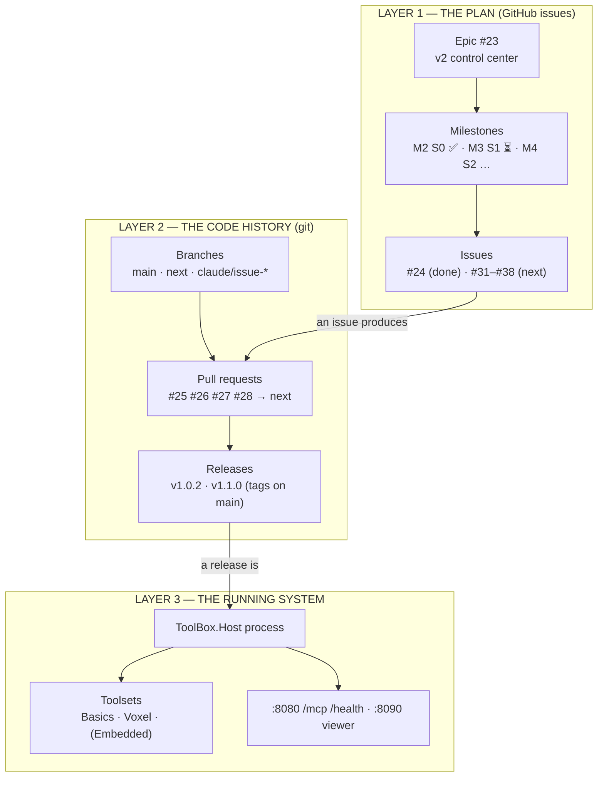
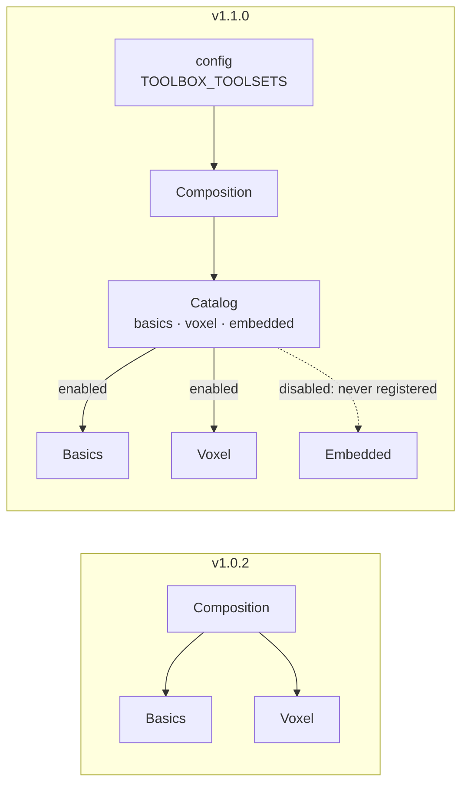
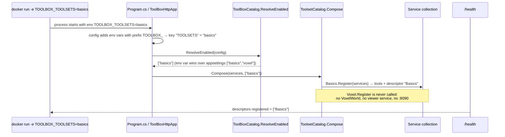
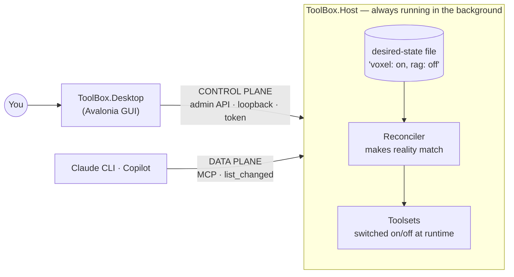
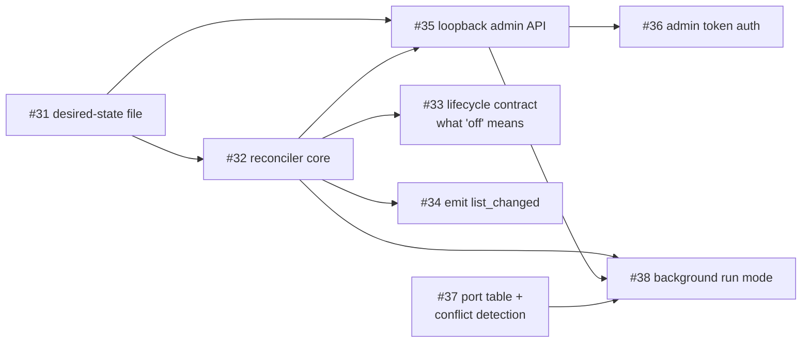

2026_11_07_21_25-(Where-Tool_Box-Stands)

# Lecture 3: Where Tool_Box Stands, How We Got Here, and Where It's Going

### A map of everything that changed in two days, the system as it is now, and the S1 work ahead

---

## Why this lecture exists

In two days, Tool_Box went from "an old project with loose branches" to "a released v1.1.0 with a roadmap, a working AI workflow, and eight new issues queued." That's a lot of motion. Each step made sense on its own, but you said it felt like "a bunch of random issues" with no visible connection, and no clear picture of the state before and after each one.

That feeling is a real problem in engineering, not just in learning: **work you can't place on a map is work you can't review, explain or build on.** This lecture draws the map. It does three things:

1. Shows how the **three layers** of the project (the plan, the code history, the running system) connect, so any issue can be placed.
2. Walks through **what we did**, in order, with the state before and after each step.
3. Explains **where we're going** (phase S1) well enough that you can lead the discussions on the eight new issues instead of following them.

The final part explains the **workflow changes** I've made so that every future issue and PR shows its place on the map with diagrams.

---

# Part 1 — The three layers

Everything we touched lives in one of three layers. Most of the confusion comes from switching between them without noticing.



How they connect:
- **An issue (plan) produces one or more PRs (code).** Issue #24 produced PRs #25, #26, #27 and #28.
- **PRs merge into `next`; a release merges `next` into `main` and tags it.** v1.1.0 is a tag on `main`.
- **A tag is what you build and run (system).** The Docker image you tested is layer 3. It's the only layer users ever see.

When something feels confusing, ask **"which layer am I looking at?"** A label is layer 1, a merge commit is layer 2, a port number is layer 3.

---

# Part 2 — What we did, step by step

## Step A — M0: making the repo workable (issues #8–#13)

**Before:**

```
main ──●  (v1.0.2, the résumé link)
        ├─ development               3 commits nobody merged
        ├─ feature/firmware-…        10 commits of unfinished Embedded work, PR #5 open
        ├─ feature/002/003/Release   already merged, never deleted
        └─ feature/ai-workflow-change
```

No workflow, no roadmap, a 7-KB `CLAUDE.md`, and nowhere safe to make changes without risking the résumé link.

**What happened, and why:**

| Issue | What it did | Why it mattered |
|---|---|---|
| (PR #6) | Set up the AI workflow: slim `CLAUDE.md`, `claude.yml`, agents, templates, labels | You need the machine before you can use it |
| #8 | Smoke test: one README line through the whole loop | Proved issue → branch → PR → CI → merge works end to end |
| #9 | Consolidated the old branches: firmware (which contained `development`) merged into `next`; Dockerfile fixed; old branches deleted | One history instead of six loose ends |
| #10 | Archived v1 as the existing tag `v1.0.2` + a GitHub Release (ADR-014) | v1 is permanently findable without copying code into a folder |
| #11 | Decided v2 **evolves** the current code instead of a rewrite | The Host/Core/Toolset split was already the right shape |
| (#15, #17, #21) | Hardened `claude.yml`: owner-only triggers, more allowed commands | Lessons from the first runs |

**After:**

```
main ──●──────────────────────●  v1.0.2 archived; workflow files live here (they must be on the default branch)
        \                      \
next     ●── firmware merged ───●── ready for v2 work
```

## Step B — M1: deciding what v2 is (issue #12)

**Before:** a voice-note vision ("Docker Desktop for MCP tools").
**After:** `Documentation/Brainstorms/004-GuiControlCenterAndRag.md` (options, recommendation, seven build phases S0–S6) plus **12 decisions** recorded in epic #23 (Avalonia, background Host, SQLite for RAG, …).

This step wrote no code, which is why it felt abstract. It's the step that makes every later issue *connected*: each S-phase in the brainstorm became a milestone, and each milestone becomes a set of issues.

## Step C — M2 / S0: the catalog seam (issue #24 → PRs #25–#28)

This was the first real code change. The next part covers it in detail.

## Step D — Release v1.1.0 (PRs #29, #30)

`next` → `main` with a merge commit, the duplicated ADR-015 removed first, tag `v1.1.0`, a GitHub Release, and the Docker image published automatically by `docker_image_release.yml` when the tag was pushed.

---

# Part 3 — S0 in detail: what changed in the running system

## 3.1 Before and after

**Before (v1.0.2):** the list of toolsets was hard-coded:

```csharp
// ToolBoxServerComposition.cs — v1.0.2
return services
    .AddMcpServer()
    .AddBasicsToolset()
    .AddVoxelToolset();      // always both, always on, recompile to change
```

**After (v1.1.0):** the list is data plus configuration:

```csharp
// ToolBoxServerComposition.cs — v1.1.0
var enabled = ToolBoxCatalog.ResolveEnabled(configuration);   // e.g. ["basics"]
ToolBoxCatalog.Create().Compose(services, enabled);           // registers ONLY those
services.AddHostedService(... ToolsetStartupLogger ...);      // "Enabled toolsets: basics"
return services.AddMcpServer();
```



## 3.2 The four pieces, and which layer of the code each lives in

| Piece | File | Job |
|---|---|---|
| `ToolsetCatalogEntry` | `ToolBox.Core` | A record: `Id`, `Name`, `Description`, and `Register`, a function that adds the toolset to a service collection |
| `ToolsetCatalog` | `ToolBox.Core` | Holds entries; rejects duplicate ids; `Compose(services, enabledIds)` calls `Register` only for enabled ids and throws on an unknown one |
| `CatalogEntry` per toolset | each `*ToolsetExtensions.cs` | e.g. Voxel's entry: `Register = services => services.AddMcpServer().AddVoxelToolset()` |
| `ToolBoxCatalog` | `ToolBox.Host` | **The only place toolsets are named**, and `ResolveEnabled(config)`: env var > appsettings > default |

Why is the catalog *type* in Core while the *list* is in the Host? Core must never know about specific toolsets (ADR-003). The type is generic, like "a list of plugins". The list itself ("Basics, Voxel, Embedded") is a deployment choice, and deployment choices belong to the **composition root**, the Host.

## 3.3 Tracing your Docker test through the code

You ran:

```
docker run … -e TOOLBOX_TOOLSETS=basics toolbox:s0
curl localhost:8080/health   →   {"toolsets":["Basics"], …}
```

Here's the path that answer took:



One detail worth checking yourself: run that container again with `TOOLBOX_TOOLSETS=basics`, look at `docker logs`, and you'll find **no** "Voxel viewer listening on port 8090" line. In your default run that line was there. Port 8090 not being opened is what "never registered" means in practice.

## 3.4 The limitation S0 deliberately leaves

```
Build() ──► the service collection is FROZEN
```

In .NET, all registration happens *before* `Build()`. After that the container can't be changed. So in v1.1.0, **changing which toolsets are on means restarting the process.** That was fine for S0 (it's in the issue's "Out of scope"). It's the main problem S1 has to solve.

---

# Part 4 — The state right now

| Layer | Item | State |
|---|---|---|
| Plan | Epic #23 | Open; M2 done |
| Plan | Milestones | M0, M1, M2 closed; **M3 has 8 open issues (#31–#38)** |
| Code | `main` | = v1.1.0 (tag + GitHub Release + Docker image) |
| Code | `next` | Same content as `main`; all new work branches from here |
| Code | Old branches | Gone. Only `main` and `next` remain long-lived |
| Code | Archive | `v1.0.2` tag + Release = v1 forever |
| System | Toolsets | Basics, Voxel on by default; Embedded available, off |
| System | Choosing toolsets | `TOOLBOX_TOOLSETS` / `Toolsets:Enabled`, read **once at startup** |
| System | Ports | `:8080` (MCP + `/health`), `:8090` (viewer, only if Voxel is on) |
| Docs | Decisions | ADR-001 … ADR-015 |
| Docs | Architecture | `docs/ARCHITECTURE.md` (new; see Part 7) |

---

# Part 5 — Where we're going

## 5.1 The destination



Two vocabulary items from this picture are used throughout S1:

- **Control plane vs data plane.** The *data plane* is the real work: agents calling tools over MCP. The *control plane* is configuration: the GUI saying "turn Voxel on". They're kept on **separate channels** (separate ports, separate auth), so an agent can never reconfigure the system it's using. That's also decision 7 in your epic, and the prompt-injection lesson from Lecture 1. Kubernetes, network routers and cloud services are all built this way.
- **Declarative desired state + reconciler.** You don't tell the system *what to do* ("start voxel"). You tell it *what you want* ("voxel: on"), and a loop called the **reconciler** keeps comparing *desired* with *actual* and fixes the differences. If something crashes, the next pass restarts it. This is how Kubernetes and Docker Desktop work, and it's what you described in your voice note: *"the user is setting up a declarative situation… and the GUI and underlying services need to make it that way."* That was this concept, before you knew its name.

## 5.2 S1 as eight issues



| Issue | Adds to the system | Concept to learn |
|---|---|---|
| **#37** Port table | One documented table of every port, and a clear error when one is taken | Fail fast; resource conflicts |
| **#31** Desired-state file | A JSON file on disk: which toolsets you *want*, plus their settings | Desired vs actual state; schema versioning |
| **#32** Reconciler | The loop that compares desired with actual and starts or stops toolsets | Reconciliation loops; idempotency |
| **#33** Lifecycle contract | A defined "start / stop / save state / restore state" for each toolset | Lifecycle hooks; graceful shutdown |
| **#34** list_changed | Tells connected agents "the tool list changed, fetch it again" | MCP notifications; push vs pull |
| **#35** Admin API | A small HTTP API on its own loopback port: GET and PUT toolset state | Control plane; REST design |
| **#36** Token auth | The admin API requires a secret token stored on disk | Local auth; DNS-rebinding defence |
| **#38** Background run mode | Run the Host as a long-lived service the GUI connects to | Service lifetime; process supervision |

Once S1 is done, you'll be able to `curl -X PUT localhost:<admin-port>/toolsets/voxel -d '{"enabled":false}'` with the token, and Voxel disappears from your agent's tool list **without a restart**. That's the moment to release v1.2. S2 then puts a GUI on top of that same API.

## 5.3 The central design question of S1

This is the most important thing in this lecture for the coming discussions, and it connects Part 3.4 to Part 5.

> **S0 registers toolsets into the DI container at startup, and the container freezes at `Build()`. S1 must switch toolsets on and off *while running*. How?**

There are three broad answers:

| Option | Idea | Cost |
|---|---|---|
| **A. Restart internally** | When desired state changes, rebuild the inner server with the new roster | Simple and reuses S0 exactly; but connected agents drop their connection, and Voxel's world is lost unless it's saved first (#33) |
| **B. Register all, gate at runtime** | Register every toolset at startup; hide disabled ones from `tools/list`, reject their calls, and start/stop their background services manually | Agents stay connected; but it **reverses part of ADR-015** ("disabled toolsets are never registered"), and Embedded's firmware lookup would run even when off |
| **C. One host per toolset** | Each toolset runs in its own inner host or child process; the reconciler starts and stops those | True isolation and the cleanest "off"; the most complex, and it's the "child processes" option the brainstorm deferred |

None of these is obviously right. That's why it belongs in discussion, in #32/#33, *before* anyone plans code. Changing ADR-015 here would be normal. ADR-011 superseded part of ADR-008 for exactly the same reason: circumstances changed, so the decision is revised on the record.

**Suggested order:** start #37 (ports) as a small warm-up, and at the same time open the discussion on #32 with this question. Your opening comment there could be:

```
@claude Before planning: S0 registers toolsets at startup and the DI container freezes at Build(). How should the reconciler turn a toolset on/off at runtime? Compare (A) rebuild the inner server, (B) register everything and gate tools/list, calls and hosted services, (C) a host per toolset. Include what each means for ADR-015, for connected agents, and for Voxel's world. Diagrams for each.
```

---

# Part 6 — Why it felt random, and what changes

The issues weren't random. Each one came from the plan. But **the connections were only in my head and in Claude's**, never shown to you at the moment you were looking at an issue or a PR. Three things were missing:

1. **No map of the system** to place a change on.
2. **No "where this fits"** on each issue or PR: what it depends on, what it unblocks.
3. **No before/after**, only a list of statements ("added X, changed Y").

These are the same gaps that make large codebases hard to work in for humans, which is why good teams write architecture docs and design reviews with diagrams.

---

# Part 7 — The workflow changes for clarity

I've changed five files in your folder (on `main`'s copy, uncommitted; the commands to turn them into a PR are in my message):

| File | Change | What you'll see |
|---|---|---|
| **`docs/ARCHITECTURE.md`** (new) | A living picture of the system as it is *right now*: big-picture diagram, project dependencies, startup flow, config precedence, ports, branches, roadmap with status, target architecture | One page to open before any issue. It changes whenever the structure changes |
| **`CLAUDE.md`** rule 9 (new) | Every plan and PR must include **Where this fits**, a **Before → After** mermaid diagram, and plain-language explanations; structural PRs must update `ARCHITECTURE.md` | Diagrams on every plan and PR, without having to ask |
| `CLAUDE.md` rule 3 | Session notes end with **"System state now:"** in one line | After every session, you know what works that didn't before |
| `.claude/agents/planner.md` | The plan template gains "Where this fits" and "Before → After" sections | Every Stage 3 plan opens with its place on the map |
| `.claude/agents/reviewer.md` | The reviewer checks the diagrams match the diff and that `ARCHITECTURE.md` is current | A wrong diagram is flagged |
| `.github/pull_request_template.md` | New sections: Where this fits · Before → After (mermaid) · What changed and why · **Where to start reviewing** | Every PR tells you which 1–3 files to read first |

GitHub renders mermaid diagrams directly in issues, PR descriptions, comments and markdown files, so they'll appear as pictures in all of those places.

## The orientation routine

The workflow can show you the map, but you have to look at it. A routine:

- **Before starting an issue:** open `docs/ARCHITECTURE.md` and find where the issue sits. Read the issue's "Where this fits".
- **When a plan arrives:** look at the Before → After diagram *before* the steps. If you can't explain the diagram, ask in the issue before approving. That's part of your job as reviewer, not a delay.
- **When a PR arrives:** read "Where to start reviewing", then those files, then the diff.
- **After merging:** read the session notes' "System state now" line, and check that `ARCHITECTURE.md` still matches.
- **At each release:** re-read the roadmap table in `ARCHITECTURE.md` and tick the phase.

---

# Self-check

<details><summary>1. Name the three layers and one example item from each.</summary>
Plan (epic #23, milestone M3, issue #31), code history (branch next, PR #26, tag v1.1.0), running system (the Host process, port 8080, the Voxel toolset).
</details>

<details><summary>2. What did S0 change, in one sentence?</summary>
The list of toolsets went from a hard-coded chain to a catalog plus configuration, read at startup, and disabled toolsets are never registered.
</details>

<details><summary>3. Why does the catalog type live in Core but the list of toolsets in the Host?</summary>
Core must not know specific toolsets (ADR-003). The list is a deployment decision, which belongs to the composition root.
</details>

<details><summary>4. How could you show from logs alone that Voxel was really off?</summary>
With TOOLBOX_TOOLSETS=basics, the "Voxel viewer listening on port 8090" line is missing from docker logs. The viewer service was never registered.
</details>

<details><summary>5. What limitation does S0 leave for S1?</summary>
The DI container freezes at Build(), so changing toolsets needs a restart.
</details>

<details><summary>6. Explain control plane vs data plane using Tool_Box.</summary>
Data plane: agents calling tools over MCP. Control plane: the GUI changing which toolsets are on through the admin API. Separate channels mean an agent can't reconfigure its own tools.
</details>

<details><summary>7. What does a reconciler do?</summary>
It repeatedly compares desired state (the file) with actual state (what's running) and makes changes until they match.
</details>

<details><summary>8. Which S1 issue can start without any other?</summary>
#37, the port table. (#31 also has no S1 dependency.)
</details>

<details><summary>9. Why might S1 revise ADR-015, and is that a problem?</summary>
Runtime toggling might require registering everything and gating at runtime (option B). Revising a decision openly, with a new ADR, is normal (compare ADR-011 superseding part of ADR-008).
</details>

<details><summary>10. What three things should every plan and PR now show you?</summary>
Where this fits, a Before → After diagram, and plain-language explanations of each change (and PRs: where to start reviewing).
</details>
