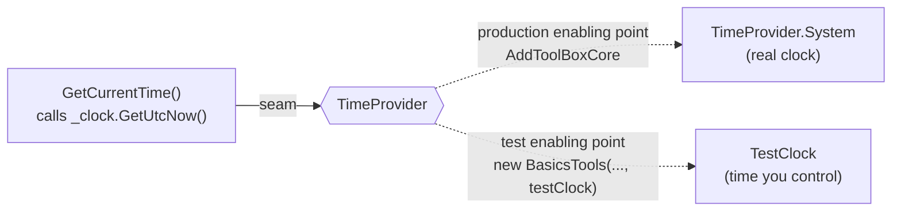
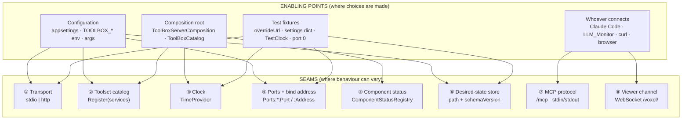
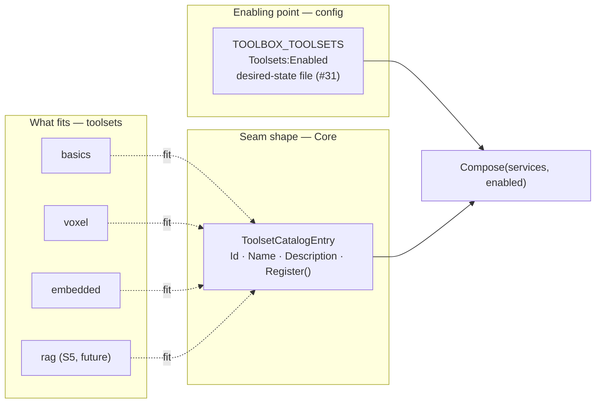
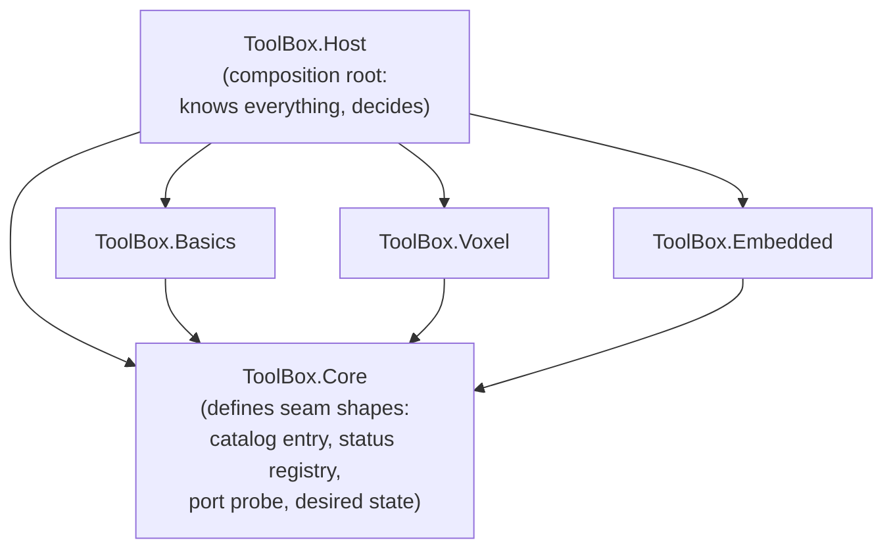

2026_11_08_14_08-(Seams)

# Lecture 4: Seams, the Idea Holding Tool_Box Together

### What a seam is, how to recognise one, every seam in Tool_Box today, and how the v2 roadmap is a series of seams

---

## Why this lecture

"Seam" has come up again and again: "the catalog seam", "evolve in place with a catalog seam", "S0 builds the seam the GUI will drive". If the word is fuzzy, those sentences sound like jargon. Once it's clear, the whole v2 roadmap reads as one straightforward plan:

> **v2 is a sequence of moves: create a seam, then change what plugs into it, then move the place where that choice is made.**

By the end of this lecture you should be able to look at any file in Tool_Box and say where the seams are, what plugs into them, and who decides.

---

# Part 1 — What a seam is

## 1.1 The definition

The term comes from Michael Feathers' book *Working Effectively with Legacy Code* (2004). In his words, a seam is a place where you can change what a program does **without editing the code at that place**.

Every seam has two parts:

| Part | Meaning |
|---|---|
| **The seam** | The spot in the code where behaviour *can* vary. The code there doesn't decide which behaviour you get. |
| **The enabling point** | The place where the choice *is* made: which behaviour plugs in. |

**If you can't name the enabling point, it isn't really a seam.** An interface that only one class could ever fill, chosen in only one way, is just indirection.

## 1.2 An everyday picture

A wall socket is a seam. The wiring behind the wall doesn't care whether you plug in a lamp, a kettle or a laptop charger. You change what happens at that spot without opening the wall. The enabling point is your hand, choosing the plug.

Compare a lamp wired straight into the wall: to swap it for a fan, you need tools and an electrician. That's code **without** a seam: changing behaviour means editing the place itself.

## 1.3 The smallest real example in your code

Here's the clearest seam in Tool_Box, in `BasicsTools.cs`:

```csharp
public BasicsTools(ServerInfoProvider serverInfo, TimeProvider clock)   // ← receives a clock
...
public CurrentTime GetCurrentTime()
{
    DateTimeOffset utcNow = _clock.GetUtcNow();     // ← THE SEAM: "ask whatever clock I was given"
```

Without a seam, it would read:

```csharp
DateTimeOffset utcNow = DateTimeOffset.UtcNow;     // ← welded to the real system clock
```

Both versions behave identically in production. The difference shows up when you want *different* behaviour without editing `GetCurrentTime`. There are **two enabling points**:

```csharp
// Enabling point 1 — production (ToolBox.Core, AddToolBoxCore):
services.TryAddSingleton(TimeProvider.System);          // the real clock

// Enabling point 2 — tests (BasicsToolsTests.cs):
private sealed class TestClock : TimeProvider { public DateTimeOffset Now {get;set;} … }
return new BasicsTools(provider, clock);                // a clock the test controls
...
clock.Now += TimeSpan.FromSeconds(90);                  // "90 seconds pass" — instantly
Assert.Equal(TimeSpan.FromSeconds(90), tools.GetServerInfo().Uptime);
```

That last test proves uptime advances correctly without waiting 90 seconds, and it gives the same result on any machine at any time of day. Without the seam it couldn't be written.



---

# Part 2 — The kinds of seams

Feathers names three classic kinds. Modern services add a few more. Tool_Box uses almost all of them.

| Kind | Behaviour varies by… | Enabling point is… | In Tool_Box |
|---|---|---|---|
| **Object seam** | which object is passed in (an interface, abstract class or delegate) | wherever the object is created: DI registration, a constructor call | `TimeProvider`, `ToolsetCatalogEntry.Register` |
| **Link seam** | which library or project is compiled in | the project references / build | Host references Basics, Voxel, Embedded |
| **Preprocessor seam** | `#if` symbols at compile time | build flags | not used (rarely worth it in C#) |
| **Configuration seam** | a setting's value | config files, env vars, command line | `TOOLBOX_TRANSPORT`, `TOOLBOX_TOOLSETS`, `Ports:*`, `Desired:Path` |
| **Protocol seam** | who is on the other end of a wire | which process connects | MCP (any agent), the viewer WebSocket, `/health`, soon the admin API |
| **Data seam** | the shape of stored data, across versions | the schema version + migrations | the desired-state file's `schemaVersion` |

Two of these deserve more attention:

- **Configuration seams** are object seams whose enabling point has been moved *out of code entirely*. A setting picks which object or behaviour is used. Anyone can change behaviour without recompiling, including Docker, CI, and eventually your GUI.
- **Protocol seams** separate *processes* rather than classes. MCP is the reason Tool_Box works with Claude Code, Claude Desktop and LLM_Monitor without knowing which one is connected. The protocol is the seam, and "which client connects" is the enabling point.

---

# Part 3 — Every seam in Tool_Box today



Each one in turn:

### ① Transport: a configuration seam
`Program.cs` reads `Transport` (`--transport` > `TOOLBOX_TRANSPORT` > `appsettings.json`) and calls either `RunStdioAsync` or `ToolBoxHttpApp.Build`. **Both** call the same `AddToolBoxServer()`. The seam is the switch; the enabling point is your command line or the Dockerfile's env var. This is why ADR-007 says "deployment identity is configuration, not compilation."

### ② The toolset catalog: the central seam (S0)
Covered in full in Part 4.

### ③ The clock: an object seam
Shown in Part 1. `AddToolBoxCore` uses `TryAddSingleton`, meaning "register the real clock *unless someone already registered one*". That `Try` is a deliberate detail: it leaves the enabling point open for a test or a future host to supply its own clock first.

### ④ Ports and bind addresses: a configuration seam with layers (#37)
`PortTable.AddDefaults` inserts the defaults as the **lowest** configuration layer:

```csharp
builder.Sources.Insert(0, new MemoryConfigurationSource { InitialData = Defaults });
```

Every higher layer (appsettings, `TOOLBOX_Ports__Mcp__Port`, command line, test settings) is an enabling point that overrides it. The code that binds the port never changes; *where* it binds is decided elsewhere. That's how you moved MCP to 8085 with an env var and no code change, and how the Dockerfile opts into `0.0.0.0`.

### ⑤ Component status: a seam for reporting, not for behaviour
`ComponentStatusRegistry` lives in Core and knows nothing about the viewer. Any component can `Set("viewer", "unavailable: …")`, and `/health` reads `Snapshot()`. The registry is a meeting point: Voxel *writes* to it without knowing who reads, and `/health` *reads* without knowing who writes. Later the admin API and the GUI read the same registry. One seam serves three consumers.

### ⑥ The desired-state store: a test seam plus a data seam (#31)
- `DesiredStateStore(string? path = null)`: the path is a seam. Production uses `LocalApplicationData/ToolBox/…`; tests pass a temporary folder, so they never touch your real files. The enabling point is the constructor argument, or `TOOLBOX_Desired__Path`.
- `schemaVersion` plus the migrator is a seam **across time**: today's code can read yesterday's file, because the change between versions has a defined plug-in point, the migration step table. Claude even made that table injectable, so a test can plug in a fake "v0 → v1" migration. That's a seam *inside* a seam.

### ⑦ MCP: a protocol seam
The deepest seam in the project. Tool_Box doesn't know or care which agent is calling. You proved it yourself by calling `place_box` with raw `curl`, and then Claude Code called the same tool. Same seam, two enabling points.

### ⑧ The viewer channel: a protocol seam
`VoxelViewerBroadcastService` broadcasts world changes over a WebSocket. `viewer/index.html` is one client. A future "View world" window in the GUI (S3) would be another, and the service won't change.

### And the test seams in the Host
`ToolBoxHttpApp.Build(args, overrideUrl, settings)` has two parameters that exist **only** to be test enabling points:
- `overrideUrl = "http://127.0.0.1:0"` → "use any free port", so parallel tests never collide.
- `settings` → an in-memory config layer added *last*, so a test can override anything.

That's why `ToolsetSelectionTests` can build a server with Voxel off in a few milliseconds.

---

# Part 4 — The catalog seam, in depth

## 4.1 Before: no seam

```csharp
// v1.0.2
return services.AddMcpServer()
    .AddBasicsToolset()
    .AddVoxelToolset();
```

Which toolsets exist was **welded** into this method. Changing it meant editing this method and recompiling. There was no enabling point other than "edit the code".

## 4.2 After: a seam with an enabling point outside the code

```csharp
// Core: the shape of the seam (knows no toolset)
public sealed record ToolsetCatalogEntry(string Id, string Name, string Description,
                                         Action<IServiceCollection> Register);

// Each toolset: something that fits the seam
public static ToolsetCatalogEntry CatalogEntry { get; } = new(
    Id: "basics", …, Register: services => services.AddMcpServer().AddBasicsToolset());

// Host: the composition root lists what's available…
ToolBoxCatalog.Create() => new([Basics.CatalogEntry, Voxel.CatalogEntry, Embedded.CatalogEntry]);

// …and the ENABLING POINT decides what's used
var enabled = ToolBoxCatalog.ResolveEnabled(configuration);   // TOOLBOX_TOOLSETS / appsettings
ToolBoxCatalog.Create().Compose(services, enabled);
```



The method that composes the server is now identical whatever the roster. You verified that in Docker: `TOOLBOX_TOOLSETS=basics` gave `["Basics"]`, the default gave both, and not a line of code changed between the two runs.

## 4.3 Why `Register` is a function, not an interface

`Action<IServiceCollection>` is the smallest possible object seam: "give me a function that registers yourself". Each toolset decides *how* it registers (its tools, singletons, background services) behind that one function. Core only knows "call this function", which is why Core still references no toolset (ADR-003).

## 4.4 The enabling point keeps moving, and that *is* the v2 roadmap

This is the key insight of the lecture. The **seam** built in S0 stays the same. Each later phase moves the **enabling point** one step closer to the user:

| Phase | Where the toolset choice is made | Who can make it |
|---|---|---|
| v1.0 | the C# source code | a developer, plus a recompile |
| **S0** (v1.1) | `TOOLBOX_TOOLSETS` / appsettings, read at startup | an operator, plus a restart |
| **#31** | + a desired-state file (user intent), env var as an operator pin | a user editing a file, plus a restart |
| **#32** | + a reconciler that applies changes **while running** | still the file, now live |
| **#35** | + the admin API (`PUT /toolsets/voxel`) | any local program holding the token |
| **S2** | + a toggle in the GUI | **you, with a mouse** |

That's what "S0 is the seam the GUI toggles will later drive" meant. The GUI won't contain any toolset logic. It's just a new enabling point for a seam that already exists.

---

# Part 5 — Seams decide the direction of dependencies

## 5.1 Who owns the seam?

A good seam is **defined by the side that uses it**, not the side that implements it. Core defines `ToolsetCatalogEntry`; the toolsets *conform* to it. Core never points at a toolset; toolsets point at Core.



This is the **dependency inversion principle**, the "D" in SOLID. High-level policy (Core: "toolsets register through this shape") doesn't depend on low-level details (Voxel's world). Both depend on the abstraction. ADR-003 ("Core never references a toolset") is this principle written as a project rule. Every seam shape that went into Core in S1 (port probe, status registry, desired-state model) was checked against it, which is why Claude kept saying "Core knows no service".

## 5.2 The composition root: where enabling points gather

A seam means *something* has to make the choice. In a well-structured program those choices live in **one place**, the composition root. In Tool_Box that's the Host: `ToolBoxServerComposition`, `ToolBoxCatalog`, `PortTable`. That's why "the Host is the only place toolsets are named" matters. If the choices were spread across many files, you'd have seams with no single place to understand or change them.

---

# Part 6 — Seams in the roadmap ahead

Each upcoming phase is a seam you'll create or use:

| Coming | Seam | Implementations that plug in | Enabling point |
|---|---|---|---|
| #32 reconciler | `IToolsetLifecycle` (Start/Stop) + **one gate** for `tools/list`, `tools/call`, background services | every toolset | the reconciler, driven by desired state |
| #35 admin API | an HTTP control API (protocol seam) | the GUI, `curl`, tests, a future CLI | whichever client calls it, holding the token |
| S2 GUI | the GUI talks *only* through the admin API | the Avalonia app (or any other front end) | the user |
| S4 agents | `IAgentRegistrar` | Claude CLI, VS Code Copilot, future agents | the agent picker in the GUI |
| S5 RAG | `IVectorStore` | SQLite + sqlite-vec, pgvector | config / GUI setting (decision 5) |
| S5 RAG | `IEmbeddingProvider` | ONNX in-process, Ollama | config (decision 6) |
| later | "a host per toolset" (option C in #32) | in-process, child process | the `IToolsetLifecycle` seam lets this swap in later |

Look at the last row. In #32 you chose option B (gate inside one process) over option C (a process per toolset). Because B introduces the `IToolsetLifecycle` seam, option C becomes **a different thing plugged into the same seam** later, not a rewrite. A good seam keeps future options open without paying for them now.

### Seams make "evolve, don't rewrite" possible

When you decided v2 would **evolve** rather than rewrite (ADR-014), you were relying on seams. The pattern is called the **strangler fig**: build a seam around the old behaviour, plug in new behaviour alongside it, move callers across gradually, and remove the old one when nothing uses it. S0 is a textbook case: the old hard-coded chain was replaced through a seam while every existing test passed unchanged.

---

# Part 7 — When *not* to add a seam

Seams cost something: an extra level of indirection, another file to read, and a choice someone has to understand. A seam with only one implementation, ever, is wasted complexity. The general warning is called **speculative generality**, also known as YAGNI ("you aren't gonna need it").

Your ADRs already practise this:
- **ADR-003**: "abstract from evidence, not imagination". There's no plugin loader until something needs one.
- **ADR-009**: one global `VoxelWorld`. A per-session seam was deliberately *not* built until a multi-client case appears.
- **#32**: option C (a process per toolset) was deferred. Its seam will exist, but its second implementation waits.

**Add a seam when at least one of these is true:**
1. **A test needs it** (`TimeProvider`, `overrideUrl`, the store's `path`).
2. **There are, or will soon be, two real implementations** (stdio and HTTP; SQLite and pgvector).
3. **A decision is likely to change, or belongs to someone else** (which toolsets are on → the user; which port → the operator).

**Don't add one when** the only reason is "it might be flexible someday".

---

# Part 8 — Using this in reviews and interviews

## 8.1 Questions to ask of any plan or PR

1. **What changes here, and where is the choice made?** (seam + enabling point)
2. **Is that choice in the composition root or in config, or is it buried in a feature class?**
3. **Which way do the dependencies point?** Does Core now know about something specific? That's a red flag.
4. **Can this be tested without the network, the clock, the filesystem or a real port?** If not, what seam is missing?
5. **Is this seam justified** (test, second implementation, changing decision), or is it speculative?

Try these on PR C of #31 when it arrives. The desired-state merge is a configuration seam plus a data seam, and it should pass all five.

## 8.2 How it sounds in an interview

- *"How do you make code testable?"* → "Put seams at the boundaries: time, I/O, network, configuration. Inject them, and keep the choices in a composition root. In Tool_Box, `TimeProvider` lets me test uptime without waiting, and a path parameter keeps the desired-state tests away from real user files."
- *"How would you add a feature without breaking existing behaviour?"* → "Create a seam, plug the old behaviour in as the default, prove it with the existing tests unchanged, then plug in the new behaviour. That's how my toolset catalog replaced a hard-coded list."
- *"How do you avoid over-engineering?"* → "A seam has to earn its place: a test, a second implementation, or a decision that will change. My ADRs record seams I deliberately *didn't* build yet."

---

# Exercises

1. **Find the enabling point.** For each of `TOOLBOX_TRANSPORT`, `Ports:Viewer:Address` and `TimeProvider`, write down the file and line where the choice is finally made in production, and where a test makes it instead.
2. **Break a seam on paper.** Imagine `GetCurrentTime` used `DateTimeOffset.UtcNow` directly. Which existing tests would become impossible, and why?
3. **Trace the enabling point's journey.** Using the table in 4.4, describe in your own words what changes in the code at #32, at #35 and at S2, and what *doesn't* change.
4. **Design a seam.** Sketch `IVectorStore` for S5 in about five method signatures. What does Core define, what does `ToolBox.Rag` implement, and where does the SQLite-vs-pgvector choice live?
5. **Judge a seam.** Pick one seam from Part 3 and argue whether it passes the "earn its place" test in Part 7.

---

# Self-check

<details><summary>1. Define a seam and its enabling point in one sentence each.</summary>
A seam is a place where behaviour can change without editing the code at that place. The enabling point is where the choice of behaviour is actually made.
</details>

<details><summary>2. What's the seam and what are the two enabling points in GetCurrentTime?</summary>
The seam is `_clock.GetUtcNow()` on an injected TimeProvider. Production's enabling point is `TryAddSingleton(TimeProvider.System)` in AddToolBoxCore; the tests' is `new BasicsTools(provider, testClock)`.
</details>

<details><summary>3. What kind of seam is TOOLBOX_TOOLSETS, and what kind is MCP?</summary>
A configuration seam, and a protocol seam.
</details>

<details><summary>4. Why is Register an Action&lt;IServiceCollection&gt; rather than something MCP-specific?</summary>
So Core can define the seam without depending on any toolset or on the MCP package (ADR-003). Each toolset decides how it registers behind that one function.
</details>

<details><summary>5. "The seam stays; the enabling point moves." Explain using the v2 roadmap.</summary>
The catalog seam from S0 doesn't change. The place where the toolset choice is made moves from code → env var → desired-state file → live reconciler → admin API → GUI toggle.
</details>

<details><summary>6. Which principle does ADR-003 express, and how does it relate to seams?</summary>
Dependency inversion: Core defines the seam shapes and toolsets conform to them, so dependencies point toward Core, never from Core to a toolset.
</details>

<details><summary>7. What is a composition root, and which files are Tool_Box's?</summary>
The single place where the enabling points gather and the object graph is assembled: ToolBoxServerComposition, ToolBoxCatalog and PortTable in the Host.
</details>

<details><summary>8. Why does choosing option B in #32 keep option C open?</summary>
B introduces the IToolsetLifecycle seam. A process-per-toolset implementation could later plug into the same seam instead of requiring a rewrite.
</details>

<details><summary>9. Give the three reasons a seam earns its place.</summary>
A test needs it; there are (or will soon be) two real implementations; or the decision is likely to change or belongs to someone else.
</details>

<details><summary>10. How do seams make the strangler-fig pattern work?</summary>
You wrap the old behaviour behind a seam, plug the new behaviour in alongside it, move callers over gradually, and remove the old one, without a big-bang rewrite.
</details>
