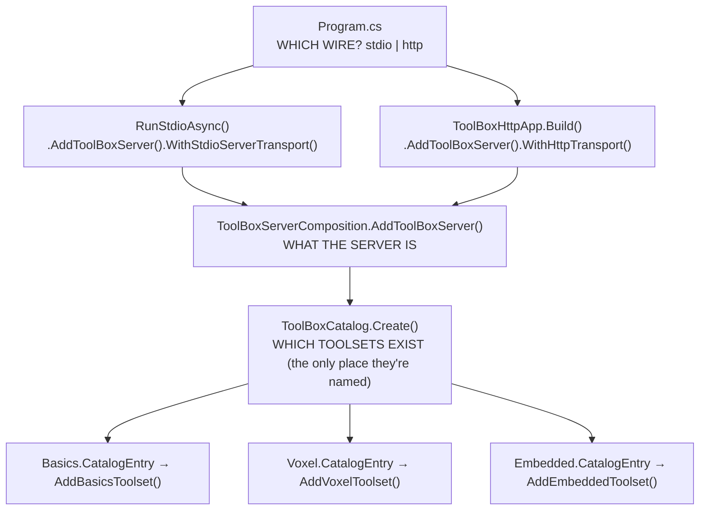
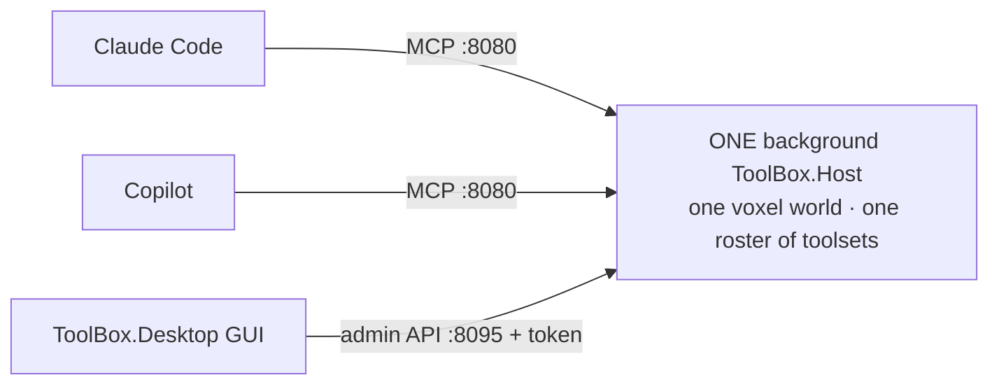

1. Can you show me how we use the composition root? I want to understand what is even meant by this idea of a composition root, and so can you show me what we are doing and why we're doing it? Kind of give me a little bit of a walkthrough and explain things from the architectural perspective.

2. I am trying to figure out about how the HTTP will actually be utilized because I understand that when the agent starts up, it can create a child process of this application from the DLL, and then it is able to direct the standard input and standard output of this application to be able to communicate with it, and the purpose will be to be invoking those specific tools. But now I'm trying to get a more holistic understanding of how the HTTP will actually be utilized, and in which situations. It has been a little while since I was working on this project, and if I remember correctly, it was that I wanted to be able to have local agents being able to interact with it, or maybe it was because I was trying to integrate this project into my orchestration project. So, can you go over what the advantages and use cases are of the http and how this will be utilized?

---

# Answers — Round 1

## 1. The composition root

### What the term means

A **composition root** is the one place in an application where the object graph gets assembled: where you decide *which* concrete classes exist and how they're wired together. Everywhere else, classes just say "I need an X" in their constructor and get one. They never build their own dependencies and never decide which implementation they get.

An analogy: think of a theater's stage manager. The actors (your tools, services) don't go find their own props. They walk on stage and expect the prop to be there. The stage manager (the composition root) decides before the show which prop goes where. If you want to swap the real sword for a prop sword in rehearsal (a test fake), you only talk to the stage manager, not to every actor.

In .NET that "stage manager" is the code that fills the `IServiceCollection` (the DI container's registration list) before `Build()` is called.

### What Tool_Box does: three layers, from the outside in



**Layer 1: `Program.cs`, "which wire?"** Its own header comment calls it a *thin composition root*. It reads config (flag > env var > appsettings), picks `stdio` or `http`, handles background mode and exit codes, and that's it. It knows nothing about tools.

**Layer 2: `ToolBoxServerComposition.AddToolBoxServer()`, "what is this server?"** This is the heart of it. Both transport paths call this *same* method, then bolt on their wire. In order it:
1. Registers Core's shared services (`AddToolBoxCore()`: `TimeProvider`, `ToolsetGate`, `ServerInfoProvider`, the health registry).
2. Loads the desired-state file and works out which toolsets the user wants enabled.
3. Asks the catalog to register **every** toolset (`catalog.ComposeAll`). Registration is cheap and side-effect-free; nothing starts yet (ADR-018).
4. Wires the runtime machinery: the `ToolsetReconciler` (starts/stops toolsets and opens the gate), the file watcher, the admin write service.
5. Returns `AddMcpServer().WithToolsetGateFilters()` so the caller can attach a transport.

**Layer 3: `ToolBoxCatalog` and each toolset's doorway, "which capabilities exist?"** `ToolBoxCatalog.Create()` is the *only* place in the whole codebase where Basics, Voxel and Embedded are named. Each toolset exposes one `CatalogEntry` plus one `Add<Name>Toolset()` extension method, and the host learns nothing about the tool classes inside.

### Why we do it this way

- **Core stays ignorant of toolsets (ADR-003).** Because all the naming happens in the Host, `ToolBox.Core` can never accidentally depend on Voxel. Dependencies point inward only.
- **The transport is swappable (ADR-007).** Since "what the server is" lives in one method and "which wire" lives in another, adding HTTP needed **zero changes** to Core or any toolset. The ADR records that this was measured, not assumed. That's the payoff of the pattern in one sentence.
- **Tests boot the real thing.** `ToolBoxHttpApp.Build()` was pulled out of `Program.cs` so integration tests run the exact same composition production runs. As its comment puts it, "If tests built their own copy of this, they'd be testing the copy."
- **Substitution happens in one spot.** Two concrete examples in this code:
  - `AddToolBoxCore()` uses `TryAdd...`, so a test can register a fake `TimeProvider` *first* and Core won't overwrite it.
  - `AddToolBoxServer()` registers a do-nothing `IToolListChangedNotifier` by default, and the stdio path in `Program.cs` then **replaces** it with the real stdio notifier (stdio has a live session to push to; stateless HTTP doesn't). Nobody who *uses* the notifier knows or cares which one they got. That's dependency inversion, decided at the root.
- **Adding a toolset is one project reference plus one line** in `ToolBoxCatalog.Create()`. No hunting through the code.

**Rule of thumb to keep:** if you ever see a `new SomeService(...)` for a dependency deep inside a tool class, or Core mentioning a toolset by name, that's wiring leaking out of the composition root.

---

## 2. Why HTTP, and when it's used

You remembered correctly: **the original reason was your orchestration project, LLM_Monitor.** ADR-002 literally says "Streamable HTTP (for LLM_Monitor's compose network) is plan 002." Since then a second, bigger reason has grown out of the v2 desktop plan: **one long-lived host that many local agents share.**

### The core difference

| | **stdio** | **HTTP** |
|---|---|---|
| Who starts the server? | The agent spawns it as a child process | It's already running on its own; clients connect by URL |
| How many clients? | Exactly one, the parent | Any number |
| Lifetime | Dies when the agent session ends | Lives as long as you want (all day, in Docker, as a background service) |
| Where can the client be? | Same machine, and it must be able to launch a .NET process | Anywhere that can reach the URL (another container, another program) |
| State (e.g. the voxel world) | Private to that one session | Shared by everyone connected |

stdio is perfect when one agent wants a private toolbox. HTTP is for when the server must exist **independently of any single agent.**

### Use case 1: LLM_Monitor (the original reason)

```
langchain_service (Python, in Docker) ──HTTP POST──► toolbox:8080/mcp (in Docker)
```

The LangGraph agent lives in a Python container. It can't spawn a .NET DLL as a child process from inside its container, and you wouldn't want it to anyway. Instead Tool_Box runs as its own compose service, and `langchain-mcp-adapters` connects to `http://toolbox:8080/mcp`, discovers the tools, and hands them to the agent's tool loop. The stated payoff in `docs/LLM_MONITOR_INTEGRATION.md`: **add a toolset to Tool_Box and the LLM_Monitor agent gains that capability with zero LLM_Monitor code changes.** Note that in that compose the MCP port is deliberately *not* published. Only containers on the internal network can reach it (ADR-008/011), because the MCP port has no authentication.

### Use case 2: one shared host for your local agents (the v2 direction)

This is `--mode background` (ADR-024), which is HTTP plus a single-instance lock plus a `host.json` discovery file. Picture it like this:



Why this beats every agent spawning its own stdio copy:
- **One shared state.** With stdio, three agents mean three processes, three separate voxel worlds, and three viewers fighting over port 8090 (ADR-024 calls this overlap out). With one HTTP host, everyone builds in the same world.
- **One control point.** Flip a toolset off in the GUI and it's off for *every* agent. The admin API (control plane) only exists in HTTP mode, because several stdio copies would fight over its port.
- **It outlives any one session.** You can close Claude Code and the host (and its state) is still there.

### Use case 3: other machines (later)

ADR-007 notes the same binary could run on, say, a Raspberry Pi with a different toolset roster. HTTP is what makes "the tools live over there" possible. The caveat is that this is only safe on a trusted network until MCP-port authentication exists.

### What HTTP costs you

- **Security surface.** Anything that can reach the port can run tools. That's why it binds to `127.0.0.1` by default (ADR-016), has a Host/Origin guard against DNS-rebinding attacks from web pages (ADR-021), and must never be exposed beyond a trusted network.
- **No push notifications.** HTTP runs *stateless* (ADR-007), so when a toolset is switched on or off, HTTP clients find out on their next `tools/list` call. stdio clients get a `list_changed` push (ADR-022).
- **Shared state cuts both ways.** Two agents in the same voxel world can step on each other. This is a known, accepted limitation (ADR-009).

**Short version:** stdio = "my agent's private toolbox." HTTP = "a toolbox service that other things connect to": first LLM_Monitor's containers, and next your whole set of local agents plus the GUI, all sharing one running host.


1. I have heard a lot about this idea of seams, and I know that there was a full lecture document which was generated, but honestly I have not had enough time to be able to dedicate to going and reading that lecture document in full. So instead, could you give me a high-level understanding of what seams are and show me examples in this project of what they are and how they are used and why they are important? 

2. I'm also seeing a lot of things with this idea of planes, like data plane and control plane and all of that, so I'm trying to understand what it's meaning by those planes and also about all of the different doors which are located in this project.

3. Can you explain this thing I see of MCP SKD JSON RPC?

4. I am still struggling with the ideas in networking because networking has been my least competent skill set within engineering. And so in this project, it actually does provide a lot of really nice things that I can dig into to try to improve my skills in this regard. And one of the things that I am looking at right now is that there is a lot of things with ports, and so now I am trying to go and understand what they mean and how I am able to take advantage of them in this project. So what I'm thinking is going on is that ports are associated with specific network interfaces, and network interfaces are software abstractions that allow the operating system to expose certain networking components, but it's not actually the physical device or the driver of that device, but rather it's just some kind of abstraction. Anyways, there is some kind of protocol that occurs, and the operating system is going to assign an IP address to that specific interface. Once again, not the actual device or the actual driver, but the IP address is going to be only for the application abstraction interface. And now my application is going to attempt to open up a handle with that particular interface, and so the operating system is going to go in and because the single application is associated with a single process, that means that the address space is actually shared, and that process has a component which is called the handle table, where the operating system is able to associate the actual kernel object with the integer handle for that application process. So the network interface is the real kernel object, and so this is how I am able to have in my application the connection to a network interface. So now I am also considering what binding the port actually means, and so I'm thinking that with this software abstraction, which is called the network interface, that is the thing that is going to also, in addition, The kernel object of the network interface will also have this port, and so IP address and port are just two fields within the kernel object, and then it gets associated to a process. But now that I'm saying this out loud, I am starting to realize that I think that the port is going to be a thing which is specific to the application. Or actually, no, I do think that it is a global variable. Or maybe I have actually no idea what's going on. So, the more I'm talking, the more I am realizing that I really have no idea what this idea of a port is, where and how it is used, and what the actual connection to my operating system and application really is. Then there is this term which is called binding that I don't know what that means. Another point is that recently I have been studying the operating system of Windows, and so if you're able to try to put things into the context of Windows, that would be helpful.