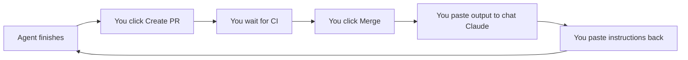
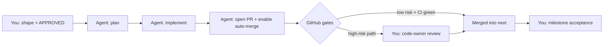

2026_11_14_00_46-(Workflow v2 Supervised Autonomy)

# Lecture 5: Workflow v2, Supervised Autonomy

> **What this lecture covers:** why the week-1 workflow stopped working, the model that replaced it, every gate you built on Friday night and what each one actually enforces, and what your job is now. By the end you should be able to explain, in an interview, how you let AI agents merge code into your repository without losing control of it.

---

## 1. The problem you noticed

After one week of the issue-driven workflow, you wrote this down:

> "I am essentially just being a mindless clicker on the open PR button and waiting for the CI pipeline to pass until I press the merge button."

That observation is the whole reason for Workflow v2, so take it seriously. You had become the **transport layer**: the thing that carries messages between two systems without adding anything. The loop looked like this:



None of those boxes needed your judgment. And the evidence showed it was worse than wasted time: on one night, several PRs were merged **before CI finished**, the unrun spike (#78) was merged, and the security PR (#82) was merged before its manual checks. That isn't a character flaw. It's what happens to any human asked for attention forty times a day on things that don't need it.

**The key insight:** a gate nobody really looks at is worse than no gate. It costs attention *and* gives false confidence. The fix is not "try harder to look". It's to **move the gates to where machines can enforce them, and move your attention to where only you can add value.**

---

## 2. The model: on the loop, not in the loop

Two phrases from safety engineering describe the difference:

- **Human in the loop**: the system can't take a step without you. Every step waits.
- **Human on the loop**: the system runs by itself; you set direction, handle exceptions, and accept results.

Workflow v2 puts you **on** the loop, at three touchpoints:

| Touchpoint | When | What you do | Why it needs *you* |
|---|---|---|---|
| **Shaping** | Stages 1–2 | State the goal; answer the design questions | Architecture, security posture and scope are judgment calls. This is also where you learn the most. |
| **Exceptions** | Any time | Answer a `needs-timothy` | The agent hit a real fork, an unexplained failure, or a high-risk change |
| **Acceptance** | Milestone end, `next` → `main` | Read the digest, verify once *carefully*, merge to `main` | `main` is your résumé link and publishes the Docker image |

Look back at the moments in week 1 where you actually contributed: choosing A+C for list_changed (#34), the four security answers on #66, noticing that the spike had never run. Each took minutes. Each was a **decision**, not a click. Workflow v2 is designed so that those are the *only* things that reach you.



### Is this just the old "implementation plan" approach again?

You worried about this, and it's a fair question. The old approach failed because of **big-bang delivery**: one huge plan, one long agent run, testing only at the end. Workflow v2 keeps everything that fixed that: small PRs, CI on every change, the issue as memory, ADRs, design discussion before code. The only thing that changed is **who presses the buttons in the middle.**

---

## 3. Rules a machine enforces vs rules an agent is asked to follow

This is the most important idea in the lecture. There are two kinds of rule:

- **Advice**: text the agent reads (CLAUDE.md, the agent files). The agent will *usually* follow it. A confused or manipulated agent might not.
- **Enforcement**: something GitHub checks mechanically (a ruleset, a workflow `if:`). It doesn't matter what the agent believes; the action is impossible.

Claude itself put it well on the epic: *"prompts are advice and `if:` is enforcement."* Every important rule in Workflow v2 has an enforcement layer underneath its advice layer. That's called **defence in depth**: no single layer has to be perfect.

| Layer | Example | Kind | Can it be bypassed by the agent? |
|---|---|---|---|
| CLAUDE.md | "Never open a PR while `next` is red" | Advice | Yes, if it misbehaves |
| Allowlist (`--allowedTools`, settings.json) | Only `gh pr merge --auto` is allowed | Mostly enforced, but patterns can be imperfect | Possibly (the `--admin` deny pattern probably doesn't match) |
| Workflow `if:` | `claude:paused` label stops the run | Enforced by GitHub | No |
| Push helper | One branch per run | Enforced by the action | No (Claude hit this and correctly stopped) |
| Ruleset + CODEOWNERS | High-risk PRs wait for your review | Enforced by GitHub | No |
| You, at acceptance | Verify and merge to `main` | Human judgment | — |

Notice the allowlist row. The `--admin` deny pattern in settings.json probably doesn't work as written, because permission patterns match prefixes. That would be a real hole *if it were the only layer*. It isn't: the ruleset has an empty bypass list, so even `--admin` can't skip it. **That's what defence in depth buys you: an imperfect layer doesn't become a vulnerability.**

---

## 4. The gates, one by one

### 4.1 CODEOWNERS: your risk policy as a file

`.github/CODEOWNERS` maps file paths to the people who must approve changes to them:

```
/.github/ @Timothy-Lee-Grant
/src/ToolBox.Host/*Guard* @Timothy-Lee-Grant
*.csproj @Timothy-Lee-Grant
```

How to read it:
- A leading `/` means "from the repo root". Without it, the pattern matches at any depth (`*.csproj` matches every project file).
- A path ending in `/` covers the whole folder.
- When several lines match a file, **the last matching line wins.**

The file divides the repo into two **risk tiers**:

- **Low** (everything not listed): tests, docs, toolsets, ordinary code. Auto-merges after CI.
- **High** (everything listed): workflows, CLAUDE.md, agent files, ADRs, Docker files, package versions, scripts, `Program.cs`, `ToolBoxHttpApp.cs`, ports, guards, auth, admin code, and **the tests of those**.

Two subtle choices worth understanding:

1. **Why `Program.cs` and `ToolBoxHttpApp.cs` are high-risk.** They don't *contain* security code, but they *wire it up*. Moving one line of middleware registration can disable the DNS-rebinding guard without touching any file named `*Guard*`. Protect the wiring, not just the parts.
2. **Why the guards' tests are high-risk.** If an agent can edit the tests of the guard, it can make a broken guard pass CI. Green CI only means something if the tests weren't weakened to get there.

And one honest limit: **CODEOWNERS protects by path, not by intent.** A new toolset in a "low" folder could add a tool that runs shell commands. That's why the reviewer agent's checklist explicitly flags "new capabilities that run commands, read files or open network connections", and why CLAUDE.md has a **naming rule**: any new security code must get a CODEOWNERS pattern in the same PR.

### 4.2 The `next-gate` ruleset

A **ruleset** is GitHub's mechanism for enforcing rules on branches. Here's what each setting you ticked does:

| Setting | What it enforces | Why |
|---|---|---|
| Restrict deletions | Nobody can delete `next` | Obvious, but rules should be explicit |
| Block force pushes | Nobody can rewrite `next`'s history | History is evidence; rewriting it destroys the audit trail |
| Require a pull request | No direct pushes, not even yours | Every change goes through CI and review |
| Required approvals: **0** | Low-risk PRs need no human | With 1, every PR would need you, the old bottleneck |
| Require review from Code Owners | High-risk paths need your approval | This is the tier system's teeth |
| Dismiss stale approvals | New commits after your approval reset it | You can't approve version A and get version B merged |
| Required checks: `build-and-test`, `docker` | Both must pass | Green CI is a precondition, not a suggestion |
| Require branches up to date | PR must include the latest `next` | Two PRs that each pass alone can break together; this forces testing the combination |
| Bypass list: **empty** | The rules apply to everyone | No silent escape hatch |

Settings you deliberately left **off**: *Restrict updates* (would block every merge, including legitimate ones) and *Require linear history* (would block the merge-commit syncs from `main`).

### 4.3 Auto-merge and squash

**Auto-merge** means "merge this PR the moment every requirement is met". The agent arms it with `gh pr merge --auto --squash <n>` and then stops. It doesn't wait, it doesn't poll; GitHub does the merge when CI finishes. That's why Claude's session notes say "I'm not waiting".

You saw a subtlety on PR #88: the **Enable auto-merge** button didn't appear because CI had already passed. GitHub only offers auto-merge while a PR is still waiting for something.

**Squash** turns all of a PR's commits into one commit on `next`. Agent PRs use squash so `next`'s history reads as one line per change. But syncs from `main` use **merge commits**, because a squash would disconnect the two branches' histories and make the next sync think everything had changed.

### 4.4 The workflow's own gates (`claude.yml`)

You edited this file by hand (the Claude App isn't allowed to edit workflows). Three changes:

1. **Single-flight concurrency** (`group: claude-single-flight`). Only one Claude run in the whole repo at a time. This prevents two agents editing the same docs or both picking "ADR-023". **The catch:** GitHub keeps one *running* and **one** *pending* run. A third trigger **cancels** the pending one; it doesn't queue. So: one `@claude` at a time, and wait for it to finish.
2. **Kill switches** at the front of the `if:`. The label `claude:paused` stops runs on one issue; the repo variable `CLAUDE_PAUSED=true` stops everything. You tested this: the run's conclusion was `skipped`, and the agent never started.
3. **New permissions**: `gh pr merge --auto`, `gh pr comment`, `gh pr edit`.

The brackets you checked in the diff mattered. The new condition is:

```
not paused && not paused && not paused && ( any of the original five triggers )
```

Without the brackets, `&&` would bind only to the first trigger, and a paused issue could still start through the other four. **Operator precedence bugs in security conditions are classic and easy to miss in review.**

---

## 5. Prove it before you build on it

Claude's plan didn't start by writing rules. It started with two **probes**: throwaway PRs that tested the two facts everything else depended on.

| Fact | Probe | Result |
|---|---|---|
| 1. PRs opened by the Claude App trigger CI | #88 (a docs file) | ✅ CI ran with event `pull_request`, no extra token needed |
| 2a. Low-risk PRs merge without your approval | #88 | ✅ "Merging can be performed automatically" |
| 2b. High-risk PRs are blocked until you review | #89 (`.dockerignore`) | ✅ "Merging is blocked — Waiting on code owner review" |

This is the same lesson as the #34 spike, applied to process instead of code: **test the assumption before the design depends on it.** Fact 1 was the plan's biggest unknown. If it had failed, the fix would have been a personal access token stored as a secret, which would have changed the whole security picture. Finding that out in step 3 is cheap; finding it in step 7 is a rewrite.

---

## 6. Two discoveries along the way

### 6.1 One branch per run, so one PR per run

During step 3, Claude's push was refused: *"this session can only push to `claude/issue-84-<timestamp>`"*. Each run may push only to its own branch. So **each run can produce at most one PR**, and the plan's "up to 5 PRs per run" was impossible.

Claude did the right thing: stopped, didn't try to get around it, explained three options, and added `needs-timothy`. That's the "exceptions" touchpoint working exactly as designed.

### 6.2 Bots can't wake bots

If each run makes one PR, what starts the next run after a PR merges? Not the agent: the workflow only responds to comments from the OWNER, and a bot's comment is never OWNER. And GitHub has a deliberate safety rule: **events caused by the built-in `GITHUB_TOKEN` don't start other workflows.** Otherwise two workflows could trigger each other forever.

Getting around that would need a personal token stored as a secret, which gives an automated workflow more power. So you chose **option A: size issues to one PR each.** You start each issue with one `@claude APPROVED` comment. One click per issue is a small price, and each approval stays small enough to read.

---

## 7. The approval signal: why a comment, not a label

The agent needs to know when *you* have approved. The obvious design is a label (`stage-4-implement`). But **the agent can change labels itself**, so a label can't prove anything about you.

A comment is different: GitHub records who wrote it, and the workflow checks `author_association == 'OWNER'`, which the agent cannot fake. So the rule is: **a comment from the owner whose first line starts with `APPROVED`.** "First line" matters, so a sentence like "this is not approved" can't trigger anything by accident. And a new plan cancels any earlier approval, so you can't accidentally approve a plan you haven't seen.

This is **authentication** applied to a workflow: verify *who* said something, not just *that* it was said.

---

## 8. Syncing `main` back into `next`: the trap you avoided

After merging the workflow change into `main`, `next` needed it too. The obvious move, a PR from `main` straight into `next`, was a trap:

1. The ruleset requires the PR branch to be up to date with `next`.
2. `main` is far behind `next`.
3. GitHub would offer an **Update branch** button.
4. Clicking it would merge all of `next` into `main`, **publishing unfinished work to your résumé branch.**

The fix: make a **sync branch** that starts from `next` (so it's already up to date) and merge `main` into it. The PR from that branch contains only `main`'s new commits. Merge it with a **merge commit** so the histories stay connected.

One more thing you observed: your own sync PR touched `.github/` but **wasn't** blocked on code-owner review. GitHub appears not to require a code owner to review their own PR. Agent PRs on the same paths *are* blocked (#89 proved it). That's exactly the asymmetry you want, so no bypass list was needed.

---

## 9. Your new job

Your attention is now spent in three places.

**Shaping.** When you answer design questions, you're making the decisions you'll defend in an interview. Take them seriously; they're the most valuable minutes you spend.

**Exceptions.** When `needs-timothy` appears, something real needs you: a fork in the road, a high-risk PR, a failure the agent can't explain. For a high-risk PR, read the diff before approving. That review is the gate.

**Acceptance.** At the end of a milestone, the agent prepares a **digest** (`docs/MILESTONE_DIGEST_TEMPLATE.md`): for each issue, a 5-line summary (what changed / why / risk / how to verify / what to learn), one "What happens if X?" question, and a checklist of manual checks CI can't run (Docker, macOS, browser), each written as *command · expected output · what it proves*.

How to do an acceptance pass well:
1. **Before each command, say what you expect it to print and why.** If you can't, stop and ask; you're about to rubber-stamp.
2. **A blank output is not a pass.** (Remember the first Docker check, where `curl` printed nothing because the server wasn't up yet.)
3. **Answer each "What happens if X?" question before reading the answer.** If you can't, that issue's summary didn't teach you enough. Ask for a lecture.
4. **Only then merge `next` → `main`** and tag.

The rubber-stamp risk doesn't disappear in this model; it moves to the digest. The "what happens if X?" questions are there so that passive reading fails visibly.

---

## 10. What's still ahead

- **Step 7**: acceptance check. One scratch low-risk issue goes from `@claude APPROVED` to merged with zero clicks.
- **Step 8**: the ADR, recording all of this and superseding part of ADR-013. It also carries two CLAUDE.md follow-ups: high-risk PRs will arm auto-merge too (so your approval is the single click), and the agent writes "Ready to close" in its notes, because `Closes #N` doesn't auto-close issues on `next`.
- **Phase 2**: an independent **reviewer agent**: a separate run with a fresh context that sees only the issue and the diff, not the author's reasoning. Its verdict becomes a required check. This replaces the job you were doing by pasting PRs into chat.
- **Phase 3**: a queue that starts the next issue when its dependencies close. Only built if starting issues becomes the bottleneck.

---

## 11. Interview stories from this week

- **"I noticed my review gates had become rubber stamps, so I redesigned the process: GitHub enforces the gates mechanically, and my attention goes only to decisions."** Follow up with the three touchpoints and the risk tiers.
- **"Before building the automation, I proved its two load-bearing assumptions with throwaway PRs."** Fact 1 and fact 2, and what you'd have done if fact 1 had failed.
- **"Every rule has an enforcement layer under its advice layer."** Use the `--admin` example: the allowlist pattern was imperfect, but the ruleset's empty bypass list meant it didn't matter.
- **"I protected the wiring, not just the security code."** Why `Program.cs` is high-risk even though it contains no guard.
- **"I chose one click per issue over storing a token that would let bots trigger bots."** A security-versus-convenience trade-off, decided on purpose.

---

## 12. Check yourself

Try to answer these without looking back. If one is hard, reread its section.

1. Why does the workflow use an owner **comment** as the approval signal instead of a label?
2. An agent PR changes only `docs/README.md`. What has to happen before it merges? What if it also changes `ToolBoxHttpApp.cs`?
3. You comment `@claude` on issues #40, #41 and #42 in quick succession. What happens to each run, and why?
4. Why would clicking **Update branch** on a `main` → `next` PR have been dangerous?
5. The allowlist's `--admin` deny pattern doesn't work. Why is the repository still safe?
6. Why are the *tests* of the guards in CODEOWNERS, not just the guards?
7. Why can't the agent start the next step after its PR merges, and what did you choose to do about it?
8. In the `claude.yml` `if:`, what would go wrong if the brackets around the original five triggers were removed?

<details>
<summary>Answers</summary>

1. The agent can change labels, so a label proves nothing about you. A comment's author is recorded by GitHub and checked as OWNER, which the agent can't fake.
2. Docs only: `build-and-test` and `docker` must pass and the branch must be up to date; then auto-merge fires with no human. Adding `ToolBoxHttpApp.cs` puts it in the high tier: it also waits for your code-owner approval.
3. #40 runs. #41 becomes the single pending run. #42 arrives and **cancels** #41's pending run, then waits itself. #41 never runs. Single-flight holds one running and one pending.
4. It would have merged all of `next` into `main`, publishing unfinished work to the résumé branch (and triggering the Docker image publish).
5. The ruleset has an empty bypass list, so even an `--admin` merge can't skip the required checks and code-owner review. Defence in depth.
6. If an agent could edit those tests, it could weaken them until a broken guard passed CI. Protecting the tests keeps CI meaningful.
7. GitHub doesn't let events from the built-in token trigger other workflows (loop prevention), and the workflow only obeys OWNER comments. You chose option A: one PR per issue, started by your one `@claude APPROVED` comment, instead of storing a token that would let bots trigger bots.
8. `&&` binds tighter than `||`, so the pause checks would apply only to the first trigger. A paused issue could still start a run through the other four.

</details>
