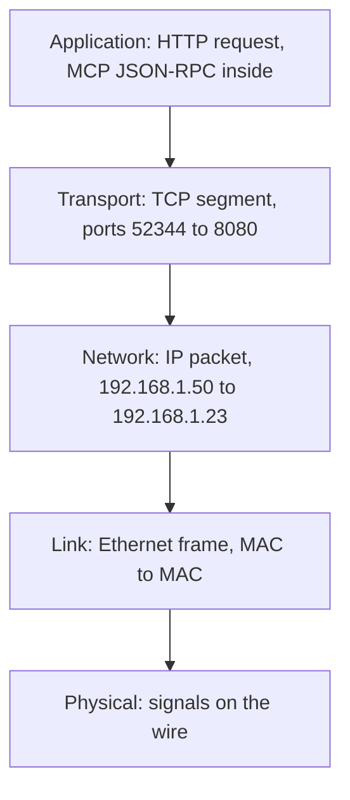
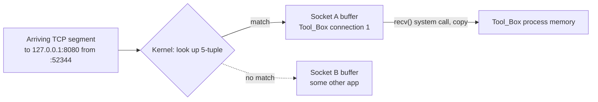
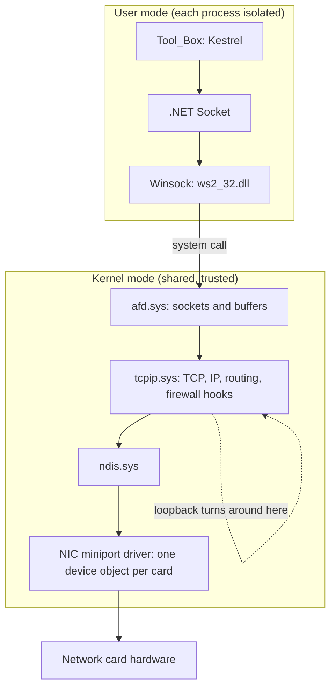
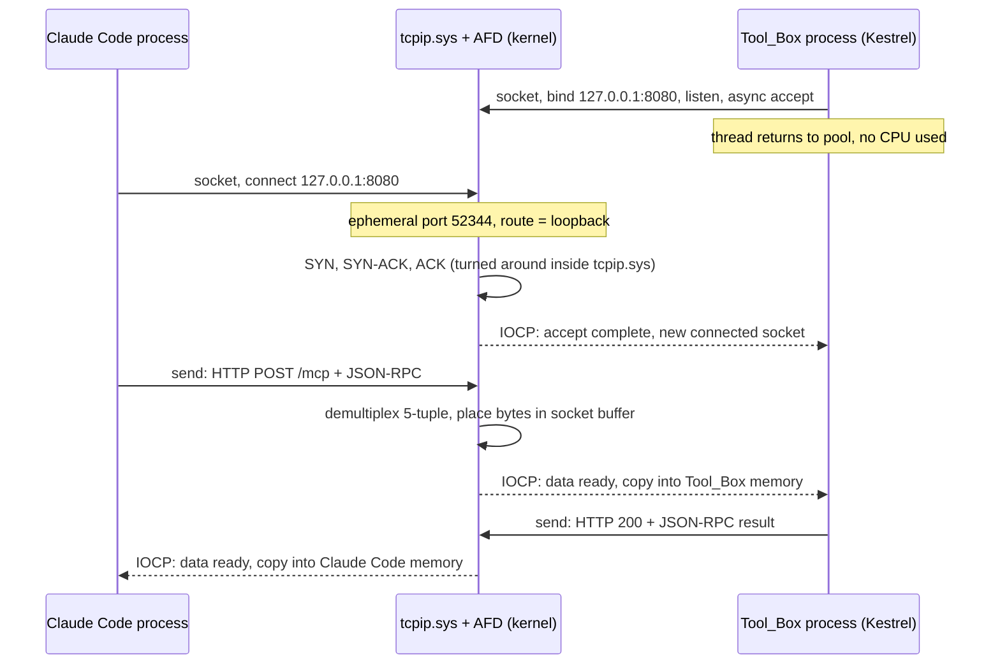
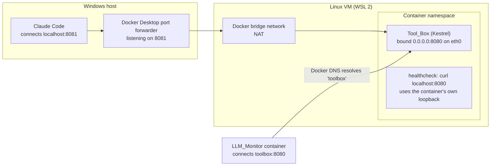

2026_11_19_19_23-(Networking From The Wire To MCP)

# Lecture 6: Networking, from the Wire to MCP

> **Why this lecture exists.** You wrote down your current understanding of networking, honestly, including the places where it fell apart as you wrote it. That's the best possible starting point. This lecture goes through each confusion, replaces it with the real model, and then traces one request from Claude Code to Tool_Box through every component of the **Windows** operating system, so the connections stop being fuzzy. It finishes with Docker networking and with how MCP sits on top of all of it.
>
> **How to read it:** sections 1–7 build the model piece by piece. Section 8 is the full Windows trace; it only makes sense once 1–7 are in place. Sections 9–11 apply the model to Docker, MCP and Tool_Box's own settings. Try the self-check at the end without looking back.

---

## 0. What you got right, and where the model broke

Before correcting anything: several of your instincts were correct.

- ✅ **"A driver is shared logic; each physical card is an instantiated device that follows that logic."** Exactly right, and it's how Windows models it (section 7).
- ✅ **"Ports are dealt with by the operating system."** Yes.
- ✅ **"The overarching goal is that individual packets get directed."** Yes, that is the problem networking solves, at several levels.
- ✅ **"Processes can't share memory; they must use system calls."** Yes, and this is the key that resolves your "shared queue" confusion.

And here's where the model broke, which is what the rest of the lecture fixes:

| What you thought | What's actually true | Section |
|---|---|---|
| An IP address identifies a device or driver | It identifies a **network interface**: an OS object representing one attachment to a network. A computer has several. | 1 |
| `eth0` is a fundamental thing | It's just Linux's **name** for an interface. Windows calls the same thing "Ethernet" or "Wi-Fi". | 1 |
| A port means a protocol (80 = HTTP) | A port identifies **which socket** on a host gets the data. Port 80 = HTTP is only a convention. | 3 |
| A socket is four numbers | A socket is an **OS object** your process holds a handle to. The four (really five) numbers identify a **connection**. | 4 |
| All incoming data sits in one queue processes drain | **Each socket has its own** kernel buffer. The kernel decides which socket's buffer each packet goes into. | 5 |
| "Localhost" and "my IP" are the same thing | Your computer has **many** IP addresses, one per interface. `127.0.0.1` belongs to a **software-only** interface called loopback. | 6 |
| Binding to `0.0.0.0` means "listening to everything" in some vague sense | It means "my socket accepts connections arriving on **any of this machine's addresses**", nothing more. | 6 |

---

## 1. Network interfaces: what an IP address belongs to

### The problem
Your computer may be connected to several networks at once: Wi-Fi at home, an Ethernet cable, a VPN, Docker's internal network. Each connection needs its own address **on that network**, the same way a person needs a separate postal address for each house they own.

### The concept
A **network interface** is the operating system's object representing **one attachment point to one network**. It has:
- a name (Windows: "Wi-Fi", "Ethernet", "vEthernet (WSL)"; Linux: `eth0`, `wlan0`; macOS: `en0`),
- a numeric index the OS uses internally,
- usually a **hardware (MAC) address** if there's real hardware behind it,
- zero or more **IP addresses** (often one IPv4 and one or more IPv6).

An **IP address identifies an interface on a network**, not a computer, not a driver, and not a device. A laptop with Wi-Fi connected and an Ethernet cable plugged in has **two** IP addresses on the outside world, plus loopback (section 6), plus any virtual ones.

### Physical vs virtual interfaces
Not every interface has hardware behind it:

| Interface | Hardware? | Example |
|---|---|---|
| Wi-Fi / Ethernet | Yes: a network card | `192.168.1.23` |
| Loopback | **No**: purely software, inside the OS | `127.0.0.1`, `::1` |
| VPN adapter | No: software that wraps packets and sends them out a real interface | `10.8.0.5` |
| Hyper-V / WSL / Docker virtual adapter | No: a virtual switch connecting to a virtual machine | `172.x.x.x` |

This is why your "IP = instantiated device" idea broke on `localhost`: loopback is an interface with **no device at all**.

### See it yourself
- **Windows:** `ipconfig /all` lists every interface with its addresses. In PowerShell, `Get-NetIPAddress` does the same.
- **macOS (yours):** `ifconfig` lists `lo0` (loopback), `en0` (Wi-Fi), and others.

---

## 2. The layers: why there are so many kinds of address

Networking is built in **layers**. Each layer solves one problem and hands the rest to the layer below. Each layer has its own kind of address, which is why there are so many.

| Layer | Problem it solves | Address | Example |
|---|---|---|---|
| **Application** | What do the bytes *mean*? | URL path, method | `POST /mcp` with JSON-RPC inside |
| **Transport** (TCP/UDP) | Which **program's socket** on that machine? Reliable, ordered delivery? | **Port** | `8080` |
| **Network** (IP) | Which **interface**, anywhere in the world? | **IP address** | `127.0.0.1`, `192.168.1.23` |
| **Link** (Ethernet/Wi-Fi) | Which **card** on this local wire or Wi-Fi? | **MAC address** | `3c:22:fb:…` |
| **Physical** | Turn bits into signals | — | Voltage, radio |



When you send, each layer **wraps** the layer above's data in its own header, like envelopes inside envelopes. When a machine receives, each layer **unwraps** one envelope, reads its address, and hands the contents upward.

**The key insight for your port confusion:** a port isn't about *meaning*. Meaning is the application layer's job. A port only answers "which socket on this machine?"

---

## 3. Ports: which socket, not which protocol

### What a port really is
A **port** is a 16-bit number (0–65535) in the **TCP or UDP header**. When a packet arrives at an interface, the OS uses the port (together with addresses, section 4) to decide **which socket** should receive the data.

The OS **never looks inside the data** to decide what protocol it is. It doesn't know or care whether the bytes are HTTP, JSON-RPC or a video stream.

### Then why is port 80 "HTTP"?
Pure **convention**, published by IANA so that clients know where to knock by default. When you type `http://example.com`, your browser connects to port 80 **because the browser assumes it**, and a web server listens on port 80 **because the admin configured it**. Nothing enforces it. You could run a web server on port 6274 (MCP Inspector does) or SSH on port 80.

So for Tool_Box:
- Port **8080** speaks HTTP **because Kestrel (the ASP.NET web server) is the program that bound it**, and Kestrel speaks HTTP.
- Port **8095** also speaks HTTP, the admin API, because Kestrel bound that too.
- Port **8090** speaks HTTP because the Voxel viewer's `HttpListener` bound it.

**The protocol is decided by the program holding the port, not by the number.** That resolves the contradiction you noticed: the port tells the OS *who* gets the data; the program decides *how to interpret* it.

### Ephemeral ports
Clients need a port too, for replies. They usually don't pick one; the OS assigns a free **ephemeral port** from a high range (on Windows, by default 49152–65535). When Claude Code connects to Tool_Box, its side might be `127.0.0.1:52344` without anyone choosing that number.

---

## 4. Sockets: the OS object, and the numbers that name a connection

### What a socket really is
A **socket** is an **object inside the operating system kernel** representing one endpoint of communication. Your process doesn't hold the socket itself; it holds a **handle** (Windows) or **file descriptor** (Unix), a small number that refers to the kernel object, like a coat-check ticket.

This is how process isolation is kept: the socket's data lives in **kernel memory**. Your process can only reach it through **system calls**, passing its handle.

### The five numbers
What you remembered as "four numbers" identifies a **connection**, and there are really five:

> **(protocol, local IP, local port, remote IP, remote port)**, e.g. `(TCP, 127.0.0.1, 8080, 127.0.0.1, 52344)`

This is called the **5-tuple**. No two TCP connections on a machine can share the same one, which is how the OS tells them apart.

### Two kinds of TCP socket
This is the piece that makes servers make sense:

1. A **listening socket** has only a local half: "TCP, any connection to `127.0.0.1:8080`". It never carries data. Its only job is to accept new connections.
2. Each accepted connection creates a **new connected socket** with the full 5-tuple. All data flows through these.

So Tool_Box has **one** listening socket on 8080 and **one connected socket per client connection**. Ten clients means ten connected sockets plus one listener, all "on port 8080", told apart by the remote half of the 5-tuple.

### The lifecycle (server side)
| Call | What it asks the OS to do |
|---|---|
| `socket()` | Create a new socket object; give me a handle |
| `bind(addr, port)` | **Claim** this local address and port for this socket. Fails if someone else has it. |
| `listen()` | Mark it as a listening socket; create a queue for incoming connections |
| `accept()` | Give me the next completed connection as a new connected socket (wait if none) |
| `recv()` / `send()` | Copy bytes out of / into the connected socket's kernel buffers |
| `close()` | Release it. The OS also does this automatically if the process dies. |

**This is what "binding" accomplishes:** it's how a program tells the OS "deliver connections for this address and port to me". Until something binds a port, the OS has nowhere to deliver; it answers a connection attempt with a refusal (TCP RST). That's what your `curl` hit when it printed nothing on `localhost:8080`: nobody had bound it.

And now Tool_Box's **port conflict check** (#37, #103) makes complete sense: it **tries to bind** first, and if the OS says "already bound by someone else" (`AddressAlreadyInUse`, on Windows `WSAEADDRINUSE`), it reports a clean error instead of crashing later.

### Clients have the same lifecycle, shorter
`socket()` → `connect(remote addr, port)` (the OS picks the local address and an ephemeral port, and performs the TCP handshake) → `send()` / `recv()` → `close()`.

---

## 5. Where the data waits: per-socket buffers, not a shared queue

You reasoned your way to "all data waits in some queue, and processes drain it", then noticed it contradicts process isolation. Your contradiction detector was right. Here's the real design:

1. **Every socket has its own receive buffer in kernel memory.** There's no shared queue that all processes can see.
2. When a packet arrives, the kernel's TCP code looks up the **5-tuple** in its table of connections and finds **exactly one** socket. This lookup is called **demultiplexing**.
3. The data is placed into **that socket's** buffer only.
4. The owning process makes a system call (`recv`), passing its handle. The kernel checks that the handle belongs to that process, then **copies** bytes from the kernel buffer into the process's own memory.



Process isolation holds: no process ever touches another socket's buffer, because only the kernel moves data, and only into the memory of the process that owns the handle.

---

## 6. Loopback, localhost, and `0.0.0.0`

### Loopback
**Loopback** is a **software-only interface** that exists on every machine. Its IPv4 address is `127.0.0.1` (in fact the whole `127.0.0.0/8` range) and its IPv6 address is `::1`. Packets sent to it **never leave the machine and never reach a network card**: the OS's network stack turns them around internally and delivers them to the matching socket on the same machine.

### localhost
`localhost` is a **name**, not an address. The OS resolves it (from its hosts file and built-in rules) to `127.0.0.1` and/or `::1`. So "connect to localhost" means "connect to the loopback interface".

### "My computer's IP" vs localhost
Your computer has **several** IP addresses, one per interface:

| Address | Interface | Who can reach it |
|---|---|---|
| `127.0.0.1` / `::1` | Loopback | **Only programs on this same machine** |
| `192.168.1.23` (example) | Wi-Fi | Anyone on your home network |
| `172.27.x.x` (example) | WSL/Hyper-V virtual adapter | The virtual machines behind it |

There's no single "IP of the computer". When someone says "my IP", they usually mean the address of the interface they're using to reach the internet.

### What binding to an address means
When a server binds, it chooses **which of the machine's addresses** it will accept connections on:

| Bind address | Accepts connections that arrived for… | Reachable from… |
|---|---|---|
| `127.0.0.1` | The loopback address only | Only this machine |
| `192.168.1.23` | The Wi-Fi address only | The home network (and this machine, if it uses that address) |
| `0.0.0.0` (the **wildcard**, "any") | **Any** IPv4 address this machine has | Every network this machine is on |
| `::` | Any IPv6 address (and often IPv4 too) | Same, for IPv6 |

So for the sentence you didn't have the base to understand, *"bind on `0.0.0.0` means we're listening to everything"*:
- **Who is listening?** One process (Kestrel inside Tool_Box), through its one listening socket.
- **Listening to what?** New TCP connections to **port 8080** that arrive on **any** of the machine's addresses. Not all traffic; only connections to that port.
- **What happens when it hears one?** The OS completes the TCP handshake and puts the connection in the listening socket's queue. Kestrel `accept`s it, gets a connected socket, reads the bytes, and parses them as HTTP.

**This is the security decision in ADR-016:** Tool_Box binds `127.0.0.1` on your desktop so that **only programs on your own machine** can reach it, and binds `0.0.0.0` only inside Docker, for a reason section 9 explains.

---

## 7. Drivers, devices and the Windows network stack

Your instinct about drivers was right. Here's how Windows actually structures it.

### Driver vs device object
- A **driver** is code: a `.sys` file loaded into the kernel once.
- For each piece of hardware it controls, the driver creates a **device object**: an instance, with its own state.

So one Intel Ethernet driver (`e1i68x64.sys`, for example) controls two identical cards by creating two device objects, exactly as you guessed.

### The Windows networking stack, top to bottom

| Layer | Component | Mode | What it does |
|---|---|---|---|
| Your program | Tool_Box (Kestrel) or Claude Code | User | Wants to send and receive bytes |
| Runtime library | .NET `System.Net.Sockets.Socket` | User | .NET's object-oriented wrapper around Winsock |
| Socket API | **Winsock** (`ws2_32.dll`, `mswsock.dll`) | User | The Windows sockets API: `socket`, `bind`, `connect`, `send`… |
| ↓ system call | `NtDeviceIoControlFile` and friends | — | **Crosses from user mode into the kernel.** The only door. |
| Socket driver | **AFD** (`afd.sys`, Ancillary Function Driver) | Kernel | The kernel side of Winsock. Owns socket objects and their buffers; handles waiting. |
| Protocol driver | **TCP/IP** (`tcpip.sys`) | Kernel | Implements IP, TCP, UDP, routing, ports, connection tables, and loopback. Also hosts the **Windows Filtering Platform** hooks used by the firewall. |
| Interface layer | **NDIS** (`ndis.sys`, Network Driver Interface Specification) | Kernel | Standard interface between protocols (above) and network-card drivers (below). |
| Card driver | **Miniport driver** (e.g. Intel or Realtek `.sys`) | Kernel | Speaks to one specific kind of network card. One device object per card. |
| Hardware | Network interface card | — | Sends and receives frames on the wire or radio |



Two things to notice:
1. **Loopback turns around inside `tcpip.sys`.** A packet to `127.0.0.1` never goes down to NDIS, the miniport driver, or any hardware. That's why loopback is fast and why it can't be reached from outside: the outside world is only connected through the bottom of the stack.
2. **The firewall lives inside the stack** (Windows Filtering Platform callouts in `tcpip.sys`). When a program first listens on a non-loopback address, Windows Defender Firewall may ask whether to allow it. Binding to `127.0.0.1` doesn't trigger that prompt, because loopback traffic never comes from another machine.

### How the program waits without burning CPU
On Windows, .NET uses **I/O completion ports (IOCP)**. Kestrel doesn't sit in a loop asking "any data yet?". It issues a request ("tell me when data arrives on this socket"), and its thread goes back to the thread pool. When data arrives, the kernel marks the request complete and posts a notification to the completion port; a thread-pool thread picks it up and runs Kestrel's next step. (Linux uses `epoll` and macOS uses `kqueue` for the same purpose.)

---

## 8. The full trace: Claude Code calls a Tool_Box tool, on Windows

Scenario: Tool_Box runs in HTTP mode on Windows, bound to `127.0.0.1:8080`. Claude Code is configured with `http://localhost:8080/mcp` and calls the `ping` tool.

### Phase A: Tool_Box starts and claims its port

1. **Tool_Box's port probe** (`PortProbe.Check`) creates a throwaway listener on `127.0.0.1:8080` and closes it, to check the port is free (#37).
2. **Kestrel creates the real socket.** .NET calls Winsock `socket()`. Winsock makes a system call into **AFD**, which creates a socket object in kernel memory and returns a **handle** to the Tool_Box process.
3. **`bind(127.0.0.1, 8080)`.** AFD passes it to **tcpip.sys**, which checks its table of bound endpoints. Free, so tcpip.sys records "`127.0.0.1:8080` belongs to this socket". (If another process had it, the call would fail with `WSAEADDRINUSE`: the error our conflict check translates.)
4. **`listen()`.** tcpip.sys marks the endpoint as listening and creates its **accept queue**.
5. **Kestrel posts an asynchronous accept** through IOCP. Its thread returns to the pool. **Nothing is using CPU now**; the request is parked in the kernel.

### Phase B: Claude Code connects (the TCP handshake)

6. Claude Code resolves `localhost` to `127.0.0.1` (and/or `::1`).
7. It creates its own socket (its own AFD object, its own handle in its own process) and calls `connect(127.0.0.1, 8080)`.
8. tcpip.sys assigns an **ephemeral port**, say **52344**, and consults the **routing table**: destination `127.0.0.1` → the loopback interface.
9. tcpip.sys builds a TCP **SYN** ("I'd like to connect") and, because the route is loopback, **turns it around internally**. It never reaches NDIS or a card.
10. On the receiving side of tcpip.sys, the SYN is for `127.0.0.1:8080`: the **listening socket** matches. tcpip.sys replies **SYN-ACK**, Claude Code's side replies **ACK**. That's the **three-way handshake**; the connection now exists, with the 5-tuple `(TCP, 127.0.0.1, 8080, 127.0.0.1, 52344)`.
11. The new connection goes into the listening socket's **accept queue**. AFD completes Kestrel's parked accept, IOCP wakes a thread-pool thread, and Kestrel receives a handle to a **new connected socket**.



### Phase C: the request travels

12. Claude Code `send`s bytes. They're just bytes to the OS, but they happen to be:
```
POST /mcp HTTP/1.1
Host: localhost:8080
Content-Type: application/json
Accept: application/json, text/event-stream

{"jsonrpc":"2.0","id":7,"method":"tools/call","params":{"name":"ping","arguments":{}}}
```
13. The system call copies them from Claude Code's memory into kernel memory. tcpip.sys wraps them in a TCP segment (ports 52344 → 8080) inside an IP packet (127.0.0.1 → 127.0.0.1), turns it around on loopback, and on arrival **demultiplexes** by 5-tuple to Tool_Box's **connected** socket (not the listening one).
14. The bytes land in that socket's kernel receive buffer. AFD completes Kestrel's pending receive, and IOCP wakes a thread. The kernel **copies** the bytes into Tool_Box's memory.

### Phase D: Tool_Box interprets the bytes (all user mode now)

15. **Kestrel parses HTTP**: method `POST`, path `/mcp`, headers including `Host: localhost:8080`. The OS's job ended at step 14; from here it's all Tool_Box code.
16. **ASP.NET middleware pipeline**, in order: plane separation (which socket is this? MCP port, not admin), then **McpGuardMiddleware** (#66). Is `localhost` an allowed Host? Yes. Is there a foreign `Origin`? No. Continue.
17. **The MCP SDK** reads the body as **JSON-RPC 2.0**: method `tools/call`, tool `ping`.
18. **The gate filter** (#32) checks that the `basics` toolset is on, then the `ping` tool runs and returns `pong`.
19. The SDK builds the JSON-RPC response with the same `id: 7`; Kestrel wraps it in an HTTP `200` response.

### Phase E: the reply goes back
20. Kestrel `send`s; the bytes go down through AFD and tcpip.sys, turn around on loopback, are demultiplexed to **Claude Code's** socket (5-tuple from its side), and IOCP wakes Claude Code, which reads the result.

**If the request had come from another computer** (Tool_Box bound to `0.0.0.0` instead): at step 9 the packet would arrive from the bottom. The card receives a frame, signals an **interrupt**, the miniport driver hands the frame to **NDIS**, NDIS hands it to **tcpip.sys**, which checks the IP header, consults the **firewall** hooks, and then demultiplexes exactly as above. Everything from step 10 up is identical.

---

## 9. Docker networking: why `0.0.0.0`, 8081 and `toolbox`

### A container has its own network stack
A container isn't a virtual computer, but the OS gives it its own **network namespace**: its own set of interfaces, its own routing table, its own port table, and **its own loopback**. Inside the container there's an `eth0` with an address like `172.18.0.2` and an `lo` with `127.0.0.1`.

**`127.0.0.1` inside the container is the container's own loopback, not your machine's.** That's why:
- Tool_Box **must** bind `0.0.0.0` inside Docker. Bound to `127.0.0.1`, it would only accept connections from inside the container, and Docker's port forwarding arrives on `eth0`, not on the container's loopback.
- The **compose healthcheck** (`curl localhost:8080` inside the container) works: it runs inside the namespace and reaches the container's loopback.
- When you ran a native host holding `127.0.0.1:8090` and the container still reported `viewer: ok` (#101): the container's 8090 is in a **different port table**, so there was no conflict inside it.

### On Windows (and macOS), there's also a virtual machine
Containers need a Linux kernel. Docker Desktop on Windows runs one inside a lightweight **virtual machine** (using WSL 2). So there are **three** network stacks involved: Windows, the Linux VM, and the container's namespace inside the VM.



### Port publishing: `8081:8080`
`ports: "8081:8080"` in `docker-compose.yml` means: "**on the host**, accept connections on port 8081 and forward them to port 8080 **in the container**". A Docker Desktop process on the host binds 8081 and relays each connection into the VM and on to the container. The two ports are numbered differently on purpose, so a native Tool_Box on 8080 and the container can run at the same time.

### Why the Host header and the port don't match
The `Host` header is **text the client writes** (section 8, step 12). Claude Code connected to `localhost:8081`, so it writes `Host: localhost:8081`, even though by the time the request arrives, Kestrel is listening on 8080. Forwarding moves bytes; it doesn't rewrite them. **That's exactly why the #66 guard matches the host name only, ignoring the port.**

### Service names: `toolbox:8080`
Containers on the same compose network can reach each other **by service name**. Docker runs a small DNS server for that network, which resolves `toolbox` to the container's internal address. LLM_Monitor's request therefore says `Host: toolbox:8080`, which is why `toolbox` is in `Security:Mcp:AllowedHosts`.

---

## 10. Where MCP sits in all of this

**MCP is an application-layer protocol.** It defines **messages**, not how they travel. The messages are **JSON-RPC 2.0**: requests with a `method` (`initialize`, `tools/list`, `tools/call`), an `id`, and `params`; responses with the same `id`; and **notifications** (no `id`, no reply expected, like `notifications/tools/list_changed`).

How those messages travel is called the **transport**. Tool_Box supports two:

### stdio: no network at all
When Claude Code starts Tool_Box as a child process, the operating system gives the child **three standard streams**: stdin, stdout and stderr. On Windows, `CreateProcess` connects them to **anonymous pipes**: kernel objects (handled by the pipe file system driver, `npfs.sys`) that carry bytes from one process to another.
- Claude Code writes JSON-RPC to Tool_Box's **stdin**.
- Tool_Box writes responses to **stdout**.
- Logs go to **stderr**, kept separate so they never corrupt the protocol.

**No sockets, no ports, no IP addresses, no network stack.** Nothing outside the two processes can connect, which is why stdio mode needs none of the Host/Origin guards. It's also why stdio can **push** `tools/list_changed` (#34): the pipe stays open for the whole session, so the server can write at any time.

### Streamable HTTP: MCP over TCP
Tool_Box listens on a TCP port (8080), and each JSON-RPC message from the client is an **HTTP POST to `/mcp`**. The response comes back either as plain JSON or as a short **SSE** (Server-Sent Events) stream. Everything in section 8 applies.

In **stateless** mode (Tool_Box's setting), each POST is independent, and there's **no long-lived channel** for the server to push on. The optional `GET /mcp` stream that stateful servers offer isn't mapped, which is the `405` you saw when MCP Inspector tried it (#34's spike). So HTTP clients learn about tool changes by asking (`tools/list`), not by being told.

### Why MCP over HTTP needs the guards
A **web browser** can also send HTTP to `localhost`. A malicious page can use **DNS rebinding** to make its own name resolve to `127.0.0.1`, so the browser connects to Tool_Box while believing it's talking to `evil.example`. The **network** can't tell the difference (it's a normal loopback connection). Only the **application layer** can: the browser still writes `Host: evil.example` and `Origin: http://evil.example`. That's why the defence (#66) lives in **middleware**, after HTTP parsing: it's the first layer that can see those headers.

| Transport | Uses network stack? | Who can reach it? | Server can push? | Guards needed |
|---|---|---|---|---|
| stdio | No (pipes) | Only the parent process | Yes | None |
| HTTP on `127.0.0.1` | Yes, loopback only | Programs on this machine, **including browsers** | Not in stateless mode | Host + Origin checks |
| HTTP on `0.0.0.0` (Docker) | Yes, all interfaces | Anything that can reach the published port | Not in stateless mode | Host allowlist + Origin checks |

---

## 11. Tool_Box's network settings, decoded

Every setting you've been testing, explained with this lecture's vocabulary:

| Setting or behaviour | What it means at the network level | Why |
|---|---|---|
| MCP on `127.0.0.1:8080` (desktop) | One listening socket, loopback interface only | Only local programs can connect (ADR-016) |
| Admin on `127.0.0.1:8095` | A **separate** listening socket, so a separate port | Control plane kept apart from the data plane (ADR-019) |
| Viewer on `127.0.0.1:8090` | A third socket, via `HttpListener` | The voxel web view |
| Docker binds `0.0.0.0` | Accept on the container's `eth0` | Docker's forwarding arrives there, not on the container's loopback |
| `8081:8080` | A host-side forwarder on 8081 relays into the container's 8080 | Lets native and Docker Tool_Box coexist |
| Port pre-flight probe | Try `bind`; `AddressAlreadyInUse` = someone else owns it | Clear error (exit 3) instead of a crash (#37) |
| Wildcard probe also checks loopback | macOS lets a wildcard socket and a `127.0.0.1` socket share a port; then the more specific one wins incoming loopback connections | Catch that case (#103) |
| Host guard returns `421` | Header text names a host we don't serve | Defeats DNS rebinding (#66) |
| Origin guard returns `403` | A browser page from another site is calling | Spec-required second check (#66) |
| `kill -9` releases the instance lock | The OS closes every handle a dead process owned, sockets and files alike | Why OS-held locks can't go stale (#38) |

One Windows-specific note for when Tool_Box runs there: the Voxel viewer uses `HttpListener`, which on Windows is built on **HTTP.sys**, a **kernel-mode** HTTP server shared by many programs (including IIS). Kestrel, by contrast, uses ordinary sockets. HTTP.sys can share one port between several programs by URL path, and it can require a URL reservation. So port conflicts for the viewer can look different on Windows than on macOS or Linux. That's one more reason the cross-platform CI matrix (#104) is worth having.

---

## 12. Try it on your Mac

You can watch everything in this lecture with commands you already have. (Windows equivalents in brackets.)

**See your interfaces and their addresses**: find `lo0` (loopback, `127.0.0.1`) and `en0` (Wi-Fi, a `192.168.x.x`-style address).
```
ifconfig
```
[Windows: `ipconfig /all`]

**See the routing table**: which interface each destination goes out of.
```
netstat -rn
```
[Windows: `route print`]

Then start Tool_Box in HTTP mode in one terminal:
```
TOOLBOX_TRANSPORT=http TOOLBOX_Desired__Path=/tmp/tb/desired-state.json dotnet run --project src/ToolBox.Host
```
**See its listening sockets**: you should find `127.0.0.1:8080`, `127.0.0.1:8095` and `127.0.0.1:8090`, each marked `LISTEN`, all owned by the same process ID.
```
lsof -nP -iTCP -sTCP:LISTEN | grep -E "8080|8090|8095"
```
[Windows PowerShell: `Get-NetTCPConnection -State Listen -LocalPort 8080,8090,8095`]

**Watch a connection's 5-tuple appear**: keep a connection open for 10 seconds in the background, then look.
```
curl -s --max-time 10 http://127.0.0.1:8080/mcp -H "Accept: text/event-stream" > /dev/null &
lsof -nP -iTCP:8080
```
You'll see the listener (`LISTEN`) **and** a connected pair (`ESTABLISHED`): Tool_Box's side `127.0.0.1:8080->127.0.0.1:5xxxx` and curl's side the other way round. That's section 4's "one listening socket plus one connected socket per client", live. Press Ctrl+C in the first terminal when done.

---

## 13. Check yourself

Answer before opening the answers.

1. What does an IP address identify, precisely? Name three interfaces your Mac has.
2. Tool_Box listens on 8080 and speaks HTTP. What would change if you configured it to listen on port 22 instead?
3. Ten clients are connected to Tool_Box's port 8080. How many sockets does Tool_Box hold, and how does the OS tell the connections apart?
4. Two processes are both running. A packet arrives for `127.0.0.1:8095`. How does the kernel decide which process gets the data, and why can't the other process read it?
5. Why does a request to `127.0.0.1` never reach your network card?
6. Inside a container, Tool_Box is bound to `127.0.0.1:8080`. You publish `8081:8080` and connect from your Mac. What happens, and why?
7. Claude Code connects through `localhost:8081` to a container listening on 8080. What `Host` header does Tool_Box see, and what does that mean for the guard?
8. Why does stdio MCP need no Host/Origin guard?
9. On Windows, what is the only way a user-mode program's bytes get into the network stack? Name the user-mode library and the kernel driver on either side of that boundary.
10. `kill -9` stops Tool_Box. What happens to its listening socket, and why can the next start bind 8080 again?

<details>
<summary>Answers</summary>

1. A **network interface**: one attachment to one network. On a Mac: `lo0` (loopback), `en0` (Wi-Fi), and usually others such as `utun` (VPN-style) or bridge interfaces.
2. Nothing about HTTP. Clients would connect to port 22 and still get HTTP. SSH clients connecting to 22 would get confusing replies, because the **program** decides the protocol, not the port number. (On some systems, ports below 1024 also need administrator rights to bind.)
3. **Eleven**: one listening socket plus ten connected sockets. The OS distinguishes them by the **5-tuple**: the remote IP and port differ for each client.
4. The kernel (`tcpip.sys` on Windows) matches the 5-tuple to exactly one socket and puts the data in **that socket's** kernel buffer. Only the process holding that socket's **handle** can read it, through a system call, and the kernel copies the data into that process's memory only.
5. The routing table sends `127.0.0.1` to the **loopback interface**, which is software inside the network stack. On Windows, the packet turns around inside `tcpip.sys` and never reaches NDIS, the miniport driver or the hardware.
6. The connection fails. Docker forwards the connection into the container through its `eth0` interface, but Tool_Box only accepts connections on the **container's own** loopback. That's why Docker mode binds `0.0.0.0`.
7. `Host: localhost:8081`: the client wrote what **it** connected to; forwarding doesn't rewrite bytes. So the guard must match the **host name only**, ignoring the port, or it would reject every Docker client.
8. stdio uses **pipes** between a parent and a child process. There's no socket and no port, so no browser or other program can connect. Only the process that started Tool_Box can talk to it.
9. Through a **system call**. On the user side, **Winsock** (`ws2_32.dll`); on the kernel side, **AFD** (`afd.sys`), which hands the work to `tcpip.sys`.
10. When a process dies, the OS closes **every handle it owned**, including the listening socket, so `127.0.0.1:8080` is released and the next start can bind it. (The same mechanism releases the instance lock file from #38.)

</details>

---

## Where to go next

If you want to go deeper on the operating-system side, the best single source for Windows internals is *Windows Internals* by Pavel Yosifovich, Mark Russinovich, David Solomon and Alex Ionescu: the I/O system chapter covers drivers, device objects, IRPs and completion ports, and the networking material covers AFD, `tcpip.sys` and NDIS. For networking itself, any introduction to TCP/IP covers the layers in sections 2–6 in more depth. Both are very relevant to a software engineering role at Microsoft.
