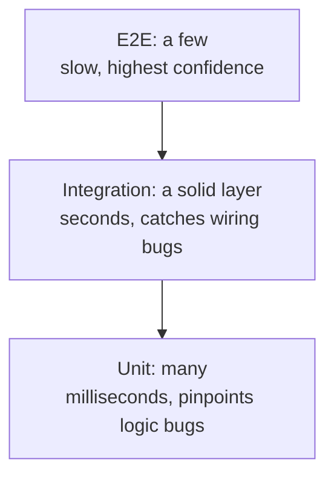

2026_11_23_20_20-(Testing Levels Unit Integration E2E)

# Lecture 7: Testing Levels: Unit, Integration and End-to-End

> **What this lecture covers:** what unit, integration and end-to-end tests are, what each one can and can't prove, and how to decide where a test belongs. Every example comes from Tool_Box's own test suite, because you already have all three kinds; they just aren't labelled. It ends with what an end-to-end test for Tool_Box would look like, in code and in CI, and a self-check.

---

## 1. Why tests come in levels at all

A test answers one question: **"if this passes, what do I now know is true?"**

A test that runs one function with fake inputs proves that function's logic is right. It proves nothing about whether the function is ever called, whether the web server is wired to it, or whether the Docker image even starts. A test that starts the whole program and talks to it like a user proves the program works, but when it fails, it can't tell you where.

So tests trade off five things against each other:

| Property | What it means |
|---|---|
| **Confidence** | How close the test is to what a real user experiences |
| **Speed** | How long it takes, which decides how often you can run it |
| **Determinism** | Whether it gives the same answer every run (no flakiness) |
| **Diagnosability** | When it fails, how quickly you know *what* broke |
| **Cost** | How hard it is to write and keep working as the code changes |

No single kind of test wins on all five. The levels exist because **each level is the best trade-off for a different question.**

---

## 2. The three levels

### Unit tests
**What's real:** one class or function. **What's faked:** everything it talks to.

Tool_Box examples:
- `HostOriginPolicyTests`: is `evil.example` rejected? Is `localhost.` normalised? No server, no sockets; just the policy object.
- `PortProbeTests`: does the probe report a conflict? (It binds a real socket, so it's on the boundary, but it tests one class.)
- Most of `ToolsetReconcilerTests`: does the reconciler start the right toolsets, using a `FakeLifecycle` instead of real Voxel?

**Strengths:** milliseconds each; you can run hundreds on every save; a failure points at one function. **Weakness:** they can all pass while the program is broken, because the bug is in how the pieces are connected.

### Integration tests
**What's real:** several real parts working together: a real web server, real sockets, the real MCP SDK, the real file system. **What's faked:** the outside world (no real users, no Docker, no other machines).

Tool_Box examples:
- `McpGuardTests`, `AdminAuthTests`, `PlaneSeparationTests`: start **real Kestrel** on **real loopback sockets** and send **real HTTP** with forged headers. They prove the middleware is actually registered, in the right order, on the right port: things no unit test of the guard class could show.
- `SdkFilterSeamTests` and `ToolListChangedStdioTests`: your code plus the **real MCP SDK**, connected through a real pipe. They proved the SDK's filter seam works the way the design assumed.
- `LiveReconcile_FileEditChangesToolsList`: the real `FileSystemWatcher` and the real clock. It's the deliberate exception to "no real time in tests", because the operating system's file watcher **is** the thing under test.

**Strengths:** catch wiring and configuration bugs, still fast enough to run on every PR. **Weakness:** slower, and failures can come from any of the parts involved.

### End-to-end (E2E) tests
**What's real:** the whole system, **as a user runs it**: the real program (or container), started the real way, driven only through its outside interface by a real client. **What's faked:** nothing, or almost nothing.

Tool_Box examples:
- `StdioGateTests` and `ToolListChangedChildProcessTests`: they **launch the real `ToolBox.Host` program as a separate process** and talk to it only through MCP over stdio, exactly as Claude Code does. They know nothing about its internals. That's why `ToolListChangedChildProcessTests` was the only test that could prove `Program.cs` registers the notifier: your mutation check removed that line, and only this test noticed.
- `ViewerFailSoftEndToEndTests`: a real host started while port 8090 is genuinely taken.

**Strengths:** the highest confidence; they test the thing users actually run. **Weaknesses:** slowest (starting processes takes seconds), most likely to be flaky (real timing, real ports), and a failure says "something is wrong" without saying where.

### The fourth kind you've been doing: manual E2E
Every check you ran by hand was an end-to-end test: Docker plus `curl` for `421` and `403`, MCP Inspector in a browser, `kill -9` then restart, the background-mode exit codes. They found real bugs the automated tests couldn't:
- the Docker container crashing because it couldn't write the admin token under `/app`;
- `ToolBox.Embedded.csproj` missing from the Dockerfile;
- the macOS port-probe miss (#103).

Manual tests are the right tool for **exploring** something new. They're the wrong tool for **repeating** the same check every release, because humans skip steps when tired (you saw the rubber-stamp problem in Workflow v2). **Rule of thumb: the second time you run the same manual check, consider automating it.**

---

## 3. The shape: pyramid (and why it isn't a law)



The classic advice is the **test pyramid**: many unit tests, fewer integration tests, very few E2E tests. The reasoning: cover every detail at the cheapest level that can catch it, and use the expensive levels only for what cheaper ones **can't** see.

Some teams prefer a "trophy" shape with more integration tests than unit tests, because for web services most real bugs are in the wiring. Both views agree on the principle, which matters more than the shape: **test each behaviour at the lowest level that can actually prove it.**

How to decide for one behaviour:

| Question | If yes → |
|---|---|
| Is it pure logic inside one class (parsing, a policy, a calculation)? | **Unit** |
| Does it depend on parts being connected correctly (middleware order, DI registration, the SDK calling your filter)? | **Integration** |
| Does it depend on how the program is started, packaged or run (command-line flags, exit codes, Docker, a real client)? | **E2E** |
| Is it new, and are you still discovering how it behaves? | **Manual first**, then automate |

Examples from Tool_Box:
- "A forged Host is rejected by the policy" → unit (`HostOriginPolicyTests`).
- "A forged Host on the MCP **port** gets 421, but the admin port isn't affected" → integration (`McpGuardTests`), because it depends on which middleware runs on which socket.
- "A forged Host against the **published Docker image** gets 421" → E2E, because it depends on the Dockerfile, the compose file and the environment variables. **Nothing automated checks this today.**

---

## 4. The tools that make tests trustworthy

Week after week, the same techniques showed up in Tool_Box's tests. They're worth naming, because they apply at every level.

### Test doubles: fakes, stubs and mocks
A **test double** stands in for a real dependency.
- A **fake** is a simple working implementation (`FakeLifecycle` records "start:voxel" in a list).
- A **stub** returns canned answers.
- A **mock** also checks how it was called.

Tool_Box mostly uses fakes, which are usually easier to read than mocks.

### Seams
A **seam** is a place where a test can swap a real part for a double without changing production behaviour: an interface (`IToolsetLifecycle`), a constructor parameter, a `TimeProvider`. In #102, you **chose not to** add a broad seam to `ToolBoxHttpApp.cs` just for a test, and tested `StopAsync` directly instead. That's the trade-off: seams make testing easier but add surface to production code, so add them only for a real need.

### Determinism: signals, not sleeps
A test that does `Task.Delay(200)` and hopes the work finished is **guessing**. On a slow CI machine it fails; on a fast one it may pass without proving anything. #63 replaced those with **signals**:
- a `TaskCompletionSource` that the code completes when the event happens, awaited with a timeout (`WaitAsync(10s)`);
- a fake `TimeProvider` (`ManualClock`) so debounce timers advance on command;
- `Eventually(...)`: poll for a condition, with a deadline.

**Proving that something didn't happen** is the hardest case. The trick from #34 and #63: cause a second, real event afterwards and wait for it (a **sentinel**). If the count is exactly what you expect when the sentinel arrives, the earlier non-event really didn't happen.

### Isolation
Tests must not share state, or they'll fail depending on the order they run in. Tool_Box's tests use:
- **port 0**: the OS picks a free port, so parallel tests never collide;
- **temp directories** for the desired-state file, token and instance lock (`AdminTokenIsolation`);
- one app per test.

The flaky lock test in #38 is the cautionary tale: two processes held the lock, the test waited for only one, and it failed on CI some of the time.

### Mutation checking
How do you know a test actually tests something? **Break the code on purpose and check that the test fails.** You did this twice: removing the write lock (the concurrency test failed 3/3 times) and commenting out the notifier registration (the child-process test failed after 60 s). A test that still passes with the feature removed is decoration. Tools exist that do this automatically (Stryker.NET for C#); doing it by hand for important tests is a great habit.

### Characterization tests
Tests that record **what a library actually does**, not what you wish it did: the #34 spike tests pinning SDK 1.4.1's behaviour. When you upgrade the SDK (#77), they tell you exactly what changed.

---

## 5. What's missing in Tool_Box

Compare your test levels with your manual checks:

| Behaviour | Covered by | Gap |
|---|---|---|
| Guard logic | Unit | — |
| Guard on the right port | Integration | — |
| **Guard in the published Docker image** | Manual only | ❌ |
| **Image starts and reports the right version** | Manual only | ❌ (and `main` publishes images with no tests) |
| Stdio gate, list_changed through the real program | E2E | — |
| **Background mode as the GUI will use it** (host.json, token, toggle, shutdown, exit codes) | Partly integration, rest manual | ❌ |
| macOS / Windows behaviour | Manual only | ❌ (#104 will fix) |

The gaps all share one feature: **they depend on how Tool_Box is packaged and started**, which only E2E tests can see. And they're exactly the checks you've repeated by hand.

---

## 6. What a Tool_Box E2E test looks like

### A. The background-host contract test (C#)

This tests the **outside interface** S2's GUI will depend on. It's written from the outside only: it starts the program, reads files, and makes HTTP and MCP calls. It never touches internal classes.

> The sketch below shows the shape and the reasoning. It isn't compiled; the real version would use the project's existing helpers.

```csharp
[Fact]
[Trait("Category", "E2E")]               // lets CI run E2E tests as a separate step
public async Task Background_host_contract_as_the_GUI_will_use_it()
{
    // Isolation: own temp folder, OS-chosen ports.
    string dir = TempDir.Create();
    var env = new Dictionary<string, string>
    {
        ["TOOLBOX_Instance__Dir"]     = dir,
        ["TOOLBOX_Admin__TokenPath"]  = Path.Combine(dir, "admin-token"),
        ["TOOLBOX_Desired__Path"]     = Path.Combine(dir, "desired-state.json"),
        ["TOOLBOX_Ports__Mcp__Port"]   = "0",
        ["TOOLBOX_Ports__Admin__Port"] = "0",
        ["TOOLBOX_Ports__Viewer__Port"] = "0",
    };

    // 1. Start the REAL program, the way a user would.
    using var host = HostProcess.Start("--mode background", env);

    // 2. Discovery: wait for host.json (a signal, not a sleep), with a deadline.
    HostInfo info = await HostInfoFile.WaitForAsync(dir, TimeSpan.FromSeconds(30));

    // 3. A real MCP client lists tools.
    await using var mcp = await ConnectMcp(info.McpUrl);
    Assert.Contains(await ToolNames(mcp), n => n == "place_block");

    // 4. The admin API, authenticated with the token from its file.
    var admin = AdminClient(info.AdminUrl, File.ReadAllText(env["TOOLBOX_Admin__TokenPath"]));
    Assert.Equal(202, await admin.PutEnabled("voxel", false));

    // 5. The change becomes visible through MCP (polling with a deadline: the reconcile is async).
    await Eventually(async () => !(await ToolNames(mcp)).Contains("place_block"));

    // 6. Graceful stop, and the exit code is part of the contract.
    Assert.Equal(202, await admin.PostShutdown());
    Assert.Equal(0, await host.WaitForExitAsync(TimeSpan.FromSeconds(30)));
    Assert.False(File.Exists(Path.Combine(dir, "host.json")));
}
```

Notice what makes it trustworthy:
- **Black box:** only things the GUI can see. If an internal class is renamed, this test doesn't care; if the GUI's view breaks, it fails.
- **Every wait is a signal with a deadline** (the file appearing, `Eventually`, the process exiting). There are no sleeps.
- **Fully isolated:** temp folder, port 0, its own token. It can run beside every other test.
- **Exit codes are asserted:** they're part of the interface, as the background-mode ADR says.

### B. The Docker smoke test (CI)

This is your release-night manual check, automated. It belongs in `ci.yml` (your hand edit, since the Claude app can't change workflows):

```yaml
  docker-smoke:
    runs-on: ubuntu-latest
    steps:
      - uses: actions/checkout@v4
      - name: Start the stack and wait until healthy
        run: docker compose up -d --build --wait
      - name: Health reports ok
        run: curl -fsS http://localhost:8081/health | grep '"status":"ok"'
      - name: Forged Host is rejected (421)
        run: test "$(curl -s -o /dev/null -w '%{http_code}' -H 'Host: evil.example' http://localhost:8081/mcp)" = "421"
      - name: Foreign Origin is rejected (403)
        run: test "$(curl -s -o /dev/null -w '%{http_code}' -H 'Origin: http://evil.example' http://localhost:8081/mcp)" = "403"
      - name: Logs if anything failed
        if: failure()
        run: docker compose logs
      - name: Stop
        if: always()
        run: docker compose down
```

Details worth noticing:
- **`--wait`** makes compose wait until the container's healthcheck passes: the "wait for a signal, not a sleep" rule, done by Docker. (That's what your first release-night check was missing: `curl` ran before the server was up and printed nothing.)
- **`curl -f`** makes curl fail on an error status, and `test … = "421"` fails the step if the code is wrong. A CI step must **fail loudly**; printing a wrong number and carrying on would be another blank output that looks like a pass.
- **`if: failure()`** dumps the container logs only when something broke, so you can diagnose it.
- **`if: always()`** cleans up even after a failure.

Once it's reliable, add `docker-smoke` to the required checks in the `next-gate` and `main-gate` rulesets. Then **no image can be published that fails its own smoke test.**

---

## 7. Flaky tests: the cost of realism

A **flaky** test sometimes passes and sometimes fails without any code change. The higher the level, the more ways a test can be flaky: real time, real ports, process start-up, machine load.

Flaky tests are worse than no tests, because they teach everyone to ignore red CI, and then real failures get ignored too. How to keep E2E tests honest:

1. **Never sleep; wait for a signal with a deadline** (section 4).
2. **Generous deadlines, fast exits.** A 60 s deadline that exits at the first success costs nothing when things work, and only bounds the failure case (the `LiveReconcile` test does this).
3. **Isolate everything**: temp folders, port 0, no shared files.
4. **Print diagnostics on failure**: captured stderr, container logs.
5. **When a test flakes, treat it as a bug**, as you did with the lock test in #38. Find the race; don't just re-run CI until it goes green.

---

## 8. When to run which

| Tests | When | Why |
|---|---|---|
| Unit | Locally on every change, and in CI on every PR | Fast enough to never skip |
| Integration | CI on every PR | Seconds; catch wiring bugs before merge |
| E2E (in-process / child-process) | CI on every PR | Still under a minute for Tool_Box's scale |
| Docker smoke | CI on every PR to `next` and `main` | It's the last check before an image is published |
| Cross-platform matrix (#104) | CI, non-required at first | Find OS-specific behaviour without blocking merges |
| Manual exploration | New features and acceptance passes | Discover what you didn't think to automate |

Large companies sometimes run slow E2E suites only nightly, because they take hours. Tool_Box's are short, and your Actions minutes are free (public repo), so running them on every PR is the better choice: you find out **before** the merge.

---

## 9. Check yourself

1. A test starts real Kestrel and sends a request with `Host: evil.example`. Is it a unit, integration or E2E test? What can it prove that `HostOriginPolicyTests` can't?
2. Why was `ToolListChangedChildProcessTests` the only test able to catch a missing registration in `Program.cs`?
3. Name two bugs in this project that only manual end-to-end checks found. Why couldn't the existing automated tests catch them?
4. What makes a test "flaky", and why is a flaky test worse than no test?
5. You want to prove the reconciler does **not** start a pinned toolset. Why is `Task.Delay(200)` followed by an assertion a bad test, and what's the better pattern?
6. In the Docker smoke job, what does `--wait` replace, and why does each check use `test … = "421"` instead of just printing the status code?
7. You change an internal class name inside the Host. Which kind of test should keep passing, and why is that a feature?
8. How do you check that a test actually tests something?

<details>
<summary>Answers</summary>

1. Integration. It proves the guard is actually **registered and running on the MCP port** of a real server, in the right order relative to other middleware. The unit test only proves the policy's logic.
2. Because it starts the **real program** through its real entry point (`Program.cs`) and observes it only from outside. Every other test built the services itself, so a missing registration in `Program.cs` never affected them.
3. Any two of: the container crashing on the admin-token path under `/app`; `ToolBox.Embedded.csproj` missing from the Dockerfile restore step; the macOS wildcard-vs-loopback port probe miss. The automated tests never built or ran the Docker image, and CI only ran on Linux.
4. It passes or fails without any code change (timing, shared state, ports, machine load). It's worse than nothing because it trains people to ignore red CI, so real failures get ignored too.
5. The delay can't tell "the reconcile ran and did nothing" from "the reconcile hasn't run yet", so it can pass without proving anything. Better: make a second, real change and wait for its observable effect (a sentinel); since the loop is serial, the earlier run must have finished, and a monotonic counter proves nothing was started.
6. It replaces a fixed `sleep`: compose waits until the container's healthcheck passes. `test … = "421"` makes the step **fail** when the code is wrong; just printing it would let a wrong result look like a pass, like the blank `curl` output on release night.
7. The **E2E** tests (and ideally the integration ones), because they only use the outside interface. Tests that survive internal refactoring let you restructure code freely while still guarding what users and clients depend on.
8. **Mutation check:** break the code the test is supposed to protect (remove the line, flip the condition) and confirm the test fails. Then restore it.

</details>

---

## Where this goes next

The issue you're about to open (E2E smoke tests: Docker image and background-host contract) turns sections 6A and 6B into real tests. After that, S2's GUI will have its own testing questions (Avalonia supports "headless" tests that drive the UI without a screen), and the same principle will apply: test each behaviour at the lowest level that can actually prove it.
