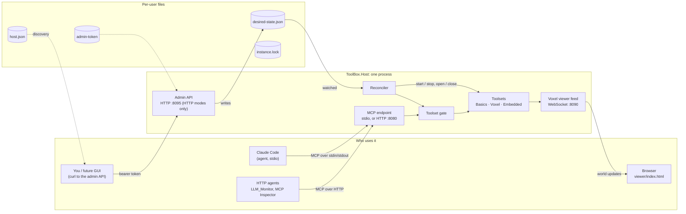
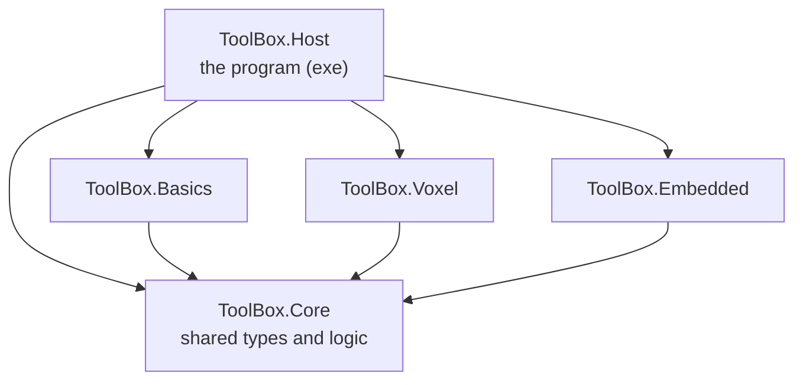
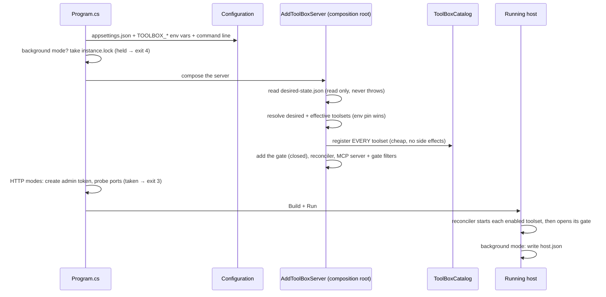
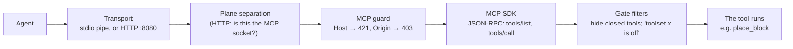
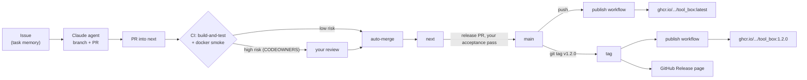
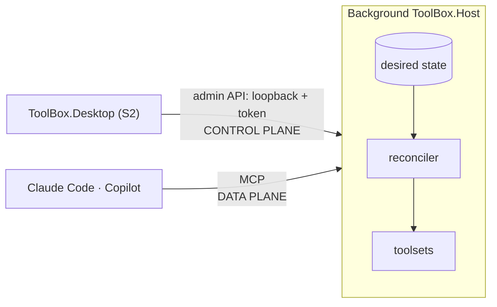

2026_11_25_16_15-(The Whole System Tool_Box Architecture)

# Lecture 8: The Whole System: Tool_Box's Architecture as of v1.2.0

> **Why this lecture exists.** The project grew fast: a reconciler, an admin API, two security guards, a background mode, Docker images, a new workflow. Each piece made sense when it was built, but it's easy to lose the picture of how they fit together. This lecture is that picture: **what Tool_Box is, what runs, how the parts talk, why each part is shaped the way it is, how it's built and shipped, and how people use it.**
>
> It describes the code on `main` at **v1.2.0** (commit `387b18c`). Each "why" points to the ADR in `docs/DECISIONS.md` that records it, so you can go deeper on any piece.
>
> **How to read it:** sections 1–3 are the big picture. 4–8 are how it works at runtime. 9–10 are how it's built and shipped. 11 is how people use it. 12 collects the reasons. 13 lists what's stale or missing. Use the diagrams as a map and come back to them.

---

## 1. What Tool_Box is, in one paragraph

AI agents like Claude Code can do more when they can call **tools**: functions that read information or act in the world. **MCP** (Model Context Protocol) is the standard way an agent discovers and calls tools. **Tool_Box is an MCP server that hosts groups of tools, called toolsets**, and lets you turn each toolset on and off while it runs. Today it has three toolsets: **Basics** (ping, server info, time), **Voxel** (build 3D block structures you can watch live in a browser) and **Embedded** (build microcontroller firmware). The long-term goal (epic #23, "v2") is a **"Docker Desktop for MCP tools"**: a background service plus a desktop GUI where you see your toolsets, switch them on and off, and connect them to your agents.

---

## 2. The big picture



Four ideas carry the whole design. Hold on to them; every later section is one of them in detail.

1. **One process, several doors.** The Host is a single program. Agents come in through the **MCP door** (the data plane). People and the future GUI come in through the **admin door** (the control plane). The browser viewer has its **own door**. Each door is a separate port with its own rules.
2. **Desired vs actual.** You say what you *want* (the desired-state file, written through the admin API). A **reconciler** continuously makes reality match: it starts and stops toolsets and opens and closes the gate.
3. **Everything registered, only some visible.** Every toolset's code is loaded at startup. The **gate** decides which tools agents can see and call.
4. **Loopback by default.** On your machine, every door listens only on `127.0.0.1`, so only programs on your own computer can reach it. Docker is the one deliberate exception, and it's guarded.

---

## 3. The code: projects and the one dependency rule



| Project | What lives there |
|---|---|
| **ToolBox.Host** | The program itself: `Program.cs` (entry point, run modes), `ToolBoxServerComposition` (the composition root), `ToolBoxCatalog` (the **only** list of toolsets), the HTTP app, the admin API, both guards, the reconciler **service**, ports, background mode |
| **ToolBox.Core** | Everything shared and toolset-agnostic: catalog types, `IToolsetLifecycle`, the reconciler **logic** and gate, the desired-state model and store, the admin token store, the instance lock and `host.json`, the port probe |
| **ToolBox.Basics / Voxel / Embedded** | One toolset each. Each exposes a `CatalogEntry` and an `Add<Name>Toolset()` method, plus its tools and (optionally) a lifecycle |

**The rule (ADR-003): Core knows no toolset.** Only the Host references toolset projects. So adding a toolset (S5 will add `ToolBox.Rag`) means: write the project, add one line to `ToolBoxCatalog`. Nothing in Core changes. This is the **dependency inversion** idea from your seams lecture: the stable core defines interfaces (`IToolsetLifecycle`), and the plug-ins implement them.

Other folders worth knowing: `viewer/` (the browser page for Voxel), `firmware/` (sample firmware the Embedded toolset builds), `docs/` (architecture, ADRs, workflow, tool catalog), `Documentation/` (the older plans, brainstorms, and the agent-written lectures).

---

## 4. Four ways to run it

The same program runs in four shapes, chosen at startup. This table is the key to most of the configuration you've seen.

| Run shape | How it starts | Who starts it | Doors open | Admin API | Instance lock | Typical use |
|---|---|---|---|---|---|---|
| **stdio** (default) | `dotnet ToolBox.Host.dll` | An agent (Claude Code) launches it as a child process | stdin/stdout only, plus viewer :8090 | No | No | One agent, private connection |
| **HTTP** | `--transport http` | You | MCP :8080, admin :8095, viewer :8090 | Yes | No | Development, testing, several clients |
| **Background** | `--mode background` | You (later: the OS, S6) | Same as HTTP | Yes | **Yes** (exit 4 if already running) + `host.json` | The long-lived service the GUI will talk to (ADR-024) |
| **Docker** | `docker compose up` or `docker run` | You, or another project's compose | MCP :8080 inside (published as 8081), viewer :8090 | Inside the container only | No | Packaged deployment, LLM_Monitor |

Why these differences:
- **stdio has no ports at all** (lecture 006): the agent and Tool_Box talk through pipes, so there's nothing for a browser or another program to reach. That's why stdio needs no guards, and why it can **push** `tools/list_changed` notifications (ADR-022).
- **Background mode is HTTP plus single-instance guarantees** (a "run profile", not a new transport), because the GUI needs exactly one host per user, which it can find and stop (ADR-024).
- **Docker binds `0.0.0.0` inside the container**, because the container's own loopback can't be reached through published ports (ADR-016), and the MCP guard makes that safe (ADR-021).

---

## 5. Startup: how Tool_Box decides what it is



### Where "enabled" comes from: five layers, later wins

| Layer | Example | Who sets it |
|---|---|---|
| 1. Code default | `basics, voxel` | The code |
| 2. `appsettings.json` | `Toolsets:Enabled` | The developer |
| 3. **Desired-state file** | `{"voxel": {"enabled": false}}` | **The user**, through the admin API (later the GUI) |
| 4. `TOOLBOX_TOOLSETS` env var | `basics` | An operator **pinning** the roster; it overrides the file |
| 5. Test overrides | — | Tests |

Layers 1–3 give the **desired** set (what the user wants). All five give the **effective** set (what will run). When they differ, the toolset is reported as **pinned** (`pinnedBy`), so a GUI can show its switch as locked. This came from #31 and ADR-017.

### Why "register everything, gate the visibility" (ADR-018)
.NET's dependency-injection container is **frozen** once the app is built: you can't add services later. But toolsets must turn on and off while running. The solution: **register every toolset at startup** (registration does nothing expensive and starts nothing), and let the reconciler **start** toolsets and the **gate** control what agents see. ADR-015's original "never register disabled toolsets" was replaced by this.

---

## 6. Runtime: two planes

### The data plane: an agent calls a tool



- **`tools/list`** returns only tools whose toolset gate is open.
- **`tools/call`** on a closed toolset returns a clear error ("toolset 'voxel' is off") instead of crashing. A stale agent that cached an old list gets a helpful answer.
- Over stdio, the guards don't apply (there's no HTTP), but the gate does.

### The control plane: you turn a toolset off

```mermaid
sequenceDiagram
    participant U as You (curl) / future GUI
    participant A as Admin API :8095
    participant F as desired-state.json
    participant R as Reconciler
    participant G as Gate
    participant V as Voxel lifecycle
    participant N as Notifier
    U->>A: PUT /api/v1/toolsets/voxel/enabled {"enabled": false} + bearer token
    A->>A: plane check, Host/Origin check, token check (401 if wrong)
    A->>F: under the write lock: load, change, save atomically
    A->>R: request reconcile
    A-->>U: 202 Accepted (desired = false; actual will follow)
    R->>F: re-read, resolve with env pins
    R->>G: close voxel
    R->>V: stop (viewer closes port 8090, world persisted)
    R->>N: open set changed → notify
    N-->>N: stdio: send tools/list_changed · HTTP: no-op (pull-only)
```

Key ideas, each with its reason:
- **`202 Accepted`, not `200 OK`** (ADR-020): the admin API records your **intent** and returns immediately; the reconciler does the actual work a moment later. `GET /api/v1/toolsets` shows `desired`, `effective` and `actual` separately, so you can watch reality catch up.
- **One write lock** (ADR-020): two simultaneous PUTs can't overwrite each other (the "lost update" problem; you saw the test fail 3/3 times with the lock removed).
- **Atomic save** (ADR-017): write a temp file, then rename, so a crash never leaves a half-written file.
- **The file is also watched**, with a 300 ms debounce, so a hand edit works too. The admin API is the only supported writer.
- **Notification on a diff**: the notifier fires once per reconcile pass, only if the set of open toolsets actually changed (ADR-022).
- **Agents can't reach the control plane at all** (v2 decision 7): letting an agent switch its own tools on is a prompt-injection risk. The admin API is a separate socket the MCP door can't route to.

### This is the reconciler pattern
"Declare the desired state; a loop drives the actual state toward it" is how Kubernetes works, and how Docker Desktop's settings behave. It's robust because it **retries**: if a toolset fails to start, it's reported as `failed`, the others keep running (ADR-018's fail-open addendum), and the next reconcile can try again.

---

## 7. The security model

There's no login for agents on the MCP door; that's a deliberate, documented choice (ADR-008, ADR-011). Instead, security comes from **where the doors are and who can reach them**:

| Layer | What it stops | Where |
|---|---|---|
| **Loopback binds** | Other machines on your network | All doors, desktop (ADR-016) |
| **Admin port refuses non-loopback** | Exposing the control plane even by misconfiguration | Admin startup |
| **Plane separation by socket port** | MCP clients reaching `/api/v1`, or admin clients reaching `/mcp` | Middleware; decided by the real socket, never the `Host` header, which the client controls (ADR-019) |
| **Admin bearer token** | Other local programs and users changing your settings | 32 random bytes, file mode `0600`, constant-time comparison, rotatable (ADR-019) |
| **MCP Host/Origin guard** | Web pages in your browser using DNS rebinding | `421` for a foreign Host, `403` for a foreign Origin (ADR-021; CVE-2026-11624 as the cautionary example) |
| **Gate + decision 7** | Agents enabling tools for themselves | No control-plane route on the MCP door |
| **Embedded physical-action gate** | Firmware tools touching real hardware without consent | Inside the Embedded toolset |
| **Non-root container** | A compromised process owning the container | `USER $APP_UID` in the Dockerfile |

What's **not** protected, on purpose: any program running as **you** on your machine can call MCP tools on 8080. On a single-user desktop that's accepted; it's the same trust level as anything else you run.

---

## 8. Files on disk

| File | Location (macOS) | Written by | Read by | Lifetime |
|---|---|---|---|---|
| `desired-state.json` | `~/Library/Application Support/ToolBox/` | Admin API only (atomic) | Host at startup + on change | Permanent: your intent |
| `admin-token` | same folder | Host on first HTTP start; `/token/rotate` | Admin API; you, the future GUI | Permanent until rotated; `0600` |
| `host.json` | same folder | Background host at start | GUI/CLI to find the host | Deleted on clean exit; a **hint**, verified with `/health` |
| `instance.lock` | same folder | Background host holds it open | The OS (the lock is the open handle) | Released by the OS when the process ends, even on `kill -9` |

(Windows: `%LOCALAPPDATA%\ToolBox\`. Linux: `~/.local/share/ToolBox/`. Docker: the token goes to `/tmp/toolbox/`, and the desired-state file is skipped unless you mount a volume.)

---

## 9. Health and failure: fail fast or degrade

Tool_Box decides, per problem, whether to **stop** or **keep going and say so**:

| Problem | Behaviour | Why |
|---|---|---|
| MCP or admin port taken | **Exit 3** with one clear line naming the port and config key | Without these doors the host is useless (ADR-016) |
| Already running (background) | **Exit 4**, printing the running pid and URLs | One host per user (ADR-024) |
| Bad transport/mode combination | **Exit 2** | A configuration mistake to fix now |
| Viewer port 8090 taken | **Keep running**; `/health` says `degraded`, `components.viewer = unavailable: port 8090 in use` | The viewer is optional; MCP tools still work (#101) |
| A toolset fails to start | That toolset is `failed`; the others run | Fail-open per toolset (ADR-018) |
| Corrupt desired-state file | Use defaults; `/health` reports `components.desiredState` | Never brick the host over a settings file |

`/health` (on the MCP door) returns `status`, `components`, `version`, the running toolsets, and per-toolset `desired/effective/actual`. It always answers HTTP 200 while the process is alive, so Docker's healthcheck keeps passing in a degraded state; the JSON says what's wrong.

**Exit codes are an interface:** scripts, Docker and the future GUI read them to tell failures apart.

---

## 10. How it's built, tested and shipped



### Branches
- **`main`**: released and always working; your résumé link. Changes only through a release PR.
- **`next`**: integration. Protected by the `next-gate` ruleset (PR required, CI required, up to date, code-owner review for high-risk paths, no bypass).
- **`claude/issue-…`**: one branch per agent run.

### The workflow (ADR-013, ADR-023)
Each task is a GitHub **issue** that holds its own memory (discussion, plan, session notes). You **shape** it (stages 1–2), approve with an owner comment starting `APPROVED`, and the agent implements, opens a PR, and arms auto-merge. **Risk tiers** are enforced by `CODEOWNERS` and the ruleset: low-risk PRs merge themselves after CI; high-risk ones (workflows, guards, auth, `Program.cs`, ports, Docker files, versions) wait for your review. One Claude run at a time, with kill switches.

### CI (`ci.yml`, on every push and PR)
- **`build-and-test`**: restore, build with warnings as errors, run all ~400 tests (unit, integration and E2E-style; lecture 007). It installs the real ARM compiler so the Embedded build tools are tested against the real thing.
- **`docker`**: builds the image, **runs it, and polls `/health` until healthy**, so "the container boots" is checked on every PR. (Correction to lecture 007: there *is* an automated Docker smoke test. What it doesn't check yet is the version, the guards, or a real MCP call; that's what the E2E smoke issue would add.)

### Packaging: the Docker image
Two-stage `Dockerfile`: the .NET **SDK** image restores and publishes (project files copied first for layer caching); the small **ASP.NET runtime** image receives only the published output, installs `curl` for the healthcheck, sets HTTP transport, `0.0.0.0` binds and the token path, and runs as a **non-root** user.

### Publishing (`docker_image_release.yml`)
- Push to `main` → image tagged **`:latest`**.
- Push of a `v*.*.*` tag → image tagged with the version, **`:1.2.0`**.
- Built for **`linux/amd64` and `linux/arm64`** (one manifest list), with build **attestations**, pushed to **GHCR** with GitHub's short-lived token.

### Releases so far
| Version | What | |
|---|---|---|
| `v1.0.0`–`v1.0.2` | v1: stdio + HTTP, Voxel, LLM_Monitor integration | Archived as tag `v1.0.2` (ADR-014) |
| `v1.1.0` | S0: toolsets from a catalog + configuration | M2 |
| `v1.2.0` | S1: desired state, reconciler, admin API, guards, background mode | M3 |

---

## 11. How people use it

### As a Claude Code user (stdio)
Register the built program once; Claude Code starts it when needed:
```
claude mcp add toolbox -- dotnet /absolute/path/to/Tool_Box/src/ToolBox.Host/bin/Release/net10.0/ToolBox.Host.dll
```
Then in Claude Code, ask it to build something with the Voxel tools, and open `viewer/index.html` in a browser to watch it appear.

### From Docker (no .NET needed)
```
docker run -p 8081:8080 -p 8090:8090 ghcr.io/timothy-lee-grant/tool_box:1.2.0
```
MCP is at `http://localhost:8081/mcp`. Connect MCP Inspector, or register it with Claude Code over HTTP:
```
claude mcp add --transport http toolbox http://localhost:8081/mcp
```

### From another project (LLM_Monitor)
Add Tool_Box as a service in that project's compose file, with **no published ports**, so only containers on the same network can reach it, and list the service name in `Security:Mcp:AllowedHosts`. The agent connects to `http://toolbox:8080/mcp` (see `docs/LLM_MONITOR_INTEGRATION.md`).

### As a long-running local service (background mode)
Start it once (`--mode background`), point agents at `http://127.0.0.1:8080/mcp`, and manage it through the admin API with the token: list toolsets, switch them on and off, change settings, shut it down. **Today that's `curl`; S2's GUI will do exactly these calls behind buttons.**

### Tomorrow (the roadmap)
| Phase | Adds |
|---|---|
| **S2** | **ToolBox.Desktop**, an Avalonia GUI: finds the host via `host.json`, uses the admin API with the token, shows desired vs actual, toggles toolsets |
| S3 | A Voxel page in the GUI, "View world", the world persisted across off/on |
| S4 | Registering Tool_Box with agents (VS Code Copilot first) |
| S5 | **ToolBox.Rag**: a retrieval toolset (SQLite + sqlite-vec, ONNX embeddings) |
| S6 | Installers, start with the OS, v2.0 |



Notice that S1 already built everything the GUI needs on the host side. S2 is a **new client**, not a change to the server. That's why the planned background-host contract test (lecture 007) matters: it pins exactly the interface the GUI will depend on.

---

## 12. Why it's shaped this way: the decisions, grouped

| Theme | Decision | ADR |
|---|---|---|
| **Foundation** | C# with the official MCP SDK; .NET 10 | 001, 006 |
| | stdio first, then HTTP; one binary, both transports | 002, 007 |
| | Host / Core / Toolsets layout; Core knows no toolset | 003 |
| | Logs go to stderr (stdout is reserved for the protocol) | 004 |
| **Toolsets** | Toolsets register through extension methods | 005 |
| | Composed from a catalog + configuration | 015 (partly replaced by 018) |
| | Registration is cheap; startup is gated | 018 |
| | Toolsets may run background services (as lifecycles) | 010 |
| | Voxel world is one shared singleton | 009 |
| **Runtime state** | Desired-state file, layered under the env pin | 017 |
| | Admin writes: 202, problem codes, one write lock | 020 |
| | list_changed: stdio push, HTTP pull-only | 022 |
| | Background mode: run profile, OS lock, verified hint, graceful stop | 024 |
| **Networking & security** | HTTP posture: unauthenticated, isolated | 008, 011 |
| | Viewer port independent of MCP | 012 |
| | Loopback by default; ports fail fast; viewer degrades | 016 |
| | Admin API: second listener, by socket, bearer token | 019 |
| | MCP Host/Origin guard against DNS rebinding | 021 |
| **Process** | Issue-driven AI workflow | 013 |
| | v1 archived as a tag; v2 evolves in place | 014 |
| | Supervised autonomy: risk tiers, auto-merge into `next` | 023 |

When you wonder "why is it like this?", find the theme, then read the ADR: each one records the context, the decision, and the consequences, including what was rejected.

---

## 13. What's stale or missing (found while writing this)

Writing an overview is a good audit. These are worth small issues:

1. **`docs/ARCHITECTURE.md` is partly out of date.** Its header still says "State as of v1.1.0 (S0 complete)", and the roadmap row for S1 still says the admin API, port table and background mode "remain". The body sections are current.
2. **`README.md` Quickstart says "77 tests, four projects".** It's now around 400 tests in five projects.
3. **Two agent lectures are both numbered 016** in `Documentation/Learning/`.
4. **Lecture 007 overstated a gap:** CI already boots the Docker image and checks `/health` (section 10). The real gap is narrower: version, guards and a real MCP call.
5. **Embedded vs decision 4:** the v2 decisions say "Embedded is out of the first version", while the toolset exists (off by default). Worth stating clearly in the docs what "out" means.

A single low-risk docs issue could fix 1–3 and 5, and the E2E smoke issue covers 4.

---

## 14. Check yourself

1. Name the three "doors" of a running HTTP-mode host, their ports, and who each one is for.
2. Why does stdio mode need no Host/Origin guard, and why can only stdio push `tools/list_changed`?
3. You `PUT` Voxel to disabled and get `202`, but `tools/list` still shows `place_block` for a moment. Is that a bug? What's happening?
4. Why does Tool_Box register **every** toolset at startup, even disabled ones?
5. `TOOLBOX_TOOLSETS=basics` is set and you enable Voxel through the admin API. What happens, and how would a GUI know?
6. Which problems make Tool_Box exit, and which make it keep running in a degraded state? What's the principle?
7. What does merging into `main` publish, and what does pushing the tag `v1.2.0` publish?
8. Why can't an agent enable a toolset for itself?
9. Which files does the GUI need to read to talk to a background host, and which one must it never trust without checking?
10. Adding the RAG toolset in S5: which projects change?

<details>
<summary>Answers</summary>

1. MCP on 8080 (agents: the data plane), the admin API on 8095 (you and the future GUI: the control plane), and the Voxel viewer on 8090 (the browser).
2. stdio uses pipes between a parent and child process: no socket, so no browser or other program can connect. It can push because the pipe stays open for the whole session; stateless HTTP has no channel that outlives a request (ADR-022).
3. Not a bug. `202` means the intent was saved; the reconciler applies it a moment later. `GET /api/v1/toolsets/voxel` would show `desired: false` with `actual` catching up. HTTP clients see the change on their next `tools/list`.
4. The DI container is frozen after the app is built, so services can't be added later. Registering everything cheaply and gating visibility is what makes runtime on/off possible (ADR-018).
5. The env var pins the roster, so the admin API answers `409 pinned-by-env` and Voxel stays off. The toolset reports `pinnedBy`, so a GUI can show the switch as locked.
6. Exit: required ports taken (3), already running (4), bad mode/transport (2). Degrade: viewer port taken, a toolset failing, a corrupt settings file. The principle: fail fast when the host would be useless; keep going and report it when only an optional part is affected.
7. Merging into `main` publishes `ghcr.io/timothy-lee-grant/tool_box:latest`; pushing `v1.2.0` publishes `:1.2.0`. Both are multi-architecture (amd64 + arm64).
8. The control plane is a separate socket that the MCP door can't route to (plane separation), and it needs the admin token. This is v2 decision 7, against prompt injection.
9. `host.json` (where the host is) and `admin-token` (the credential). `host.json` is only a hint: the GUI must verify it with `/health`, because a crash can leave it stale.
10. A new `ToolBox.Rag` project, plus one entry in the Host's `ToolBoxCatalog` (and the project reference). Core doesn't change (ADR-003).

</details>
