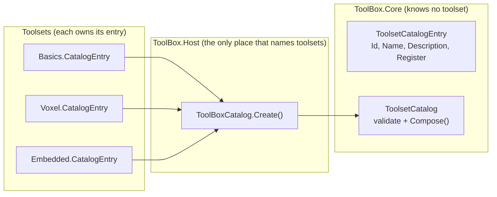
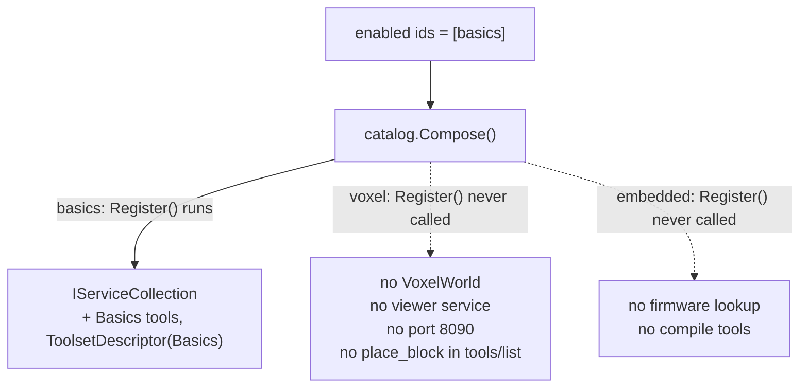
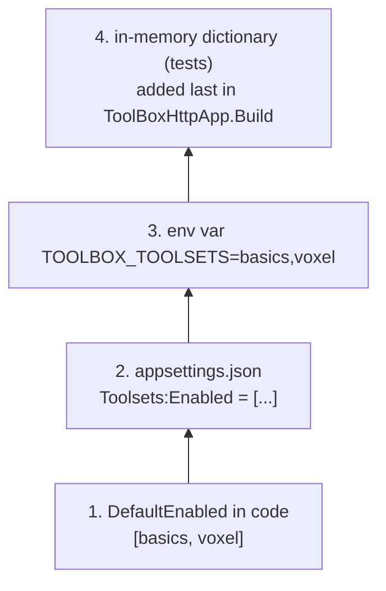
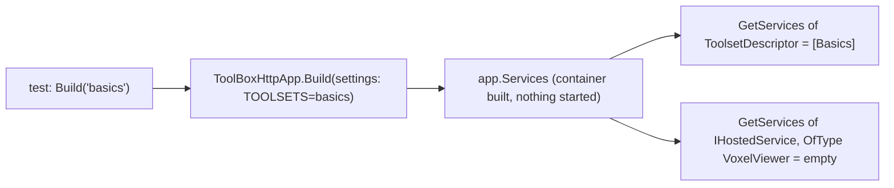
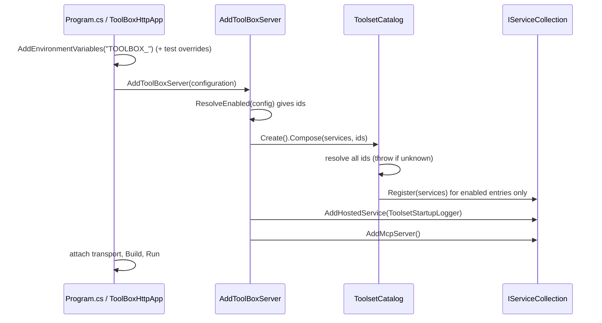

2026_11_08_04_41-(Choosing-What-Exists)

# Lecture 011 — Choosing What Exists: Catalogs, Configuration Layers, and Testing the Container

Issue #24 (S0) changed one sentence in the server's life. Before: "the server has Basics and Voxel, because the code says so." After: "the server has whatever the catalog offers and the configuration enables." That sounds like a small refactor. It touches six ideas you will meet again at work: the registry pattern, layered configuration, conditional registration, the composition root, testing a dependency-injection container, and fail-fast validation. This lecture teaches each from the real code that landed in PRs #25, #26 and #27.

The one idea to hold onto: **a thing that is never registered cannot misbehave.** Everything else is machinery for deciding, cleanly, what gets registered.

---

# Part 1 — The problem: a roster fixed at compile time

Before S0, `ToolBoxServerComposition` hard-coded the roster (ADR-015's Context quotes it): `.AddBasicsToolset().AddVoxelToolset()`. Two pressures broke that:

1. The Embedded toolset existed but could not be on by default (it needs firmware paths and can touch hardware).
2. The future GUI (S1/S2) needs to toggle toolsets, so "which toolsets" has to be *data*, not a chain of method calls.

There was a constraint too. ADR-003 says Core never references a toolset, and Core must stay free of the MCP package. So the solution cannot be "put a list of toolsets in Core."

---

# Part 2 — The catalog pattern: data plus a delegate

Open `src/ToolBox.Core/ToolsetCatalogEntry.cs`:

```csharp
public sealed record ToolsetCatalogEntry(
    string Id,
    string Name,
    string Description,
    Action<IServiceCollection> Register);
```

An entry is **three strings and a function**. `Register` is a *delegate* (`Action<IServiceCollection>`): a value that holds "code to run later." The catalog stores the function without running it. That deferral is the whole trick.

`Register` takes `IServiceCollection` (the plain DI container builder from `Microsoft.Extensions.DependencyInjection`), not `IMcpServerBuilder`. `IMcpServerBuilder` lives in the MCP package. Taking the plain type keeps Core MCP-free, which is ADR-003 paid for in a parameter type.

Each toolset owns its own entry, next to its existing doorway. From `src/ToolSets/ToolBox.Voxel/VoxelToolsetExtensions.cs`:

```csharp
public static ToolsetCatalogEntry CatalogEntry { get; } = new(
    Id: "voxel",
    Name: "Voxel",
    Description: "A live-buildable voxel world with shape primitives and a browser viewer.",
    Register: services => services.AddMcpServer().AddVoxelToolset());
```

The lambda `services => services.AddMcpServer().AddVoxelToolset()` is the delegate. It calls the toolset's existing `AddVoxelToolset()` (the ADR-005 doorway), which is *refined, not replaced*. Basics and Embedded have the same shape.

The Host holds the only list. `src/ToolBox.Host/ToolBoxCatalog.cs`:

```csharp
public static ToolsetCatalog Create() => new(
[
    BasicsToolsetExtensions.CatalogEntry,
    VoxelToolsetExtensions.CatalogEntry,
    EmbeddedToolsetExtensions.CatalogEntry,
]);
```

Adding a toolset is now one project reference plus one line here.

## Catalog versus plugin loading

You could instead scan a folder for DLLs, load them with reflection, and let anything announce itself. That is *plugin loading*. ADR-003 says: no dynamic plugin loader until two real toolsets exist and the need is proven. A catalog is its small static cousin: the list is compiled in, type-checked, and easy to debug (F12 on `CatalogEntry`). Plugin loading buys "add a toolset without recompiling the Host," which nobody needs yet, and costs assembly-loading complexity, versioning headaches, and security questions. "Separate early, abstract late" is the rule: start with data and a delegate.



Dependencies point inward: toolsets and Host reference Core; Core references nobody.

---

# Part 3 — What `ToolsetCatalog` does, and fail-fast validation

`src/ToolBox.Core/ToolsetCatalog.cs` has two jobs.

**Job 1: reject bad catalogs at construction.** The constructor throws on a null entry, a blank id, a null `Register`, or a duplicate id (`_entries.TryAdd` returning false). The dictionary uses `StringComparer.OrdinalIgnoreCase`, so `"Voxel"` and `"voxel"` are the same id.

**Job 2: `Compose`.**

```csharp
if (!_entries.TryGetValue(id?.Trim() ?? string.Empty, out var entry))
{
    throw new InvalidOperationException(
        $"unknown toolset id '{id}'. Valid ids: {string.Join(", ", _entries.Values.Select(e => e.Id))}.");
}
```

Notice the order: it first loops over every requested id and *resolves* them all into a `selected` list, and only then loops again to call `entry.Register(services)`. A typo in the third id throws before the first toolset has been registered, so nothing is half-composed.

This is **fail-fast**: when input is wrong, stop at startup with a message that says how to fix it, rather than carrying on and failing mysteriously later. Silently ignoring `"voxle"` would give you a server that starts happily with no Voxel tools, and you would debug it for twenty minutes. `Program.cs` does the same for transports (`Unknown transport 'x'. Valid values: stdio, http.`, exit code 2). The message lists valid ids because whoever reads it at 2am should not need the source.

Two quieter rules: ids are trimmed and case-insensitive, and a repeated id is registered once (`if (!selected.Contains(entry))`).

---

# Part 4 — Conditional registration: "never registered = never exists"

There are two ways to make a toolset "off."

| Approach | How | Cost |
|---|---|---|
| Runtime branching | Register everything; each tool or service checks a flag and refuses or hides | The code and its side effects still exist |
| Conditional registration | Do not call `Register` at all | Nothing exists |

The plan rejected the first, and ADR-015 records why. Embedded's `AddEmbeddedToolset` does a firmware-path lookup that throws when the repo root is missing. If everything were registered and then filtered, that lookup would run on every machine that merely *has* the Embedded assembly. Likewise the Voxel viewer is a hosted service (ADR-010) that binds port 8090 when the host starts. A "disabled" Voxel that still bound a port would not be disabled.



Mental model: DI is a shopping list. Hosted services, tools and descriptors are items on it, and the host is built from the list. An item not on the list has no code path, no memory, no port, and nothing to audit. That is why the off switch is "the delegate is never invoked," not "a boolean the tools read."

---

# Part 5 — Idempotent `AddMcpServer()`

Each entry's `Register` calls `services.AddMcpServer()` before adding its toolset. With Basics and Voxel both enabled, `AddMcpServer()` runs at least three times (once per entry, plus once at the end of `ToolBoxServerComposition`). That is only safe if the call is **idempotent**: N calls have the same effect as one.

You do not assume that; you prove it. `tests/ToolBox.Basics.Tests/CatalogEntryTests.cs`:

```csharp
services.AddMcpServer();
services.AddMcpServer();
BasicsToolsetExtensions.CatalogEntry.Register(services);

using var sp = services.BuildServiceProvider();
Assert.NotNull(sp.GetService<ToolsetDescriptor>());
```

The comment above it calls this "Risk 1 from the plan." A risk listed in the plan became a test, which is how risks should end.

The call sits inside each entry so a toolset can register itself without relying on someone else having called `AddMcpServer()` first. The final `return services.AddMcpServer();` in the composition guarantees a builder for the transport to attach to even when *zero* toolsets are enabled.

---

# Part 6 — The composition root

A **composition root** is the single place in a program where the object graph is assembled: where concrete types are chosen and wired. Everything else just receives things. ADR-003 calls the Host a "thin composition root." `src/ToolBox.Host/ToolBoxServerComposition.cs`:

```csharp
services.AddToolBoxCore();

var enabled = ToolBoxCatalog.ResolveEnabled(configuration);
ToolBoxCatalog.Create().Compose(services, enabled);

var ids = enabled.Select(e => e.ToLowerInvariant()).Distinct().ToArray();
services.AddHostedService(sp => new ToolsetStartupLogger(
    ids, sp.GetRequiredService<ILogger<ToolsetStartupLogger>>()));

return services.AddMcpServer();
```

Read it as: shared plumbing, decide what is enabled, compose it, log what we did, hand back a builder. Both transports call `AddToolBoxServer(builder.Configuration)`: `RunStdioAsync` in `Program.cs` and `ToolBoxHttpApp.Build`. So there is one definition of the server and two ways to attach a wire to it, which is why TOOL_CATALOG.md can say the wire is "a deployment decision, never a capability decision."

Why only the Host may name toolsets: if Core knew `VoxelToolsetExtensions`, every project using Core would transitively pull in Voxel, and you could no longer build a Basics-only server. The arrow points one way.

`ToolsetStartupLogger` is a small `IHostedService` that logs `Enabled toolsets: basics, voxel` through `ILogger`, not `Console.WriteLine`, because ADR-004 reserves stdout for the stdio JSON-RPC protocol. One stray stdout line would corrupt the protocol stream. It receives the *ids that were composed*, so it reports reality.

---

# Part 7 — Configuration layering and precedence

.NET configuration is a stack of **providers**. Each provider (JSON file, environment variables, command line, in-memory dictionary) contributes key/value pairs. Providers are added in order; for the same key, **the last one added wins**. Keys are flat strings with `:` as the hierarchy separator, so `Toolsets:Enabled:0` means "section Toolsets, child Enabled, element 0."

The precedence for the toolset list, from `ToolBoxCatalog.ResolveEnabled`'s doc comment:

```
code default  <  appsettings "Toolsets:Enabled"  <  TOOLBOX_TOOLSETS  <  in-memory / test overrides
(lowest)                                                                        (highest)
```



## Default in code, override in config

`DefaultEnabled = ["basics", "voxel"]` lives in code; appsettings and env vars override it. Why not put the default only in `appsettings.json`? If the file is not found (`Program.cs` has a comment about clients launching the DLL from an arbitrary working directory), the server must still behave sensibly. The code default is a floor that can never be absent; config *adjusts* it. With nothing configured, behaviour is identical to the pre-catalog server, which was the "no behaviour change by default" requirement.

## Why a separate comma-separated key

You might expect to override the JSON list with `Toolsets__Enabled__0=basics`. Two facts explain why that is a trap.

1. Environment variable names cannot portably contain `:`, so .NET maps `__` (double underscore) to `:`. `Toolsets__Enabled__0` becomes `Toolsets:Enabled:0`. Also, `AddEnvironmentVariables(prefix: "TOOLBOX_")` strips the prefix, so `TOOLBOX_TOOLSETS` arrives as the key `TOOLSETS`. That is the `EnvKey = "TOOLSETS"` constant.
2. An array is, to the config system, just numbered keys (`:0`, `:1`, ...), and providers **merge by key**. If appsettings has `["basics", "voxel"]` (keys `:0`, `:1`) and an env var sets `Toolsets__Enabled__0=embedded`, the merged result is `["embedded", "voxel"]`: index 0 replaced, index 1 left over. You cannot say "replace the whole list" or "shrink it" this way. The comment in `ToolBoxCatalog` says so: "array config merges by index, so an env var could only partially override the JSON list."

A scalar string does not merge. `TOOLBOX_TOOLSETS=basics` replaces the whole thing, so a separate key with a comma-separated value gives the operator clean "replace" semantics (and matches the existing `TOOLBOX_TRANSPORT` style):

```csharp
string? csv = configuration[EnvKey];
if (csv is not null)
{
    return Split(csv);
}
```

Notice that `ResolveEnabled` checks the CSV key first, then the section, then the default. The *providers* layer each key; the *if-chain* encodes precedence between the two different keys. Be able to say which mechanism is responsible for what.

## `null` versus empty

`if (csv is not null)` is deliberate. `TOOLBOX_TOOLSETS=` (set but empty) gives `""`, not null, so `Split` returns an empty array and nothing is enabled. Nothing set at all gives null and falls through to the defaults. "Absent" and "present but empty" are different messages from the operator, and the code honours both. The test `EmptyValue_EnablesNothing` pins it. `Split` uses `RemoveEmptyEntries | TrimEntries`, so `"basics, voxel"` and `"basics,,voxel"` both work.

---

# Part 8 — Testing the container instead of the network

`tests/ToolBox.Host.Tests/ToolsetSelectionTests.cs` proves a claim that sounds hard to prove: *a disabled toolset is absent, not merely hidden.* Most tests never start anything. They `Build()` the app and inspect the container:

```csharp
private static bool HasViewer(WebApplication app) =>
    app.Services.GetServices<IHostedService>().OfType<VoxelViewerBroadcastService>().Any();
```

`app.Services` is the built `IServiceProvider`. `GetServices<IHostedService>()` returns every registered hosted service, and `OfType<...>().Any()` asks whether the viewer is among them. Building only constructs the container; hosted services start on `StartAsync`, which these tests do not call. So no port is bound, and the tests are fast and parallel-safe. The companion `ToolsetNames(app)` reads the `ToolsetDescriptor` each enabled toolset registers.



One test does go end to end: `BasicsOnly_ToolsListHasNoVoxelTools_AndHealthListsOnlyBasics` starts the app, connects a real MCP client, and asserts `ping` is listed while `place_block` and `clear` are not, and that `/health` mentions Basics but not Voxel. It is safe because Voxel is off, so no viewer port is bound. Rule of thumb: prove the cheap structural claim in-process, and prove the user-visible claim once over the wire.

How do tests choose configuration? `ToolBoxHttpApp.Build` takes a `settings` dictionary and adds it with `AddInMemoryCollection` **last** ("Added last so tests can override everything, env vars included"). That is layer 4, and it is why a CI machine's own environment cannot change a test result. Tests use `ToolBoxCatalog.EnvKey` rather than a copy of the string `"TOOLSETS"`, so renaming the constant cannot silently decouple test and code.

`UnknownId_ThrowsListingValidIds` wraps `Build` in `Assert.Throws`: fail-fast exercised while the container is being composed, before any server exists. It asserts the message contains `nope` and every valid id, because the message is part of the feature.

`ResolveEnabled_Precedence_DefaultThenAppsettingsThenCsv` builds three tiny `ConfigurationBuilder`s with no files. `ResolveEnabled` takes an `IConfiguration` parameter instead of reading the environment itself, and that injected input is what makes it testable.

---

# Part 9 — xUnit collections and fixed ports

xUnit runs test **classes** in parallel by default; tests inside one class run sequentially. Usually fine. But the Voxel viewer binds a *fixed* port (8090, falling back to 8091-8093, ADR-012), and two parallel classes that both start Voxel would fight over it.

Compare the MCP endpoint, where tests pass `http://127.0.0.1:0`: port 0 means "OS, pick any free port," so those never collide. A fixed port cannot use that trick, so the fix is to serialise the classes. `tests/ToolBox.Host.Tests/VoxelViewerCollection.cs`:

```csharp
[CollectionDefinition(Name, DisableParallelization = true)]
public sealed class VoxelViewerCollection
{
    public const string Name = "VoxelViewer";
}
```

Every class that starts Voxel adds `[Collection(VoxelViewerCollection.Name)]` (`HttpTransportTests`, `ToolsetSelectionTests`). Classes in one collection never run concurrently, and `DisableParallelization = true` also keeps them from overlapping other collections. The empty class is just a label to hang the attribute on. The collection is per class, not per test, which is why `ToolsetSelectionTests` joins it even though only some of its tests start the app. It is a test-side fix for a production-side constraint.

---

# Part 10 — One version number: `Directory.Build.props`

`Directory.Build.props` at the repo root is picked up automatically by MSBuild for every `.csproj` beneath it. S0 added one line:

```xml
<Version>1.1.0</Version>
```

`Version` is the single source of truth, and the build turns it into the assembly version. Assembly versions have four parts (`major.minor.build.revision`), so `1.1.0` becomes `1.1.0.0`. `ServerInfoProvider` reports the assembly version and `/health` serves it, which is why the endpoint shows `1.1.0.0`. You verified this in Docker: the running container's number matched the one in a single file.

Why central and not per-project? The file's own comment: a csproj value "would silently override this file, defeating the point of central enforcement." Same reason `TargetFramework` and `TreatWarningsAsErrors` live there. Why 1.0 to 1.1? Semantic versioning: new backwards-compatible capability, same default behaviour.

---

# Part 11 — How it fits together



---

# Self-check questions

1. `ToolsetCatalogEntry.Register` is an `Action<IServiceCollection>`. What would break in ADR-003 if it were an `Action<IMcpServerBuilder>`?
2. Why does `Compose` resolve every id before calling any `Register`? What would the container look like otherwise when given `"basics,nope"`?
3. Someone proposes: "Register all three toolsets and have each tool return an error when disabled." Name two things in this repo that would still happen. (Hint: a port, and a path lookup.)
4. appsettings has `["basics", "voxel"]` and an operator sets `Toolsets__Enabled__0=embedded`. What list results, and why does `TOOLBOX_TOOLSETS` not have this problem?
5. What is the difference between `TOOLBOX_TOOLSETS` unset and `TOOLBOX_TOOLSETS=`? Which line of `ResolveEnabled` makes the difference?
6. Why does the code default live in `ToolBoxCatalog` rather than only in `appsettings.json`?
7. `HasViewer` passes without starting the app. Why is that valid proof a disabled Voxel is absent, and what does the end-to-end test prove that it does not?
8. Why does `ToolsetSelectionTests` join `VoxelViewerCollection` while the MCP endpoint needs no such treatment?
9. `/health` shows `1.1.0.0` but `Directory.Build.props` says `1.1.0`. Where does the extra `.0` come from?
10. You add a fourth toolset, Robotics. Which files must you touch, and which must you not touch (hint: Core)?

# Look up next

- Microsoft docs, "Configuration in .NET" (provider order, `__` mapping, array binding).
- "Composition Root" (Mark Seemann, *Dependency Injection: Principles, Practices, and Patterns*).
- xUnit docs, "Running tests in parallel" (collections).
- Semantic Versioning 2.0.0.
