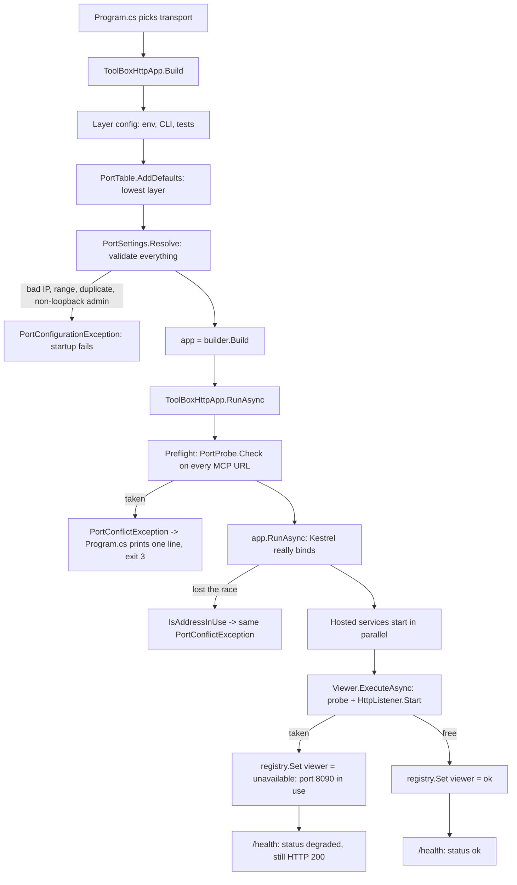
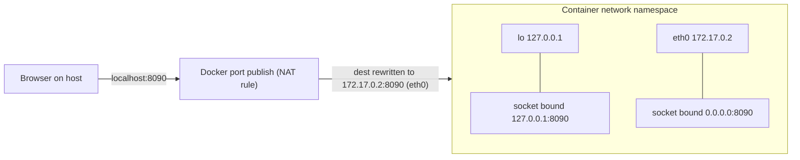
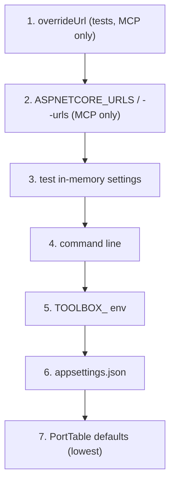

2026_11_08_20_15-Who-Owns-Which-Door

# Lecture 012: Who Owns Which Door (ports, bind addresses and conflict handling)

Written after issue #37 (S1: port table + conflict detection) merged in PRs #40, #41 and #43. Everything quoted below is real code in this repo, so you can open each file next to this lecture.

## 0. The big picture first

A network service is a process that stands at a door and waits. The door has two parts of its address: a number (the port) and a street (the bind address: which of the machine's network interfaces it answers on). Issue #37 had to answer three questions that sound trivial and are not:

1. Who is allowed to stand at which door? (the port table)
2. Who can walk up to that door? (loopback vs `0.0.0.0`)
3. What happens when someone is already standing there? (conflict handling)

The cast of characters:

| Character | Role | File |
|---|---|---|
| The Registrar | Holds the one list of who gets which port and street | `src/ToolBox.Host/Ports/PortTable.cs` |
| The Inspector | Checks the config is sane before any door opens | `src/ToolBox.Host/Ports/PortSettings.cs` |
| The Scout | Knocks on a door briefly to see if it is occupied, then leaves | `src/ToolBox.Core/Ports/PortProbe.cs` |
| The Messenger | Carries a clear "door taken" message to the operator | `src/ToolBox.Core/Ports/PortConflictException.cs` |
| The Noticeboard | Where optional services post "I'm down, here's why" | `src/ToolBox.Core/Health/ComponentStatusRegistry.cs` |
| The Bouncer (required) | MCP on 8080: if its door is taken, the whole building closes (exit 3) | `src/ToolBox.Host/ToolBoxHttpApp.cs` |
| The Understudy (optional) | The viewer: if its door is taken, the show goes on without it, and says so | `src/ToolSets/ToolBox.Voxel/VoxelViewerBroadcastService.cs` |

Control flow at startup (HTTP mode):



Keep this picture; every section below zooms into one box.

## 1. Loopback vs `0.0.0.0`, and why Docker `-p` cannot reach loopback

### The mechanism

A machine has several network interfaces. A socket bound to an address answers only for packets addressed to that address:

- `127.0.0.1` (loopback): the virtual interface that exists only inside this machine (strictly, inside this network namespace). Packets never leave it.
- `0.0.0.0` (the "any" address, `IPAddress.Any`): answer on every interface, including the real network card.
- `::1` and `::` are the IPv6 equivalents.

```
 Laptop
 +-------------------------------------------+
 |  lo (127.0.0.1)     eth0 (192.168.1.20)   |
 |      ^                    ^               |
 |      |                    |  other devices on the LAN
 |  bound to 127.0.0.1   bound to 0.0.0.0 also hears here
 +-------------------------------------------+
```

The default in `PortTable.cs` is the safe one:

```csharp
public const string LoopbackAddress = "127.0.0.1";
...
["Ports:Viewer:Port"] = "8090",
["Ports:Viewer:Address"] = LoopbackAddress,
```

On a laptop, a loopback bind means nothing else on your Wi-Fi can even attempt to connect. Before #37 the viewer bound `http://+:8090/` (ADR-012), which is the `HttpListener` spelling of "all interfaces", so a coffee-shop neighbour could open your voxel feed. That was an exposure, not a feature.

### Why Docker needs `0.0.0.0` (the bug that ADR-012 originally fixed)

Each container gets its own network namespace: its own private `lo` and its own `eth0` (for example `172.17.0.2`). `docker run -p 8090:8090` does not teleport your host's packets into the container's loopback. It installs a forwarding rule (NAT) that rewrites the destination to the container's `eth0` address and sends the packet there. So the packet arrives on `eth0`, and a socket bound only to the container's `127.0.0.1` never hears it.



Only the `0.0.0.0` socket is on a path the NAT rule reaches. This is why `Dockerfile` and `docker-compose.yml` now say it out loud:

```
ENV TOOLBOX_Ports__Mcp__Address=0.0.0.0
ENV TOOLBOX_Ports__Viewer__Address=0.0.0.0
```

The design shift in ADR-016: the bind address stopped being a fact hidden in code and became configuration, safe by default, with the container explicitly opting in to wider exposure. "Secure by default, widen explicitly" is a phrase worth having ready in an interview.

Note the asymmetry that remains: in the container, `0.0.0.0` inside is fine because the host decides what to publish (`8081:8080`, `8090:8090`), and compose does not publish 8080 to the world. The bind address and the publish mapping are two separate gates.

## 2. Probe vs bind, and the TOCTOU race

### What the Scout does

`PortProbe.Check` opens a throwaway `TcpListener` and releases it:

```csharp
var listener = new TcpListener(address, port);
try { listener.Start(); }
catch (SocketException ex) when (ex.SocketErrorCode == SocketError.AddressAlreadyInUse)
{ throw new PortConflictException(service, port, address, configKey, ex); }
finally { listener.Stop(); }
```

Why bother, when the real server would also fail? Because the real server fails badly. Kestrel throws a raw bind exception that names an address but not which service, and `HttpListener` throws a different exception type. The probe is one shared code path that produces one consistent, actionable message, and it can report before anything else has started.

### The race: Time Of Check To Time Of Use (TOCTOU)

The probe answers "is the port free right now?" The real bind happens later. Between them another process can take the port:

```
 time ->
 Host:      probe(8080) ........ free .......... bind(8080) -> BOOM
 Intruder:                    bind(8080) OK
```

Checking and using are two separate operations, so nothing makes them atomic. This is the same family of bug as "check file exists, then open it" (a classic security issue), and the same shape as the check-then-act race in concurrent code, which you listed as a weakness in `persona.md`. The only truly correct primitive is the operation itself: try to bind and handle failure. A probe is an optimisation for the error message, never a guarantee.

That is why the design is "D2 plus a thin D1" (issue discussion): the probe gives the good message up front; the translation of the real bind failure is the backstop. In `ToolBoxHttpApp.RunAsync`:

```csharp
Preflight(endpoints);
afterPreflight?.Invoke();           // test seam: the gap where the race lives
try { await app.RunAsync(); }
catch (Exception ex) when (PortConflictException.IsAddressInUse(ex)) { ... }
```

Notice `afterPreflight`. A race is hard to test because it is timing-dependent; the seam lets the test deterministically steal the port in the gap. See `Mcp_PortTakenAfterProbe_BindFailureIsTranslated` in `tests/ToolBox.Host.Tests/PortConflictTests.cs`. Turning a nondeterministic race into a deterministic test by adding a hook is a technique worth stealing.

### Probe on the same address as the real bind

The doc comment on `PortProbe` says "MUST use the real bind address". Reason: `127.0.0.1:8080` and `0.0.0.0:8080` are different addresses to the kernel, but they conflict with each other (on Linux, a wildcard bind fails if a specific-address listener already holds that port). Probing loopback when you will bind `0.0.0.0` can report "free" for a port that is not. (The OS-specific rules differ between Linux, macOS and Windows; I did not verify every combination here, so treat this as the principle rather than a table of guarantees.)

## 3. EADDRINUSE, SO_REUSEADDR and ExclusiveAddressUse

- `EADDRINUSE` (errno 98 on Linux, `WSAEADDRINUSE` 10048 on Windows) is the kernel saying "that address:port is already bound". .NET surfaces it as `SocketError.AddressAlreadyInUse`.
- `PortConflictException.IsAddressInUse` is where the repo collects every disguise it arrives in:

```csharp
if (ex is SocketException { SocketErrorCode: SocketError.AddressAlreadyInUse }) return true;
if (ex is HttpListenerException { ErrorCode: 98 or 10048 }) return true;   // walks InnerException too
```

Why the loop over `InnerException`? Kestrel wraps the `SocketException` in an `IOException`. A catch on the outer type alone would miss it. The numbers 98 and 10048 are the native codes because `HttpListenerException` exposes only a raw `ErrorCode`.

- `SO_REUSEADDR` is a socket option. On Linux its main effect is letting a restarted server bind a port still held by connections in `TIME_WAIT` (otherwise a quick restart fails for a minute or so). It does not let two live listeners share a port on Linux. On Windows the same-named option has a more dangerous meaning (a second process can hijack the port), which is why Windows has `ExclusiveAddressUse`: it opts a socket out of that sharing. Microsoft's `TcpListener.ExclusiveAddressUse` documentation is the source to read; I am stating the general principle, not quoting its exact semantics.
- Why you care here: the probe starts and stops a listener immediately. Stopping a listener that never accepted a connection leaves no `TIME_WAIT`, so the probe does not poison the real bind that follows. If it did accept connections, `SO_REUSEADDR` would matter.

Common mistake: assuming "I can bind it" means "nobody is using it". Reuse options can make a bind succeed in cases that surprise you. The test suite sidesteps this by using real sockets and asserting real outcomes.

## 4. Layered configuration (`IConfiguration`)

### The model

.NET configuration is a stack of providers. Each provider contributes key/value pairs; for a key, the last-added provider that has it wins. Keys are flat strings with `:` as the hierarchy separator: `Ports:Viewer:Port`.

Environment variables cannot contain `:` portably (it is illegal in many shells), so the convention is `__` (double underscore), which the provider converts to `:`. Hence `TOOLBOX_Ports__Viewer__Port` means key `Ports:Viewer:Port` (the `TOOLBOX_` prefix is stripped by `AddEnvironmentVariables(prefix: "TOOLBOX_")`). `PortConflictException.EnvVarName` is the repo's own proof of the rule:

```csharp
public static string EnvVarName(string configKey) => "TOOLBOX_" + configKey.Replace(":", "__");
```

### Order matters, and the interesting trick

`PortTable.AddDefaults` does not add to the end; it inserts at index 0, so the defaults are the lowest priority:

```csharp
builder.Sources.Insert(0, new MemoryConfigurationSource { InitialData = Defaults });
```

And `ToolBoxHttpApp.Build` re-adds the command line after the env layer, because `WebApplication.CreateBuilder` had already added env then command line, and adding `TOOLBOX_` env afterwards would have outranked the command line:

```csharp
builder.Configuration.AddEnvironmentVariables(prefix: "TOOLBOX_");
builder.Configuration.AddCommandLine(args);
```

Resulting precedence (also in `docs/ARCHITECTURE.md` section 4):



Why is `ASPNETCORE_URLS` above `Ports:*`? Backward compatibility: existing images and scripts set it. The consequence is a trap the PR had to avoid: if the Dockerfile kept `ASPNETCORE_URLS`, it would silently override the new `TOOLBOX_Ports__Mcp__Address`. So the Dockerfile dropped it (see the comment at `Dockerfile:55`). When layering config, always ask "what does an old setting do to my new one?"

A small detective trick in `Build`: `mcpExplicit` is computed before `AddDefaults`, because after the defaults exist every key is non-null and you can no longer tell "the user set this" from "it's the default". Order of operations is part of the logic.

### Validate once, up front

`PortSettings.Resolve` turns strings into typed, validated bindings and throws `PortConfigurationException` naming the key on any problem (bad IP, port outside 0-65535, two services on one port, non-loopback admin). This is "parse, don't validate later": after `Resolve`, nobody downstream re-checks. The admin loopback rule refuses rather than warns, by your decision in the issue (security rules that only warn get ignored).

## 5. Fail fast vs graceful degradation

The same event, "port taken", is handled in two opposite ways on purpose. The rule is about whether the system is still useful without the component.

| | MCP (required) | Viewer (optional) |
|---|---|---|
| If its port is taken | Throw `PortConflictException`, exit code 3 | Set status `unavailable: port 8090 in use`, log a warning, return |
| Why | A server with no MCP endpoint does nothing useful; staying up hides the failure | The agent's tools still work; a human just has no picture |
| Where visible | stderr line, exit code | `/health` `components.viewer`, and `status: "degraded"` |

The danger of graceful degradation is silent degradation: a background process with a dead viewer is exactly the "mysterious failure" the issue wanted gone. Your decision "must not take down the system, but the failure must be visible, not just logged" is the whole point. The Noticeboard (`ComponentStatusRegistry`) is the mechanism:

```csharp
private readonly ConcurrentDictionary<string, string> _statuses = new(StringComparer.Ordinal);
public void Set(string component, string status) => _statuses[component] = status;
```

Core only stores strings and knows no component (ADR-003). Voxel writes `viewer`; the Host's `/health` reads a snapshot; later the admin API (#35) and GUI (S2) read the same snapshot. `ConcurrentDictionary` because the writer (a background thread) and the reader (a request thread) run at the same time.

`/health` then encodes a three-way distinction:

```csharp
bool degraded = components.Values.Any(v => v != "ok");
status = degraded ? "degraded" : "ok",    // both are HTTP 200
```

Why HTTP 200 for degraded? A container healthcheck (`curl -f`) treats non-2xx as "restart me". Restarting does not free port 8090, so a 503 would cause a pointless restart loop. Health endpoints answer "should the orchestrator kill this?", while the body answers "what is wrong?". Kubernetes separates the same ideas as liveness (restart me) and readiness (route traffic to me). Worth naming in an interview.

## 6. Exit codes are a contract

`Program.cs`:

```csharp
catch (PortConflictException ex)
{
    Console.Error.WriteLine(ex.Message);
    return 3;
}
...
Console.Error.WriteLine($"Unknown transport '{transport}'. Valid values: stdio, http.");
return 2;
```

| Code | Meaning |
|---|---|
| 0 | Clean shutdown |
| 2 | Unknown transport |
| 3 | A required port is already in use |

Why this matters: when this host runs in the background (the v2 goal), the thing that launched it (a service manager, the future GUI, a Docker restart policy, a script) cannot read prose; it can read an integer. If the GUI sees 3 it can say "port busy, pick another"; if it sees 2 it knows config is wrong and retrying is pointless. Once someone depends on a number, changing it is a breaking change, which is why ADR-016 records 2 and 3 as part of the contract. Conventions: 0 is success; 1 is a generic failure; small numbers like 2 are conventionally misuse of the command line; avoid values above 125 which shells use for signals and exec failures.

Related ADR-004 rule: the message goes to stderr, never stdout, because in stdio mode stdout is the JSON-RPC protocol and a stray line corrupts it.

## 7. Port 0 in tests

Port 0 means "OS, pick any free port for me". Tests use it so that parallel CI jobs and a developer's machine that already uses 8080 or 8090 never collide:

```csharp
ToolBoxHttpApp.Build([], overrideUrl: "http://127.0.0.1:0", settings: Settings(0, viewerPort: 0));
```

and `PortProbe.Check` returns immediately for 0 ("never a conflict"). Two subtleties:

- To test a conflict you need a port you know is taken: the helper `Occupy` binds port 0, reads the assigned port back, and keeps the listener open. The test holds the occupied port so the code under test must hit the real conflict path. No hard-coded numbers, no flakiness.
- `HttpListener` cannot bind port 0 itself, so the viewer asks `PortProbe.FindFreePort` first. That is itself a tiny TOCTOU race (find the port, release it, bind it), accepted because only tests use port 0. Recognising a known-benign race and writing down why it is benign is a mark of seniority.

## 8. HttpListener prefixes and the Host header

`HttpListener` does not just bind an address; it matches each request's `Host` header against registered prefixes. A request whose host name matches no prefix is rejected (HTTP 400), even if the TCP connection reached the right socket.

`viewer/index.html` connects to `ws://localhost:8090/voxel/`. If the listener only registered `http://127.0.0.1:8090/voxel/`, the TCP connection succeeds but the Host header says `localhost:8090` and nothing matches. So in loopback mode the viewer registers two prefixes:

```csharp
var prefixes = new List<string> { $"http://{host}:{port}/voxel/" };
if (IPAddress.IsLoopback(address)) prefixes.Add($"http://localhost:{port}/voxel/");
```

and for `0.0.0.0` it uses the strong wildcard `+`, which matches any Host:

```csharp
return [$"http://+:{port}/voxel/"];
```

The plan flagged this as a risk before any code existed ("I'll verify this in Step 4"), and a test was made mandatory: `Viewer_FreePort_ReportsOkAndAcceptsBothLoopbackHostNames` loops over `"127.0.0.1"` and `"localhost"` and really connects a `ClientWebSocket`. Also look at `BuildPrefixes_MapsBindAddressToHttpListenerPrefixes`: a pure function, tested as a table, no sockets needed. Extracting the decision from the I/O is what made that possible.

Compare with Kestrel (MCP): Kestrel binds sockets directly and does not do prefix matching by Host header, except that ASP.NET's `AllowedHosts` filtering (ADR-008) applies at a higher level. Two servers in one process, two different models.

## 9. `BackgroundService.ExecuteAsync` is not guaranteed to have run when `StartAsync` returns

This was the subtle bug PR C exposed. The viewer is a `BackgroundService`. The host's startup calls `StartAsync` on each hosted service; `BackgroundService.StartAsync` calls `ExecuteAsync` and, if it hasn't completed synchronously, returns its task without waiting. Code up to the first real `await` runs inline on the starting thread, but you must not rely on how far it got. In this repo `ExecuteAsync` does its work synchronously before the first await:

```csharp
// No awaits before this point, so the status is set before the host finishes starting.
_listener = StartListener();
```

but the PR C session notes record that tests which read `/health` straight after `await app.StartAsync()` "passed by luck". The robust approach is what the test now does: poll until the status appears, with a deadline.

```csharp
while (!registry.Snapshot().ContainsKey("viewer"))
{
    Assert.True(DateTime.UtcNow < deadline, "viewer status was never set");
    await Task.Delay(10);
}
```

The lesson: "started" and "ready" are different states. Real systems model this explicitly (readiness probes, `IHostedLifecycleService`, startup tasks). Here `components` itself is the readiness signal. Also note that a missing `viewer` key is ambiguous in `/health`: it means "Voxel is off" or "viewer hasn't reported yet". The tests distinguish them with `viewerExpected`.

If you have to explain async to an interviewer: the host fires hosted services and keeps going; completion of `StartAsync` means "launched", not "running".

## 10. Alternatives that were considered

| Idea | Why not |
|---|---|
| Auto-reassign to the next free port (the old 8091-8093 viewer fallback) | The browser page and Docker mapping hard-code 8090; a silent hop yields a "working" server nobody can reach. Fixed port + visible failure beats clever recovery |
| Only the real-bind exception (D1) | No race, but three server types each need wiring and the message is raw. Kept as the backstop |
| Only the probe (D2) | Easy but racy; hence both |
| Put the viewer port in Core | Breaks ADR-003 (Core knows no toolset). The Host seeds defaults and Voxel only reads keys |
| Bind address as boolean `BindAll` | You chose an address value instead: it generalises (a specific NIC, IPv6) and has no inverted meaning |
| Warn on non-loopback admin | A warning is skippable; the admin API will hold power. Refuse |

## 11. Production relevance

- Kubernetes: the pod's container binds `0.0.0.0` for the same NAT-ish reason; the Service decides exposure. Liveness vs readiness probes are the cousins of `ok` vs `degraded`.
- Sidecars and dev tools (databases, language servers, IDEs) all hit port conflicts; good ones name the port and the config key, like `PortConflictException`.
- Fail-fast vs degrade is the same decision as "is this a hard or soft dependency" in resilience design (circuit breakers, feature flags).
- Exit codes are how supervisors (systemd, Docker restart policies, CI) classify a failure.

## 12. Self-check questions (interview framing)

1. "A teammate says: our service works locally but not in Docker; `curl localhost:8090` from the host gets connection reset. The service logs say it listens on 127.0.0.1:8090. Diagnose and fix." Explain what Docker's `-p` actually does and what two things must be true for the port to be reachable.
2. "Your health check passes, then the process fails to bind its port because another process grabbed it in between. Why can't a pre-flight check prevent this, and what do you do instead?" Name TOCTOU and give the repo's two-layer answer.
3. "Why does the service return HTTP 200 with `status: degraded` rather than 503 when the optional viewer is down?" Bring in container restart loops and the liveness/readiness distinction.
4. "An env var `TOOLBOX_Ports__Viewer__Port=9000` is set but the app still uses 8090. List three reasons that could happen in a layered configuration." (Hint: source order, an `ASPNETCORE_URLS`-style higher-priority override for MCP, a test or command-line layer, wrong key spelling.)
5. "Design the contract between a launcher (GUI or systemd) and this host for failures." Which exit codes, what goes to stderr vs stdout in stdio mode and why, and why changing code 3 later would be breaking.
6. "Why does the viewer register both `127.0.0.1` and `localhost` prefixes in loopback mode, and what status does `HttpListener` return if you register only one and connect with the other?" Mention the Host header.
7. "Your integration test reads a status set by a `BackgroundService` right after `StartAsync` and fails one run in fifty. Why, and what is the fix?" Distinguish started from ready.
8. "Why do tests use port 0, and what hidden race does `FindFreePort` reintroduce? Why is that acceptable?"

## 13. Where to go next

- Read `tests/ToolBox.Host.Tests/PortConflictTests.cs` top to bottom; each test pins one claim in this lecture.
- Try it by hand: `nc -l 8080`, then `dotnet run --project src/ToolBox.Host -- --transport http`, and check `echo $?` prints 3.
- Follow-up topics: Kubernetes liveness/readiness/startup probes; `IHostedLifecycleService`; Linux `SO_REUSEPORT`; Windows `ExclusiveAddressUse` docs; network namespaces (`ip netns`) to see why loopback is per-container.
- S3 and the admin API (#35) will add a second listener: when you implement it, the port table entry already exists and only the probe and listener are missing.
