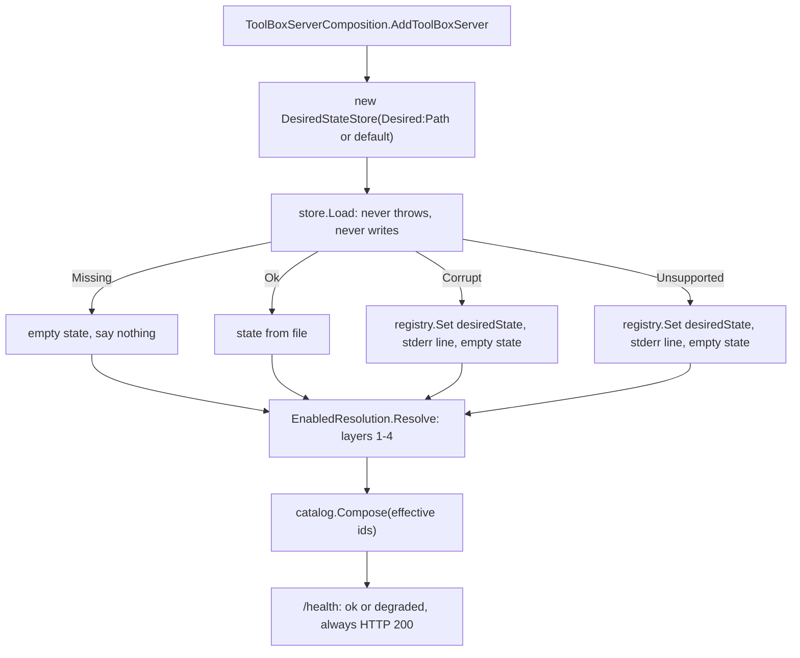
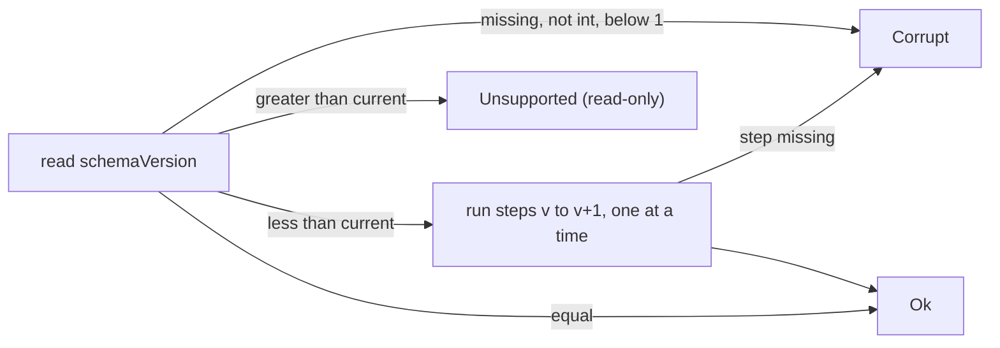

2026_11_09_01_30-Intent-Reality-And-The-Safe-Save

# Lecture 013: Intent, Reality and the Safe Save (the desired-state file)

Written after issue #31 (desired-state file) merged in PRs A to D (#48, #49 and the two before them). Everything quoted below is real code in this repo, so you can open each file next to this lecture.

## 0. The big picture first

Until #31, "which toolsets are on?" was answered only by deployment config: an `appsettings` list and the `TOOLBOX_TOOLSETS` environment variable. That is the operator's voice. The coming GUI (epic #23) needs a second voice: the user saying "I want Voxel off". That choice has to survive a restart, so it must live in a file. This lecture is about the four problems that file creates:

1. Two voices disagree. Who wins, and how do we say so honestly? (desired vs effective state)
2. A file can be half-written when the power dies. (atomic save)
3. A file can be old, new, hand-broken or unreadable. (versioning and fail-soft loading)
4. The file must hold settings for toolsets Core is forbidden to know about. (opaque payloads)

The cast:

| Character | Role | File |
|---|---|---|
| The Wish List | The data model: what the user wants | `src/ToolBox.Core/Desired/DesiredState.cs` |
| The Archivist | Loads and saves the file safely | `src/ToolBox.Core/Desired/DesiredStateStore.cs` |
| The Translator-of-Old-Documents | Upgrades old versions, refuses newer ones | `src/ToolBox.Core/Desired/DesiredStateMigrator.cs` |
| The Notary | One shared set of JSON rules for every reader and writer | `src/ToolBox.Core/Desired/DesiredStateJson.cs` |
| The Arbiter | Merges five layers into "desired" and "effective" | `src/ToolBox.Host/EnabledResolution.cs` |
| The Noticeboard | Shows "degraded" in `/health` | `src/ToolBox.Core/Health/ComponentStatusRegistry.cs` (from lecture 012) |
| The Wiring | Calls all of the above once at startup | `src/ToolBox.Host/ToolBoxServerComposition.cs` |

Startup flow:



Note that the host only ever calls `Load`. `Save` is reserved for the future admin API (#35). A server that rewrites its own config at startup is a server that can destroy it at startup.

## 1. Desired state vs effective state

### The mechanism

This split is one of the most reused ideas in infrastructure. Kubernetes calls the two halves `spec` (what you asked for) and `status` (what exists). A controller loop compares them and acts. Terraform does the same with config vs state.

In Tool_Box:

- **Desired** = what the user asked for.
- **Effective** = what is actually composed and running.

Usually they are equal. They differ when someone with more authority overrides the user. Here that is the operator, who sets `TOOLBOX_TOOLSETS`. Look at the record that carries both answers:

```csharp
// src/ToolBox.Host/EnabledResolution.cs
internal sealed record EnabledResolution(
    IReadOnlyList<string> Desired,
    IReadOnlyList<string> Effective,
    IReadOnlyDictionary<string, string> PinnedBy,
    ...
```

`PinnedBy` is the explanation of any gap: "voxel is effective-on, desired-off, because `TOOLBOX_TOOLSETS` pins it". A GUI can show that to the user instead of a toggle that silently does nothing. That is the point: a system that cannot explain why reality differs from intent will be filed as a bug.

### The five layers

Lowest to highest priority:

```
1. code default        ToolBoxCatalog.DefaultEnabled
2. appsettings         Toolsets:Enabled   (replaces layer 1 wholesale)
3. desired-state file  per id, only where "enabled" is stated
-------------------- desired is computed up to here --------------------
4. TOOLBOX_TOOLSETS    env var pin: authoritative for EVERY known id
5. test overrides      in-memory config used by tests
```

Layers 1 to 3 give **Desired**. Layer 4 turns Desired into **Effective**. Here is layer 3 in code:

```csharp
if (intent.Enabled is bool on)
{
    bool present = desiredIds.Contains(id, StringComparer.OrdinalIgnoreCase);
    if (on && !present) desiredIds.Add(id);
    else if (!on && present) desiredIds.RemoveAll(...);
}
```

`Enabled` is `bool?`, and that third state matters. In `DesiredState.cs`: `null` = "no opinion: lower configuration layers decide". If the file stored only `true`/`false`, then writing the file for the first time (to change a setting) would silently turn every other toolset off or on. A nullable bool is how a layered config says "I did not vote".

Layer 4 is deliberately different: when the env var exists, it is authoritative for every known id, named means on, unnamed means off:

```csharp
var pinned = known.ToDictionary(id => id, _ => EnvPin, StringComparer.OrdinalIgnoreCase);
return new(desiredIds, effective, pinned, settings, unknown);
```

Why per-id merge for the file but total control for the pin? Because they are different kinds of authority. The user expresses preferences about some things. The operator who pins is declaring "this deployment runs exactly this", often in Docker or CI, where a stray file on someone's disk must not change what ships.

Settings are not pinned: the pin test is `EnvVar_PinsEveryKnownId_ButFileSettingsStillHonoured` (`tests/ToolBox.Host.Tests/DesiredStateWiringTests.cs`). The pin answers "is it on?", not "how is it configured?".

### Alternatives considered

- Let the file win over the env var: rejected, because containers become non-reproducible.
- Merge env var per id like the file: possible, but then `TOOLBOX_TOOLSETS=basics` would mean "basics on, everything else unchanged", which breaks the existing meaning from ADR-015.

## 2. Atomic writes: the Archivist's careful routine

### The problem

`File.WriteAllText(path, json)` truncates the file to zero bytes and then writes. If the process dies, or the disk fills, or the machine loses power in between, the user's only copy of their settings is half a file or empty. This is the "torn write".

### The mechanism

Never modify the real file in place. Write a complete new file beside it, make sure the bytes are on disk, then swap with one rename. Rename within one filesystem is atomic on POSIX, and `File.Move(..., overwrite: true)` uses the OS replace on Windows: observers see the old file or the new file, never a mixture.

```
   desired-state.json            (old, untouched)
   .desired-state.json.<guid>.tmp  <- 1. create, 0600, write all bytes
                                  <- 2. flush stream buffer to OS
                                  <- 3. fs.Flush(flushToDisk: true): OS to disk
   rename tmp -> desired-state.json   <- 4. the single atomic step
```

The real code:

```csharp
// src/ToolBox.Core/Desired/DesiredStateStore.cs
tmp = System.IO.Path.Combine(dir, $".{System.IO.Path.GetFileName(Path)}.{Guid.NewGuid():N}.tmp");
...
using (var fs = new FileStream(tmp, options))
{
    using var writer = new StreamWriter(fs, new System.Text.UTF8Encoding(false));
    writer.Write(json);
    writer.Flush();
    fs.Flush(flushToDisk: true);
}

_move(tmp, Path);
tmp = null; // moved: nothing to clean up
```

Details worth noticing:

- **Same directory.** Rename is only atomic inside one filesystem. A temp file in `/tmp` renamed into `~/.local/share` becomes copy-then-delete, which is not atomic. Hence `dir` is computed from the target path.
- **Two flushes.** `writer.Flush()` moves the StreamWriter's buffer into the FileStream. `fs.Flush(flushToDisk: true)` asks the OS to push its cache to the device. Without the second one, a power cut after the rename can leave a renamed but empty file, because the rename can reach disk before the data does.
- **`FileMode.CreateNew` and `FileShare.None`.** The random GUID plus CreateNew means we never clobber someone else's temp file.
- **The `finally` block** deletes the temp file if the rename did not happen, so failures do not litter the directory. Tests: `Save_leaves_no_temp_files`, `Failed_move_keeps_old_file_and_cleans_temp`.
- **`_move` is injectable** (`internal` constructor taking an `Action<string,string>`) so the test can make the rename fail and prove the old file survives. This is a seam: a deliberate place to substitute behaviour so failure can be tested on demand.
- **The lock.** `private static readonly object SaveLock` is static on purpose: two `DesiredStateStore` instances for the same path must not interleave. `Save` also re-runs `LoadCore()` inside the lock instead of trusting an earlier Load, because the file may have changed since (the test `Concurrent_saves_always_leave_valid_json`). The static lock only protects one process; the ADR states plainly that cross-process safety relies on there being a single writer.

You know the concept from embedded work: it is the same idea as double-buffered configuration in flash, or a journaling filesystem. Never destroy the last known-good copy until the new one is complete.

### Common mistakes

- Writing to the target and calling it atomic because the file is small.
- Temp file in a different directory or volume.
- Forgetting to flush to disk, only to the stream.
- Leaving the temp file around on exception.

## 3. File permissions and where the file lives

### 0600

```csharp
if (!OperatingSystem.IsWindows())
{
    options.UnixCreateMode = UnixFileMode.UserRead | UnixFileMode.UserWrite; // 0600
}
```

Unix permissions are three triples (owner, group, others) of read/write/execute. `0600` means owner read+write, nobody else anything. Why bother for a toolset list? Because settings are opaque and will one day hold things like paths or tokens, and default file creation masks (umask 022) would make the file world-readable. The key detail: the mode is set **at creation time** via `UnixCreateMode`. Creating the file and then calling chmod leaves a window where it exists with looser permissions. Windows has no such mode bits (it uses ACLs, inherited from the user's profile directory), hence the guard. Test: `Saved_file_is_user_only_on_unix`.

### SpecialFolder per OS

```csharp
Environment.GetFolderPath(Environment.SpecialFolder.LocalApplicationData)
```

Rather than writing `if (windows) ... else if (mac) ...`, ask .NET where this OS keeps per-user app data:

| OS | `LocalApplicationData` resolves to |
|---|---|
| Windows | `%LOCALAPPDATA%` (`C:\Users\you\AppData\Local`) |
| macOS (.NET 8+) | `~/Library/Application Support` |
| Linux | `$XDG_DATA_HOME`, else `~/.local/share` |

The macOS row is a history trap: before .NET 8, macOS returned `~/.local/share`, which is a Linux convention that Mac users never look in. ADR-017 records the choice to rely on the newer native behaviour. "Local" (not roaming) was chosen because the file is per machine: a desired toolset list that follows you to another laptop with different paths would be wrong.

The path can be overridden with `Desired:Path` (env `TOOLBOX_Desired__Path`; double underscore is how environment variables express `:` nesting). Docker skips the file by default because a container's filesystem is disposable; a volume plus that variable is the opt-in.

## 4. Schema versioning: a file outlives the code

### The problem

The file is written by build N and read, months later, by build N+3 or by build N-1 after a downgrade. The shape will change. The file must say which shape it is.

### The mechanism

An integer `schemaVersion` at the root. On load, `DesiredStateMigrator.Migrate` compares it with `_current`:



The sequential loop:

```csharp
while (version < _current)
{
    if (!_steps.TryGetValue(version, out var step))
        return Corrupt(version, $"no migration from schemaVersion {version}.");
    doc = step(doc);
    version++;
    doc["schemaVersion"] = version;
}
```

Why sequential (v1 to v2, v2 to v3) rather than a direct v1 to v5 converter? With n versions you write n-1 small steps instead of n(n-1)/2 converters, and each step is only ever written once and tested against its neighbours. This is how database migrations (EF Core, Rails, Flyway) work too. The table is empty today because v1 is the first version, but the machinery is tested with fake steps (`Migration_chain_runs_each_step_in_order_and_stamps_the_version`), so the first real migration is an addition, not a redesign.

Notice the migrator works on `JsonObject`, not on `DesiredState`. Old versions may not fit the current C# class at all; you migrate the raw document first, then deserialize. It is also pure (no file I/O), so it is tested alone.

### Newer versions are read-only

The interesting case is `version > current`: a downgrade, or two different builds sharing one file. The tempting wrong answer is "read what I understand and save it back". That would delete every field the newer build added. The right answer is **Unsupported**: load as empty, report it, and in `Save`:

```csharp
if (existing.Status == DesiredStateLoadStatus.Unsupported)
{
    return new(DesiredStateSaveOutcome.RefusedUnsupported, Path, existing.Reason);
}
```

Tests `Newer_version_is_Unsupported_and_untouched` and `Save_refuses_to_overwrite_newer_version` check the file stays byte-identical. Principle: **never overwrite what you cannot fully read**.

### Forward compatibility inside a version: `[JsonExtensionData]`

Even at the same version, a newer build in the same schema line may add a field. This catches it:

```csharp
[JsonExtensionData]
public Dictionary<string, JsonElement>? Extra { get; set; }
```

System.Text.Json normally ignores unknown properties, and they vanish on the next save. `[JsonExtensionData]` tells it "put every property you cannot map into this dictionary, and write them back when serializing". It exists at both the top level and on each `DesiredToolset`. Test: `Unknown_ids_and_unknown_fields_survive_a_round_trip`. The same reasoning applies to whole toolset ids Core does not know (a toolset the build does not have): `EnabledResolution` reports them in `UnknownIds`, ignores them for composition, but they stay in the file.

## 5. Fail-soft config: degrade, do not die, do not destroy

Two opposite instincts, and the design picks a side deliberately:

| Situation | Fail-loud answer | Fail-soft answer (chosen) |
|---|---|---|
| Corrupt desired-state file | Refuse to start | Start with defaults, report `degraded` |
| Newer-version file | Refuse to start | Same |
| Unknown id in the **env var** or appsettings | Fail startup (still) | n/a |
| Unknown id in the **file** | n/a | Warn, ignore, preserve |

The dividing line is who made the mistake and who can see it. The env var is an operator's deliberate act, so a typo should shout. The file will eventually be edited by a GUI, by a user, by an older or newer build: it is exactly the kind of input that is wrong through no one's carelessness, and a background host that will not boot because of a settings file is a bad product.

How "degraded" is reported (`ToolBoxServerComposition.cs`):

```csharp
if (loaded.Status == DesiredStateLoadStatus.Corrupt)
{
    registry.Set("desiredState", $"corrupt: {loaded.Reason}");
    Console.Error.WriteLine($"desired-state file {loaded.Path} is corrupt ({loaded.Reason}); using defaults.");
}
```

- It writes to **stderr**, because stdout is the MCP protocol (ADR-004).
- `/health` returns HTTP 200 with `"status":"degraded"`. This matches what lecture 012 said for the viewer: an orchestrator that restarts a container on a non-200 health check would restart-loop forever on a bad file that a restart cannot fix. Degraded means "running, but look at this".
- Missing file reports nothing: a fresh install is normal, and `Load` does not create it (`Missing_file_gives_empty_state_and_is_not_created`).

And the safety half: loading never writes. A corrupt file is copied aside to `desired-state.json.bad-<UTC>` only at the next explicit `Save`, the moment we are about to replace it (`Save_over_corrupt_file_keeps_a_bad_copy`). Until then, the user can still open and fix their own broken file. `Load` also catches a long list of exceptions (`JsonException`, `IOException`, `UnauthorizedAccessException`, `ArgumentException`...) and converts them to a status: "never throws" is a contract the rest of startup relies on. Look at `ArgumentException`: its comment says it covers duplicate or case-colliding toolset ids from a hand edit, which the case-insensitive dictionary rejects.

## 6. Opaque payloads: keeping Core toolset-agnostic

ADR-003: `ToolBox.Core` must never reference a specific toolset. But the file must someday hold Voxel's viewer port or the SPICE solver path. How does Core store what it cannot name?

```csharp
// DesiredState.cs
public Dictionary<string, JsonElement>? Settings { get; set; }
```

Core stores toolset ids as plain strings and settings as `JsonElement`, a read-only view of a piece of JSON with no C# type behind it. Core round-trips the data without interpreting it, like a postal service carrying sealed envelopes. Each toolset will (later) validate its own envelope; the ADR defers that "until a toolset defines real settings", which is YAGNI applied honestly.

The alternative, a `VoxelSettings` class inside Core, would break the dependency rule the moment you wrote it, and every new toolset would force a change to Core. Opaque payloads make the extension point a data format rather than a code dependency.

One small subtlety in the model:

```csharp
set => _toolsets = new(value ?? [], StringComparer.OrdinalIgnoreCase);
```

System.Text.Json builds its own case-sensitive dictionary and assigns it to the property. The setter re-wraps it so `Voxel` and `voxel` are the same id, matching the catalog.

`DesiredStateJson.Options` is the Notary: one shared `JsonSerializerOptions` (camelCase via `JsonSerializerDefaults.Web`, indented, `WhenWritingNull` so absent `enabled` stays absent, tolerant of comments and trailing commas). Sharing one object means the reader, the writer and the tests cannot disagree about the format. Comments are tolerated on read but lost on the next save; that is why hand-editing is "allowed but unsupported".

## 7. What should I pay attention to?

- Every `Status` and `Outcome` is an enum, not an exception. Expected failures (a bad file) are values the caller must handle; exceptions are reserved for bugs.
- The test list is the specification. Read `tests/ToolBox.Core.Tests/DesiredStateStoreTests.cs` top to bottom and you can reconstruct the whole contract.
- `DesiredStateIsolation.cs` in the Host tests sets `TOOLBOX_Desired__Path` to a nonexistent temp file before any test runs, so no test can read your real app-data file. A feature that reads from a user's home directory needs this, or tests pass on CI and fail on your laptop.
- The host composes once at startup. Changing the file does nothing until restart. Closing that gap is the reconciler's job (#32).

## 8. Interview relevance

- "Desired state vs observed state" is the vocabulary of Kubernetes operators, Terraform, and every control-plane system. Explaining your own small instance of it signals you understand the pattern.
- "How do you write a config file safely?" is a classic question. The answer you can now give: temp file, same directory, fsync, atomic rename, set permissions at creation, and keep the old copy on any failure.
- "How do you evolve a persisted format?" Version integer, sequential migrations, refuse newer versions, preserve unknown fields.
- "What should a service do when its config is bad?" There is no universal answer; the strong answer separates operator errors from user data and explains each choice, as the table in section 5 does.

## 9. Self-check questions

1. A user turns Voxel off in the file, but `TOOLBOX_TOOLSETS=basics,voxel` is set. What are Desired and Effective for voxel, and what does `PinnedBy` contain? What would the file's `settings` for voxel do?
2. Why is `Enabled` a `bool?` rather than a `bool`? What goes wrong the first time the GUI saves if it is a plain `bool`?
3. Suppose the temp file were created in `Path.GetTempPath()`. Why might rename stop being atomic? Which test would not notice?
4. What does `fs.Flush(flushToDisk: true)` protect against that `writer.Flush()` does not?
5. A build understanding v1 meets a file with `schemaVersion: 3`. List everything that happens on load, on `/health`, and on a later `Save` call.
6. Why does `Save` call `LoadCore()` again instead of using the result of an earlier `Load`?
7. Why is a corrupt desired-state file `degraded` (HTTP 200) but an unknown id in `TOOLBOX_TOOLSETS` fatal?
8. Where would you add a v1 to v2 migration step (rename a field), and which test would you copy as a template?
9. How does `[JsonExtensionData]` differ from simply ignoring unknown JSON properties, and which test proves it?
10. Which line of code lets Core store Voxel's settings without ever mentioning Voxel, and which ADR forbids the alternative?

## 10. Where to go next

- The reconciler (#32): comparing desired with effective at runtime, which is the Kubernetes controller loop in miniature.
- The admin API (#35): the single caller of `Save`, and the reason a cross-process lock is deferred.
- Further reading: "write-ahead logging" and `fsync` semantics (why databases care about the exact order of flush and rename), and the Kubernetes "declarative API" docs on spec vs status.
