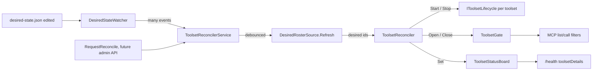
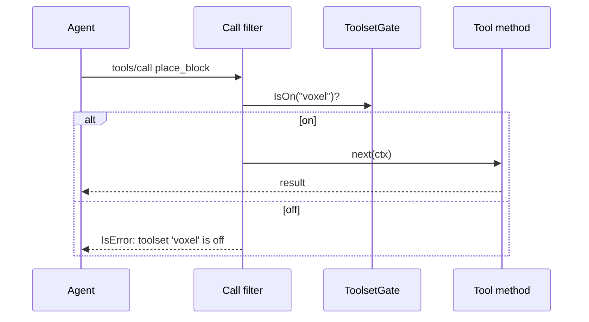
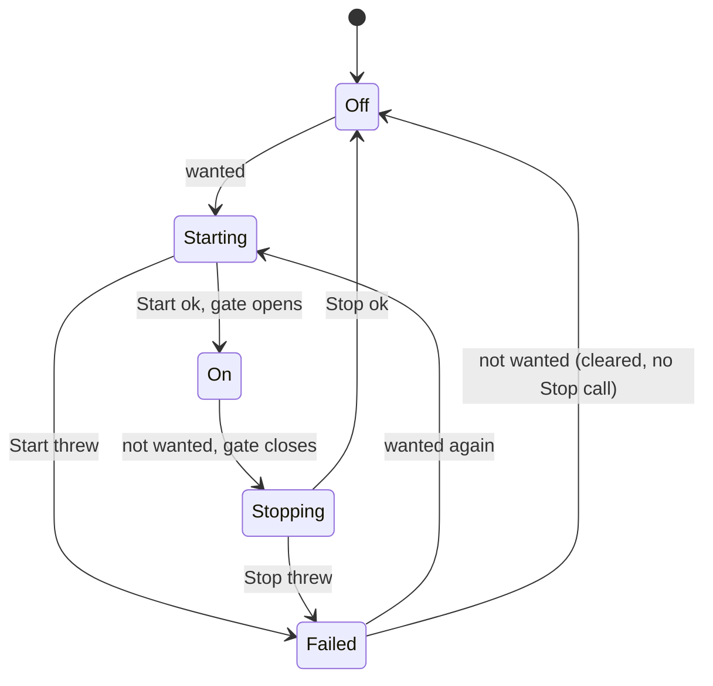

2026_11_09_08_00-The-Reconciler-Turning-Toolsets-On-And-Off-Live

# Lecture 014: The Reconciler, or How a Running Server Changes Its Mind

Written after issue #32 (reconciler core). Lecture 013 ended with "the host composes once at startup; changing the file does nothing until restart. Closing that gap is the reconciler's job." This lecture is that job. Every snippet below is real code in this repo, so open the file beside the text.

## 0. The big picture first

Before #32 the roster of toolsets was decided once, in `Build()`. Turning Voxel off meant editing config and restarting the process. The GUI (epic #23) needs "toggle Voxel" to work on a live server, without losing the Voxel world and without kicking the connected agent. Six ideas make that possible:

1. The reconciler: compare desired with actual, act only on the difference. (Section 1)
2. One choke point (the gate) instead of checks scattered through every tool. (Section 2)
3. MCP request filters: where the gate plugs into the protocol. (Section 3)
4. A lifecycle interface instead of `IHostedService`, because the DI container freezes. (Section 4)
5. A clock and a lifecycle behind interfaces, so tests can control time and side effects. (Section 5)
6. Debounce and coalescing, tested with a fake `TimeProvider`. (Section 6)
7. "Off" is not "failed": two different states, reported differently. (Section 7)

The cast:

| Character | Role | File |
|---|---|---|
| The Controller | Diffs desired vs actual, acts, never overlaps | `src/ToolBox.Core/Toolsets/ToolsetReconciler.cs` |
| The Doorman | Single answer to "is this toolset on?" | `src/ToolBox.Core/Toolsets/ToolsetGate.cs` |
| The Scoreboard | Actual state per toolset, with a reason on failure | `src/ToolBox.Core/Toolsets/ToolsetState.cs` |
| The Contract | What start and stop mean for one toolset | `src/ToolBox.Core/Toolsets/IToolsetLifecycle.cs` |
| The Bouncer | MCP filters that ask the Doorman | `src/ToolBox.Host/ToolsetGateFilters.cs` |
| The Driver | Hosted service: startup, file change, manual, shutdown triggers | `src/ToolBox.Host/ToolsetReconcilerService.cs` |
| The Lookout | Watches the desired-state file | `src/ToolBox.Host/DesiredStateWatcher.cs` |
| A real Contract holder | Voxel: on binds the port, off releases it | `src/ToolSets/ToolBox.Voxel/VoxelLifecycle.cs` |



## 1. The reconciler pattern

### The problem

Something wants state X (the user ticked Voxel off). The world is in state Y (Voxel is running). How do you get from Y to X safely, when requests can repeat, arrive out of order, or fail halfway?

### The mechanism

There are two styles:

- **Imperative commands**: "stop voxel", "start embedded". Each command assumes you know the current state. Send "start voxel" twice and the second call may crash or double-bind a port.
- **Declarative reconcile**: "the end state should be {basics, embedded}". The controller looks at what is actually true, computes the difference and does only that. This is the Kubernetes controller loop, and Terraform's plan/apply. Lecture 013 introduced desired vs effective; this is the loop that closes the gap.

The heart of it is one loop:

```csharp
// src/ToolBox.Core/Toolsets/ToolsetReconciler.cs
foreach (var id in _knownIds)
{
    var shouldRun = want.Contains(id);
    var status = _board.Get(id).Status;

    if (shouldRun && status == ToolsetStatus.On) { unchanged.Add(id); continue; }
    if (!shouldRun && status != ToolsetStatus.On)
    {
        if (status == ToolsetStatus.Failed) _board.Set(id, ToolsetState.Off);
        unchanged.Add(id);
        continue;
    }
    var error = shouldRun ? await StartAsync(id, ct) : await StopAsync(id, ct);
    ...
}
```

Read the two `continue` lines. They are the idempotence: if actual already matches desired, nothing is called. The test says it directly:

```csharp
// tests/ToolBox.Core.Tests/ToolsetReconcilerTests.cs
var second = await r.ReconcileAsync(new[] { "basics", "voxel" });
Assert.True(second.IsNoOp);
Assert.Empty(_log);
```

Idempotent means "doing it twice equals doing it once". Why this is valuable here: the file watcher fires several events per save, the admin API may call "reconcile" redundantly, startup and a file edit can race. If a reconcile could do harm when repeated, every trigger would need to be perfectly deduplicated. Instead the reconciler is safe to call as often as you like, and triggers can be sloppy.

The desired list is not a command ("turn on voxel"), it is a complete picture ("the on-set is exactly this"). That is why an id missing from the list means stop. It also makes "last desired wins" trivial, covered in Section 6.

### Failure isolation and the retry rule

A toolset whose `StartAsync` throws is marked `Failed` with the message; the loop continues to the next id (`StartFailure_IsReportedAndOthersContinue`). Failed is not sticky: on the next reconcile the toolset is `status != On` and still wanted, so it is started again (`FailedToolset_RetriedOnNextReconcile`). There is deliberately no timer retry (ADR-018): a retry loop is a second source of surprising behaviour, and the retry triggers (a file edit, a manual request) already exist.

### Order matters: start then open, close then stop

```csharp
// StartAsync: lifecycle first, gate last
await lifecycle.StartAsync(ct);
_gate.Open(id);
_board.Set(id, new ToolsetState(ToolsetStatus.On));

// StopAsync: gate first, lifecycle last
_gate.Close(id);
_board.Set(id, new ToolsetState(ToolsetStatus.Stopping));
await lifecycle.StopAsync(ct);
```

The comments in the source give the reason. Start order means a tool an agent can see is always one that works: the tool is not advertised until the port is bound. Stop order means no new call reaches a toolset that is shutting down. Think of a restaurant: open the door only after the kitchen is ready, and lock the door before turning the stoves off. Note `StopFailure_KeepsGateClosedAndReportsReason`: if stop throws, the gate stays closed. Failing safe means "hidden but messy" rather than "visible but half-dead".

### Serialization: one run at a time

```csharp
private readonly SemaphoreSlim _lock = new(1, 1);
private long _requestVersion;
...
var myVersion = Interlocked.Increment(ref _requestVersion);
await _lock.WaitAsync(ct);
if (Volatile.Read(ref _requestVersion) != myVersion)
    return ReconcileResult.SupersededResult;
```

`SemaphoreSlim(1, 1)` is an async-friendly mutex (`lock` cannot span an `await`). Each call takes a ticket number first. After waiting its turn, a call checks whether a higher ticket exists; if so, someone newer is queued behind it with a fresher picture of desired, so this one returns `Superseded` and applies nothing. Test `RapidChanges_LastDesiredWins_NoOverlap` fires three requests while the first is blocked inside `Start`, then asserts the second was superseded, the third ran, and `MaxActive` was 1 (never two lifecycles in flight at once). Applying a stale picture after a newer one is how you get flapping, so the reconciler skips it.

## 2. A choke point beats per-tool checks

### The problem

Once every toolset is registered (ADR-018) but only some are "on", something must stop an off tool from being listed or called. The obvious but wrong approach is to put `if (!voxelEnabled) return error;` at the top of each tool method.

### Why that fails

- Forget one line in one new tool and an "off" toolset leaks.
- Every future toolset author must remember the rule. The failure is silent.
- Toolset code ends up depending on the gating mechanism.

### The choke point

`ToolsetGate` is the single place that answers the question:

```csharp
// src/ToolBox.Core/Toolsets/ToolsetGate.cs
private readonly ConcurrentDictionary<string, byte> _open = new(StringComparer.OrdinalIgnoreCase);
public bool IsOn(string toolsetId) => _open.ContainsKey(toolsetId);
internal void Open(string toolsetId) => _open[toolsetId] = 0;
internal void Close(string toolsetId) => _open.TryRemove(toolsetId, out _);
```

Three design choices are visible here:

- **Default closed.** An id nobody opened is off. A forgotten registration fails safe.
- **`Open` and `Close` are `internal`.** Only Core (and friends granted `InternalsVisibleTo`) can write; the reconciler is the only writer. With exactly one writer, "who turned this on?" always has one answer. This is the same encapsulation idea as lecture 013's rule that only the admin API calls `Save`.
- **`ConcurrentDictionary<string, byte>` used as a set.** .NET has no `ConcurrentHashSet`; the `byte` value is a throwaway. Reads happen on every MCP request from many threads while the reconciler writes, so the collection must be thread-safe. `Snapshot()` returns a sorted copy, so a reader never sees a set change under its feet.

The gate is one half; the other half is that every surface asks it: `tools/list`, `tools/call`, and `ServerInfoProvider`. Adding a toolset adds zero gating code.

## 3. MCP request filters

### The mechanism

The MCP server receives JSON-RPC requests (`tools/list`, `tools/call`). The SDK lets you wrap the handler for a request type, exactly like ASP.NET middleware wraps an HTTP request. Each filter receives `next` (the rest of the pipeline) and returns a new handler:

```csharp
// src/ToolBox.Host/ToolsetGateFilters.cs
filters.AddCallToolFilter(next => async (ctx, ct) =>
{
    ...
    if (owners.TryGetOwner(sp, ctx.Params!.Name, out var id) && !gate.IsOn(id))
    {
        return new CallToolResult
        {
            IsError = true,
            Content = [new TextContentBlock { Text = ToolsetGate.OffMessage(id) }],
        };
    }
    return await next(ctx, ct);
});
```

Not calling `next` is what short-circuits: the tool never runs. The list filter does the opposite, it calls `next` first and then edits the result:

```csharp
var result = await next(ctx, ct);
result.Tools = result.Tools
    .Where(t => !owners.TryGetOwner(sp, t.Name, out var id) || gate.IsOn(id))
    .ToList();
```



### Why an error and not "tool not found"

`OffMessage` is documented as "Deliberately not 'tool not found'". An agent told a tool does not exist may conclude it hallucinated the name and wander off. "Toolset 'voxel' is off" tells it (and the human reading the log) something true and actionable. It is also the same honesty principle as `PinnedBy` in lecture 013.

### Who owns a tool?

The filter sees a tool name; the gate speaks toolset ids. `ToolOwners` bridges them. It reads the `ServiceDescriptor`s that each catalog entry added during `ComposeAll`, finds the ones whose type is `McpServerTool`, and builds a name-to-id map lazily on first use (instances come from factories that need the built provider). Note the double-checked pattern:

```csharp
var map = _map;
if (map is null) { lock (_lock) { map = _map ??= Build(sp); } }
```

A tool with no owner is never filtered, so core plumbing cannot be accidentally hidden.

## 4. Lifecycle interface vs IHostedService: the frozen container

### The problem

Voxel has a side effect when on: it binds the viewer port and broadcasts over WebSocket. The standard .NET way to run background work is `IHostedService` (ADR-010 used it). The trouble is what that implies.

.NET dependency injection works in two phases: you add registrations to an `IServiceCollection`, then call `Build()`, and the resulting provider is frozen. You cannot add or remove services after. Hosted services are started by the host at boot and stopped at shutdown, in registration order, and by nobody else. So:

- If a toolset is not registered at boot, it can never be turned on later (the reason ADR-015's "never register disabled toolsets" had to be superseded by ADR-018).
- If it is registered as a hosted service, it starts at boot whether or not it should, and nothing can stop it mid-run.

### The solution: an interface the reconciler owns

```csharp
// src/ToolBox.Core/Toolsets/IToolsetLifecycle.cs
public interface IToolsetLifecycle
{
    string ToolsetId { get; }
    Task StartAsync(CancellationToken cancellationToken);
    Task StopAsync(CancellationToken cancellationToken);
}
```

It looks like `IHostedService` on purpose, but the container does not know about it, so nothing starts it at boot. Only the reconciler calls it, as often as needed. Registration becomes "cheap and side-effect-free" (ADR-018): everything is registered, nothing runs. Voxel shows the pattern:

```csharp
// src/ToolSets/ToolBox.Voxel/VoxelToolsetExtensions.cs
// Deliberately NOT AddHostedService: a container-started service cannot be turned off.
builder.Services.AddSingleton<VoxelViewerBroadcastService>();
builder.Services.AddSingleton<IToolsetLifecycle, VoxelLifecycle>();
```

```csharp
// src/ToolSets/ToolBox.Voxel/VoxelLifecycle.cs
public Task StartAsync(CancellationToken ct) => viewer.StartAsync(ct);
public Task StopAsync(CancellationToken ct) => viewer.StopAsync(ct);
```

Notice what stop does not do: it never touches `VoxelWorld`. "Off" means release the port, keep the build. That is a product decision, written into the interface doc ("Must keep in-memory state such as the Voxel world").

Because the rule is easy to break by accident, it is enforced by code, not documentation:

```csharp
// src/ToolBox.Core/ToolsetCatalog.cs
if (descriptors.Any(d => d.ServiceType.FullName == "Microsoft.Extensions.Hosting.IHostedService"))
    throw new InvalidOperationException(
        $"toolset '{entry.Id}' registers a raw IHostedService; use an IToolsetLifecycle so it can be stopped.");
```

How does it know what a toolset registered? `ComposeAll` records `services.Count` before calling `entry.Register`, then `services.Skip(before)` is exactly the descriptors that entry added. Reading the descriptors, not the types, is also how `ToolOwners` got its map: one trick, two uses.

Toolsets with nothing to start (Basics) have no lifecycle. The reconciler handles that with `TryGetValue`: gate only. The reconciler itself, though, is hosted: `ToolsetReconcilerService` is a normal `IHostedService`, because "run for the life of the process, start at boot, stop at shutdown" is exactly what that interface is for. Rule of thumb: `IHostedService` for things that live as long as the process; your own lifecycle interface for things whose lifetime you control at runtime.

Core also does not name any toolset: the interface lives in Core, each toolset supplies its own implementation (ADR-003).

## 5. Why a clock and a lifecycle sit behind interfaces

Both are the same idea: a **seam**, a deliberate point where a test can substitute behaviour (lecture 013 met this as the injectable `_move` in the Archivist).

**The lifecycle seam.** Real lifecycles bind ports and look up firmware. The reconciler is "pure logic" (its own doc comment: no MCP, no config, no wall clock), so `ToolsetReconcilerTests` can pass in a fake and just record the calls:

```csharp
private sealed class FakeLifecycle(string id, List<string> log) : IToolsetLifecycle
{
    public Exception? FailStart { get; set; }
    public Task? StartBlocker { get; set; }
    ...
}
```

With that you can force a failure (`FailStart = new InvalidOperationException("port 8090 in use")`) on demand, or hold a start open with `StartBlocker` to prove runs do not overlap. Reaching "viewer port occupied" with the real thing would need a second process and a race. (Step 8's notes admit the same thing about Embedded: a real failure was too hard to reach by hand, so the failed path is proven with the fake.)

**The clock seam.** `Fail` stamps the failure time:

```csharp
_board.Set(id, new ToolsetState(ToolsetStatus.Failed, reason, _time.GetUtcNow()));
```

`DateTimeOffset.UtcNow` in the middle of that line would make the timestamp unassertable. Instead the reconciler takes `TimeProvider? time = null` and defaults to `TimeProvider.System`. `TimeProvider` is a .NET 8+ abstract class in the BCL, so no third-party `IClock` package is needed. The test supplies a clock frozen at a known moment:

```csharp
private sealed class FakeClock(DateTimeOffset now) : TimeProvider
{
    public override DateTimeOffset GetUtcNow() => now;
}
...
Assert.Equal(_clock.GetUtcNow(), state.AtUtc);
```

The general rule: anything non-deterministic (time, randomness, the file system, the network) that the logic depends on should enter through a parameter. Then the logic is a function, and functions are testable.

## 6. Debounce, coalescing and the fake TimeProvider

### The problem

Lecture 013's atomic save writes a temp file and renames it over the target. To a file watcher that is several events (create temp, change, rename, delete) per single logical save. Editors add more. If each event triggered a reconcile you would do several for one edit, and might act on a half-written state.

### Watch the directory, filter by name

```csharp
// src/ToolBox.Host/DesiredStateWatcher.cs
var w = new FileSystemWatcher(dir) { NotifyFilter = ... };
void Handle(string? changed) { if (string.Equals(changed, name, StringComparison.Ordinal)) onChange(); }
w.Renamed += (_, e) => { Handle(e.Name); Handle(e.OldName); };
```

A watcher pointed at the file itself would lose track when the rename replaces the file's identity; the directory watcher sees the rename land. Hence "watching the directory (not the file) is what catches an atomic save." Failure here is soft: if the directory does not exist the host logs it and carries on with manual requests only.

### Debounce

Debouncing means "wait until things go quiet, then act once". The driver keeps a channel of signals and a loop:

```csharp
// src/ToolBox.Host/ToolsetReconcilerService.cs
private readonly Channel<bool> _signals = Channel.CreateUnbounded<bool>();
...
while (await _signals.Reader.WaitToReadAsync(ct))
{
    _signals.Reader.TryRead(out var manual);
    if (!manual)
    {
        await Task.Delay(_debounce, _time, ct);   // 300 ms window
    }
    while (_signals.Reader.TryRead(out _)) { }    // drain: coalesce

    await ReconcileOnceAsync(ct);
}
```

Walk through it. The first file event wakes the loop. It sleeps 300 ms. During that sleep more events pile up in the channel. After the sleep it drains every queued signal in one go and reconciles once. That drain line is the coalescing: N signals in, one reconcile out. The boolean says "manual": a manual request (the future admin API calling `RequestReconcile`) skips the delay because a human or a UI just asked and expects it now.

Why a `Channel<T>` and not a lock or a timer? `FileSystemWatcher` raises events on a thread-pool thread, and `TryWrite` on a channel is a cheap, thread-safe, non-blocking handoff, so the watcher callback returns immediately; the real work happens on the service's own single loop. Having exactly one consumer loop also means reconciles from the Driver are serial before they even reach the reconciler's semaphore. Two layers of protection, each simple.

Note how the reconciler and the debounce cooperate rather than duplicate: the debounce reduces the number of requests, and the reconciler's ticket check handles any that still overlap. Neither relies on the other being perfect.

### Testing time without sleeping

A test that waits 300 real milliseconds is slow and flaky. `Task.Delay(delay, timeProvider, ct)` takes a `TimeProvider`, so the test hands in a clock whose timers only fire when told to:

```csharp
// tests/ToolBox.Host.Tests/ReconcileTriggerTests.cs
private sealed class ManualClock : TimeProvider
{
    public override ITimer CreateTimer(TimerCallback callback, object? state, TimeSpan dueTime, TimeSpan period) { ... }
    public int PendingTimers { get { ... } }
    public void Advance(TimeSpan by) { ... }
}
```

and the debounce test reads like the requirement:

```csharp
File.WriteAllText(FilePath, VoxelFile(on: true));  rig.Service.NotifyDesiredStateChanged();
File.WriteAllText(FilePath, VoxelFile(on: false)); rig.Service.NotifyDesiredStateChanged();
File.WriteAllText(FilePath, VoxelFile(on: true));  rig.Service.NotifyDesiredStateChanged();

await Eventually(() => rig.Clock.PendingTimers == 1);
Assert.Equal(0, rig.Voxel.Starts);          // nothing yet: the clock has not moved

rig.Clock.Advance(TimeSpan.FromMilliseconds(300));
await Eventually(() => rig.Gate.IsOn("voxel"));
Assert.Equal(1, rig.Voxel.Starts);          // three edits, one Start
```

`PendingTimers == 1` is the clever part: three signals produced exactly one waiting timer, which is the coalescing proven structurally, and `Starts == 0` proves the delay is really holding the reconcile back. `NotifyDesiredStateChanged` is `internal` precisely as a test seam, the same function the real watcher calls.

`Eventually(...)` polls with a 10 second ceiling. The loop runs on another thread, so the test cannot assert immediately after a signal; it must wait for an observable condition. Polling a condition with a deadline is the standard answer; a bare `Task.Delay(500)` guesses at timing instead.

One more test worth reading is `CorruptFile_KeepsPreviousState_AndReportsComponent`: a corrupt edit does not turn everything off. The roster source remembers the last good roster, so a half-typed JSON file in an editor cannot kill a running toolset. This is lecture 013's fail-soft rule applied at runtime.

## 7. "Off" versus "failed"

These look like two flavours of "not running". They are very different, and the code keeps them in separate channels.

| | Off | Failed |
|---|---|---|
| Who chose it | the user/operator (desired = off) | nobody; something broke |
| Is it a problem? | no | yes |
| Carries a reason | no | yes, plus a UTC timestamp |
| Affects `/health` status | no, stays `ok` | yes, `degraded` (still HTTP 200) |
| Next reconcile | nothing to do | retry if still wanted; clear to Off if not wanted |

```csharp
// src/ToolBox.Core/Toolsets/ToolsetState.cs
/// <summary>What a toolset is doing now. "Off" is normal; only "Failed" carries a reason.</summary>
public sealed record ToolsetState(ToolsetStatus Status, string? Reason = null, DateTimeOffset? AtUtc = null)
{
    public static readonly ToolsetState Off = new(ToolsetStatus.Off);
}
```

The state is a five-value lifecycle: Off, Starting, On, Stopping, Failed.



Why a new `ToolsetStatusBoard` rather than reuse `ComponentStatusRegistry` from lecture 012? That registry's rule is "any string other than 'ok' means degraded". Putting "voxel: off" in it would paint a healthy server as degraded every time a user switched a toolset off. The board's doc comment says so explicitly. Two kinds of information, two channels:

- the board holds a rich record for every toolset (`/health` `toolsetDetails`: desired, effective, actual, reason);
- the registry holds only things that are wrong.

`/health` then applies one rule: only `Failed` degrades the host. This is the same instinct as Kubernetes distinguishing a pod scaled to zero (fine) from a pod in CrashLoopBackOff (alarm). The status values being an `enum` rather than strings makes "is this a problem?" a compile-checked question.

A related subtlety: Voxel's occupied-port case does **not** mark the toolset Failed; the toolset is On, the viewer component is `unavailable` (ADR-016). Not everything wrong with a toolset is a toolset failure. Decide what a failure means for the user ("my tools do not work") and report only that at the toolset level.

## 8. What should I pay attention to?

- The reconciler never throws for a toolset problem. It returns a `ReconcileResult` (Started/Stopped/Unchanged/Failed). Same as lecture 013: expected failures are values, exceptions are bugs. The one exception it rethrows is cancellation, after leaving the toolset Off.
- `catch (OperationCanceledException) when (ct.IsCancellationRequested)` appears before the general `catch`. Order matters: a cancelled start is not a failure and must not be recorded as one.
- HTTP mode is stateless (ADR-007): a client sees changes on its next `tools/list`. Push notifications are #34's problem.
- Shutdown reconciles to the empty list (`ReconcileAsync([], ...)`), reusing the exact same code path to stop everything. No second "shutdown" implementation to keep in sync.
- Unknown ids requested at runtime are reported in `Failed` rather than ignored, but unknown ids in the file are tolerated and preserved (lecture 013): fail-soft for user data, loud report for the caller who asked.

## 9. Interview relevance

- "Explain the controller/reconciler pattern." Desired vs actual, level-triggered not edge-triggered (it compares state, it does not replay events), idempotent, safe to run repeatedly. Cite `ToolsetReconciler` as your small instance.
- "How do you make code with timers testable?" Inject `TimeProvider`; fake `CreateTimer` and `Advance`. A strong, current .NET answer.
- "Debounce vs throttle?" Debounce waits for quiet then fires once (this code); throttle fires at most once per interval.
- "Where do you enforce a cross-cutting rule?" At a choke point (filter/middleware/gate), not in each handler. Default deny.
- "Why can't you add a service after the DI container is built?" And what you do about it: register everything, gate at runtime.
- "How do you serialize async work?" `SemaphoreSlim(1,1)` (not `lock`) plus a version ticket for last-write-wins.

## 10. Self-check questions

1. Reconcile is called twice in a row with the same desired list. Which two lines in `ReconcileAsync` make the second call do nothing, and which test asserts it?
2. Why does `StartAsync` open the gate after the lifecycle succeeds, but `StopAsync` closes it before? What would an agent observe if the orders were reversed?
3. If `StopAsync` throws, should the gate be open or closed afterwards? What does the code do and which test proves it?
4. Three reconcile requests arrive while the first is blocked in `Start`. What does each return, and why is the middle one skipped rather than run?
5. Why is a per-tool `if (!enabled)` check worse than the gate filter? Give two concrete failure modes.
6. A disabled tool is called. Why return `IsError` with "toolset 'x' is off" instead of "tool not found"?
7. Why would `AddHostedService<VoxelViewerBroadcastService>()` break the idea of turning Voxel off? Which line of `ToolsetCatalog.ComposeAll` catches it?
8. Why does `DesiredStateWatcher` watch the directory instead of the file?
9. In `RapidEdits_AreCoalescedIntoOneReconcile`, what does `PendingTimers == 1` prove, and what does `Starts == 0` before `Advance` prove?
10. Why is `Task.Delay(_debounce, _time, ct)` testable but `Task.Delay(_debounce, ct)` is not?
11. Why is a toolset that is Off not recorded in `ComponentStatusRegistry`? What would `/health` look like if it were?
12. A Failed toolset is no longer desired. Which call does the reconciler make to its lifecycle, and why?
13. A user saves a half-typed, invalid JSON file while Voxel is running. What happens to Voxel, and where is that remembered?

## 11. Where to go next

- #35, the admin API: the single caller of `DesiredStateStore.Save` and `RequestReconcile()`. It should create the desired-state directory on first save.
- #34, change notifications: pushing `tools/list_changed` to connected clients instead of waiting for their next request.
- Further reading: the Kubernetes docs on controllers and "level-triggered vs edge-triggered"; Microsoft docs on `TimeProvider` and `FakeTimeProvider` (`Microsoft.Extensions.TimeProvider.Testing`, a ready-made version of the `ManualClock` in the test file); the ASP.NET Core middleware pipeline, which the MCP filters mirror.
