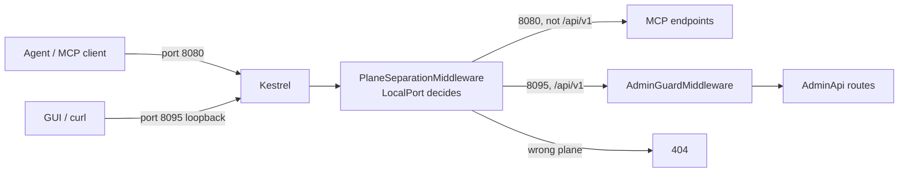
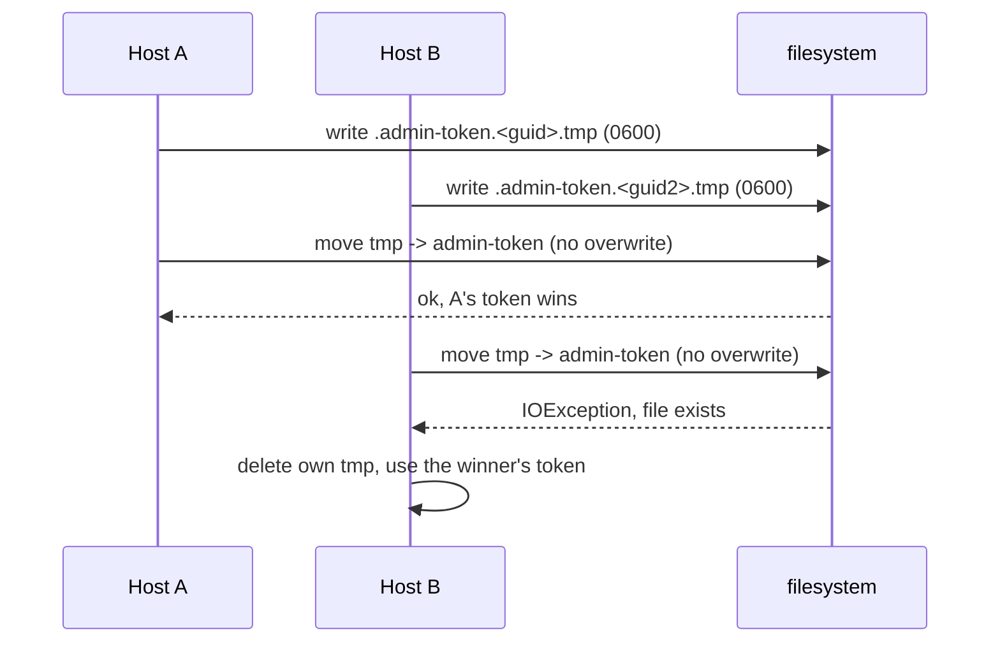
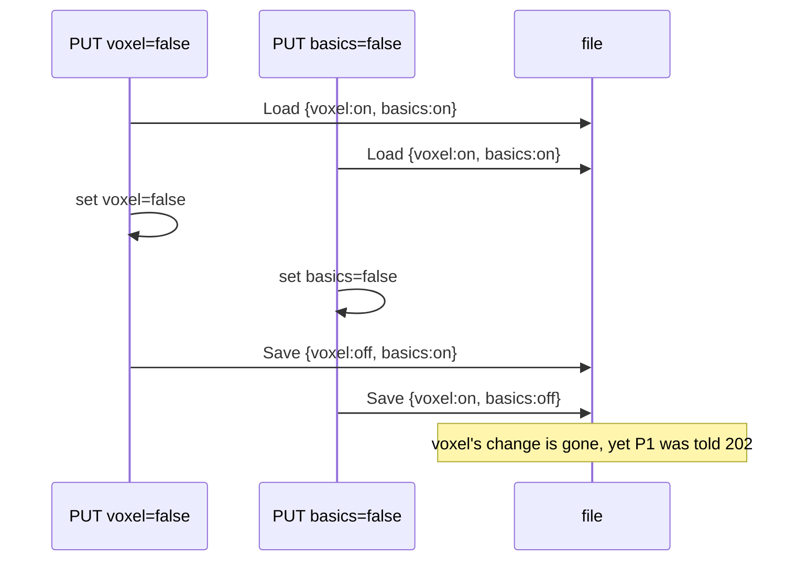

2026_11_12_09_00-Two-Doors-One-Key-And-One-Pen

# Lecture 015: Two Doors, One Key, and One Pen

Written after issues #35 (admin API) and #36 (admin token), ADR-019 and ADR-020. Lecture 012 asked "who owns which door". This lecture is about a door that is not for agents at all: the one the GUI and `curl` use to change what the server is doing. Every snippet below is real code in this repo, so keep the file open beside the text.

## 0. The big picture first

Before these issues, the only way to turn Voxel off was to edit `desired-state.json` by hand (Lecture 013) and let the reconciler (Lecture 014) notice. The GUI in epic #23 needs a proper API to do that, and the API must not be reachable by the agents it governs. Four ideas make that safe and correct:

1. Control plane vs data plane: two doors on two different ports. (Section 1)
2. Token auth: a secret file, compared without leaking timing. (Section 2)
3. DNS rebinding: why a loopback-only listener still needs Host and Origin checks. (Section 3)
4. Honest write semantics: 202 Accepted, stable error codes, and one write lock. (Sections 4 and 5)

The cast:

| Character | Role | File |
|---|---|---|
| The Usher | Decides which plane a request belongs to, by the socket it arrived on | `src/ToolBox.Host/PlaneSeparationMiddleware.cs` |
| The Gatekeeper | Host, Origin, token and content-type checks, before routing | `src/ToolBox.Host/AdminGuardMiddleware.cs` |
| The Keyholder | Creates, reads, rotates and validates the secret | `src/ToolBox.Core/Admin/AdminTokenStore.cs` |
| The Receptionist | The routes themselves | `src/ToolBox.Host/AdminApi.cs` |
| The Scribe | The only writer of the desired-state file | `src/ToolBox.Host/AdminWriteService.cs` |
| The Complaints Desk | Errors with stable machine-readable codes | `src/ToolBox.Host/AdminProblems.cs` |

## 1. Control plane vs data plane

Networking and infrastructure split a system into two planes:

- **Data plane:** the traffic the system exists to carry. Here, MCP: an agent calls a tool.
- **Control plane:** the traffic that configures the system. Here, `PUT /api/v1/toolsets/voxel/enabled`.

You already know this from embedded work: the bytes flowing over an I2C bus are the data plane; writing the chip's configuration registers is the control plane. Kubernetes, Azure networking and every load balancer are built the same way, and "keep the two apart" is a standard interview answer to "how do you stop a tenant reconfiguring the platform?"

The key decision (epic #23, decision 7): admin operations are **plain minimal-API routes, never MCP tools**. If "disable Voxel" were an MCP tool, the agent could call it. It would have a door to change its own permissions. By making the admin API not part of MCP at all, the agent has no tool that reaches it.

### 1.1 Separate by socket, not by header

The admin API listens on its own loopback port (`Ports:Admin`, 8095), added to the same `WebApplication` as a second URL. Now the question: when a request arrives, how does the server know which plane it belongs to?

The tempting answer is the `Host` header (`Host: localhost:8095`). That is wrong, and the ADR says why: **the Host header is written by the client.** Anyone can send `Host: localhost:8095` to port 8080. The only thing the client cannot fake is which socket its TCP connection landed on. ASP.NET exposes that as `HttpContext.Connection.LocalPort`:

```csharp
// src/ToolBox.Host/PlaneSeparationMiddleware.cs
bool onAdmin = admin.IsAdminPort(context.Connection.LocalPort);
bool adminPath = context.Request.Path.StartsWithSegments(AdminPrefix, StringComparison.OrdinalIgnoreCase);

if (onAdmin != adminPath)
{
    context.Response.StatusCode = StatusCodes.Status404NotFound;
    return Task.CompletedTask;
}
return next(context);
```

Read the `!=` carefully, because it encodes two rules in one line:

| Arrived on | Path starts `/api/v1` | `onAdmin != adminPath` | Result |
|---|---|---|---|
| MCP port | no | false | continue (normal MCP traffic) |
| MCP port | yes | true | 404 (the control plane does not exist here) |
| Admin port | yes | false | continue (to the guard) |
| Admin port | no | true | 404 (the admin port serves nothing else) |

Both planes answer 404 about the other's routes, so neither reveals the other exists. The analogy: the Usher at a building with two entrances. He does not read your ticket to decide which entrance you are at; he looks at which door you walked through.



### 1.2 The guard runs before routing

`AdminGuardMiddleware` guards the **socket**, not individual routes. Compare two designs:

- **Per-route:** put `[Authorize]` on every endpoint. A new endpoint added next month with the attribute forgotten is silently open.
- **Per-socket (chosen):** everything that arrives on the admin port passes through the guard before the router even looks at the path. A new endpoint cannot be added outside it.

The ADR adds a second safety net: a test enumerates the `/api/v1` endpoint table and asserts each answers 401 without a token. Design so the safe path is the default, then test that it stays so. That is "secure by construction" rather than "secure by discipline".

Order inside the guard matters too, and is deliberate: Host and Origin (they need no secret, so they reject cheaply), then the token, then content-type.

## 2. Token auth

Loopback binding keeps other machines out, but any program run by any user on this machine can still connect to 127.0.0.1:8095. The token is what proves "this caller can read a file only I can read".

### 2.1 Generating and storing the secret

```csharp
// src/ToolBox.Core/Admin/AdminTokenStore.cs
byte[] bytes = RandomNumberGenerator.GetBytes(32);
string token = Convert.ToBase64String(bytes).TrimEnd('=').Replace('+', '-').Replace('/', '_');
```

32 bytes is 256 bits from the operating system's cryptographically secure generator. `System.Random` would be a bug here: it is predictable. base64url makes it safe in a header without escaping.

The file is `0600` (owner read/write only) in a `0700` directory on Unix:

```csharp
options.UnixCreateMode = UnixFileMode.UserRead | UnixFileMode.UserWrite; // 0600
```

Notice it is set **at creation**, not after. If you create the file with default permissions and `chmod` afterwards, there is a window where another user could read it. This is a classic bug called a TOCTOU (time-of-check to time-of-use) race. You will recognise the permission bits from Linux work; `0600` is the same number as `chmod 600 ~/.ssh/id_rsa`, and ssh refuses a key file that is too open for exactly this reason. `TightenIfLoose()` repairs a file that was made loose by someone else and logs the path, never the token. On Windows the per-user `LocalApplicationData` ACL does the job.

### 2.2 The create race

Two hosts starting at the same instant both see "no token file" and both try to create one. A naive `File.WriteAllText` would let the second overwrite the first, so the first host would hold a token that no longer matches the file. Worse, a reader could see a half-written file.

The solution is the pattern "write to a temp file, then atomically move into place **without overwrite**":

```csharp
try
{
    File.Move(tmp, Path, overwrite);   // overwrite is false for EnsureExists
    tmp = string.Empty;
}
catch (IOException) when (!overwrite && File.Exists(Path))
{
    // Lost the create race: keep the winner's token. Our temp file is deleted below.
}
```



The rename is atomic: a reader sees either no file or the complete file. The loser does not fail; it loses gracefully and adopts the winner's token. This "create if absent, else accept the winner" shape appears everywhere in distributed systems (leader election, leases, idempotent creates). Rotation uses the same code with `overwrite: true`, because there replacing is the point.

### 2.3 Constant-time compare

```csharp
byte[] actual = SHA256.HashData(Encoding.UTF8.GetBytes(presented));
return CryptographicOperations.FixedTimeEquals(expected, actual);
```

An ordinary `==` on strings stops at the first differing character. An attacker measuring response times can learn "the first 3 characters were right", then guess the fourth, and so on: a **timing side channel**. `FixedTimeEquals` always takes the same time for the same length. It requires equal-length inputs, which is why both sides are hashed first: SHA-256 always yields 32 bytes, so the compare is always legal and the real token's length leaks nothing.

Only the hash is cached (`_cachedHash`), keyed by the file's modification time and length. Consequence: replacing the file by hand, or calling `Rotate()`, takes effect on the next request with no restart, and the plain token is never held in memory longer than needed.

### 2.4 Rules the token must never break

From ADR-019: it is sent only as `Authorization: Bearer ...`. Never in a query string (URLs end up in access logs, browser history and proxies). Never logged, never in a response, never in an exception message. There is **no endpoint that hands the token out**. `POST /api/v1/token/rotate` returns 204 with no body; the caller, being the same OS user, re-reads the file. An API that returns the secret to anyone who has the secret adds nothing, and one that returns it to anyone else is a hole.

## 3. DNS rebinding, and why loopback is not enough

The attack: you visit `evil.example` in your browser. Its DNS first answers with the attacker's server (so the page loads), then, a few seconds later, answers `127.0.0.1`. The page's JavaScript now believes `evil.example` is its own origin, so the browser's same-origin policy lets it make requests to your local admin port and read the answers. From the browser, it is "same site". From your machine, it is a web page reaching into localhost.

What gives it away is that the browser still sends `Host: evil.example` and `Origin: http://evil.example`. So the guard checks:

```csharp
if (!IsLoopbackName(request.Host.Host) || request.Host.Port != localPort)
    return Reject(context, StatusCodes.Status421MisdirectedRequest);

if (request.Headers.TryGetValue(HeaderNames.Origin, out var origin) && origin.Count > 0
    && !IsAllowedOrigin(origin.ToString(), localPort))
    return Reject(context, StatusCodes.Status403Forbidden);
```

Wait: Section 1.1 said the Host header is not a boundary. Is this a contradiction? No, and the distinction is the core insight:

| Question | Who is the adversary | Host header trustworthy? |
|---|---|---|
| "Which plane is this request for?" | A client that can write any header | No, so use `LocalPort` |
| "Is a browser being tricked into talking to me?" | A web page, whose browser sets Host and Origin honestly and the page cannot override them | Yes, that is the signal |

A browser enforces those headers on the page; `curl` can send anything, but `curl` already needs the token. Host/Origin stop the browser attacker; the token stops everyone else. The ADR calls Host/Origin "defence in depth" and the bearer token "the real barrier".

Two more small pieces. An absent Origin is allowed, because `curl` and the GUI send none. And **no CORS headers are ever emitted**: without `Access-Control-Allow-Origin` a browser can neither read a cross-site response nor pass a preflight carrying `Authorization`. Doing less here is the secure choice. Finally, writes must be `application/json` (415 otherwise), so a "simple" cross-site HTML form post, which cannot set that header, never reaches a handler.

Notice the same attack applies to the MCP port; ADR-019 admits that and tracks it as #66 instead of pretending it is solved. Naming a known gap with its issue number is a good habit in design docs.

## 4. 202 Accepted, and stable problem codes

### 4.1 Why not 200?

The reconciler is asynchronous (Lecture 014). `PUT enabled=false` saves the intent and calls `RequestReconcile()`, which returns nothing: it queues work. When the handler returns, Voxel may still be running. Answering `200 OK` would claim "done" when the truth is "durably recorded, work queued". HTTP has a status for exactly that: **202 Accepted**.

```csharp
// src/ToolBox.Host/AdminWriteService.cs
return Results.Json(new
{
    saved = true,
    reconcile = "requested",
    backupPath,
    toolset = DesiredRosterSource.Describe(resolution, _board, canonicalId),
}, statusCode: StatusCodes.Status202Accepted);
```

Your manual verification shows it: `PUT enabled=false` gave 202, `desired` was already false, `actual` was still on, and a moment later `actual` became off. That gap is the whole lesson. The client's job is to poll `GET /status`. Two states, desired and actual, are the reconciler's vocabulary (Lecture 014) now leaking honestly into the API.

The same logic as the pattern of "long-running operation" in Azure APIs: `202` plus a way to check. `?wait=true` (block until finished) was deliberately deferred until the GUI needs it: do not build the convenience before the consumer exists.

A subtle detail: `desired` and `effective` in the 202 body are computed from the state **just saved**, not from the roster's cache, which is stale until the loop refreshes. Reporting the cache would have the response contradict the write that just succeeded.

### 4.2 Errors a program can switch on

```csharp
// src/ToolBox.Host/AdminProblems.cs
public static IResult UnknownToolset(string id) =>
    Create(StatusCodes.Status404NotFound, "unknown-toolset", $"No toolset with id '{id}'.");
```

The format is RFC 9457 `application/problem+json`: a standard envelope (`status`, `title`) plus an extension member `code`. The rule from ADR-020: **clients switch on `code`, never on prose.** The `title` is for humans and may be reworded in any release; the `code` is a contract.

| Code | Status | Meaning |
|---|---|---|
| `unknown-toolset` | 404 | No such id |
| `pinned-by-env` | 409 | The environment pins `enabled`; nothing was written |
| `desired-state-unsupported` | 409 | File from a newer build; left byte-identical |
| `desired-state-write-failed` | 500 | Disk failed; previous file intact |
| `invalid-body` | 400 | Not JSON, or wrong shape |

Why 409 for the pin? 409 Conflict means "the request is fine, but the resource's current state forbids it". The same PUT would succeed with the pin removed. The check order (unknown id, then pin, then body, then write) is also deliberate: cheapest and most fundamental refusal first, and nothing touches the disk until every refusal has had its say.

The design with two PUTs (`/enabled` and `/settings`) rather than one `PATCH`: each is idempotent (repeat it, same result), each maps to one field of `DesiredToolset`, and saving settings can never accidentally clear `enabled`.

## 5. Lost updates and the write lock

This is the section on asynchronous programming and race conditions that your persona lists as a weakness, so go slowly.

### 5.1 The bug that would have shipped

Every change to the desired-state file is a **read-modify-write**: load the whole file, change one toolset, save the whole file. The store already has a lock, but look at what it covers: only `Save`. Now two PUTs arrive at once, one for `voxel`, one for `basics`:



Each `Save` was individually safe. The problem is the **gap between Load and Save**: both requests built their change on a snapshot that was already out of date. P1 was told "accepted" and its change silently vanished. This is a **lost update**, one of the classic concurrency anomalies, the same one that databases fight with transactions and optimistic concurrency (ETags, row versions). Tool_Box has the same shape in miniature, and in Lecture 009 you met its cousin: the Voxel `Dictionary` data race.

A lock around `Save` cannot fix it, because the dangerous span is Load through Save. The lock must cover the whole critical section:

```csharp
// src/ToolBox.Host/AdminWriteService.cs
private readonly SemaphoreSlim _writeLock = new(1, 1);

await _writeLock.WaitAsync(ct);
try
{
    DesiredStateLoadResult loaded = _store.Load();
    // ... modify one toolset ...
    _store.Save(state);
    _reconciler.RequestReconcile();
    // ... return 202 ...
}
finally
{
    _writeLock.Release();
}
```

### 5.2 Why `SemaphoreSlim`, not `lock`

The C# `lock` statement cannot contain an `await`; the compiler forbids it, because a `lock` is tied to a thread and an `await` may resume on a different one. `SemaphoreSlim(1, 1)` is a counter with one permit, not tied to any thread, with an awaitable `WaitAsync`. While one request holds the permit the others are parked as cheap continuations, not as blocked threads. That is the async-friendly mutex. The `try/finally` is not optional: an exception that skipped `Release()` would deadlock every future write, forever.

The `ct` passed to `WaitAsync` lets a client that disconnects stop waiting in the queue.

### 5.3 What the lock does not do

ADR-020 is honest about scope: the lock is per process. If a human edits the file in an editor during a PUT, they can still race. That was accepted in ADR-017. Also, two hosts (several stdio hosts, for instance) would each have their own lock. Know which boundary a lock protects. In a multi-server system this is where you would reach for a database transaction or a distributed lock, and "a lock in memory is not a lock across processes" is a common interview probe.

Smaller correctness choices in the same method are worth reading:

- An unchanged value skips the write but still requests a reconcile: cheap, and it self-heals a drifted state.
- A missing or corrupt file always gets a write, so the file ends up holding the intent.
- `POST /reconcile` takes no lock because it writes nothing.

### 5.4 Proving the lock matters

A test that passes whether or not the lock exists proves nothing. Your manual check removed the lock and ran the concurrent test: **3 runs, 3 failures**; with the lock restored, it passes. That is a "mutation check" and you did it by hand. The test:

```csharp
// tests/.../AdminToolsetTests.cs
for (int round = 0; round < 20; round++)
{
    var responses = await Task.WhenAll(ids.Select(id => PutEnabled(id, ...)));
    ...
    // read the file and check every toolset has the value we just wrote
}
```

Three design choices make it reliable rather than lucky: three requests fired simultaneously with `Task.WhenAll`, twenty rounds, and every round flips all values so a stale value cannot coincidentally equal the expected one. Even so, three failures out of three is evidence, not proof: a race test is a probabilistic detector, and "it passed" never proves absence. Say that out loud in an interview, and you will sound like someone who has debugged races. Without a readable message, the failure was an unhelpful `NullReferenceException`; asserting with a sentence naming the lost toolset turns a regression into a diagnosis.

## 6. The whole walk, end to end

A `PUT /api/v1/toolsets/voxel/enabled` with `{"enabled": false}`:

1. Kestrel accepts the connection on 8095. `LocalPort` is 8095.
2. `PlaneSeparationMiddleware`: admin port and `/api/v1` path, continue.
3. `AdminGuardMiddleware`: Host is `127.0.0.1:8095` (else 421); Origin absent or loopback (else 403); bearer token hashes equal (else 401); `Content-Type: application/json` (else 415).
4. Routing finds the PUT handler. `CheckEnabledWritable`: id known (else 404), not pinned (else 409).
5. Body parsed: bad JSON or wrong shape gives 400 `invalid-body`.
6. `AdminWriteService.SetEnabledAsync` takes the write lock, loads, modifies, saves, requests a reconcile, releases.
7. 202 returns. The reconciler, on its own schedule, stops Voxel and releases port 8090.
8. The caller polls `GET /status` until `actual` is off.

## 7. Common mistakes

- Trusting the `Host` header to choose a plane or authenticate. It proves nothing about who sent it.
- `==` to compare secrets. Use `FixedTimeEquals`.
- Creating a secret file with default permissions, then `chmod`. Create it restricted.
- Overwrite on create: lets a racing process invalidate the winner's token.
- Putting a token in a URL.
- Returning 200 for work that has merely been queued.
- Clients that parse the error message instead of a code.
- Locking only the write, when the hazard is the read-modify-write.
- `lock` around an `await` (does not compile) or a `SemaphoreSlim` without `finally`.
- Declaring a concurrency test good because it passes, without proving it fails when the protection is removed.

## 8. Interview relevance

- "Design an admin API for a service whose clients must not reconfigure it." Two planes, separate port, guard at the socket, token from an owner-only file.
- "How do you compare secrets?" Constant time, and why length must be equalised first.
- "What is DNS rebinding and does binding to localhost stop it?" No; explain Host/Origin and the token.
- "What is a lost update and how do you prevent it?" Lock the whole read-modify-write in a single process; transactions or optimistic concurrency (ETag) across processes.
- "When do you return 202?" When the work is accepted but not complete; return enough for the client to poll.
- Real-world cousins: Docker's daemon socket (a control plane whose access equals root), Kubernetes API server vs the pods it runs, kubelet's authenticated port, Azure's `202` plus `Location` long-running-operation pattern, Jupyter's per-run token.

## 9. Self-check questions

1. A client sends `Host: localhost:8095` to port 8080 and asks for `/api/v1/status`. What does it get, and which line decides? What would change if separation used the Host header?
2. Why is the guard middleware attached to the admin socket rather than as an attribute on each endpoint? What test backs that up?
3. Two hosts start together and both see no token file. Walk through what each does. What is the end state, and what does the loser do with its temp file?
4. Why hash both values before `FixedTimeEquals`, instead of comparing the raw strings in constant time?
5. DNS rebinding sends a request to 127.0.0.1. Which header values give it away, and why can a hostile web page not forge them while `curl` can? Then why is the token still needed?
6. After `PUT enabled=false` returns 202, `GET /status` shows `actual: on`. Is that a bug? What should a client do?
7. Draw the interleaving in which two PUTs to different toolsets lose an update with a lock only around `Save`. Which span must the lock cover?
8. Why `SemaphoreSlim` instead of `lock`? What happens to the server if `Release()` is skipped on an exception?
9. The concurrency test failed 3 of 3 without the lock. What does that prove and what does it not prove?
10. The lock is per process. Describe one scenario in this project it does not protect against, and what you would use if the file were shared by several servers.

## 10. Where to read next

- `docs/DECISIONS.md` ADR-019 and ADR-020: the decisions in their own words, including what was rejected.
- Lecture 014 (the reconciler these writes trigger) and Lecture 013 (the file they write).
- Topics that follow naturally: optimistic concurrency with ETags and `If-Match`; the OWASP guidance on SSRF and DNS rebinding; RFC 9457; Unix file permissions and `umask`; OAuth bearer tokens versus session cookies.
