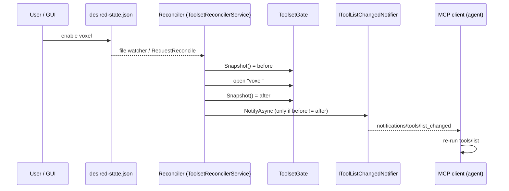

2026_11_14_06_00-Telling-The-Client-What-Changed

# Lecture 016: Telling the Client What Changed

Written after issue #34 (`tools/list_changed` after a reconcile) and ADR-022. Lecture 014 built the reconciler that turns toolsets on and off while the host runs. This lecture is about the next problem: the agent on the other end of the wire does not know. Every snippet is real code in this repo. Where the lecture relies on something only the ADR claims (the MCP spec direction, SDK 2.0 in #77), it says so rather than presenting it as something I verified.

## 0. The big picture first

After Lecture 014, flipping `voxel` to enabled in `desired-state.json` opens a gate inside the host and `place_block` starts working. But a client that already ran `tools/list` is holding the old list in its head. It will never call `place_block` because it does not know it exists. The fix has a name in MCP: the server pushes `notifications/tools/list_changed`, and the client re-runs `tools/list`.



Seven ideas, in this order:

1. Server-initiated notifications and the `listChanged` capability. (Section 1)
2. Why stateless HTTP cannot push. (Section 2)
3. Edge-triggered notification by diffing snapshots. (Section 3)
4. A null-object seam, chosen per transport. (Section 4)
5. Characterization tests: the spike. (Section 5)
6. Testing events: await a signal, prove absence with a sentinel. (Section 6)
7. Why only a child process can guard `Program.cs`. (Section 7)

Then the spec direction (Section 8), common mistakes, interview relevance and self-check questions.

The cast:

| Character | Role | File |
|---|---|---|
| The Town Crier | Pushes the "list changed" message down a live connection | `StdioToolListChangedNotifier` in `src/ToolBox.Host/ToolListChangedNotifier.cs` |
| The Silent Clerk | Same job description, does nothing | `NullToolListChangedNotifier`, same file |
| The Night Watchman | Compares the building before and after his round, rings the bell only if something differs | `ToolsetReconcilerService.ReconcileOnceAsync` in `src/ToolBox.Host/ToolsetReconcilerService.cs` |
| The Wiring Inspector | Checks that the Town Crier was actually hired in the real building | `ToolListChangedChildProcessTests.cs` |

## 1. Notifications and the `listChanged` capability

MCP is JSON-RPC 2.0. JSON-RPC has two kinds of message:

| Kind | Has an `id`? | Expects a reply? | Example |
|---|---|---|---|
| Request | yes | yes | `tools/list`, `tools/call` |
| Notification | no | no, fire and forget | `notifications/tools/list_changed` |

Most of MCP is client-asks, server-answers. A notification is the one place the server speaks first. The message carries no payload: it says "your list is stale", not "here is the new list". The client must ask again. That keeps the server stateless about what each client last saw.

A server may only send it if it promised to, during the handshake. The `initialize` response carries capabilities, and `tools.listChanged = true` is the promise. The spike test reads it from the client side:

```csharp
// tests/ToolBox.Host.Tests/SdkListChangedSpikeTests.cs
bool? listChanged = rig.Client.ServerCapabilities.Tools?.ListChanged;
Assert.True(listChanged == true, ...);
```

Why a capability and not "just send it"? Because a client that was never told to expect it may ignore or choke on it, and because a server that advertises a promise it cannot keep (see Section 2) is lying. Note that the notification is an optimisation, not the source of truth. A client that ignores it still gets correct state on its next `tools/list`, and a stale call gets `toolset 'x' is off` (ADR-022, Consequences).

## 2. Why stateless HTTP cannot push

Look at what the production notifier does:

```csharp
// src/ToolBox.Host/ToolListChangedNotifier.cs
var server = services.GetService<McpServer>();
if (server is null) return;
await server.SendNotificationAsync(NotificationMethods.ToolListChangedNotification, cancellationToken: ct);
```

`McpServer` here is one object holding one connection to one client. On stdio that is true by construction: one process, one pair of pipes (stdin/stdout), one session that lives as long as the process. The server can write to stdout whenever it likes.

Stateless streamable HTTP (ADR-007, `Stateless = true`) is the opposite. Each `POST /mcp` is a self-contained request and response. There is no session ID, and nothing stays open between requests. To push you need somewhere to push to: an open connection (an SSE stream) tied to a specific client. Stateless mode has no such stream. The spike measured this rather than assuming it:

```csharp
// SdkListChangedSpikeTests.Spike_1_2
Assert.True(resp.StatusCode is HttpStatusCode.MethodNotAllowed, ...);   // GET /mcp (SSE) => 405
```

Analogy for the metaphor-inclined: stdio is a phone call in progress, so the Town Crier can just speak. Stateless HTTP is a post office counter. People come, ask, get an answer and leave. There is no one standing there to tap on the shoulder, and no address to send a letter to.

The second finding is just as important: on SDK 1.4.1, stateless HTTP does not advertise `tools.listChanged` either, which is the honest behaviour. A regression pin keeps it that way:

```csharp
// Spike_1_3_Initialize_StatelessHttp_ObserveListChanged
Assert.True(listChanged != true, ...);
```

The alternative, stateful HTTP with sessions, was considered and rejected in ADR-022: it reverses ADR-007, needs session tracking (and with it sticky routing if you ever scale out, a topic from Lecture 009), and the ADR notes the MCP spec dated 2026-07-28 moves away from HTTP sessions (Section 8).

## 3. Edge-triggered notification by diffing snapshots

The temptation is to notify wherever the gate changes: put a call in `ToolsetGate.Open()` and `Close()`. ADR-022 rejects this for two reasons that are worth learning because they generalise.

1. Layering. `ToolsetGate` lives in `ToolBox.Core`, and Core must not know MCP (ADR-003). Notifying from the gate would drag `ModelContextProtocol` into Core.
2. Granularity. One reconcile pass may flip several toolsets. A notification per flip sends a burst while the roster is half applied, and the client may re-list in the middle and see a state that never existed as a whole.

So the Night Watchman notifies once per pass, after the pass, by comparing what the world looked like before and after:

```csharp
// src/ToolBox.Host/ToolsetReconcilerService.cs, ReconcileOnceAsync
var before = _gate.Snapshot();
var roster = _roster.Refresh();
var result = await _reconciler.ReconcileAsync(roster, ct);
var changed = !before.SequenceEqual(_gate.Snapshot(), StringComparer.OrdinalIgnoreCase);
...
if (changed) await NotifySafelyAsync(ct);
```

This is edge-triggered: we signal on a transition of the observable state, not on every attempt (level-triggered would mean "tell them whenever the reconciler runs"). The diff buys correctness in exactly the cases that confuse event-per-action designs:

| Scenario | Gate before | Gate after | Notify? |
|---|---|---|---|
| Enable voxel, start succeeds | no voxel | voxel | yes, once |
| Enable voxel, start throws (gate closed again) | no voxel | no voxel | no, nothing visible changed |
| Start one toolset and stop another in one pass | A | B | yes, exactly once |
| Pass with no file change | same | same | no |
| Startup and shutdown reconciles | n/a | n/a | never, they do not come through this method |

The comment in the code records the reasoning: "a failed start closes the gate again, so before == after and nothing is sent". Notice what you are comparing: the thing the client can observe (which toolsets are visible), not the actions the reconciler took. `result.Started.Count > 0` would be true for a start that later failed to open the gate; the snapshot cannot lie that way.

This is the same shape as Kubernetes controllers and React rendering: compute desired vs observed, act on the difference. It is also an idempotence habit: running the pass twice is harmless, because the second diff is empty.

## 4. The null-object seam, chosen per transport

The reconciler needs to call "the notifier", but which notifier depends on the transport, which is decided in `Program.cs`, far from the reconciler. The pattern:

```csharp
// src/ToolBox.Host/ToolListChangedNotifier.cs
internal interface IToolListChangedNotifier { ValueTask NotifyAsync(CancellationToken ct); }

internal sealed class NullToolListChangedNotifier : IToolListChangedNotifier
{
    public ValueTask NotifyAsync(CancellationToken ct) => ValueTask.CompletedTask;
}
```

```csharp
// src/ToolBox.Host/ToolBoxServerComposition.cs
services.TryAddSingleton<IToolListChangedNotifier, NullToolListChangedNotifier>();
```

```csharp
// src/ToolBox.Host/Program.cs, RunStdioAsync
builder.Services.Replace(ServiceDescriptor.Singleton<IToolListChangedNotifier, StdioToolListChangedNotifier>());
```

Why this way round:

- The default is the safe one. `TryAddSingleton` registers the no-op only if nothing is registered yet. Any host that forgets to opt in gets silence, not a crash. HTTP simply keeps the default, which is the correct behaviour for stateless HTTP.
- The reconciler has no `if (transport == "stdio")`. It always calls `NotifyAsync`. This is the null object pattern: instead of a `null` check at every call site, supply an object whose behaviour is "nothing".
- `Replace` (rather than `Add`) swaps the default. With `Add`, there would be two registrations and last-wins would work by accident; `Replace` states the intent and removes the old one.
- Core is untouched (ADR-003). The interface lives in Host, next to the only code that knows about MCP.

The Town Crier is also defensive. Three details worth reading:

1. `services.GetService<McpServer>()` is lazy and tolerant. Before a client connects there may be no server, and "nobody to tell yet" is fine, not an error.
2. A real exception is caught and logged as a warning with the reasoning in the message: clients will see the change on their next `tools/list`. The notification is best-effort.
3. `OperationCanceledException` when the token is cancelled is rethrown, never swallowed. Swallowing cancellation makes shutdown hang. The service repeats this discipline one level up in `NotifySafelyAsync`, and the loop keeps running if a notifier throws (tested by `ANotifierThatThrows_DoesNotBreakTheLoop`). Logging goes to stderr only because stdout is the protocol channel (ADR-004).

## 5. Characterization tests: the spike

Before writing production code, step 1 of #34 wrote tests that assert what the SDK does today, not what we wish it did. `SdkListChangedSpikeTests.cs` says so in its header: "CHARACTERIZATION TESTS: these record what SDK 1.4.1 actually does (observed, not guessed)".

Why it matters:

- A spike answers a question (can stdio push? how do I get the server object? what does HTTP do?) with evidence, before a design is built on a guess.
- Keeping the spike as tests turns a one-time experiment into a tripwire. The four spikes pin four facts: 1.1 stdio can send and `McpServer` resolves from DI; 1.2 stateless HTTP delivers nothing and GET returns 405; 1.3 capability advertising per transport; 1.4 an explicit `Capabilities.Tools.ListChanged = false` is a working knob.
- The failure messages are written for a future reader. The HTTP pin says: "after #77, HTTP push exists and this pin should be revisited". A red characterization test after an SDK upgrade is not a bug, it is the SDK telling you exactly which behaviour moved. That is how issue #77 (the SDK 2.0 evaluation, named in ADR-022) will find out what it changes without reading a changelog line by line.

Contrast with a normal unit test, which asserts the behaviour you intend. A characterization test asserts the behaviour you observe, so you can change code safely around something you do not own.

One honest wrinkle the author flagged himself: spike 1.2 has to prove that something did not arrive, and uses a short bounded wait ("absence cannot be awaited"). That is acceptable in a throwaway-style spike; Section 6 shows how the real tests avoid it.

The spike also used a rig worth recognising: an in-process `Pipe` pair standing in for stdin/stdout.

```csharp
var clientToServer = new Pipe();
var serverToClient = new Pipe();
... .WithStreamServerTransport(clientToServer.Reader.AsStream(), serverToClient.Writer.AsStream());
var client = await McpClient.CreateAsync(new StreamClientTransport(
    clientToServer.Writer.AsStream(), serverToClient.Reader.AsStream()));
```

A real server and a real client, real JSON-RPC, no process, no sockets. That is a fast, deterministic stand-in for stdio.

## 6. Testing events: await a signal, prove absence with a sentinel

Event tests have two classic failure modes: `Thread.Sleep(2000)` and hope (slow when right, flaky when the machine is busy), and asserting "nothing happened" after a sleep (passes if you simply did not wait long enough).

Part one, waiting for a thing that should happen. Do not sleep; complete a signal from the handler and await that. In the child-process test:

```csharp
var notified = new TaskCompletionSource(TaskCreationOptions.RunContinuationsAsynchronously);
client.RegisterNotificationHandler(NotificationMethods.ToolListChangedNotification, (_, _) =>
{
    notified.TrySetResult();
    return ValueTask.CompletedTask;
});
...
await notified.Task.WaitAsync(cts.Token);
```

A `TaskCompletionSource` is a Task whose completion you control by hand: the handler is the producer, the test is the consumer. The wait returns the instant the event fires, and the 60 second token only bounds failure, as the comment says. Two details:

- `TrySetResult`, not `SetResult`: a second notification would throw on `SetResult` inside the SDK's handler.
- `TaskCreationOptions.RunContinuationsAsynchronously`: without it, the awaiting test code could run inline on the thread that called `TrySetResult`, which is the SDK's receive loop. Running test code on someone else's critical thread is a classic path to deadlocks. This links to your async weaknesses in persona.md: continuations run where you complete the task unless you say otherwise.

The in-process stdio tests use the sibling primitive, a counting `SemaphoreSlim`, because they need to wait for more than one notification:

```csharp
// ToolListChangedStdioTests.cs
private readonly SemaphoreSlim _notifications = new(0);
...
Assert.True(await _notifications.WaitAsync(Bound), "no tools/list_changed within the bound");
```

Part two, proving something did not happen. You cannot wait for nothing. The trick is a sentinel: after the thing that should be silent, trigger a thing that must produce a signal, wait for that, and then check the count. Because the client receives notifications in order, if the quiet pass had sent one it would be in the count before the sentinel's.

```csharp
// ToolListChangedStdioTests.AReconcileWithNoChange_SendsNothing_ARealChangeSendsExactlyOneMore
reconciler.RequestReconcile(); // nothing changed: must not notify
File.WriteAllText(FilePath, VoxelFile(on: true));
reconciler.RequestReconcile();
await AwaitNotificationAsync();
...
reconciler.RequestReconcile(); // still nothing changed
File.WriteAllText(FilePath, VoxelFile(on: false));
reconciler.RequestReconcile(); // sentinel: a real change
await AwaitNotificationAsync();
...
Assert.Equal(2, Volatile.Read(ref _count));
```

`FailedStart_DoesNotNotify` in `ReconcileNotificationTests.cs` uses the same idea with a different sentinel: voxel's start throws, then embedded really opens, and the count must be exactly 1. The sentinel is a real behaviour, not a delay, so the test is as fast as the code and as strict as the assertion.

Also notice the ordering guarantee the production code gives the tests. The notification is sent after the gate is final, so when the client wakes it can immediately `ListToolsAsync()` and see `place_block`. The test comment says it: "the gate was opened before the notification, so the list is already fresh". That is the same race a real agent would hit: notify before the state is ready and the agent re-lists and sees the old list.

An honest caveat from reading the code, not a criticism: `ReconcileNotificationTests` uses a polling helper (`Eventually`, with `Task.Delay(10)` and a 10 second deadline) rather than a signal, because it uses a `CountingNotifier` and a manual clock. It still avoids a fixed sleep (it exits as soon as the condition is true) and still uses sentinels for absence, but it is polling, not awaiting a completion. Know the difference when you choose.

## 7. Why a child-process test guards `Program.cs`

Two layers of test cover this feature, and the second exists because of a blind spot in the first.

| Test | What is real | What it can prove | What it cannot prove |
|---|---|---|---|
| `ReconcileNotificationTests` | Reconciler service, fake notifier | The diff logic, once per pass, failure handling | That anything reaches a client |
| `ToolListChangedStdioTests` | Production composition, real SDK server, real client over pipes | The reconciler plus the real Town Crier deliver the notification | That `Program.cs` hires the Town Crier |
| `ToolListChangedChildProcessTests` | The unmodified `ToolBox.Host.dll` over real stdio | Everything, including `Program.cs` | (slower, so only one) |

Look closely at the middle test's setup:

```csharp
// ToolListChangedStdioTests.InitializeAsync
// The same replacement Program.RunStdioAsync makes.
builder.Services.Replace(ServiceDescriptor.Singleton<IToolListChangedNotifier, StdioToolListChangedNotifier>());
```

The test copies the one line from `Program.cs`. If someone deletes that line from `Program.cs`, this test still passes, because it carries its own copy. The default `NullToolListChangedNotifier` would quietly take over in production: the app would build, every test but one would be green, and stdio clients would never be told. The file header of the child-process test says exactly this: "5a alone would pass even if that registration were forgotten".

This is the same lesson as Lecture 009's finding that two of the three real bugs lived in the single untested file. Startup wiring in `Program.cs` is the hardest code to test because the SDK and the host own it, and it is where the transport is chosen. The only way to execute it is to start it:

```csharp
var transport = new StdioClientTransport(new StdioClientTransportOptions
{
    Command = "dotnet",
    Arguments = [hostDll],
    EnvironmentVariables = new Dictionary<string, string?>
    {
        ["TOOLBOX_Desired__Path"] = FilePath,
        ["TOOLBOX_Ports__Viewer__Port"] = "0",
    },
    StandardErrorLines = line => { lock (stderr) { stderr.AppendLine(line); } },
});
```

Things to notice:

- `StdioClientTransport` launches the process and speaks the real protocol over its stdin/stdout. The test is a genuine MCP client of the genuine binary.
- Configuration travels by the same `TOOLBOX_` environment layer `RunStdioAsync` reads. `__` is the .NET convention for `:` in env var names, so `TOOLBOX_Desired__Path` becomes `Desired:Path`. The comment warns that `TOOLBOX_TOOLSETS` must not be set, because that pins the set and would ignore the file.
- `Ports__Viewer__Port = "0"` asks the OS for an ephemeral port so the test cannot collide with a developer's real viewer. This is the lesson of the orphaned process squatting on 8090 in plan 005.
- Without `RequestReconcile()` (it is not reachable from outside), the real file watcher and debounce drive the change, using an atomic-style save (write temp, then `File.Move(..., overwrite: true)`). That is exactly what Lecture 013's safe save does, so the test exercises the real editor path.
- A positive control comes first: `Assert.Contains("ping", before)` proves the host is up and basics is on, so a later failure means "no notification", not "host never started".
- On failure the test wraps the exception with the child's captured stderr. A child process fails in another process; without its log you only see a timeout. Capturing the output you cannot otherwise see is the general trick for any out-of-process test. `Xunit.Sdk.XunitException` is deliberately excluded from the wrapper so assertion failures stay readable.
- The comment openly calls this a deliberate exception to the fake-clock rule. Real watcher, real debounce, real process; the wait ends at the first notification, so the time bound only matters when things are broken.

Rule of thumb: unit tests prove logic, one end-to-end test proves wiring. You want few of the second kind because they are slow and brittle, and exactly one for each wiring fact that nothing else would catch.

## 8. The spec direction (2026-07-28) and issue #77

ADR-022 records two forward-looking claims. They are the author's sourced notes in the ADR; I have not independently checked the specification text, so treat them as the project's stated position.

1. The MCP spec dated 2026-07-28 removes HTTP sessions in favour of subscriptions. If that holds, the long-lived session that stateless HTTP lacks will not be the way forward either; clients would subscribe to changes instead.
2. Issue #77 is the evaluation of SDK 2.0, where HTTP push may become possible.

That is why the design has a seam rather than a hard-coded stdio path. When HTTP push exists, a new `IToolListChangedNotifier` implementation is registered for the HTTP transport, and `ToolsetReconcilerService` does not change at all. The ADR says so: "the HTTP notifier can be replaced without touching the reconciler". And the characterization tests are the alarm that tells you when SDK 2.0 changed the facts.

Design-wise this is a small instance of a big idea: put the volatile decision (how do we reach a client?) behind an interface, and keep the stable decision (when did the visible set change?) in the part that does not move.

## 9. What to pay attention to / common mistakes

- Notifying from inside the lower layer. It couples Core to the protocol and sends bursts. Notify once, from the orchestrator, after the work.
- Comparing actions instead of outcomes. "We ran a start" is not "the client-visible list changed".
- Sending before the state is consistent. The client re-lists immediately; the state must already be final.
- `Thread.Sleep` in event tests, and asserting absence after a sleep. Use a signal for presence, a sentinel for absence.
- Copying production wiring into a test and believing the test covers it. If the test builds the object graph itself, it cannot detect that production forgot to.
- Swallowing `OperationCanceledException` in a catch-all.
- Treating the notification as the source of truth. It is a hint; `tools/list` is the truth.

## 10. Interview relevance

- "How does a server push to clients over HTTP?" You can now name the mechanisms (SSE stream, WebSocket, polling) and explain why a stateless design gives them up, and why that is an explicit trade, not an oversight.
- "How do you avoid notification storms?" Coalesce at a boundary (once per pass) and fire only on a state edge, by diffing snapshots.
- "How do you test async code without flakiness?" Await a completion signal; prove absence with a sentinel; bound only the failure case.
- "What is a characterization test?" Tests that pin observed behaviour of code you do not own, used before changing or upgrading it (Michael Feathers' term from legacy-code work).
- Real-world production usage: Kubernetes controllers reconcile desired against observed state and emit events only on change; language servers and file watchers use the same notify-then-refetch pattern; cache invalidation messages usually say "invalidate X", not "here is X".

## Self-check questions

1. `tools/list_changed` carries no list of tools. Why is that a better protocol design than sending the new list, and what must the client do on receiving it?
2. On stdio the Town Crier calls `services.GetService<McpServer>()`. Why does it tolerate `null`, and what is "nobody to tell yet"?
3. Explain in your own words why stateless HTTP cannot push, and name one cost of switching to stateful sessions that ADR-022 gives.
4. In `ReconcileOnceAsync`, why is `changed` computed from `_gate.Snapshot()` before and after instead of from `result.Started.Count > 0 || result.Stopped.Count > 0`? Give a scenario where the two disagree.
5. A start and a stop happen in one pass. How many notifications go out, and which test pins this?
6. Why does `RunStdioAsync` use `Replace` while `ToolBoxServerComposition` uses `TryAddSingleton`? What would happen in HTTP mode if the default were the stdio notifier?
7. Why is `TaskCreationOptions.RunContinuationsAsynchronously` on the `TaskCompletionSource`, and what could go wrong without it?
8. In `AReconcileWithNoChange_SendsNothing_ARealChangeSendsExactlyOneMore`, which line is the sentinel, and why does the assertion `Assert.Equal(2, ...)` prove the quiet passes sent nothing?
9. Delete the `Replace(...)` line from `Program.cs`. Which of the four test files go red, and which stay green? Why?
10. Spike 1.3 asserts stateless HTTP does not advertise `listChanged`. If that test goes red after the SDK 2.0 upgrade in #77, is that necessarily a bug? What should you do?

Further topics that follow naturally: SSE and streamable HTTP session mechanics, the Kubernetes controller pattern (level- vs edge-triggered), and `SemaphoreSlim` versus `TaskCompletionSource` versus `Channel<T>` for async signalling.
