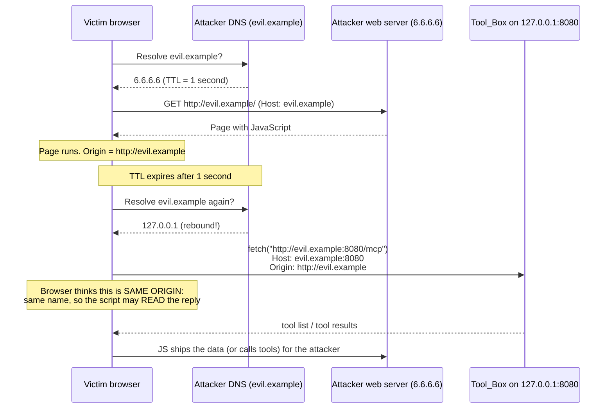
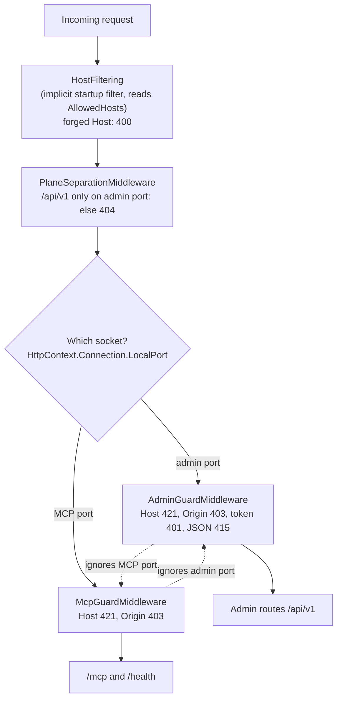

2026_11_14_05_14-The-Name-On-The-Envelope

# Lecture 016: The Name on the Envelope (DNS rebinding, Host vs Origin, and middleware order)

Written after issue #66 (MCP endpoint DNS-rebinding defence), PR A (#80), PR B, and ADR-021. Lecture 015 section 3 introduced DNS rebinding for the admin port. This lecture goes slower and deeper, because issue #66 applied the same defence to the MCP port and hit three subtle problems on the way: the Docker published port, the order of middleware, and a real-world CVE. Every snippet below is real code in this repo, so keep the files open beside the text.

## 0. The big picture first

The question: **your server only listens on 127.0.0.1. Can a web page on the internet still talk to it?** Yes. The browser running on your machine is the bridge, and DNS rebinding is how the page persuades the browser to cross it.

The defence is small, but it has four moving parts:

1. The attack: DNS rebinding, step by step. (Section 1)
2. Two checks that stop it: Host and Origin, and why you need both. (Section 2)
3. The Docker wrinkle: hostname-only matching, and the status codes. (Sections 3 and 4)
4. Where the guard sits in the pipeline, including a surprise middleware you never wrote. (Section 5)

The cast:

| Character | Role | File |
|---|---|---|
| The Rulebook | Pure Host/Origin rules, no HTTP types | `src/ToolBox.Host/HostOriginPolicy.cs` |
| The MCP Bouncer | Applies the rulebook on the MCP socket | `src/ToolBox.Host/McpGuardMiddleware.cs` |
| The Admin Bouncer | Applies the same rulebook, stricter, on the admin socket | `src/ToolBox.Host/AdminGuardMiddleware.cs` |
| The Usher | Decides which plane a request is on, by socket | `src/ToolBox.Host/PlaneSeparationMiddleware.cs` |
| The Clerk | Reads and validates the allowlist config | `src/ToolBox.Host/McpGuardOptions.cs` |
| The Hidden Doorman | ASP.NET's built-in HostFiltering, installed without you asking | (framework, not our code) |

## 1. DNS rebinding, step by step

### 1.1 What the same-origin policy actually protects

A browser tags every page with an **origin**: scheme + host name + port, for example `http://evil.example:80`. The same-origin policy says: JavaScript from origin A may not **read** responses from origin B. (It will often still *send* the request; it just won't let the script see the answer. That detail matters in section 2.)

The policy compares **names**, not IP addresses. That is the whole opening. The browser asks "is this the same name?", and a name can be made to point anywhere.

### 1.2 The attack

The attacker owns `evil.example` and runs its authoritative DNS server. They control the **TTL** (how long a resolver may cache an answer) and can change the answer over time.



Walk through it:

1. The victim visits `evil.example`. DNS says `6.6.6.6` with a 1-second TTL. The page loads.
2. The page's script waits a second, then calls `fetch("http://evil.example:8080/mcp")`.
3. The browser re-resolves the name. This time the attacker's DNS answers `127.0.0.1`.
4. The request goes to **your own machine**. The firewall never sees it, because it is local traffic. Binding Kestrel to loopback does not help: the connection genuinely comes from loopback.
5. Same name, same scheme, same port as the page, so the browser treats it as **same origin**. The script is allowed to read the response. The same-origin policy was never violated; it was fooled about what the name pointed at.

Embedded analogy: it is like a device that accepts commands from "the controller on bus address 5". If an attacker can make their gadget answer to address 5, the device obeys, because it only checks the address, never who is physically attached.

### 1.3 Why this matters for an MCP server

`/mcp` executes tools for whoever calls it, and (ADR-008) there is no authentication on the MCP port: isolation is the control. "Isolated" meant "reachable only from this machine". Rebinding is exactly the trick that makes a remote web page count as "this machine". That is why ADR-021 says issue #38 (always-on background mode) widens the exposure: a port that is always listening is a port that is always attackable while the user browses.

## 2. Host vs Origin: two envelopes, two different lies

Look at the two headers in step 3 of the diagram. The browser wrote both, and the attacker's JavaScript could not override either (browsers forbid scripts from setting `Host` or `Origin`):

| Header | What it carries | Set by | Who it defends against |
|---|---|---|---|
| `Host` | The name the user (or script) typed into the URL | Browser, from the URL | Any request that arrived via a name we did not expect |
| `Origin` | Which page the request came *from* | Browser, on cross-origin-capable requests | A request initiated by a page we did not expect |

For a rebinding request, `Host` is `evil.example:8080` and `Origin` is `http://evil.example`. Both reveal the attacker, but they are different facts, and each check has a blind spot.

### 2.1 Why both are needed

- **Origin alone is not enough.** Browsers do not send `Origin` on every request (for example a plain same-origin `GET`). After rebinding, the request *is* same-origin from the browser's view, so `Origin` may be missing entirely. And the MCP spec *requires* us to accept requests with no `Origin`, because curl, Claude Code and LLM_Monitor never send one. So an Origin-only guard has to wave through the very request an attacker's page can produce.
- **Host alone is not enough.** The MCP spec explicitly asks for Origin validation. And Host says nothing about legitimate hostnames that a *different* local web page might use: another page served from an allowed name should still be told apart by its `Origin`.

The `Host` header is the one a rebinding page cannot get right: the browser must send the name from the URL, and the name is the attacker's. Reject every name you did not expect and the attack dies at step 4 of the diagram.

### 2.2 The real-world precedent

ADR-021 and the issue cite **CVE-2026-11624** (googleapis `mcp-toolbox`, CVSS 9.4): it checked `Origin` but not `Host`, and was exploitable by rebinding. That is all this repository records about it, and the point is the shape of the mistake, not the product. It is the Origin-only blind spot above, in production, rated 9.4. The ADR cites it as the reason both checks are required. Interview relevance: "Origin-only validation fails for rebinding because the rebound request can be same-origin, so validate Host too" is a crisp, memorable answer.

### 2.3 The code: one rulebook, pure logic

`HostOriginPolicy` has no HTTP types, so it can be tested as a table (`tests/ToolBox.Host.Tests/HostOriginPolicyTests.cs`):

```csharp
// src/ToolBox.Host/HostOriginPolicy.cs
public bool IsAllowedHost(string host, int? hostPort, int localPort)
{
    if (StrictPort && hostPort != localPort) return false;
    return IsLoopbackName(host) || _extraHosts.Contains(NormalizeHost(host));
}
```

And the Origin rule:

```csharp
public static bool IsAllowedOrigin(string origin, IEnumerable<string>? configuredOrigins = null)
{
    if (TryParseLoopbackOrigin(origin, out _)) return true;
    return configuredOrigins is not null
        && configuredOrigins.Any(o => string.Equals(o.TrimEnd('/'), origin.TrimEnd('/'), StringComparison.OrdinalIgnoreCase));
}
```

Two details worth pausing on:

- **Normalisation before comparing.** `NormalizeHost` lowercases and strips a trailing dot, because `localhost.` and `LOCALHOST` are the same name to DNS. A guard that compares raw strings is a guard with a bypass. The test `[InlineData("localhost.", 8080, true)]` pins it.
- **`Origin: null` is rejected.** Sandboxed iframes and `file://` pages send the literal string `null`. It does not parse as an absolute URI, so `Uri.TryCreate` fails and the rule returns false. No special case needed; the comment in `TryParseLoopbackOrigin` says so.
- **Lookalikes are rejected.** The test `[InlineData("http://localhost.evil.example")]` in `McpGuardTests.cs` proves that "starts with localhost" is not the check. The parsed host must *equal* a loopback name.

## 3. Strict port vs hostname-only (the Docker 8081 case)

The same rulebook is used by two bouncers with one different setting:

```csharp
// src/ToolBox.Host/AdminGuardMiddleware.cs
private static readonly HostOriginPolicy Policy = new(strictPort: true);

// src/ToolBox.Host/McpGuardMiddleware.cs
private readonly HostOriginPolicy _policy = new(options.AllowedHosts, strictPort: false);
```

Why do they differ? Look at `docker-compose.yml`:

```yaml
ports:
  - "8081:8080" # host:container
```

The listener inside the container is on **8080**. The user's browser and curl, outside, send `Host: localhost:8081`. The container cannot know which host port was published. A strict "Host port must equal listener port" rule would reject every legitimate Docker request.

| | Admin port (8095) | MCP port (8080, published as 8081) |
|---|---|---|
| Strict port? | Yes: Host must carry the real admin port | No: hostname only |
| Why | Loopback only, never published, so the port is always known | A published port differs from the listener port |
| Cost of the choice | None | Almost none, see below |

Why hostname-only costs almost nothing: rebinding needs an **attacker-controlled name**, and the name is what gets rejected. `evil.example:8080` and `evil.example:8081` are both rejected because of `evil.example`. A port check would add no protection against the attacker, it would only break Docker. The test row `[InlineData("evil.example", 8081, false)]` in `HostOriginPolicyTests.cs` shows the attacker name failing on the Docker port too.

Trade-off to be honest about: the default Origin rule accepts a loopback origin on **any** port (`http://localhost:6274` for MCP Inspector's UI, for example). That means another web page you are running locally on `localhost:3000` is treated as trusted by the MCP guard. The admin guard is stricter (`IsExactLoopbackOrigin`) because the admin UI is served from that very origin and nothing else needs to call it; the MCP port has no same-origin page, and a legitimate local web client can be on any port. Rebinding itself is stopped by Host, not by this Origin leniency. Origin here is the spec-required second layer.

## 4. Status codes: 421, 403, 400, and "absent is allowed"

```csharp
// src/ToolBox.Host/McpGuardMiddleware.cs
if (!_policy.IsAllowedHost(request.Host.Host, request.Host.Port, localPort))
    return Reject(context, StatusCodes.Status421MisdirectedRequest);

if (request.Headers.TryGetValue(HeaderNames.Origin, out var origin) && origin.Count > 0
    && !HostOriginPolicy.IsAllowedOrigin(origin.ToString(), options.AllowedOrigins))
    return Reject(context, StatusCodes.Status403Forbidden);
```

| Code | Meaning in this guard | Why this code |
|---|---|---|
| **421 Misdirected Request** | The Host names a server this listener does not answer for | RFC 9110 defines 421 for exactly "this request was sent to a server not meant to answer it". The admin guard uses it too, so the two ports are consistent. |
| **403 Forbidden** | The Origin is present and not allowed | The MCP spec's transport security section says to return 403 for an invalid Origin. We follow the spec. |
| **400 Bad Request** | A forged Host rejected by ASP.NET's HostFiltering, before our code runs | Not ours. See section 5. |

**Why Host is checked before Origin.** Host is the check that actually stops rebinding, so it runs first. Both reject with an empty body and no CORS headers: no CORS means a browser can neither read a rejected response nor pass a preflight, and an empty body leaks nothing about the guard's internals.

**Absent Origin is allowed.** Read the condition again: the Origin check only runs `if (... TryGetValue ... && origin.Count > 0 ...)`. No header means no check. This is not a hole: non-browser clients (curl, Claude Code, LLM_Monitor's Python) legitimately send no Origin, and the spec requires accepting them. The rebinding attacker does not get a free pass either, because the **Host** check already caught them, and a browser attacker either sends an Origin (rejected) or sends none (still rejected on Host).

**Rejection logs are an attack surface.** The WARN logs the rejected value, but headers are attacker-controlled:

```csharp
private static string Clean(string? value)
{
    if (string.IsNullOrEmpty(value)) return "(none)";
    string s = new(value.Select(c => char.IsControl(c) ? '?' : c).ToArray());
    return s.Length > 100 ? s[..100] + "..." : s;
}
```

Control characters could forge extra log lines (log injection), and a 1 MB header would bloat the log. So it is cleaned and capped before logging.

## 5. Middleware order: who sees the request first

### 5.1 The pipeline

ASP.NET Core runs middleware in the order registered. Here is the part of `ToolBoxHttpApp.cs` that matters:

```csharp
app.UseMiddleware<PlaneSeparationMiddleware>();   // first: which plane is this socket?
app.UseMiddleware<AdminGuardMiddleware>();        // admin socket only
app.UseMiddleware<McpGuardMiddleware>();          // MCP socket only
app.MapAdminApi();
app.MapMcp("/mcp");
```



Important points:

- **PlaneSeparation first.** It decides by the socket (`LocalPort`), the only thing a client cannot forge, so requests that are on the wrong plane are 404'd before any guard spends time on them.
- **The two guards are order-independent.** Each starts with a by-socket test (`if (!admin.IsAdminPort(localPort)) return next(context);` in the admin guard, the mirror in the MCP guard) and passes the other's traffic through untouched. The comment in `ToolBoxHttpApp.cs` says so: "Both guards are by-socket, so their relative order does not matter".
- **Guard the socket, not the route.** The MCP guard covers `/health` as well as `/mcp`, the ADR-019 principle: a route added later cannot sit outside it. `/health` is not exempt because it returns toolset details.

### 5.2 The surprise: HostFiltering runs before you

`WebApplication.CreateBuilder` quietly installs ASP.NET's host filtering as a **startup filter**. Startup filters wrap the whole pipeline, so it runs **before** every `app.UseMiddleware<...>()` line you wrote. It reads the config key `AllowedHosts`. ADR-021 records the consequence, "400 before 421":

- If `AllowedHosts` is set, a forged Host gets **400** from the framework and never reaches our 421.
- If it is unset, HostFiltering does nothing, and our guard answers **421**.

This is why `docker-compose.yml` deliberately does *not* set the bare `AllowedHosts` any more:

```yaml
# Deliberately NOT the bare AllowedHosts:
# ASP.NET's HostFiltering would answer 400 before our guard could answer 421.
TOOLBOX_Security__Mcp__AllowedHosts__0: "toolbox"
```

Two tests pin both outcomes, and they are worth reading side by side (`tests/ToolBox.Host.Tests/McpGuardTests.cs`):

```csharp
// Only the new key set: the 421 is OUR guard's.
Assert.Equal(HttpStatusCode.MisdirectedRequest, await GetAsync(app.Url + "/health", host: "evil.example:8081"));

// Legacy key set: HostFiltering answers first.
Assert.Equal(HttpStatusCode.BadRequest, await GetAsync(app.Url + "/health", host: "evil.example"));
```

The lesson, which generalises beyond this repo: **your pipeline is not only the lines you wrote.** Frameworks add middleware and startup filters. When behaviour surprises you (a 400 where your code says 421), ask what ran before your first `UseMiddleware`. Here the discovery came from reasoning about the framework, and the test then proved it.

### 5.3 Fail closed, loudly

`McpGuardOptions` (the Clerk) turns config into the allowlist. Three design choices:

1. **Loopback always works.** `localhost`, `127.0.0.1`, `[::1]` are built in (`HostOriginPolicy.IsLoopbackName`), so `docker run -p 8081:8080` and `curl localhost:8081` need no configuration.
2. **Everything else is explicit and closed by default.** A service name such as `toolbox` must be listed in `Security:Mcp:AllowedHosts` (the env form `TOOLBOX_Security__Mcp__AllowedHosts__0`, the standard .NET `__` list syntax). IP literals other than loopback are not auto-allowed.
3. **A wildcard cannot switch the guard off.** In `Resolve`: `hosts.RemoveAll(h => h.Contains('*'));` with the comment "A '*' or a wildcard entry would silently disable the check; drop it rather than honour it." Also, the legacy fallback ignores a bare `*`. Failing closed means a typo makes the server stricter, not open.

Because fail-closed can surprise a Docker user, the app says so at startup:

```csharp
if (NeedsAllowlistWarning)
    logger.LogWarning("MCP binds a non-loopback address but only loopback Host names are allowed. ...");
```

and the legacy fallback (an external compose such as LLM_Monitor with only `AllowedHosts`) logs an INFO suggesting the new key. Silent failure becomes a one-line fix.

A small PR-sequence lesson hides here too. `LogStartup` was written in PR A but not called until PR B, because the fail-closed WARN would have lied while nothing enforced it. A log line that describes behaviour must not ship before the behaviour.

## 6. Walkthrough: three requests

Config: our `docker-compose.yml` (`Security:Mcp:AllowedHosts:0 = toolbox`), listener `0.0.0.0:8080`, published `8081`.

| # | Request | PlaneSeparation | HostFiltering | McpGuard | Result |
|---|---|---|---|---|---|
| 1 | Host machine: `curl http://localhost:8081/health` (`Host: localhost:8081`, no Origin) | pass (not `/api/v1`, MCP socket) | pass (`AllowedHosts` unset) | loopback name, any port: pass; no Origin: pass | 200 |
| 2 | LLM_Monitor: `Host: toolbox:8080`, no Origin | pass | pass | `toolbox` is listed: pass | 200 |
| 3 | Rebinding page: `Host: evil.example:8081`, `Origin: http://evil.example` | pass | pass | Host not allowed | **421**, Origin never examined |

If `AllowedHosts` had been set (a legacy compose), row 3 would be answered **400** by HostFiltering one step earlier. Same outcome (blocked), different code and different author.

## 7. What should I pay attention to?

- Host is not a boundary for choosing a plane (the client writes it); it *is* a boundary for rebinding (the browser writes it, and a script cannot override it). Do not mix the two claims up. Plane separation uses the socket; the guard uses Host.
- Rebinding defence is not authentication. ADR-021's consequences say it plainly: "Authentication on the MCP port is still out of scope." A non-browser local process can still send any Host it likes.
- A consumer that addresses the server by another name must list it, or gets 421. That is a documented consequence, not a bug.

## 8. Interview relevance

- "Explain DNS rebinding": walk through the sequence diagram. Key sentence: *the same-origin policy compares names, and the attacker controls what the name points to.*
- "Why isn't Origin validation enough?": rebound requests can be same-origin with no `Origin`, and the spec requires accepting no-Origin clients; validate Host. Cite CVE-2026-11624 as the real example (as recorded in ADR-021, and no more than that).
- "421 vs 403 vs 400": 421 = wrong server name for this listener, 403 = understood but refused, 400 = malformed or framework-level rejection.
- "Middleware ordering": order is registration order, and frameworks may add filters before yours, so test the observable behaviour.
- "Defence in depth": loopback bind + Host + Origin + (on admin) token + no CORS, each covering a different failure.

## 9. Check your understanding

1. In the rebinding sequence, at which step does the same-origin policy stop protecting the victim, and why is the firewall irrelevant?
2. A request arrives with `Host: evil.example:8081` and no `Origin`. Which status does the MCP guard return, and would an Origin-only guard have stopped it?
3. Why is `McpGuardMiddleware` constructed with `strictPort: false` but `AdminGuardMiddleware` with `strictPort: true`? What would break in Docker if the MCP guard were strict?
4. Our `docker-compose.yml` removed the bare `AllowedHosts` line. Explain, naming the component that runs first, what status a forged Host would get if it were still there, and which test pins that.
5. Why is it safe that a request with **no** `Origin` header is accepted? What other check protects the MCP port from a browser-based attacker who sends none?
6. `Origin: null` and `http://localhost.evil.example` are both rejected. Which mechanism in `HostOriginPolicy` rejects each?
7. The Origin rule accepts a loopback origin on any port. What does that let through, and why is Host, not Origin, what stops rebinding?
8. Why must `LogStartup` be called only once the guard enforces something, and what does the startup WARN tell a Docker user to do?

## 10. Where to go next

- Lecture 015 section 3: the admin-port version of the same defence, with the token as the real barrier.
- Read `tests/ToolBox.Host.Tests/HostOriginPolicyTests.cs` as a specification: every `InlineData` row is a decision someone made.
- Natural follow-up topic: authentication on the MCP port (ADR-008 defers it), which is what finally stops a non-browser local attacker.
