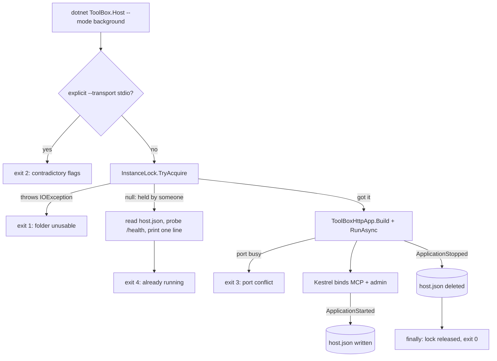
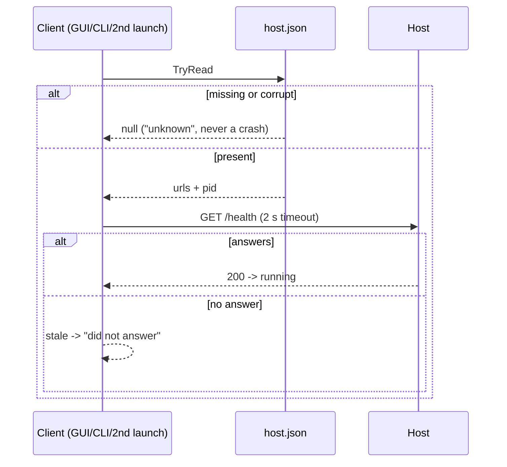
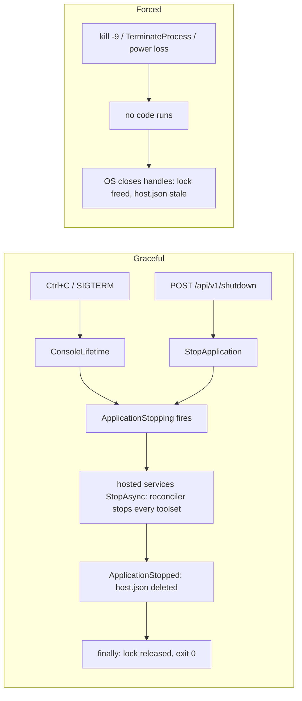

2026_11_17_02_00-One-Host-One-Lock-One-Way-To-Stop-It

# Lecture 017: One Host, One Lock, One Way to Stop It

Written after issue #38 (background run mode) and ADR-024. Every snippet is real code in this repo. Where a claim is about OS behaviour I did not measure here (for example how .NET implements `FileShare.None` on Linux), the lecture says so. The test `Lock_is_released_when_the_holder_process_is_killed` is the repo's own evidence for the Linux case.

## 0. The big picture first

After Lecture 014 and the HTTP-mode work, `--transport http` already runs MCP on 8080, the admin API on 8095 and the reconciler. Issue #38 does not add a server. It adds four promises around the existing one:

1. Only one Tool_Box per user runs at a time (the lock).
2. Other programs can find it (the discovery file).
3. It has a defined start and a defined stop (the profile and the shutdown endpoint).
4. Stopping really runs each toolset's stop/persist hook.



The cast, so the sections have faces:

| Character | Role | File |
|---|---|---|
| The Doorkeeper | Holds the only key to the building. Dies and the key returns to the hook by itself. | `src/ToolBox.Core/Instance/InstanceLock.cs` |
| The Noticeboard | A sign on the door saying where the host is. It might be old, so you phone first. | `src/ToolBox.Core/Instance/HostInfoFile.cs` |
| The Phone Call | The verification: GET `/health`. | `src/ToolBox.Core/Instance/HostProbe.cs` |
| The Dress Code | The run profile that decides what the host wears (lock, notice, HTTP). | `src/ToolBox.Host/BackgroundMode.cs` |
| The Closing Bell | `POST /api/v1/shutdown`: the only polite way to close a hidden Windows process. | `src/ToolBox.Host/AdminApi.cs` |

Seven ideas, in this order: the lock, the discovery file, profile versus transport, graceful versus forced stop, exit codes as an interface, the real-host test, and the control-plane stop endpoint.

## 1. An OS-held file lock beats a pid file

### What problem is being solved?

Two Tool_Box hosts running at once would fight over the same desired-state file, the same admin token and (for Voxel) the same viewer port. "Is one already running?" needs an answer that stays true even when the previous one crashed.

### The tempting answer: a pid file

Write your pid into a file at start, delete it at exit. The second launch reads the file and checks whether that pid is alive. The flaw is the word "delete". A process killed with `kill -9`, a power cut, or an OOM kill never runs its cleanup, so the pid file lies forever. Worse, the OS recycles pids, so "pid 4242 is alive" may now be a different program. Your options are to guess, or to add stale-file heuristics, and every heuristic has a race.

### The answer the OS already provides: hold the file open, exclusively

```csharp
// src/ToolBox.Core/Instance/InstanceLock.cs
stream = new FileStream(path, FileMode.OpenOrCreate, FileAccess.ReadWrite, FileShare.None);
```

`FileShare.None` says "while I have this open, nobody else may open it". The kernel enforces that, and the kernel also closes every file a process had open when the process dies, however it dies. So the lock disappears exactly when the holder does. There is no cleanup code to forget, and nothing to go stale.

```
   pid file                              OS-held lock
   --------                              ------------
   start:  write "4242"                  start:  open(FileShare.None)
   crash:  file stays, says 4242         crash:  kernel closes the handle
   next:   "is 4242 alive?" (guess)      next:   open succeeds (fact)
```

Notice what the file's contents are for. The code does write the pid into it (`stream.Write(Encoding.ASCII.GetBytes(Environment.ProcessId.ToString()))`), but only as a human-readable courtesy. The decision is never "read the pid and judge it". The decision is "did the open succeed?". Contents are decoration; the held handle is the truth.

### Reading `TryAcquire` carefully

```csharp
catch (IOException) when (File.Exists(path))
{
    // Sharing violation: somebody else holds it open.
    return null;
}
```

Two failure shapes are deliberately separated:

| What happened | What the code does | Why |
|---|---|---|
| Open fails with a sharing violation and the file exists | returns `null` ("someone else has it") | Normal, expected outcome of the race. |
| Directory cannot be created or written (`IOException`/`UnauthorizedAccessException` with no file) | lets the exception escape | `Program.cs` catches it, prints "Cannot use the instance folder ...", exits 1. Lying "another instance is running" about a read-only folder would send the user hunting for a process that does not exist. |

Also notice `Directory.CreateDirectory(directory, UnixFileMode.UserRead | UserWrite | UserExecute)` on Unix: the folder holding the token, lock and `host.json` is owner-only (0700), the same discipline as the admin token.

### Alternatives and trade-offs

| Option | Verdict |
|---|---|
| Pid file | Goes stale on crash; pid reuse. Rejected. |
| Port bind as the lock (the pre-existing preflight) | Cannot tell "my other Tool_Box" from "some other app on 8080"; two instances on different ports both run. Kept as the second line of defence (exit 3). |
| Named `Mutex` | Semantics differ between Windows and Linux/macOS (sessions, `/tmp` artifacts). Rejected. |
| Database or service coordinator | Overkill for one user, one machine. This is what you would use for many machines (see leader election, Lecture topics below). |

### Interview relevance

"How do you make a singleton process?" The strong answer names the failure mode first ("what happens when it crashes?") and picks a mechanism whose release is performed by the OS, not by the program. The same reasoning is behind `flock`-based lock files in Unix daemons and leases with expiry in distributed systems: a lock that depends on its holder to release it needs a timeout, and a lock held by the kernel does not.

### What to pay attention to

- The lock must live as long as the process. `InstanceLock` keeps `_stream` as a field; if you opened the stream in a `using` inside a method, the lock would vanish when the method returned. Look at `Program.cs`: the `instanceLock` variable is declared before the `try` and disposed in `finally` ("Released last: after the reconciler stopped the toolsets and host.json was removed").
- Advisory versus mandatory: on Linux, I believe .NET maps `FileShare.None` to an advisory `flock`, which only stops other cooperating processes. That is exactly what we need here (every Tool_Box uses the same code). The test comment says the same thing, and the test uses `flock(1)` from a child process to prove the kill-releases-lock behaviour. I did not verify the .NET runtime source for this; the test is the evidence.

## 2. The discovery file is a verified hint

### What problem is being solved?

The GUI and CLI (issue S2) need to know "where is the host right now?". Ports are configurable and can even be `0` (the OS picks), so guessing 8080 and 8095 is not enough.

### The design

```csharp
// src/ToolBox.Core/Instance/HostInfoFile.cs
public sealed record HostInfo(int Pid, DateTimeOffset StartedUtc, string Version, string McpUrl, string AdminUrl);
```

The host writes `host.json` after Kestrel has bound, because only then do the real ports exist:

```csharp
// src/ToolBox.Host/ToolBoxHttpApp.cs
app.Lifetime.ApplicationStarted.Register(() => { ... HostInfoFile.Write(infoDir, new HostInfo(...)); });
app.Lifetime.ApplicationStopped.Register(() => HostInfoFile.Delete(infoDir));
```

The file deliberately does not contain the admin token. It is a noticeboard, not a key (ADR-019 keeps the token in its own file with its own permissions).

### Why "hint" and not "truth"

The file can be wrong. A crash skips `ApplicationStopped`, so a stale `host.json` may describe a host that is gone. Rather than try to make the file always correct (impossible), the design makes it always checkable:

```csharp
// src/ToolBox.Core/Instance/HostProbe.cs
using HttpResponseMessage response = await Http.GetAsync(health, cts.Token);
return response.IsSuccessStatusCode;
```



This is the same idea as a DNS cache or a service registry entry with a TTL: cached knowledge is fine as long as you verify before you depend on it. `DescribeRunningAsync` in `BackgroundMode.cs` has three honest outcomes, each tested in `BackgroundModeTests.cs`:

| Situation | Message |
|---|---|
| Lock held, `host.json` missing | "...is already running (the lock ... is held), but host.json is missing or unreadable, so its address is unknown." |
| Lock held, file present, `/health` silent | "... (pid N ...) but <url> did not answer /health. It may still be starting or shutting down." |
| Lock held, file present, `/health` ok | "Tool_Box is already running (pid N) - MCP <url>, admin <url>" |

Note the division of authority: the lock says whether a host exists; the file says where; the probe says whether the "where" is still true. Three different questions, three different mechanisms.

### Small details worth stealing

- Atomic write: `Write` writes a temp file then `File.Move(tmp, path, overwrite: true)`, so a reader never sees half a JSON document. A rename is atomic on the same volume; a write-in-place is not.
- `TryRead` returns `null` for missing, unreadable and corrupt files and never throws for those. The theory test `Corrupt_host_file_reads_as_unknown_not_a_crash` feeds it `{ not json`, `{}` and an empty string.
- `Reachable(...)` turns a bound wildcard (`[::]`, `0.0.0.0`) into `127.0.0.1`, because "listening on 0.0.0.0" is not an address a client can connect to.

### Edge case

What if the process is `kill -9`'d? The lock is freed by the OS, `host.json` stays. The next launch acquires the lock, starts, and overwrites `host.json` after bind. A client that reads the stale file in between fails the `/health` probe and says "not running". Nothing needs manual cleanup. That is the point of using both mechanisms.

## 3. Run profile versus transport

### The question

Background mode needs HTTP. So why not add `background` as a third value of `Transport`?

Because `Transport` answers "what carries the JSON-RPC bytes?" (ADR-007: `stdio` or streamable `http`). Background mode answers a different question: "how is this process being run and managed?". Mixing them makes the name lie, and it makes combinations meaningless: what would `Transport=background` plus a Docker deployment mean?

```
 Transport   (what carries the protocol)     stdio | http
 Mode        (how the process is managed)    (default) | background
                                                          |
                                      implies http + lock + host.json
```

The wiring is in `Program.cs`:

```csharp
.AddCommandLine(args, new Dictionary<string, string> { ["--transport"] = "Transport", ["--mode"] = "Mode" })
...
bool background = BackgroundMode.IsBackground(bootstrap);
...
transport = "http";
```

The profile then flips three things on top of the same `ToolBoxHttpApp`: the lock, the discovery file, and the guard against contradictions. Plain `--transport http` is untouched; `Plain_http_mode_writes_no_host_json` pins that.

### A subtle trap: "explicit" stdio

`appsettings.json` defaults `Transport` to `stdio`, so after configuration is merged you cannot tell "the user typed stdio" from "nobody said anything". The code therefore re-inspects the raw environment variable and the raw `args`:

```csharp
string? explicitTransport = Environment.GetEnvironmentVariable("TOOLBOX_Transport");
for (...) if (args[i].Equals("--transport", ...)) explicitTransport = args[i + 1]; ...
```

Only an explicit `stdio` is a contradiction (exit 2); the default is quietly overridden. This is a general lesson about layered configuration: after merging, you lose provenance. When provenance matters, look at the layers.

### Why this matters beyond this feature

A profile is a named bundle of defaults. Spring has `@Profile`, ASP.NET has `ASPNETCORE_ENVIRONMENT`, Docker Compose has `profiles:`. Each lets one binary behave differently without becoming a different program. The risk is profiles that silently change semantics; the defence here is to fail loudly on contradictions (exit 2) and to make the profile only additive (plain HTTP mode is a subset of background mode).

## 4. Graceful versus forced stop

### The three ways a process ends



Graceful means your code gets to run. Forced means it does not; only the kernel's automatic cleanup applies. That is why the design puts the safety-critical piece (the lock) in the kernel's hands and the nice-to-have pieces (`host.json`, persisting toolset state) in the graceful path.

### What .NET gives you for free

The generic host registers `ConsoleLifetime`, which listens for Ctrl+C and SIGTERM (on Unix) and translates them into `IHostApplicationLifetime.StopApplication()`. That raises `ApplicationStopping`, stops hosted services in reverse registration order, then raises `ApplicationStopped`. The reconciler (Lecture 014) already stops every toolset on the way out, which is how a toolset's persist hook gets to run.

### The Windows gap

On Linux and macOS, `kill <pid>` sends SIGTERM and `ConsoleLifetime` handles it. On Windows there is no portable equivalent for a process with no console window: `Start-Process -WindowStyle Hidden` creates a process nobody can press Ctrl+C in, and `taskkill` without `/F` only works for windows that process messages. Console-close also gives the process a short budget (the discussion estimated about 5 seconds; I did not measure it). The practical result is that the only reliable "stop" for a hidden Windows host is the hard one, which skips persistence.

So the host must offer a stop that does not depend on an OS signal: ask it over its own API. That is section 7.

### Timeouts: two clocks

The discussion in issue #38 noted that the reconciler's `StopAsync` uses its own 10 s budget while the generic host's shutdown timeout defaults to 30 s. Two clocks both matter: if a toolset's stop is slower than the smaller one, the work is abandoned. The plan lists a slow-stop test for this; the shipped test file I read has one real-toolset shutdown test (Voxel) rather than a separate slow-stop case, so treat the slow-stop scenario as covered only by design, not by a dedicated test.

### Pay attention to ordering

`Program.cs` comments on it: `host.json` is deleted on `ApplicationStopped` (after the hosted services stop), and the lock is released last, in `finally`. If the lock were released first, a second launch could start while the first was still persisting state. Release order is the reverse of acquisition importance: the thing that guards everything else goes last.

## 5. Exit codes are an interface

A process's exit code is its return value to whoever started it: a shell script, a service manager, the future GUI. Treating it as an interface means choosing the values on purpose, giving each one a single meaning, and testing them.

| Code | Meaning | Where it comes from |
|---|---|---|
| 0 | Clean exit | normal path |
| 1 | The instance folder cannot be used (not writable, etc.) | `Program.cs` catch of `IOException`/`UnauthorizedAccessException` around `TryAcquire` |
| 2 | Contradictory flags (`--mode background` with explicit `--transport stdio`) | `Program.cs`; 2 is the conventional "bad usage" code on Unix |
| 3 | Port conflict (pre-existing from #37) | `PortConflictException`-style catch around `RunAsync` |
| 4 | Another Tool_Box already holds the lock | `BackgroundMode.AlreadyRunningExitCode` |

Why does this matter more than it looks? Because the callers are scripts and supervisors. A service manager (the S6 work) will want to say "exit 4 means someone else is already running, do not restart in a loop", while "exit 3 means fix the port, restarting won't help" and a crash (non-zero, e.g. a signal) means "restart". If every failure were exit 1, the supervisor could not tell a harmless duplicate launch from a real fault.

Two details of how the code earns this:

- The 4 case prints a human-readable line on stderr and exits, instead of throwing. The tests read both: `Assert.Equal(4, exit); Assert.Contains("already running", err);`.
- stdout stays untouched. In stdio mode stdout is the protocol channel, so all diagnostics go to stderr (this predates the issue, but it is why every message here uses `Console.Error`).

Common mistake: renumbering or reusing a code later. Once a script depends on "3 means port conflict", changing it is a breaking API change, same as renaming a JSON field. That is why exit codes are written down in the ADR.

## 6. A real-host integration test

### The problem with unit tests here

The behaviour we care about is not inside one class. "A second launch exits 4" involves `Program.cs` top-level statements, `InstanceLock`, `HostInfoFile`, `HostProbe` and stderr. "Stopping runs the toolset's stop hook" involves Kestrel, the admin endpoint, the lifetime, the reconciler, and a real toolset. A unit test of each part can pass while the assembly is wrong. Lecture 009's finding (two of three real bugs lived in the one untested file) is this same lesson.

### Two techniques in `BackgroundModeTests.cs`

**1. Launch the real binary as a child process, assert on exit code and stderr.**

```csharp
var psi = new ProcessStartInfo("dotnet") { RedirectStandardError = true, ... };
psi.ArgumentList.Add(dll);                       // ToolBox.Host.dll
psi.Environment["TOOLBOX_Instance__Dir"] = _dir; // isolation
psi.Environment["TOOLBOX_Ports__Mcp__Port"] = "0";
```

This is the only way to test `Program.cs`'s exit codes, because top-level code has no method to call. The test holds the lock itself (`InstanceLock.TryAcquire(_dir)`) and lets the child discover it cannot get it. Note `TOOLBOX_Instance__Dir`: the double underscore is how environment variables express the `Instance:Dir` config key (colons are not valid in env var names on all shells).

**2. Boot the real app in-process on ephemeral ports.**

```csharp
WebApplication app = ToolBoxHttpApp.Build([], overrideUrl: "http://127.0.0.1:0", settings: Settings());
await app.StartAsync();
```

Port 0 means "let the OS pick a free port", so tests can run in parallel without colliding. Then the test asserts the real thing end to end: `host.json` exists, `Assert.DoesNotContain(":0/", info.McpUrl)` (the real port was recorded, not the requested 0), `/health` answers, the admin token text does not appear in the file, and after `StopAsync` the file is gone.

### The most valuable test in the file

`Shutdown_runs_the_real_stop_path_before_the_host_exits` pins Voxel on, waits until its status is `On`, POSTs `/shutdown` with the bearer token, awaits `app.RunAsync()` finishing, and then asserts the status is `Off` and `host.json` is gone. It proves the sentence "stopping through the API runs the toolset's lifecycle before the process exits". A mock lifecycle could only prove the mock was called; Voxel's real viewer lifecycle proves the wiring.

### Isolation is part of the test

The tests share the machine with every other test and with the developer's real Tool_Box. Without `Instance:Dir`, a test would take the real lock in the real `LocalApplicationData/ToolBox` folder, and a developer's running host would make tests fail (or the reverse). The test class also joins `[Collection(VoxelViewerCollection.Name)]`, so tests that start the Voxel viewer run one at a time. Isolation-by-configuration is the pattern to remember: every piece of machine-global state (lock dir, token path, desired-state path, ports) needs an override key, or you cannot test it safely.

### What to pay attention to

- The Linux-only kill test in `InstanceTests.cs` returns early when `flock` is absent or the OS is not Linux. An early `return` makes a test pass vacuously, so on macOS and Windows that specific proof is not exercised. The note in the test says the sharing behaviour is covered elsewhere (`Second_acquire_fails_while_held_and_succeeds_after_dispose`), but the "kill releases it" claim is only proven on Linux in CI.
- Child-process tests have a 60 s timeout (`CancellationTokenSource`) so a hung host fails the test instead of hanging CI.

## 7. A control-plane endpoint that stops the process

### The code

```csharp
// src/ToolBox.Host/AdminApi.cs
group.MapPost("/shutdown", (IHostApplicationLifetime lifetime) =>
{
    _ = Task.Run(async () =>
    {
        await Task.Delay(TimeSpan.FromMilliseconds(200));
        lifetime.StopApplication();
    });
    return Results.Json(new { shutdown = "requested" }, statusCode: StatusCodes.Status202Accepted);
});
```

### Why 202 and a deferred stop

If the handler called `StopApplication()` directly, Kestrel would begin shutting down while the response was still being written, and the client could see a dropped connection instead of an answer. The handler therefore returns `202 Accepted` ("I received the request; the work is not done yet") and a background task stops the application 200 ms later. The `_ =` discards the task on purpose: nothing awaits it, and nothing should, because the request must finish first.

This is the standard shape for any "do something that kills me" endpoint: acknowledge, then act.

### Where it lives, and why that matters

The endpoint is on the admin plane (8095), not the MCP plane (8080). Two planes (Lecture 012, ADR-019/020) mean two audiences: agents call tools on MCP and must never be able to administer the host; the GUI and CLI use admin with a bearer token. `PlaneSeparationMiddleware` decides by the socket the request arrived on. The test `Shutdown_needs_the_token_and_is_not_on_the_mcp_port` checks both properties: without the token the answer is `401`, and POSTing the same path to the MCP port does not return 202 and does not trigger `ApplicationStopping`.

Is a "stop the process" endpoint dangerous? The reasoning in the discussion was that a token holder can already disable every toolset, so stopping the host adds little new power. But it is a new write on the control plane, so it is recorded in the ADR and the file is covered by `.github/CODEOWNERS` (admin code is high tier). This is the habit to copy: when you add a capability, ask what it lets an attacker do that they could not, even if the answer is "not much".

### The risk-tier lesson

CLAUDE.md's naming rule says code that enforces a security boundary must match a CODEOWNERS pattern. This PR adds `/src/ToolBox.Core/Instance/`, its tests and `BackgroundMode*` to CODEOWNERS, because the lock and `host.json` live next to the token. CODEOWNERS protects by path, not intent; if a new directory is not listed, review protection silently does not apply. Adding the pattern in the same PR is how the rule is kept.

## Common mistakes (all avoided here, and how)

| Mistake | How it shows up | What the repo does |
|---|---|---|
| Trusting a discovery file | Client talks to a dead or recycled host | Verify with `/health`; file is a hint |
| Cleanup-dependent lock | Stale lock after crash | OS releases the handle |
| Throwing for "someone else is running" | Stack trace, exit 134-ish code | Message plus dedicated exit 4 |
| Calling `StopApplication()` inline in the handler | Dropped response | 202 now, stop after 200 ms |
| Storing the token in the discovery file | Any reader of a world-visible file gets admin | Separate file (ADR-019); test asserts it is absent |
| Using machine-global paths in tests | Flaky, collides with a running host | `Instance:Dir`, `Admin:TokenPath`, port 0 |

## Real-world production usage

- `flock`-based single-instance locks in daemons, and Windows `FileShare.None` equivalents, are older than this project; the pattern is "let the kernel own the lock".
- Service managers (systemd, Windows SCM, Kubernetes) read exit codes and signals to decide on restart. systemd has `RestartPreventExitStatus=`; the dedicated code 4 is what would plug into it for the S6 installers.
- Discovery-by-file-then-verify is how many dev tools find their daemon (for example a socket path or port file in a per-user folder). In distributed systems the same idea is service registry plus health check.
- "Acknowledge then stop" matches how Kubernetes handles pod termination: the API returns first, SIGTERM and a grace period follow.

## What this PR deliberately does not do

- Real detach and start-with-the-OS (S6). Start is manual: `nohup ... &` on Linux/macOS, `Start-Process -WindowStyle Hidden` on Windows (see README).
- Change the default MCP port 8080. A collision already fails cleanly with exit 3 and names `Ports:Mcp:Port`.
- Solve the stdio plus background overlap for Voxel's viewer port 8090. It is documented, with a follow-up issue for a fail-soft viewer.
- Push `tools/list_changed` over an always-on stateless host (ADR-022): agents see changes on their next `tools/list`.

## Self-check questions

1. A host is killed with `kill -9`. List, in order, what is left on disk, what the OS did, and what happens on the next `--mode background` launch. Which of those steps relies on the OS and which on this repo's code?
2. Why does `InstanceLock` write the pid into the file if the pid is never used to decide anything? What would break if a future developer started trusting it?
3. `host.json` is written in `ApplicationStarted`, not before `RunAsync`. Why does that make `Ports:Mcp:Port=0` work? What would the file contain if it were written earlier?
4. Explain, using the table in section 5, why one generic "exit 1" for every failure would hurt a service manager. Which two codes would it be unable to tell apart?
5. Why does `/shutdown` return 202 and delay `StopApplication()` by 200 ms? Describe what the client might observe without the delay.
6. A new teammate proposes moving shutdown to `POST /mcp-admin/shutdown` on port 8080 "so agents can restart the host". Which existing test would catch it, and which principle does it violate?
7. In what order do the lock, `host.json` and the toolset stop hooks release, and what bug appears if you swap the lock and the toolset stop?
8. `Lock_is_released_when_the_holder_process_is_killed` returns early on non-Linux machines. What does a green run on a Mac actually prove about that claim?
9. Why is background mode a `Mode` and not a third `Transport`? Give one invalid combination the `Transport` approach would permit.
10. Why do the tests set `TOOLBOX_Instance__Dir` and `Ports__*__Port=0` for the child process? Name one failure each setting prevents.

## Where to go next

- Lecture 014 (the reconciler whose `StopAsync` does the persisting).
- Lecture 012 and 015 (the two-plane design and the admin token the shutdown endpoint depends on).
- Distributed coordination: this lecture's lock is per machine. Leader election with leases (ZooKeeper/etcd, Kubernetes `Lease` objects) is the same problem when the holders can be on different machines and "the OS releases it" is no longer available, so expiry timers take the OS's place.
