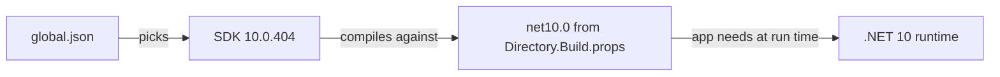

2026_11_27_22_00-SDK-Runtime-Target-And-RollForward

# Lecture 018: SDK, Runtime, Target Framework, and rollForward

Written after issue #116 (add `global.json`). Every file quoted here is real in this repo. The `dotnet --version` result below was measured on the agent's runner, which has SDKs 8, 9, 10.0.x and 11.0.100 installed side by side.

## 0. The problem in one paragraph

Your Mac has SDKs 9.0, 10.0.302 and 11.0.100-preview. With no `global.json`, `dotnet` picks the **newest** SDK, so it picked the 11 preview. That is why every build printed NETSDK1057 (a preview SDK warning). It is also a reproducibility risk: CI floats on `10.0.x`, so your Mac and CI could compile the same code with different compilers and analyzers. With `-warnaserror`, a new analyzer warning in one SDK turns the build red with no code change.

## 1. Three different things called ".NET version"

| Thing | What it is | Who chooses it | Where it lives in this repo |
|---|---|---|---|
| **SDK** | The toolbox for building: compiler (Roslyn), MSBuild, analyzers, `dotnet build/test/run` | `global.json`, else newest installed | `global.json` (new) |
| **Runtime** | What executes the compiled program (JIT, GC, base libraries) | The app's `runtimeconfig.json`, from the target framework | Docker `aspnet` image |
| **Target framework (TFM)** | The API surface your code is compiled against, e.g. `net10.0` | The project | `Directory.Build.props` |



The key insight: **a newer SDK can build an older target.** SDK 11 can happily build `net10.0`. So the TFM never stopped the preview SDK from being used. Only `global.json` does that.

## 2. The file

```json
{
  "sdk": {
    "version": "10.0.100",
    "rollForward": "latestFeature",
    "allowPrerelease": false
  }
}
```

- `version` is the **floor**, not an exact demand (because of the roll-forward policy below).
- `allowPrerelease: false` means previews like `11.0.100-preview` are never candidates.

## 3. rollForward

SDK versions look like `10.0.404`. Major.minor is `10.0`; the first digit of the last part is the **feature band** (`4xx`); the rest is the patch.

| Policy | Picks | Fails when |
|---|---|---|
| `disable` | exactly `10.0.100` | any other version is all that is installed |
| `patch` | `10.0.100` or a newer patch in band `1xx` | that band is missing |
| `latestPatch` | newest patch in band `1xx` | no `1xx` SDK is installed |
| `feature` | `10.0.100` or the next higher band that exists | |
| `latestFeature` | **newest band and patch within 10.0** | no 10.0 SDK is installed |
| `major` / `latestMajor` | may cross to 11 | (this is what we avoid) |

We chose `latestFeature`: any 10.0 SDK at or above `10.0.100`, newest preferred, and never 11, because 11 is a different major version. That fits your 10.0.302, CI's floating `10.0.x` and Docker's `sdk:10.0`.

## 4. Evidence

On the runner, which has `10.0.115`, `10.0.204`, `10.0.303`, `10.0.404` and `11.0.100` installed:

- Before the file: `dotnet --version` printed `11.0.100`.
- After the file: it prints `10.0.404`, the newest 10.0 SDK.
- `dotnet build --configuration Release -warnaserror` succeeded with 0 warnings.

## 5. What this does not do (yet)

- CI still uses `dotnet-version: 10.0.x`. That already satisfies the pin, but the pin is not the single source of truth. Switching `setup-dotnet` to `global-json-file: global.json` is a workflow edit you will make with #104.
- Docker stays on `sdk:10.0`. Inside the container, `global.json` is copied with the source and checked there too, so an image with an 11 SDK would fail loudly rather than silently build.

## 6. If the pin cannot be satisfied

With no 10.0 SDK installed, `dotnet build` stops with an error saying a compatible SDK was not found. That is the point: fail loudly rather than build with the wrong toolchain. The fix is to install a 10.0 SDK.

## Check yourself

1. Why did a `net10.0` project build with an 11 SDK at all?
2. With only `10.0.100` and `10.0.302` installed, which does `latestFeature` pick? What about `latestPatch`?
3. Would `rollForward: disable` have been safe with CI's floating `10.0.x`? What goes wrong when the runner image updates?
