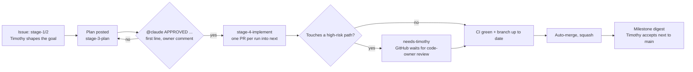

# How Tool_Box is built: supervised autonomy

Tool_Box is developed with Claude working *inside GitHub*: work starts as an issue, the discussion happens in comments, code arrives as a pull request, and GitHub itself decides whether it can merge. Epic #84 moved Timothy from "in the loop at every step" to "on the loop at every decision". `CLAUDE.md` holds the rules the agent follows; this page explains the system and why it is shaped this way. Unfamiliar term? See the [glossary](GLOSSARY.md). ADR-013 records the original issue-driven decision; the supervised-autonomy ADR (written in the final step of epic #84) supersedes its "one approved step at a time" and "Timothy merges PRs" parts.

## The problem it solves
1. **Context bloat.** Plans 001–005 lived in long markdown files and `CLAUDE.md` grew to hold every convention. Fix: scope memory to the task. The issue holds task memory; `CLAUDE.md` stays short.
2. **Timothy as transport layer.** He relayed between GitHub and a chat assistant: open PR, wait for CI, merge, paste output. None of that needs judgment. Worse, the gates had become rubber stamps, so some PRs merged before CI finished. A gate nobody looks at gives false confidence.

| Layer | Where it lives | Loaded |
|---|---|---|
| Global: architecture, commands, rules | `CLAUDE.md` (short on purpose) | every session |
| Task: goal, discussion, plan, progress | **the GitHub issue**: body + comments | only by the session working that issue |
| Durable decisions | `docs/DECISIONS.md` (ADRs) | when a task touches that area |
| Conventions for writing docs | `Documentation/CONVENTIONS.md` | only when writing in `Documentation/` |
| Specialist roles | `.claude/agents/*.md` | only when delegated to |

## Three touchpoints
| Touchpoint | Timothy does | Agents do |
|---|---|---|
| **Shaping** (stages 1–2) | States the goal, answers design questions | Discuss options, recommend |
| **Exceptions** | Answers `needs-timothy` and reviews high-risk PRs | Escalate only on a real fork, an unexplained failure, or a high-risk change |
| **Acceptance** (milestone, `next` → `main`) | Reads the digest, runs verification once with understanding, merges to `main` | Write the digest and verification steps |

Between shaping and acceptance there are no human clicks for low-risk work.

## The loop

Every run ends with a `## Session notes` comment. The next run reads it, so nothing depends on chat history.

## Approval
Approval is a comment on the issue whose **first line starts with `APPROVED`** (written `@claude APPROVED ...` because runs start on `@claude`), authored by the repo owner. The agent checks `authorAssociation == OWNER`. A label never counts, because labels can be changed by agents. A new plan comment cancels earlier approvals, and approval covers only the steps it names.

## Stages are labels
| Label | What Claude may do |
|---|---|
| `stage-1-design` | ask clarifying questions |
| `stage-2-discussion` (or no stage label) | discuss options; no code |
| `stage-3-plan` | post and revise a numbered plan; no code |
| `stage-4-implement` | implement the next approved step, open one PR, stop |
| `stage-5-verify` | show evidence; independent review |

Other labels: `needs-timothy` (Claude is blocked on you) and `claude:paused` (kill switch, see below).

## Risk tiers: autonomy depends on blast radius
| Tier | Paths | Rule |
|---|---|---|
| Low | tests, docs, toolsets, refactors, ordinary Host/Core code | auto-merge after CI |
| High | everything in `.github/CODEOWNERS` (workflows, `CLAUDE.md`, `.claude/`, `docs/DECISIONS.md`, Docker files, `*.csproj`, `scripts/`, `Program.cs`, `ToolBoxHttpApp.cs`, `Ports/`, guards, auth and admin code, and their tests) | open the PR, add `needs-timothy`; GitHub blocks the merge until Timothy reviews |

This is **enforced by GitHub, not by convention**: the `next-gate` ruleset requires code-owner review, and CODEOWNERS lists the high-risk paths. CODEOWNERS protects by path, not intent, so the reviewer also watches for low-risk files that add command, file or network capabilities. A GitHub quirk worth knowing: an author cannot be asked to review their own PR, so Timothy's own PRs on those paths are not blocked, while agent PRs are. No bypass list is needed.

## The gate on `next` (ruleset `next-gate`)
- PRs only: no direct pushes, no force pushes, no deletions, empty bypass list.
- Required checks: `build-and-test` and `docker`.
- Branch must be up to date with `next` before merging.
- Code-owner review required (0 other approvals), and stale approvals are dismissed on new pushes.
- Agent PRs are squash-merged. The agent enables auto-merge with `gh pr merge --auto --squash <n>`, only into `next`. Auto-merge waits for the gate; it cannot skip it.

## Limits and the kill switch
- **One PR per run.** The push helper lets a run push one branch, and Phase 1 sizing is one PR per issue. An epic's steps are separate issues or separate `APPROVED` comments, one run each.
- **Single-flight:** `claude.yml` uses one repo-wide concurrency group, so one run is active at a time. A group keeps one running and one pending run, so wait for a run to finish before triggering the next, or the older pending one is cancelled.
- **Kill switch:** the label `claude:paused` pauses one issue; the repo variable `CLAUDE_PAUSED=true` pauses everything. Both are enforced in the workflow `if:`, not just in the prompt. Runs are also capped by `--max-turns` and `timeout-minutes`.
- **Never open a new PR while `next` is red.** If an agent merge turns `next` red, it fixes or reverts in the same run.
- **Conflicts:** the agent merges `origin/next` into its branch and pushes. A high-risk or non-mechanical conflict goes to `needs-timothy`.
- **Step N+1 branches from `next`** after step N merged, never from step N's branch.

## Syncing `main` into `next`
The ruleset blocks direct pushes to `next`, so a sync is a PR: `gh pr create --base next --head main`, merged with a **merge commit, not squash**, so the histories stay connected. If GitHub says the branch is out of date or anything else is needed, stop and ask Timothy. `next` → `main` at milestone acceptance is also a merge commit.

## Talking to Claude
- `@claude what are the trade-offs between a tag and a legacy folder here?`
- `@claude plan this` (after moving the label to `stage-3-plan`)
- `@claude APPROVED do step 2` (first line; this is the only thing that starts implementation)
- On a PR line: `@claude why is this a singleton?`

Claude replies in a single comment that it updates as it works.

## Agents and subagents
- **The main agent** is whatever runs for a trigger: the GitHub Action (`claude.yml`) or Claude Code on a laptop. Both read the same `CLAUDE.md` and issue, so they behave alike.
- **Subagents** run in a fresh context and return only their result:
  - `planner`: writes the Stage 3 plan, tags each step by risk tier and by agent/by-hand work. Read-only.
  - `reviewer`: reviews a diff it didn't write. First line is `APPROVE` or `REQUEST_CHANGES`; it flags deleted or skipped tests, new capabilities, middleware order changes and high-risk paths touched but not flagged.
  - `lecturer`: writes a `Documentation/Learning` lecture only when an issue asks for one.

## What every Session notes comment contains
Besides what changed, decisions, open questions, next step and **System state now**:
1. A **Timothy summary** of 5 lines: what changed / why / risk / how to verify / what to learn.
2. One **"What happens if X?"** question about the change, for the milestone digest. Passive reading fails visibly when you can't answer it.
3. **Manual checks** the agent can't run (Docker, macOS, browser, hardware), as an unchecked list, one per line: `- [ ] <command> · <expected output> · <what it proves>`. Commands must be zsh copy-paste safe: no inline `#` comments.

A PR with `Closes #N` into `next` does not auto-close the issue, because GitHub only honours that keyword on the default branch. The agent writes "Ready to close" in its session notes, and Timothy closes issues at milestone acceptance.

## Milestone acceptance
The `next` → `main` PR body is a digest built from the session notes (template: `docs/MILESTONE_DIGEST_TEMPLATE.md`): per issue the Timothy summary and links, one verification checklist with the expected output of each command, and known gaps. Timothy runs it once, carefully, reads the lectures, and merges to `main`.

## CI is the verifier
The agent builds once, pushes, then reads CI's verdict (`gh run list --branch <branch>`, `gh run view <id> --log-failed`) instead of re-running the suite. CI builds with warnings as errors, runs every test project and boots the Docker image against `/health`, so green has a meaning. CI cannot run Docker compose, macOS, browsers or hardware, which is why manual checks are recorded and collected for the milestone pass.

## Branches
- `main`: linked from the résumé. Always working. Agents never commit, push or open PRs into it.
- `next`: the integration branch. All agent PRs target it.
- `claude/issue-<n>-<slug>`: one short-lived branch per task.

## Why this is worth practising
This is what AI-native engineering teams are judged on: decomposing work into well-specified tasks, writing acceptance criteria an agent can be held to, putting the human checkpoint where mistakes are expensive (shaping, high-risk changes, acceptance) rather than everywhere, enforcing rules with the platform rather than convention, and letting automated verification rather than the model's confidence decide whether code works.
