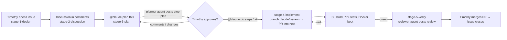

# How Tool_Box is built: issue-driven AI collaboration

Tool_Box is developed with Claude working *inside GitHub*, the way a contributor to an open-source project works: work starts as an issue, the discussion happens in comments, code arrives as a pull request, CI judges it, and a human approves the merge. This page explains the system and why it is shaped this way. ADR-013 records the decision.

## The problem it solves
Plans 001–005 lived in long markdown files, and `CLAUDE.md` grew to hold every convention. Every agent session loaded all of it, whatever the task. Context that isn't needed still costs tokens and dilutes attention, so the agent got worse the more the project knew.

The fix is to **scope memory to the task**. Each kind of knowledge lives where it belongs and is loaded only when needed:

| Layer | Where it lives | Loaded |
|---|---|---|
| Global: architecture, commands, rules | `CLAUDE.md` (kept short on purpose) | every session |
| Task: goal, discussion, plan, progress | **the GitHub issue**: body + comments | only by the session working that issue |
| Durable decisions | `docs/DECISIONS.md` (ADRs) | when a task touches that area |
| Conventions for writing docs | `Documentation/CONVENTIONS.md` | only when writing in `Documentation/` |
| Specialist roles | `.claude/agents/*.md` | only when delegated to |

## The loop

Each Claude run ends with a `## Session notes` comment (what changed, decisions, open questions, next step). The next run reads it, so nothing depends on chat history or a growing memory file.

## Stages are labels
The five-stage process from the old implementation plans carries over unchanged. Each stage is now a label, and you move the issue between them yourself:

| Old plan section | Label | What Claude may do |
|---|---|---|
| Stage 1: Design | `stage-1-design` | ask clarifying questions |
| Stage 2: Discussion | `stage-2-discussion` | discuss options; no code |
| Stage 3: Plan + discussion | `stage-3-plan` | post and revise a numbered plan; no code |
| Stage 4: Step-by-step implementation | `stage-4-implement` | implement **only the approved steps**, then report |
| Stage 5: Verification | `stage-5-verify` | show evidence; independent review |

Labels that control who acts next: `claude` (hand the issue to Claude), `needs-timothy` (Claude is blocked on you), `claude:queued` / `claude:working` (the queue runner).

## Talking to Claude
Write comments the way you would to a teammate, with `@claude` in them:
- `@claude what are the trade-offs between a tag and a legacy folder here?`
- `@claude plan this` (after moving the label to `stage-3-plan`)
- `@claude step 2 should keep the old composition path behind a flag. Revise the plan.`
- `@claude approved — do steps 1 and 2 only`
- On a PR line: `@claude why is this a singleton?`

Claude replies in a single comment that it updates as it works.

## Agents and subagents
- **The main agent** is whatever runs for a given trigger: the GitHub Action (`claude.yml`), the queue runner (`claude-queue.yml`), or you in Claude Code on your laptop ("work on issue #12"). All three read the same `CLAUDE.md` and the same issue, so they behave the same way.
- **Subagents** run in a *fresh* context and return only their result, which keeps the main session small:
  - `planner` — reads the issue and code and writes the Stage 3 plan. Read-only.
  - `reviewer` — reviews a diff it didn't write, against the acceptance criteria and the ADRs. A reviewer that hasn't seen the work being made can't grade its own homework.
  - `lecturer` — writes a `Documentation/Learning` lecture when an issue asks for one.

## CI is the verifier
The agent compiles once, pushes, and then reads CI's verdict (`gh run view --log-failed`) instead of running the full suite in its own session. The Actions runners do the heavy work, and their output only enters the agent's context when something fails. This repo's CI already builds with warnings as errors, runs every test project, and boots the Docker image against `/health`, so green has a meaning.

## Branches
- `main` — the version your résumé links to. Always working. Claude never touches it.
- `next` — integration branch for v2. All Claude PRs target it. When v2 is ready, `next` is merged into `main` in one reviewed PR.
- `claude/issue-<n>-<slug>` — one short-lived branch per task.

## Two ways to run it
1. **Interactive** (`claude.yml`, start here): Claude runs only when you `@claude` it or add the `claude` label.
2. **Queue** (`claude-queue.yml`, later): Claude picks up the oldest `claude:queued` issue on its own. It's manual-run until you trust it; uncommenting the `schedule:` block makes it run periodically, which is the "Claude checks for open issues" mode.

## One-time setup
See the setup checklist in the PR that introduced this file, or `scripts/setup-github-workflow.sh` for the labels, milestones and seed issues.

## Why this is worth practising
This is the same set of skills AI-native engineering teams are judged on: decomposing work into well-specified tasks, writing acceptance criteria an agent can be held to, putting the human checkpoint where mistakes are expensive (the plan, the merge) rather than everywhere, managing context deliberately, and letting automated verification rather than the model's own confidence decide whether code works.
