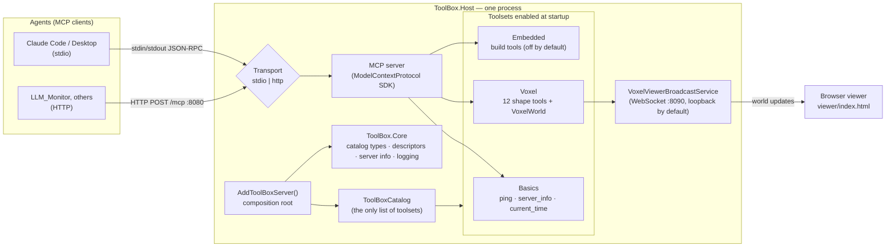
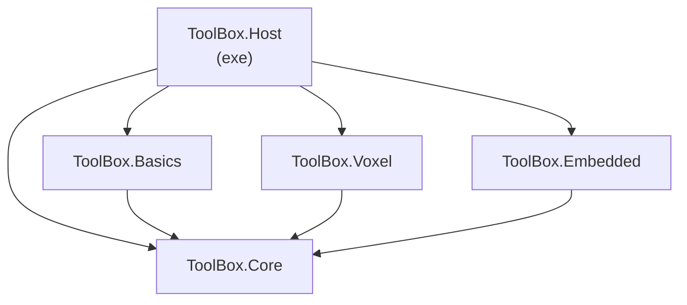
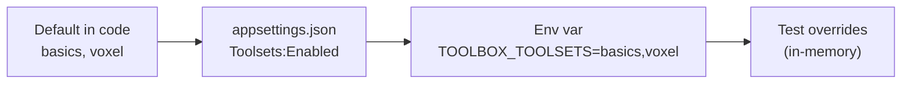
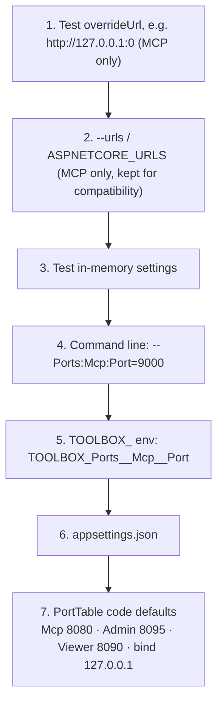
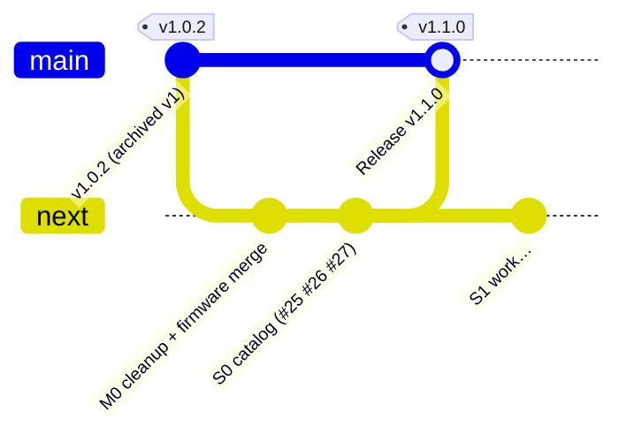
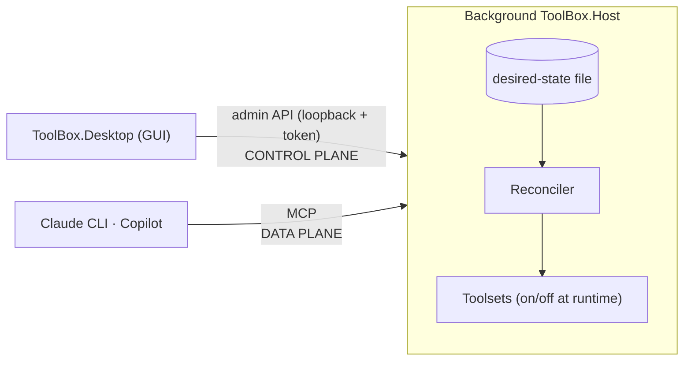

# Tool_Box architecture — the current system, in diagrams

**Living document.** It describes what is true on `next` *right now*, and it is updated in the same PR as any change to structure: projects, runtime components, ports, config keys, or the startup flow (CLAUDE.md rule 9). The *why* behind each piece lives in `docs/DECISIONS.md`. This file is the *what* and *how it connects*.

**State as of v1.1.0 (S0 complete):** a single process that serves MCP over stdio or HTTP. Its toolsets are chosen at **startup** from a catalog plus configuration.

---

## 1. The big picture



Reading the picture:
- **Agents** connect over one of two **transports** (ADR-007). The transport is picked at startup by `--transport`, then the `TOOLBOX_TRANSPORT` env var, then `appsettings.json`; the default is stdio.
- **`AddToolBoxServer()`** is the composition root: the single place that decides what the server *is*. Both transports call it.
- **`ToolBoxCatalog`** is the only place toolsets are named. Only the toolsets that are **enabled** get registered. A disabled toolset's tools and background services do not exist at all (ADR-015).
- **Voxel** brings its own background service (ADR-010), which streams world changes to a browser viewer. The agent never talks to that channel.

## 2. Projects and dependencies



Rule (ADR-003): **Core knows no toolset.** Only the Host references toolset projects. Each toolset exposes one `CatalogEntry` and one `Add<Name>Toolset()` method (ADR-005, refined by ADR-015).

## 3. Startup flow: how the toolset roster is decided

```mermaid
sequenceDiagram
  participant P as Program.cs
  participant C as Configuration
  participant S as AddToolBoxServer()
  participant K as ToolBoxCatalog / ToolsetCatalog
  participant DI as Service collection
  participant H as Host (running)

  P->>C: build config (appsettings.json, TOOLBOX_* env vars, args)
  P->>S: AddToolBoxServer(services, config)
  S->>K: ResolveEnabled(config) → e.g. ["basics"]
  S->>K: Create().Compose(services, enabled)
  K->>DI: entry.Register(services) — ONLY for enabled entries
  Note over K: unknown id → throw, listing the valid ids (fail fast)
  S->>DI: add ToolsetStartupLogger, AddMcpServer()
  P->>H: Build() + Run()
  Note over P,H: HTTP mode: PortTable defaults + validation first;<br/>then probe the MCP port before Kestrel binds (taken → exit 3)
  H-->>H: stderr log "Enabled toolsets: basics"
  H-->>H: viewer binds its port, or reports components.viewer = unavailable
  Note over DI,H: after Build() the service collection is FROZEN —<br/>changing toolsets today means a restart
```

### Where "enabled" comes from (later sources win)



An empty `TOOLBOX_TOOLSETS` enables nothing (the startup log says `(none)`).

## 4. Ports and endpoints

### Port table

Defined in one place, `src/ToolBox.Host/Ports/PortTable.cs`. Every port and bind address is configuration; there is no automatic reassignment (ADR-016).

| Service | Default port | Default bind | Config keys | Env vars | If the port is taken |
|---|---|---|---|---|---|
| MCP + `/health` (`/mcp`) | 8080 | `127.0.0.1` | `Ports:Mcp:Port`, `Ports:Mcp:Address` | `TOOLBOX_Ports__Mcp__Port`, `TOOLBOX_Ports__Mcp__Address` | **Fail fast:** one stderr line naming the service, port and key, exit code 3 |
| Admin API (#35) | 8095 | `127.0.0.1` (non-loopback is refused at startup) | `Ports:Admin:Port`, `Ports:Admin:Address` | `TOOLBOX_Ports__Admin__Port`, `TOOLBOX_Ports__Admin__Address` | Table entry only until #35 adds the listener and its probe |
| Voxel viewer feed (`/voxel/`) | 8090 | `127.0.0.1` (answers `127.0.0.1` and `localhost`) | `Ports:Viewer:Port`, `Ports:Viewer:Address` | `TOOLBOX_Ports__Viewer__Port`, `TOOLBOX_Ports__Viewer__Address` | **Degrade visibly:** MCP keeps running, `/health` shows `components.viewer = "unavailable: port 8090 in use"` |
| MCP over stdio | none | none | none | none | stdout is reserved for protocol messages; logs go to stderr (ADR-004) |

- Port `0` means "let the OS pick" and skips the probe. Tests use it.
- `0.0.0.0` means all interfaces. Containers set it explicitly in the `Dockerfile` and `docker-compose.yml`, because a loopback socket inside a container is unreachable from published ports (ADR-016, revisiting ADR-012).
- The viewer only exists when Voxel is enabled (ADR-012, ADR-015). Never publish the MCP port beyond a trusted network (ADR-008/011).
- Voxel viewer: `viewer/index.html` connects to `ws://localhost:8090/voxel/`.

### Config precedence (highest wins)



Rows 3–7 are ordinary layered .NET configuration and apply to all three services. Rows 1–2 are MCP-only escape hatches; if `ASPNETCORE_URLS` and `Ports:Mcp:*` are both set, the URLs win and a warning is logged.

### Health check and exit codes

`GET /health` returns `{"status","components","version","toolsets","uptime"}`. `status` is `"ok"` when every enabled component is healthy and `"degraded"` when an optional one (today: the viewer) is down. Both are HTTP 200, so the container healthcheck keeps passing. `components` is `{}` when no component reports (for example Voxel disabled).

| Exit code | Meaning |
|---|---|
| 0 | Clean shutdown |
| 2 | Unknown transport |
| 3 | A required port (MCP) is already in use |

## 5. Branches and releases



`main` = released and always working (the résumé link). `next` = integration. One `claude/issue-*` branch per task.

## 6. Roadmap: where this is heading

| Phase | Milestone | What it changes in the diagrams above | Status |
|---|---|---|---|
| S0 | M2 | Hard-coded toolset chain → catalog + config (§1, §3) | ✅ v1.1.0 |
| S1 | M3 | Adds a **desired-state file**, a **reconciler**, a loopback **admin API** with a token, a port table, and a background run mode. The roster becomes changeable **while running** | ⏳ next |
| S2 | M4 | Adds the **ToolBox.Desktop** GUI (Avalonia), which talks to the admin API | — |
| S3 | M5 | Voxel page, "View world", the world persists across off/on | — |
| S4 | M6 | Copilot registration | — |
| S5 | M7 | **ToolBox.Rag** toolset (SQLite + sqlite-vec, ONNX embeddings) | — |
| S6 | M8 | Installers, start with the OS, v2.0 | — |

Target shape after S2 (from Brainstorm 004):



## 7. v2 decisions

These twelve decisions apply to every task in the v2 epic. They are copied from [epic #23](https://github.com/Timothy-Lee-Grant/Tool_Box/issues/23) so agents see them without reading the epic. **The epic is the source of truth; update both together.**

| # | Question | Decision |
|---|---|---|
| 1 | GUI technology | Avalonia; "View world" falls back to the default browser |
| 2 | Where the Host lives | Long-lived background service; the GUI connects to it |
| 3 | "Off" for voxel | Save the world to disk, stop the service |
| 4 | Embedded toolset | Out of the first version |
| 5 | Vector store | SQLite + sqlite-vec by default, pgvector as a second implementation behind the same interface |
| 6 | Embeddings | ONNX in-process |
| 7 | Agent changes its own settings | No, not for now (prompt-injection risk) |
| 8 | Registering with agents | Run the agent's own CLI or show a snippet; no editing agents' config files for now |
| 9 | Copilot target | VS Code Copilot first |
| 10 | Viewer binding in desktop mode | Loopback only |
| 11 | Start with OS | Later (S6) |
| 12 | Project names | ToolBox.Desktop, ToolBox.Rag |
