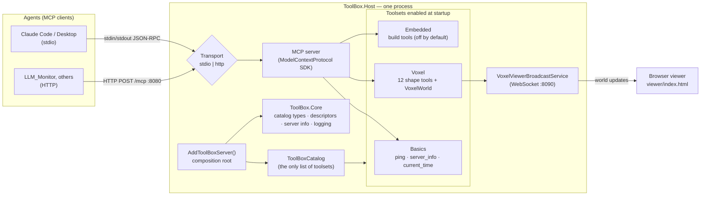
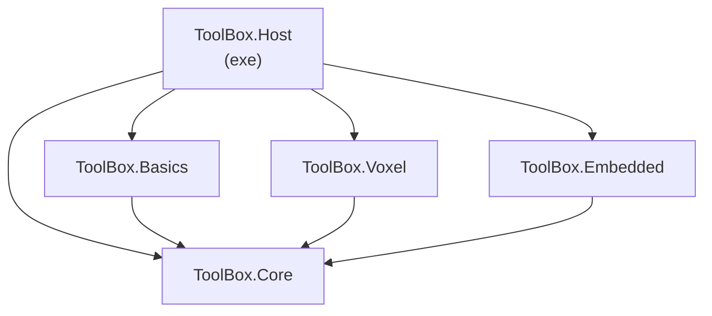
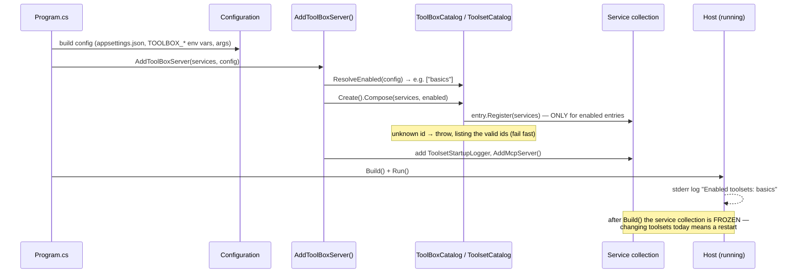
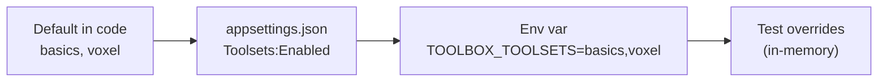
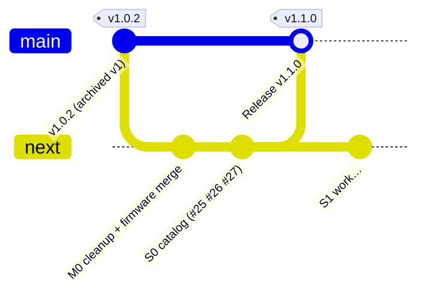
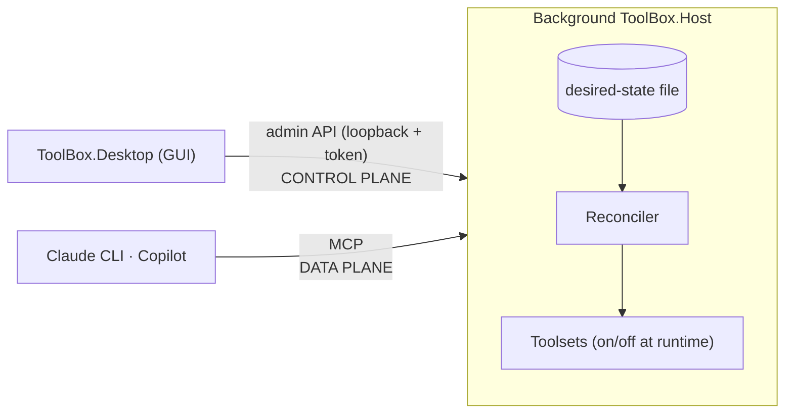

# Tool_Box architecture — the current system, in diagrams

**Living document.** It describes what is true on `next` *right now*, and it is updated in the same PR as any change to structure: projects, runtime components, ports, config keys, or the startup flow (CLAUDE.md rule 9). The *why* behind each piece lives in `docs/DECISIONS.md`. This file is the *what* and *how it connects*.

**State as of v1.1.0 (S0 complete):** a single process that serves MCP over stdio or HTTP. Its toolsets are chosen at **startup** from a catalog plus configuration.

---

## 1. The big picture

Reading the picture:
- **Agents** connect over one of two **transports** (ADR-007). The transport is picked at startup by `--transport`, then the `TOOLBOX_TRANSPORT` env var, then `appsettings.json`; the default is stdio.
- **`AddToolBoxServer()`** is the composition root: the single place that decides what the server *is*. Both transports call it.
- **`ToolBoxCatalog`** is the only place toolsets are named. Only the toolsets that are **enabled** get registered. A disabled toolset's tools and background services do not exist at all (ADR-015).
- **Voxel** brings its own background service (ADR-010), which streams world changes to a browser viewer. The agent never talks to that channel.

## 2. Projects and dependencies

Rule (ADR-003): **Core knows no toolset.** Only the Host references toolset projects. Each toolset exposes one `CatalogEntry` and one `Add<Name>Toolset()` method (ADR-005, refined by ADR-015).

## 3. Startup flow: how the toolset roster is decided

### Where "enabled" comes from (later sources win)

An empty `TOOLBOX_TOOLSETS` enables nothing (the startup log says `(none)`).

## 4. Ports and endpoints

| What | Where | Notes |
|---|---|---|
| MCP over stdio | stdin/stdout | No port. stdout is reserved for protocol messages, so all logs go to stderr (ADR-004) |
| MCP over HTTP | `:8080` `/mcp` | Stateless streamable HTTP. Never publish it beyond a trusted network (ADR-008/011) |
| Health check | `:8080` `/health` | `{"status","version","toolsets","uptime"}` |
| Voxel viewer feed | `:8090` (falls back to 8091–8093) `/voxel/` | Only exists when Voxel is enabled (ADR-012) |

## 5. Branches and releases

`main` = released and always working (the résumé link). `next` = integration. One `claude/issue-*` branch per task.

## 6. Roadmap: where this is heading

| Phase | Milestone | What it changes in the diagrams above | Status |
|---|---|---|---|
| S0 | M2 | Hard-coded toolset chain → catalog + config (§1, §3) | ✅ v1.1.0 |
| S1 | M3 | Adds a **desired-state file**, a **reconciler**, a loopback **admin API** with a token, a port table, and a background run mode. The roster becomes changeable **while running** | ⏳ next |
| S2 | M4 | Adds the **ToolBox.Desktop** GUI (Avalonia), which talks to the admin API | — |
| S3 | M5 | Voxel page, "View world", the world persists across off/on | — |
| S4 | M6 | Copilot registration | — |
| S5 | M7 | **ToolBox.Rag** toolset (SQLite + sqlite-vec, ONNX embeddings) | — |
| S6 | M8 | Installers, start with the OS, v2.0 | — |

Target shape after S2 (from Brainstorm 004):

